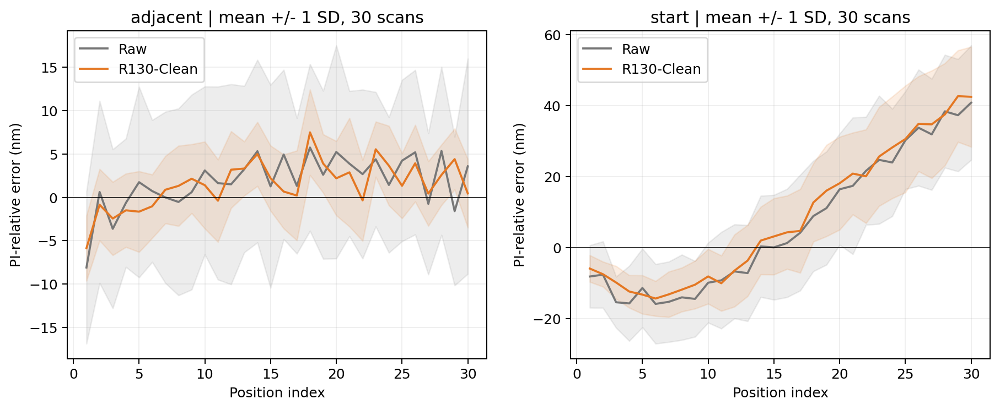
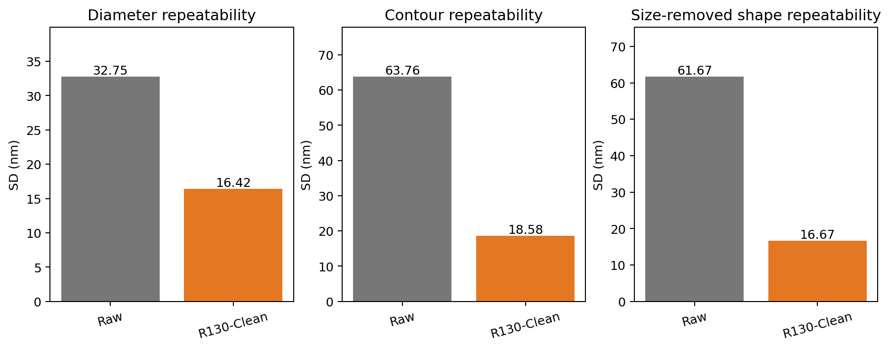
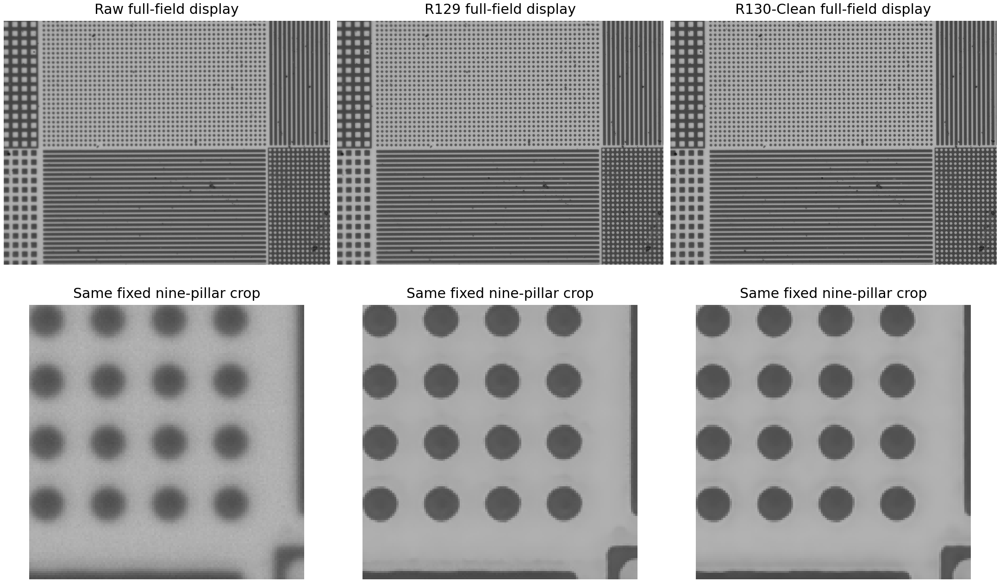
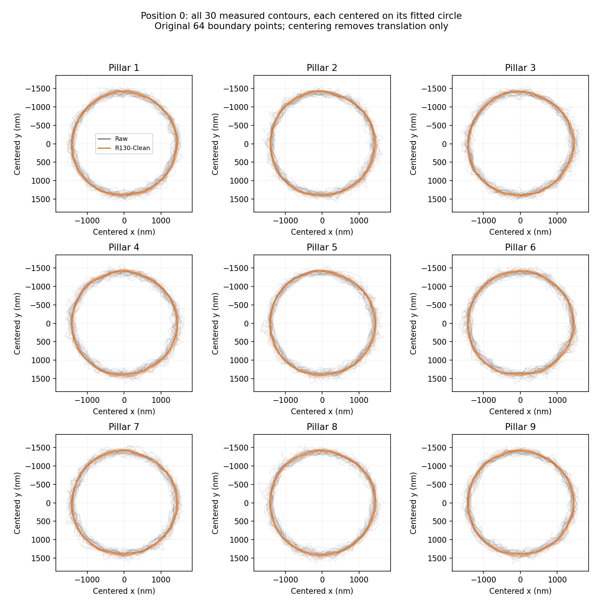
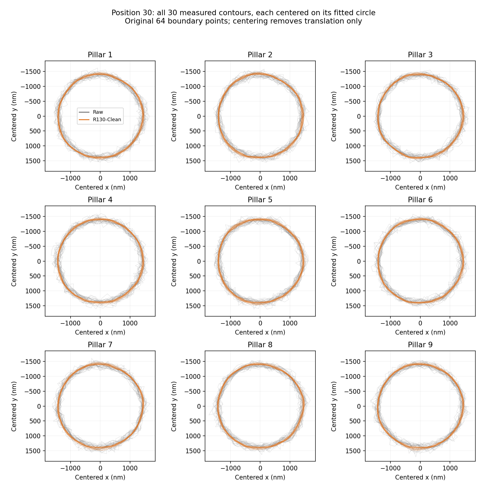

# 原圖與 R130：主要驗證結果

完整數據與定義見 [交接說明](../HANDOFF_FOR_THESIS.md)。本區只放原圖與 R130，便於後續以單一模型撰寫。

- all_circles.csv：16740 次圓心、直徑與量測資訊。
- all_displacements.csv：3600 筆九顆合成的位移。
- individual_circle_displacements.csv：32400 筆逐顆位移；不代表獨立樣本數。
- position_statistics.csv：120 組固定位置統計；scan_statistics.csv：120 組整趟統計。
- nine_pillar_size_shape.csv、geometry_by_position.csv、angular_repeatability.csv：逐顆、逐位置、逐方向重拍穩定性。
- SEM_comparison.csv：兩種方向候選的尺寸和形狀差。
- paired_scan_intervals.csv：以完整重拍趟次計算的配對差值範圍。

數字圖另附 SVG 可縮放版本。真實影像範例見 real_example，完整三方法影像展示見 02。

## 30 趟實際輪廓疊圖
每條線來自一次實際量測的 64 個邊界點；各自移至擬合圓心，只扣平移，不扣尺寸。

