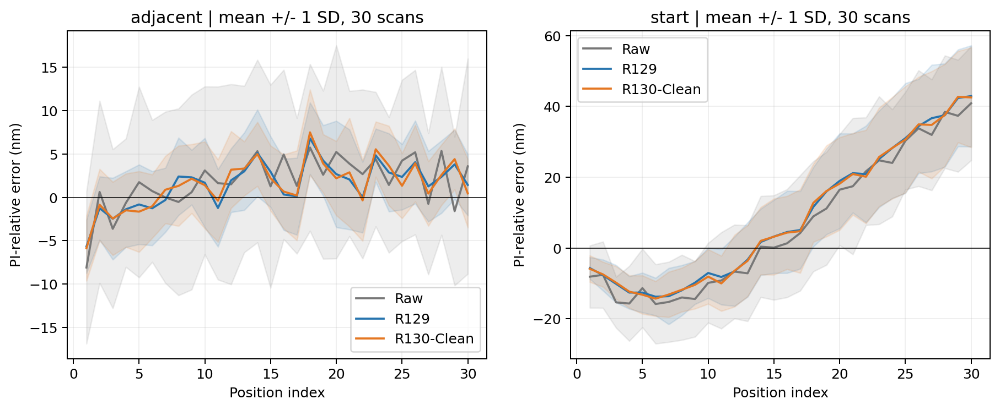
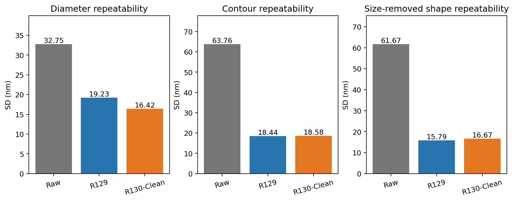
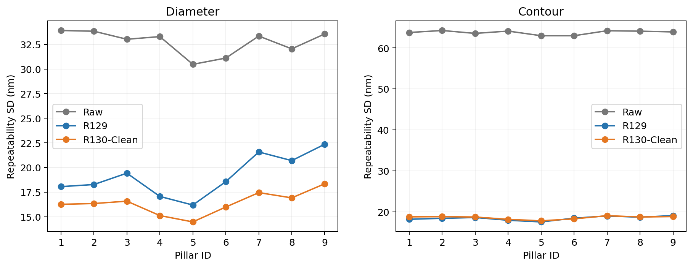
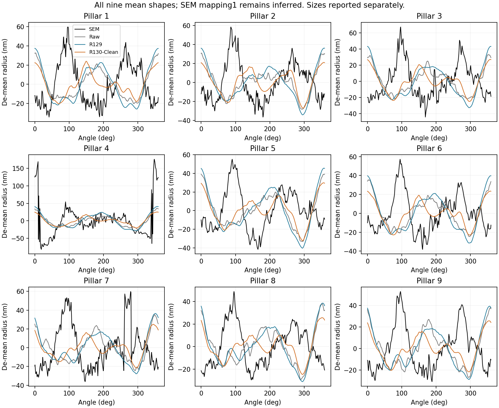

# R129 對照與速度

完整三方法原始分析表在 complete_three_method_tables，未改寫數據。原圖、R129、R130 分別以灰、藍、橘表示。

SEM 圖只示意候選方向一，兩種方向的全部數字在 SEM_comparison.csv；不能只採有利方向。影像示例不是全部影像細節保真的證明。

reconstruction_runtime.csv 是本輪 930 張時間與來源。完整及分塊速度／記憶體在 05/execution_audits 的 profile.json、profile_tiled_fresh.json。R129 是歷史整體時間，不是本輪重新測速。
