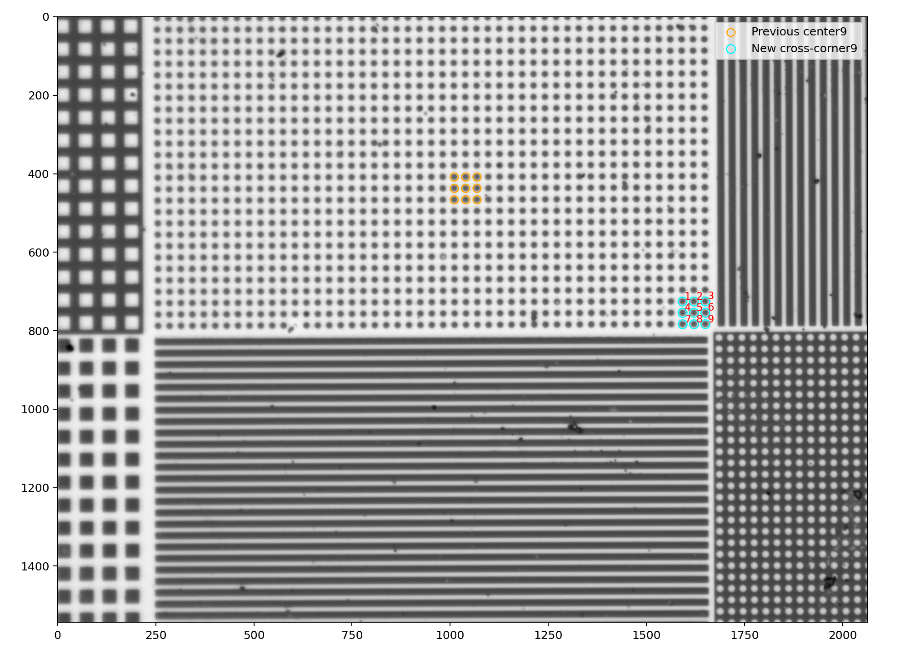

# 取樣、量測與 SEM

這次直接沿用 R129 更正後的同一組角落九顆。capture_plan.json 列出 30 趟、930 張與 PI；tracking.csv 是固定追蹤種子；measurement_config.json 是三方法共同量測設定；calibration.json 是固定軸和尺度。主分析使用 nominal_um_per_px=0.1725，未改用估算尺度。

SEM 保留兩個方向候選、原始參考點與尺度。inherited_sampling_reference 完整保留前一包的取樣與方向證據，屬於沿用來源，沒有宣稱本次重新確定方向。歷史對照圖片與 R129 處理邊界說明不等於 R130 的處理設計；R130 使用完整影像重建。
