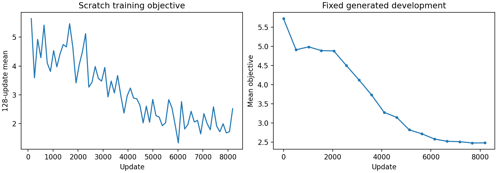
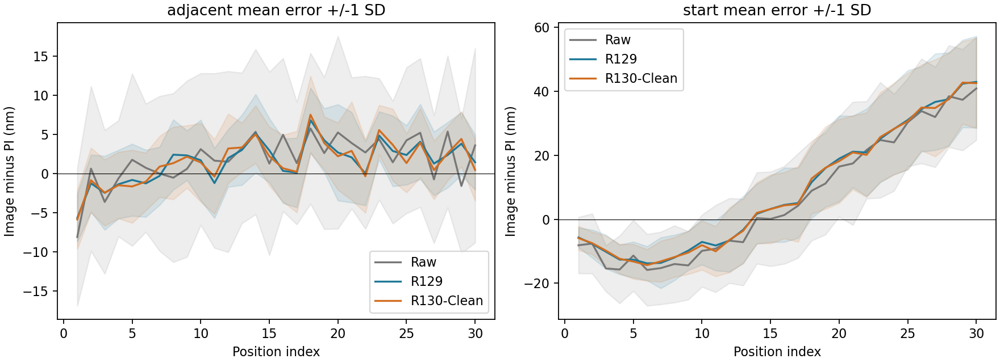
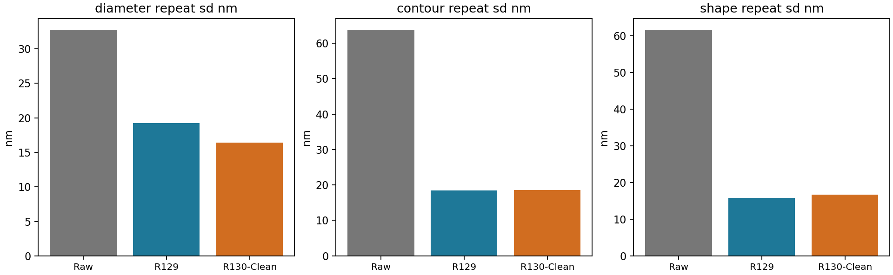
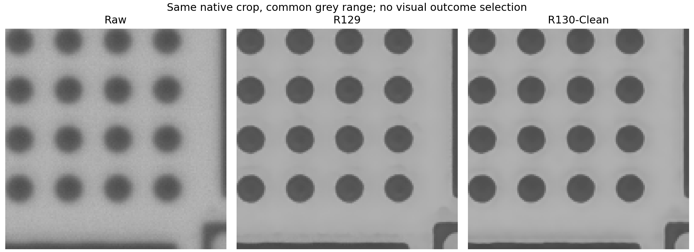
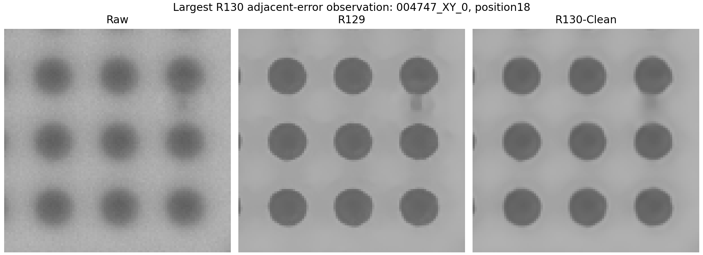

# R130-Clean 完整結果

完成日期：2026-09-20T10:13:20.824797+00:00。此輪只建立一個新模型，從零訓練8192次；未載入舊神經權重，PSF全程關閉，訓練只用既有合成配對。R129及原始結果保留，未自動更換正式基準。

## 主要結果

R130-Clean短步平均PI差 4.121 nm；R129 4.125 nm，Raw 8.167 nm。短步重拍 4.184 nm。各項取捨如下表，不以單一分數選模型。

| model      | kind     |   mae_nm |   bias_nm |   repeatability_nm |   maximum_error_nm |
|:-----------|:---------|---------:|----------:|-------------------:|-------------------:|
| R129       | adjacent |    4.125 |     1.473 |              4.251 |             16.868 |
| R129       | start    |   17.985 |     8.616 |             10.091 |             76.798 |
| R130-Clean | adjacent |    4.121 |     1.500 |              4.184 |             20.414 |
| R130-Clean | start    |   17.949 |     8.435 |              9.972 |             72.977 |
| Raw        | adjacent |    8.167 |     1.835 |              9.725 |             39.299 |
| Raw        | start    |   19.081 |     6.429 |             13.763 |             83.264 |

## 尺寸與輪廓重複性

| model      |   diameter_mean_nm |   diameter_repeat_sd_nm |   contour_repeat_sd_nm |   shape_repeat_sd_nm |   diameter_repeat_absmax_nm |
|:-----------|-------------------:|------------------------:|-----------------------:|---------------------:|----------------------------:|
| Raw        |           2799.621 |                  32.750 |                 63.758 |               61.667 |                     183.318 |
| R129       |           2838.911 |                  19.231 |                 18.437 |               15.789 |                      77.987 |
| R130-Clean |           2833.847 |                  16.422 |                 18.579 |               16.670 |                      68.237 |

## SEM對照

| model      |   mapping_candidate |   SEM_mean_diameter_nm |   mean_diameter_difference_nm |   full_radial_difference_nm |   de_size_shape_difference_nm |
|:-----------|--------------------:|-----------------------:|------------------------------:|----------------------------:|------------------------------:|
| Raw        |                   1 |               2614.439 |                       185.182 |                      98.511 |                        56.348 |
| R129       |                   1 |               2614.439 |                       224.472 |                     112.690 |                        32.636 |
| R130-Clean |                   1 |               2614.439 |                       219.409 |                     110.447 |                        28.093 |
| Raw        |                   2 |               2614.439 |                       185.182 |                      96.765 |                        50.994 |
| R129       |                   2 |               2614.439 |                       224.472 |                     113.357 |                        17.243 |
| R130-Clean |                   2 |               2614.439 |                       219.409 |                     110.909 |                        19.409 |

九顆集合相同；逐顆方向仍沿用兩種候選，沒有為新模型重配方向或尺度。尺寸平均有號差、完整徑向差及去尺寸形狀差分開解讀。

## 速度與記憶體

參數量：300101。GPU：NVIDIA RTX A6000，FP32、TF32關閉，完整1544×2064影像。

930張神經推論中位耗時：1.384秒；本輪讀取、推論、寫檔中位耗時：1.867秒。

R129歷史讀取、推論、寫檔中位耗時：11.182秒。這是既有執行紀錄，不是本轮重新載入R129做匹配微基準；不得與R130純神經計時混成速度倍數。

| mode   |   repeat |   seconds |   peak_allocated_bytes |   peak_reserved_bytes |   max_difference_vs_full |
|:-------|---------:|----------:|-----------------------:|----------------------:|-------------------------:|
| full   |        0 |     1.382 |            10840044544 |           19163774976 |                    0.000 |
| full   |        1 |     1.382 |            10865539072 |           19163774976 |                    0.000 |
| full   |        2 |     1.382 |            10865539072 |           19163774976 |                    0.000 |
| tiled  |        0 |     2.658 |             1770404864 |           19165872128 |                    0.000 |
| tiled  |        1 |     2.579 |             1770122240 |           19165872128 |                    0.000 |
| tiled  |        2 |     2.579 |             1770122240 |           19165872128 |                    0.000 |

分段及ACM獨立耗時見results/profile.json；數值包含固定主幹、局部線索、四次修正、輸出、切塊複製及全流程範圍。

## 訓練與生成驗證

固定8192次更新，16個循環，每個循環512來源。開發檢查17次。最終生成測試：{'total': 1.7614072810392827, 'image': 1.395734118821565, 'gradient': 1.20752567762338, 'pair': 0.6208401756593958}。

清楚控制的訓練後結果見results/clean_control_summary.json；初始輸出精確等於Raw不代表訓練後所有清楚影像都完全不變。

## 核對與範圍

同一930張、Raw追蹤、ACM最大梯度邊界、LSC、名義172.5nm/px及原PI算式。Raw與R129既有摘要重算符合；新8370圓另行獨立擬合核對。完整掃描配對區間另表保存，不把九顆或720方向當獨立樣品。

這是既有資料上的固定模型比較，不是新的未知holdout；未認證完整绝對量測不確定度。不得將更穩等同所有尺寸更準。PSF feature branch只有關閉介面，沒有正式實作，不能宣稱已具光學輔助能力。

最終權重SHA256：559afeff214ff15e92ce910d7df7ead12994074b6173dabe9a7f21a8b40372cc。來源及設定在runs/formal_8192/run_config.json；輸出930张位於results/reconstruction（H槽活動資料）。所有舊證據原樣保留。

## 獨立複核後的決斷

**值得保留為快速、來源乾淨的純神經研究版本；已保留R129的主要位移穩定性，但沒有解決尺寸偏大，也不是所有形狀指標都更好。** 不自動替換R129或論文主模型，也不改正式基準。

- 短步平均PI差R129 4.125nm、R130-Clean 4.121nm，差距只有約0.004nm。完整掃描配對及分開前6／後24的時間分組範圍均包含零，應解讀為相近，不宣稱精度勝出。
- 尺寸重拍波動19.231→16.422nm，降低14.6%；輪廓重拍18.437→18.579nm相近；去平均半徑後的形狀重拍15.789→16.670nm稍退。
- 觀察最大短步PI差16.868→20.414nm，需與平均值一起保留。距起點平均表現也未明確分出勝負。
- SEM平均直徑偏大224.472→219.409nm，只少約5.064nm；拿掉明確光學路徑並未自然消除此問題。不能把多處架構與訓練差異直接當成PSF單項因果實驗。
- SEM去尺寸形狀差在方向1由32.636→28.093nm，但方向2由17.243→19.409nm。方向仍未唯一確認，不能挑有利方向宣稱全面形狀改善。
- 完整1544×2064影像，純神經約1.38秒；含讀取／寫檔約1.87秒。R129歷史同類含讀寫紀錄約11.18秒，描述性比值約5.99倍；不是此次重新載入R129作同時段微基準。

### 低記憶體操作的補核

另以只跑切塊的新程序確認，固定512core／96halo、FP32，後兩次約2.577秒／完整影像。峰值張量配置1.636GiB，CUDA預留4.006GiB；兩者都不含其他程序與驅動佔用，不可把張量數字直接當整張卡的需求。原full-first混合測試的reserved值會保留前面整張推論的allocator快取，故另存這份fresh結果。

切塊與原整張輸出的最大灰階差為1.49e-07（0–1灰階），通過事前2e-6容許值；沒有羽化或縮小實際影像。此為浮點範圍內相符，不稱逐位元完全相同。

### 來源及結果再次核對

8192筆順序／種子／損失算術與最終optimizer步數全部核對；48次實際輸入獨立重建吻合。最終所有參數有限，初始scratch狀態由新種子獨立重現。930個新NPZ逐檔SHA256與原記錄符合；直接由圓心再算三方法位移摘要，最大差1.78e-15nm。新8370圓另行擬合最大差3.21e-7像素。所有受保護舊檔保持原樣，沒有重設歷史預期雜湊。

| kind     | reference   |   mean_difference_nm |   block3_separate_6_24_low_nm |   block3_separate_6_24_high_nm |
|:---------|:------------|---------------------:|------------------------------:|-------------------------------:|
| adjacent | Raw         |               -4.045 |                        -4.411 |                         -3.688 |
| adjacent | R129        |               -0.004 |                        -0.192 |                          0.165 |
| start    | Raw         |               -1.132 |                        -2.045 |                         -0.313 |
| start    | R129        |               -0.036 |                        -0.209 |                          0.136 |

### 圖像及形狀檢視

已查看固定首張完整視野、同一量測區域、最大短步誤差案例及九顆平均形狀。所看影像主結構仍存在，並非輸出成完全正圓；最差例仍有局部暗斑或灰階起伏。這些觀察不認證任意細節真實，亦不能排除光學解析度以外的過度平滑。與SEM的對應／尺寸限制依舊適用。

獨立核對位於results/independent_review；檢查程式另存results/independent_result_review.py及自身雜湊。這些是完成後的獨立審閱，不改動凍結訓練、模型或共同讀法。
