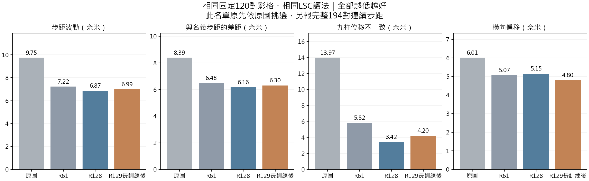
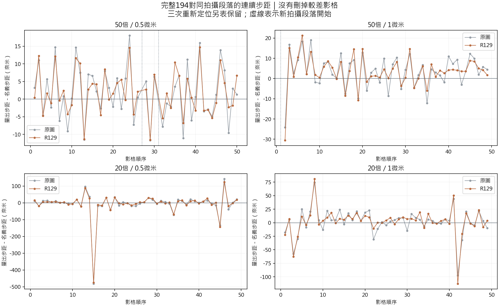

# R129 連續影像重建與 LSC 位移結果

日期：2026-09-13。R129使用長訓練第8192次固定權重；本次沒有重新訓練、改模型權重或自動採用模型。

## 完成範圍與主要答案

四組序列的 **201張原生2048×1536影像全部完成重建**，每張9顆柱子，共1809個R129圓心；原圖也完整重量1809個圓心。所有粗輪廓、取邊點、圓心、重建PNG與浮點影像均保存。

在與R128、R61完全相同的固定120對影格上，R129量出的步距波動為 **6.9911nm**，R128為6.8729nm、R61為7.2201nm；相對R128增加1.72%，相對R61降低3.17%。這是量出步距的波動，不是已由獨立儀器證明的實際位置誤差。

|              |   步距波動 |   與名義步距的差距 |   九柱位移不一致 |   橫向偏移 |
|:-------------|-----------:|-------------------:|-----------------:|-----------:|
| 原圖         |     9.7451 |             8.3876 |          13.9664 |     6.0095 |
| R61          |     7.2201 |             6.4845 |           5.8235 |     5.0711 |
| R128         |     6.8729 |             6.1628 |           3.4157 |     5.1529 |
| R129長訓練後 |     6.9911 |             6.3025 |           4.2037 |     4.7983 |

單位均為奈米，全部越低越好。步距波動先分四序列計算標準差，再取四者平均；九柱不一致與橫向偏移為120對中位數，不能與前一輪四對的平均值混用。

各模型的訓練資料、目標與預處理並不完全相同，因此這是指定使用情境的實際方法比較，不是純架構或未知資料泛化能力的判決。

## 各種拍攝條件

各序列固定30對的步距波動：

| sequence      |    R128 |   R129長訓練後 |     R61 |    原圖 |
|:--------------|--------:|---------------:|--------:|--------:|
| 50倍／0.5微米 |  3.3236 |         3.5309 |  3.3070 |  5.3799 |
| 50倍／1微米   |  3.0110 |         2.9252 |  3.0326 |  5.5887 |
| 20倍／0.5微米 | 14.3090 |        15.0305 | 14.2637 | 16.7766 |
| 20倍／1微米   |  6.8481 |         6.4776 |  8.2772 | 11.2351 |

這120對名單原先依Raw較穩定的影格選定；本次沒有為R129重選或刪掉不利結果。它提供對舊模型的同條件比較，但不是完整拍攝資料的無條件成績。相鄰影格共用照片，不當成120個互相獨立的實驗。

## 完整連續序列

全部201張構成197對相鄰影格。原始拍攝紀錄事先標出三次重新定位：50倍0.5微米的26→27、30→31，以及50倍1微米的0→1。這三對完整量測並另外保存，不把重新定位當作正常名義微小步距；其餘 **194對同段落相鄰影格全部納入**，包含原先沒有入選120對的較差影格。

|              |   步距波動 |   與名義步距的差距 |   九柱位移不一致 |   橫向偏移 |
|:-------------|-----------:|-------------------:|-----------------:|-----------:|
| 原圖         |    29.7817 |            15.4138 |          13.2285 |     8.5387 |
| R129長訓練後 |    29.0977 |            13.9048 |           3.9710 |     7.9743 |

完整194對只有Raw與R129在本輪全部量測；沒有將R128／R61的120對數字放進194對排名，也不外推它們在未測影格的表現。

圖中影格順序不是重新擬造的時間間隔。波動同时可能包含拍攝、實際平台移動、重建及取邊影響；沒有獨立實際位置記錄，不能把所有變化都歸因於網路。

## 最大誤差與邊界範圍

固定120對中的最大名義步距差距與最大橫向偏移：

|              |   max_nominal_error_nm |   max_cross_axis_nm |
|:-------------|-----------------------:|--------------------:|
| 原圖         |                36.0692 |             43.2404 |
| R61          |                32.3092 |             55.0228 |
| R128         |                31.9624 |             59.3923 |
| R129長訓練後 |                32.2981 |             59.0883 |

最不利的R129相對R128名義步距差距出現在 `20x_0p5um` 的 1→2：R129 19.0002nm，R128 9.7924nm。兩張已用新的公開完整圖入口重跑，重建PNG逐像素一致，LSC也重現。最不利個案保留，不以平均值隱藏。

R129依原本規則在距影像邊界80像素內保留Raw，再用16像素過渡；R128原規則是64／16。兩者後端量法相同，但這是各自實際輸出的比較，不是排除了全部處理差異的純網路比較。Raw位置決定的共同範圍中，兩張影格九顆量測窗都完全離開兩者邊界保留區的120對子集，各序列數量為：{'20x_0p5um': 4, '20x_1um': 24, '50x_x_0p5um': 30, '50x_x_1um': 30}。完整範圍仍是主結果，子集僅作補充，沒有刪除邊界案例。

## 執行方式與驗證

原本直接對完整視野放大的路徑，在深度分組濾波遇到32位索引限制，失敗已保留。另立執行方式：光學融合、所有全圖統計、四次影像狀態更新、原圖參照與品質調整全部保持全圖；只對具有限範圍的共享局部網路分段計算。分段核心512原像素，周圍保留16原像素／32特徵像素，超過該局部網路22特徵像素的保守範圍。未縮小相機影像或改動座標。

三張SEM實拍與不同大小／分段的對照、完整場景的512對384分段核對均通過；所有這些對照的8-bit重建像素一致，浮點差異在預先聲明的1e-6內。它不是另一個重新訓練的模型，也沒有改掉原始失敗或舊雜湊。201张中1張重用已核對的完整圖測試輸出，其餘200張新推論。

LSC完整沿用R128／R61的Raw定位、拍攝段落、像素尺度、每柱曲率循環重設、取邊數及搜尋範圍。20倍64點／13次粗取邊／2.4像素搜尋，50倍96點／15次／4像素搜尋。原圖1431個已有圓心與歷史結果重現至數值誤差範圍，確認沒有换量法。

共 3618 個保存的取邊點集合以獨立圓心擬合重算，最大差異 3.9508461e-06px；兩個方法的全部197對相鄰位移，以及120對主比較的算術均重新核算。位移只計算「下一張圓心減上一張圓心」一次，名義步距僅在報告差距時使用，不把它再次扣進位置座標。全部201張、1809個圓心／方法、120主對照與194連續對均齊全；沒有按模型結果剔除影格。

## 與模型採用的關係

本輪補上完整連續LSC證據，但不推翻上一輪真實SEM尺寸誤差退步的結果。保留R129架構與權重研究成果；是否採用仍需同時兼顧尺寸、細部形狀、位移與最差情況，不因單一指標改善自動替換現有模型。既有實拍資料不作未知樣本宣稱，舊144張封存確認集未取用。

## 成果位置與手動重建

- 201張重建：`Experiments/R129_OpticalPriorHybrid/results/continuous_lsc/images/`，依序列與影格存放。
- 每張LSC圓心與輪廓點：同資料夾下 `measurements/R129/`；原圖讀值在 `measurements/Raw/`。
- 全部比較、逐對及最大退步：`comparison_summary.csv`、`paired_changes.csv`、`largest_regressions.csv`。
- 規則／核對：`plan.json`、`staged_inference_verification.json`、`analysis_verified.json`、`worst_replay_verified.json`。
- 獨立套件新增 `addons/full_field/infer_fullfield.py`，可按其README對完整尺寸影像重建。原套件凍結程式與預設模型保留；附加入口預設用本次第8192次權重，不表示正式採用。
