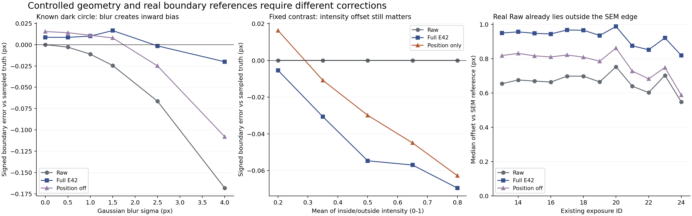

# R119：固定形狀的模糊、亮度與位移控制檢查

日期：2026-09-06，Asia/Taipei。固定模型：R119 B E42。所有新結果位於 [控制檢查資料夾](../analysis/controlled_boundary_factors_20260906)。

**我的決斷：先核實並修正合成成像與真實邊界參考的對應，再決定訓練改動。現在不刪除位置功能、不直接增加懲罰、不延長訓練，也不把真實樣品量出的偏差硬設成固定縮小量。**

理由已比上一輪明確：標準合成模糊會讓已知圓形的可見中點向內縮，E42 的向外修正通常有用；真實 Raw 相對現有 SEM 參考卻已向外偏，E42 又增加外偏。這個方向落差先於「選哪一種訓練損失」的問題。

這仍未證明真實外偏的唯一物理原因。SEM 參考的定義、尺寸對應、光學成像與材料邊緣是否一致，都需要分清楚。數值讀法校準成功，不代表這些物理對應已經獲得校正。

## 1. 實際完成的檢查

### 主檢查：240 個條件

- 三種固定幾何：直線邊界、半徑 32 像素圓、半徑 48 像素圓；亮、暗兩種物體。
- 640×640 畫面，在 8 倍解析度建立形狀、施加模糊與真實位移後，才進行像素積分。
- 分別只改變六種模糊程度、五種整體亮度倍率、九個真實位置；其他條件保持固定。
- 主分析使用無雜訊浮點影像；另有固定 1.5 灰階雜訊加 8-bit 取整的感測壓力組。後者是組合條件，不拿它單獨估計雜訊的因果影響。
- 控制測試的模型輸出保留浮點數；壓力組的 8-bit 取整作用於感測輸入。實際輸出再存成 8-bit 影像的效果不包含在這組位移數字中。
- 真實位移同時作用於原物體、觀察影像與標準答案。模型應保留它，不應被教導把真正的物體移動消掉。

### 亮度追查：100 個條件

主檢查沒有重現真實柱體的一致膨脹，因此另行記錄範圍，再做兩種追查：

- 獨立改變物體／背景的平均亮度與對比，避免把兩者綁在單一曝光倍率上。
- 只取既有真實 Raw 的物體與背景亮度中位數，套在新產生的直線與圓形上。沒有把真實像素、SEM 形狀或真實紋理放進產生器，也沒有訓練。

### 真實邊界追查：432 次既有觀察

使用前次完整保存的 12 種曝光、36 顆柱子的原始亮度小圖與 SEM 輪廓，再用半對比中點讀法量一次，避免只靠 ACM 結果推論原圖的可見邊界。

主檢查與亮度追查各比較七種輸出：Raw、只有位置操作、位置加寬度、完整輸出、只有寬度、寬度加細節但位置關閉，以及提供已知幾何的寬度操作。後者只用來測試操作能力，不是可部署模型。

## 2. 先確認量測能回答問題

每個條件沿已知邊界取 720 條法向剖面，範圍 ±12 像素，間距 1/8 像素。比較的是亮暗兩側一半對比處的位置，並另記 10–90% 過渡寬度。

不是看見多個交點就挑最接近答案的一個：多交點、缺少完整跨越，都記為失敗。七個輸出只在共同有效的剖面上配對，失敗數保留。

已知位置測試中，半像素移動量回讀為 0.499995–0.500023 像素；平坦影像與多交點測試均被拒絕。240 個主條件及 100 個亮度條件的共同有效剖面皆為 720/720。

真實 SEM 邊界是數位遮罩，初版直接使用折線表示的邊緣座標，與插值後參考影像的中點在像素角落存在最高約 0.0994 像素差異，因此先被 0.04 像素校準門檻攔下，沒有使用該版本判斷光學結果。

新版只根據同一 SEM 遮罩產生的參考影像細化座標，不讀取光學結果來調位置，之後按更嚴格的 0.004 像素門檻驗證；最大剩餘偏差為 0.000000290 像素。初版程式、範圍與失敗說明原樣保留。這只處理數位邊緣的讀取一致性，沒有更改 SEM 遮罩或物理邊界定義。

## 3. 標準合成模糊下，位置操作多半做了有用的事

以固定暗圓、半徑 48 像素、模糊 σ=4 為例，正值代表向外，負值代表向內。數值是相對對應標準答案的边界中點偏差：

| 輸出 | 邊界偏差（像素） | 10–90% 寬度（像素） |
|---|---:|---:|
| Raw | −0.16822 | 10.848 |
| 只有位置操作 | −0.05746 | 10.044 |
| 位置加寬度 | −0.04011 | 4.898 |
| 完整 E42 | **−0.02005** | 4.860 |
| 位置關閉、保留寬度與細節 | −0.10800 | 5.483 |

此時 Raw 的可見邊界因模糊已縮進去，位置操作往外移有合理作用。關閉位置反而丟掉改善。過渡雖然變窄，仍未完全恢復標準答案的寬度；本報告沒有把它當作完美恢復。

分析前訂下的診斷條件是：Raw 的邊界中位絕對誤差不超過 0.04 像素，而位置操作再增加至少 0.05 像素，才標記為明確的多餘位置操作。120 個無雜訊主條件沒有觸發這個標記。這不代表誤差為零，也不代表其他形狀、成像條件全部安全。

已知幾何的寬度操作，在主檢查與亮度追查中都沒有出現「比 Raw 額外增加 0.05 像素以上中位絕對誤差」的情況。因此目前沒有足夠理由優先重寫寬度操作，但也不能據此宣稱它在任意紋理或複雜形狀都成立。

## 4. 單獨改整體亮度不夠，背景亮度與對比也會影響動作

若物體／背景比例固定，只乘整體亮度，主檢查大多仍保持合理的邊界位置。

但把平均亮度與對比分開後，出現了明確反例：明亮背景區間中的亮直線邊界，平均亮度 0.8、對比 0.15，幾何完全沒動，Raw 的中點誤差接近零；只有位置操作卻造成約 **−0.06279 像素**偏移，完整輸出為 **−0.06952 像素**。

圓形也有類似的亮度依賴。在平均亮度 0.8、對比 0.15 時，完整輸出的中點偏差可達暗圓 **+0.15040 像素**、亮圓 **−0.10696 像素**。這兩個圓形條件不是全部由位置操作造成，不能將完整誤差全部歸到單一分支。

借用真實 Raw 的兩側亮度範圍後，簡單圓形可以出現一些向外偏，但仍沒有重現真實樣品的完整程度。因此**亮度條件是已找到的缺口，還不是全部原因**。

## 5. 真實 Raw 相對 SEM，原本就已經向外偏

為避免把平移錯當成尺寸差，每次觀察只根據 Raw 輪廓與 SEM 的中心差，做一個所有方法共用的平移對應，不縮放輪廓，也不依模型輸出重新配準。

主要讀法固定使用 Raw 的兩側亮度；敏感度檢查再讓各輸出按同一規則估計自己的兩側亮度。兩種讀法的方向一致。

| 輸出 | 向外偏移中位數（像素；固定 Raw 亮度） | 改用各自亮度的中位數 |
|---|---:|---:|
| Raw | **+0.66100** | +0.66100 |
| 完整 E42 | **+0.93356** | +0.96089 |
| 關閉位置修正 | +0.79218 | +0.82370 |
| 整體減弱修正 | +0.90735 | +0.92853 |

全部 432 次 Raw 觀察的偏差中位數都向外，不是由少數離群值決定。各次觀察共同有效的剖面至少為 711/720；無效剖面沒有被當成零誤差。

這與前次鎖定 ACM 的結果方向一致：Raw 已比 SEM 輪廓大，完整 E42 又進一步膨脹。兩套量測數字定義不同，不能相互替換。

**最重要的落差是方向：**本次標準合成模糊的圓形需要往外補回收縮；真實 Raw 對現有 SEM 參考卻已經向外偏。模型沿用前一種修正傾向，在後一種情境就可能增加錯誤。

這是對現有證據的機制解釋，尚不是從訓練歷程證明唯一因果來源。也尚不能確定 +0.661 像素全部是成像偏差、SEM 參考定義差异或尺寸配準誤差；更不能把它當成所有影像都應縮小的常數。

## 6. 真正的物體移動沒有被誤當成應消除的錯誤

圓形的標準答案隨真實位置一起移動，定位殘差始終相對它自己的移動後參考计算，沒有再扣一次位移。

在測試的九個位置中，跨圓形與亮暗條件最大的相對位移誤差為：

| 感測條件 | Raw | 完整 E42 |
|---|---:|---:|
| 無雜訊浮點影像 | 0.000492 像素 | 0.001152 像素 |
| 固定雜訊加 8-bit 取整 | 0.017154 像素 | 0.010323 像素 |

這是固定幾何與有限位置下的敏感度測試，不是靜態重複性，也不是既有真實 LSC 步進標準差。它支持保留位置能力的必要性，不能代替新模型的真實位移驗證。

## 7. 已決定的工作順序

1. **先處理資料與邊界參考的對應。** 對既有 SEM 參考的尺度、輪廓定義與光學觀察位置做釐清，區分光學可見邊緣與材料幾何邊緣；對應未釐清前，不把觀察到的偏差寫成訓練標籤。
2. **資料條件必須獨立涵蓋背景亮度與對比。** 單純乘曝光倍率不足以覆蓋本次已找到的錯誤。採用物理上能解釋的觀察變化，不能任意把膨脹影像配回較小形狀，否則會把真正的尺寸變化教成錯誤。
3. **保留位置、寬度與細節能力，先用這組已知答案檢查控制它們。** 不把分支全關，也不先增加一個和既有項目重複的懲罰。若未來改訓練，必須在同一局部邊界讀法下說明輸入偏了多少、改動必要多少、輸出還剩多少偏差。
4. **維持真實移動的正確目標。** 成像造成的偏移與物體真的移動要分開；未知物體位移不能被當作應消除的誤差。
5. **暫不啟動長訓練。** R120 已修正序列接入與比較公平性，但本次顯示仍缺少真實成像／邊界參考這一層。現在加長訓練沒有充分依據。

這是執行決策，不是要求使用者重新在模型選項中做選擇。本次沒有更新權重、調整損失、修改舊量測或再用確認集。

## 8. 可重現證據與限制

- [主檢查事先範圍](../analysis/controlled_boundary_factors_20260906/protocol.json)
- [主檢查全部量測](../analysis/controlled_boundary_factors_20260906/measurements.csv)
- [亮度追查全部量測](../analysis/controlled_boundary_factors_20260906/radiometry_measurements.csv)
- [真實邊界全部量測](../analysis/controlled_boundary_factors_20260906/real_halfcontrast_measurements_v2.csv)
- [條件與決斷摘要](../analysis/controlled_boundary_factors_20260906/decision.json)
- [數值與完整性覆核](../analysis/controlled_boundary_factors_20260906/verification.json)

每个条件的完整影像和逐剖面結果另存為壓縮檔，可直接重算。重複出現在模糊、亮度、位移三組中的基準條件，作為精確重現檢查，不當成獨立樣本增加證據量。七種輸出的共同有效樣本一併保存。

本次只有一個固定模型、三種簡單幾何；沒有真實材料紋理真值。合成參考與 SEM 數位參考也不是相同物理來源，不能把兩者的差值拿來宣稱通用修正係數。

初版真實剖面校準失敗已保留。另一次彙總檢查誤把直線邊界本來就無法定義的二維中心空值視為錯誤；修正後明確要求直線中心保持空值、圓形中心有效，沒有把空值填成零或更改量測。

重現程式為 `run.py`、`radiometry.py`、`real_profiles_v2.py`、`summarize.py` 與 `verify.py`，使用 `C:/Users/Rio/anaconda3/python.exe`。所有歷史 R119 保護項目保留不變。
