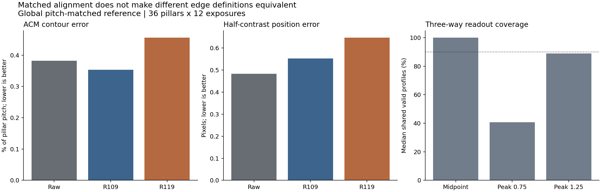
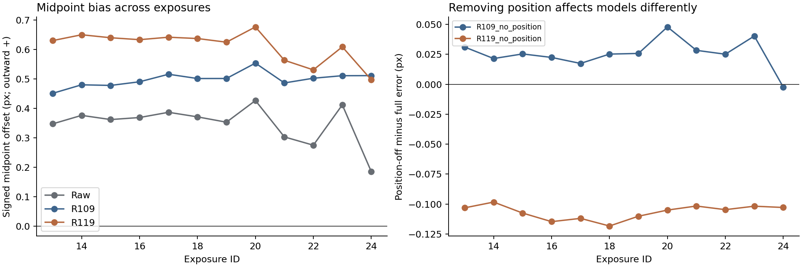
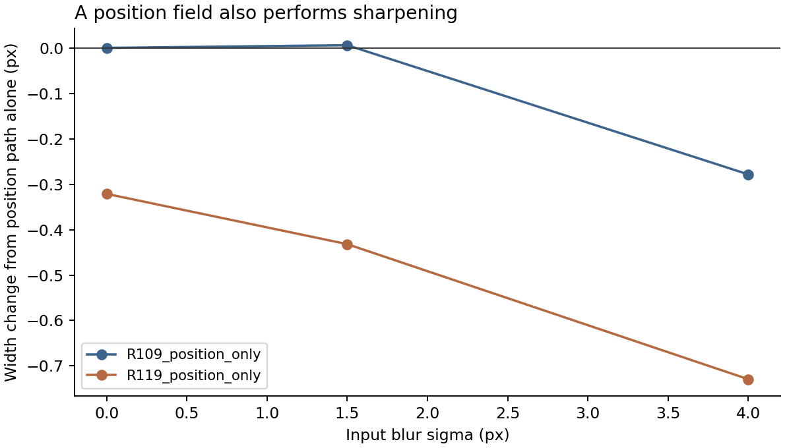

# R109 與 R119：同一影像、三種邊界讀法與處理路徑

2026-09-07，Asia/Taipei。固定 R109 E48、R119 B E42，沒有訓練或修改模型。

**結論：量法與模型作用兩個問題同時存在。R109 的 ACM 輪廓優勢可重現，但不能直接等同於光學邊界中點更接近 SEM；R119 的位置路徑有更強的負面作用，而且這個路徑也會改變邊界寬度，並不是純平移。**

因此，不把 R109 當成物理真值，也不再直接對 R119 的密集位移場追加「位置懲罰」。下一個模型改動前，先明確區分整條剖面的平移與剖面壓縮，並用已知答案檢查兩者的獨立作用；評估上繼續分列輪廓、中點與讀值可靠性，不用單一分數宣告物理邊界恢復。

## 1. 實際完成範圍

- 原圖、固定 R109 E48、固定 R119 B E42；同一批 36 顆柱子與曝光 13–24。
- 九種輸出、108 張影像：Raw；R109 完整、關閉位置、只保留位置；R119 完整、關閉位置、只保留位置、關閉細節、只保留寬度。
- R109 沒有獨立細節分支，沒有替它捏造「關閉細節」的比較。R109 的原有支撐與混合權重始終保留。
- 兩套固定 SEM 參考：歷史版本、R121 已獨立建立的全局柱距匹配版本。
- ACM 共 7,776 筆；剖面中點與兩種平滑尺度的最陡點等共 31,104 筆彙總。所有無效剖面均保留計數。
- 所有主要讀法共用同一個由 Raw 決定的整數平移，沒有依模型重新縮放或選擇對齊。原有每個模型各自平移的 ACM 結果也另行重現，供歷史核對。

108 張輸出都是同一組權重的前向計算。這是固定模型的介入診斷，不是重新訓練的消融實驗，不能單憑它歸因到某個訓練損失。

## 2. R109 與原圖的排名，確實取決於讀法

以下使用全局柱距匹配參考與共同 Raw 對齊。每個數字是各觀察的誤差再取中位數；兩欄單位不同，不相互相減。

| 輸出 | ACM 輪廓誤差（柱距百分比） | 過渡中點誤差（像素） |
|---|---:|---:|
| Raw | 0.38184 | 0.4826 |
| R109 完整 | **0.35312** | 0.5529 |
| R119 完整 | 0.45601 | 0.6469 |

以同一顆柱子跨全部曝光的配對結果看：

- ACM：R109 比 Raw 好，36/36 顆成立；R119 比 Raw 差，36/36 顆成立。
- 過渡中點：R109 和 R119 都比 Raw 差，兩者均為 36/36 顆成立。
- R119 相對 R109：ACM 與中點均較差，36/36 顆成立。

使用歷史參考也得到同樣方向。若讓各模型按相同規則估計自己的亮暗兩側，再找中點，結論也沒有翻轉。

這不是對齊方式造成的假差異：主要比較已使用完全相同的 Raw 對齊，原有逐方法對齊的 ACM 結果也保留相同方向。

**能說的是「R109 改善了這套 ACM 所抽取的輪廓」，不能直接延伸成「R109 已把所有物理邊界位置修回真值」。** 半對比中點同樣不是自動取得物理真值資格；它和 SEM 材料邊緣是否應該重合，仍需獨立依據。

## 3. 最陡位置讀法不能被硬當成第三張贊成票

最陡點使用固定的 Gaussian 導數方法，主要平滑尺度 0.75 像素，另以事先指定的 1.25 像素作敏感度檢查。平坦、微弱斜率、搜尋邊界上的最大值，以及相距至少 1 像素且高度達主峰 80% 的競爭峰，均不接受為唯一位置。

在主要 0.75 像素設定下，Raw 常有多個相近峰：三方共同有效剖面的中位數只有約 **41%**，432 次觀察沒有一次达到预定 90% 覆蓋。因此不能以這個設定下的三方誤差排名作強結論。

1.25 像素敏感度設定提高了覆蓋，但中位數仍約 **89%**，只有 202/432（歷史參考）或 205/432（柱距匹配參考）達到 90%。它不是事後替換的主要標準。

模型對模型的補充比較另外標明人口：不包含 Raw 時，R109/R119 在 1.25 像素設定的共同剖面全部 432 次均達 90%，方向仍支持 R119 較差。但這個人口不同，不能拿來挽救三方比較或宣称 Raw 一定較差。

這裡證明的是本次局部最陡點讀法受雜訊、峰的歧義與平滑尺度影響，**不是證明所有斜率或 LSC 定位方法都無效**。

## 4. 關閉位置的效果：兩個模型確實不同

下表為全局柱距匹配參考，關閉位置後相對各自完整模型的配對差。先對每顆柱子取跨曝光中位數，再對 36 顆取中位數。正值變差、負值改善。

| 關閉的部分 | ACM 差值（柱距百分點） | 中點誤差差值（像素） |
|---|---:|---:|
| R109 位置 | +0.03947 | +0.02590 |
| R119 位置 | **−0.06622** | **−0.10612** |
| R119 細節 | −0.02073 | −0.03156 |

R119 關閉位置在 12/12 種曝光的 ACM 與中點配對中位數都改善；關閉細節也有改善，但幅度較小。R109 關閉位置大多變差，固定 Raw 亮度的比較有一個曝光例外；不能說它每個條件都必須保留相同修正。

這支持 R119 的位置路徑是較大的問題來源。但以下一節的結果，不能把這個差值全稱為「純位置偏差被消除」。

## 5. 名稱叫位置，實際也在做清晰化

兩個模型的位置量都是逐像素變化的場；相鄰像素可以移動不同距離，因此一段模糊過渡可能被壓窄。R109 還有原圖支撐與輸出混合，所以它的「位置部分」不能當成沒有其他作用的單一平移。

在真實影像的同一批有效剖面上，只保留位置路徑時，相對 Raw 的過渡寬度變化中位數為：

- R109：約 **−0.341 像素**。
- R119：約 **−0.813 像素**。

兩者都變窄，R119 更明顯。真實寬度比較的每次共同有效剖面中位數為 658/720；保留了各次有效數，沒有用不一樣的剖面集湊出差異。

另用九個沒有雜訊、已知答案的固定例子確認此事。最清楚的是一條原圖已等於標準答案的直線邊界：

| 條件 | R109 只有位置：寬度變化 | R119 只有位置：寬度變化 |
|---|---:|---:|
| 無額外模糊 | +0.00104 像素 | **−0.32094 像素** |
| 模糊 σ=1.5 | +0.00697 像素 | −0.43184 像素 |
| 模糊 σ=4 | −0.27793 像素 | −0.72969 像素 |

所以這不是只由真實影像的雜訊造成。R119 的位置路徑在已經正確的清晰輸入上，也會改變過渡寬度；R109 在強模糊下也存在耦合，不能直接照搬它當作純位置操作。

這說明先前用「位置、寬度、細節」三個名稱直接解釋功能分工並不充分。它能說明為何僅憑位置路徑開關，就決定加位置監督的依據不足；尚不能把這點當成 R121 訓練失敗的唯一原因。

## 6. 已決定的下一步

1. 評估繼續分列 ACM 輪廓、過渡中點及讀值可靠性；不將任何一個直接稱作物理材料邊緣，也不挑對模型有利的讀法作唯一分數。
2. R109 保留為有實績的比較模型，而不是訓練答案或物理真值。
3. R119 的下一項操作設計，先驗證「同一邊界剖面的整體平移」能否與「剖面壓縮」分開。已知位置不變時，位置操作不應偷偷改變寬度；需要變清楚時，應能由清晰化操作完成且保持指定中點。
4. 上述操作先在已知幾何、亮暗、寬度與像素相位条件下驗證，再考慮放回網路；不先重訓、不再次只加懲罰，也不將 R109 的逐像素位移場直接移植到 R119。

這是下一個驗證方向，不是已完成的模型修復。SEM 材料邊界與光學可見邊界的物理對應仍需獨立校準，不能以固定縮小量代替。

## 7. 完整性与重現

- R109 選定權重與既有 R111 鎖定記錄的內容核對值一致；R119 亦使用固定 E42。
- R109、R119 各 12 張完整輸出均與歷史圖逐像素相同；重新計算的 R109 完整路徑也與模型內部輸出相同。
- 兩個模型各 432 筆歷史 ACM 結果完全重現。
- 7,776 筆共同對齊輪廓量測獨立重算，最大差異約 0.000000315 個柱距百分點；面積差亦一致。
- 用另一套插值實作核對中點位置，並以明確的導數卷積核核對最陡點的基礎計算。
- 132 個保護輸入前後未變。沒有使用確認集，沒有更新舊證據、權重或保護核對值。

首次嘗試沿用了 R109 一般推論設定的 1024 核心大小，曝光 13 有 50 個像素與歷史圖相差 1 灰階，因此停止。回查實際歷史重建程式與狀態，確認那批圖使用 512 核心、192 邊界。第二版按該歷史路徑重現後，所有曝光逐像素一致。初版程式、範圍與失敗原因保留，沒有放寬匹配門檻。

主要資料與程式位於 [本次比較資料夾](../analysis/R109_comparison_20260907)：

- [有效執行範圍](../analysis/R109_comparison_20260907/protocol_v2.json)
- [全部 ACM 結果](../analysis/R109_comparison_20260907/acm_measurements.csv)
- [中點、最陡點與有效數](../analysis/R109_comparison_20260907/profile_measurements.csv)
- [讀法配對比較](../analysis/R109_comparison_20260907/readout_comparisons.csv)
- [各路徑影響](../analysis/R109_comparison_20260907/path_comparisons.csv)
- [已知答案的操作檢查](../analysis/R109_comparison_20260907/operator_sanity.csv)
- [獨立覆核](../analysis/R109_comparison_20260907/verification.json)
