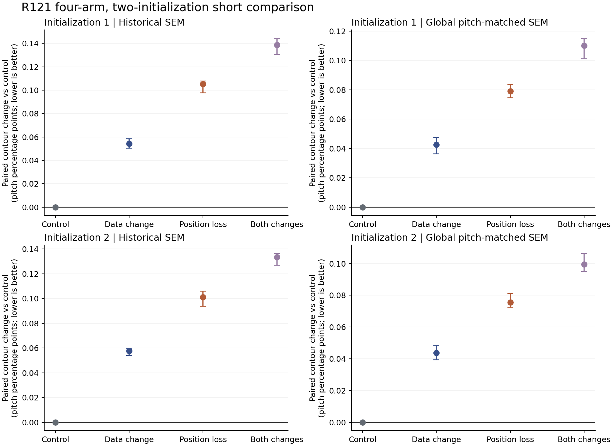
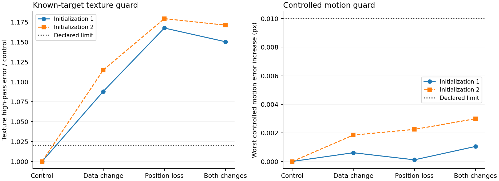
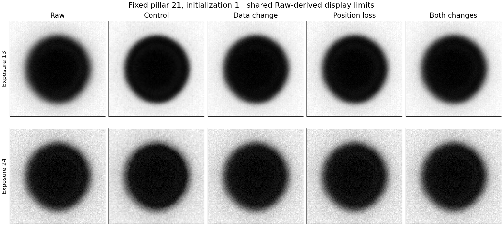

# R121 四組修正短測：未找到可採用的新模型

2026-09-06，Asia/Taipei。

**實作與八次有效短測已完成，但本次提出的資料修正、位置要求修正及合併方案，都沒有同時達到輪廓與細節要求。決定不採用 B/C/D，不進入長訓練，也不宣稱模型問題已解決。**

這不是把未完成的實驗標成失敗，而是完整比較得到的負結果。A 是本輪對照，沿用已修正的 R120 流程；保留 A 作研究參考，不等於把它升為正式基準或論文替代模型。

## 1. 實際完成的範圍

| 組別 | 唯一指定改動 |
|---|---|
| A：對照 | R120 已修正的物理序列流程 |
| B：資料組 | A 加上獨立取樣的亮度中點與對比 |
| C：位置組 | A 加上細節前後的局部位置要求，使用已修正 v2 |
| D：合併組 | 同時加入 B 與 C |

- 每組兩個獨立初始化；同一初始化內四組起點完全相同。
- 八次有效訓練各 12 輪、512 個場景、768 次更新，合計 6,144 次有效更新。
- 24 個 E4/E8/E12 模型檔均重新載入並核對；96 份逐輪驗證使用完全相同的輸入與答案。
- 共同開發集：96 個場景、192 張視圖；細節子集為 19 個帶紋理場景、38 張視圖。
- 共同控制檢查：240 個已知幾何／模糊／亮度／位移條件，另加 100 個獨立亮度條件。八組均使用相同資料；全部受測邊界剖面有效。
- 真實輪廓：12 個曝光、36 顆柱子，Raw 加八個模型，使用兩套固定參考，共 7,776 筆量測，零缺失或失敗。

模型架構、資料形狀、原有光學參數、位移安排、訓練步數與評估樣本均未依結果調整。沒有開啟舊 144 場景確認集，也沒有產生新的未看過確認集宣告。

## 2. 真實輪廓：三種改動都比對照差

下表是相對同一初始化的 A：每顆柱子先取 12 曝光的配對誤差差值中位數，再對 36 顆取中位數。單位為柱距百分點，正值代表變差。

| 組別 | 歷史參考：起點 1 / 2 | 柱距匹配參考：起點 1 / 2 |
|---|---:|---:|
| B：資料組 | +0.05432 / +0.05769 | +0.04255 / +0.04379 |
| C：位置組 | +0.10521 / +0.10110 | +0.07898 / +0.07555 |
| D：合併組 | +0.13861 / +0.13332 | +0.11002 / +0.09959 |

**三種改動在兩個起點、兩套參考下，均為 36/36 顆柱子的跨曝光中位數比 A 更差，沒有持平柱子。** 因此結果不是由少數柱子、某個初始化或挑選參考尺度造成。

A 本身相對 Raw 仍有輪廓改善：歷史參考的配對中位數為 −0.13441、−0.12662；柱距匹配參考為 −0.10694、−0.10037。B/C 也有部分相對 Raw 的改善，但都沒有保住 A 的程度；D 的配對中位數已接近且略差於 Raw。不能把「某些分數仍比 Raw 好」當成改動有效。

圖中區間為同一樣品內按柱子重抽 3,000 次的區間，保留柱子的全部曝光。它不包含跨樣品或 SEM 參考本身的不確定度。

## 3. 細節與清晰化也有代價

使用有標準答案的 38 張紋理視圖，計算輸出與答案之間的高頻誤差。原先允許相對 A 增加不超過 2%；實際如下：

| 組別 | 起點 1：細節誤差增加 | 起點 2：細節誤差增加 |
|---|---:|---:|
| B：資料組 | +8.80% | +11.48% |
| C：位置組 | +16.76% | +17.95% |
| D：合併組 | +15.05% | +17.13% |

這量的是相對答案的誤差，不能只解讀成紋理被抹掉；多留雜訊、修復不足或改錯細節都會增加它。但它清楚表明，三種改動未保住原定細節要求。

清晰化也有可見的差別。在固定暗圓、半徑 48 像素、模糊 σ=4 的控制例中，10–90% 邊界過渡寬度為：

| 輸出 | 過渡寬度（像素，兩次初始化範圍） |
|---|---:|
| 標準答案 | 3.3505 |
| Raw | 約 10.8482 |
| A | 8.5582–8.5741 |
| B | 8.7598–8.7881 |
| C | 9.5353–9.5555 |
| D | 9.7948–9.8013 |

此例中 C/D 的修復更接近保留原有模糊。不能把改得少當成已同時做好位置和清晰度；這一例也不能代替所有細節場景的判斷。

## 4. 已知幾何變好，不代表真實樣品也變好

在 240 個主控制條件中，邊界絕對誤差的条件平均值為：

| 輸出 | 起點 1 / 2（像素） |
|---|---:|
| Raw | 0.04292 |
| A | 0.07551 / 0.06912 |
| B | 0.08384 / 0.08029 |
| C | 0.03903 / 0.03856 |
| D | 0.03589 / 0.03488 |

C/D 確實讓這些合成控制形狀的邊界更準。若只看這張表，很容易宣布成功；但真實 SEM 輪廓與已知答案的細節同時退步，整體要求並未成立。

這個對比支持：本次局部位置要求能推動合成幾何對齊，卻沒有在固定短測預算中轉成真實樣品的整體改善。不能因此宣稱所有局部位置監督都不可行，也不能因控制分數漂亮就擴大訓練。

## 5. 位移只完成控制檢查，沒有冒稱真實 LSC 通過

已知位置條件下，各組最差相對位移誤差為：

| 組別 | 起點 1 / 2（像素） |
|---|---:|
| A | 0.01480 / 0.01370 |
| B | 0.01541 / 0.01554 |
| C | 0.01492 / 0.01594 |
| D | 0.01585 / 0.01669 |

全部落在事先允許的「相對 A 增加不超過 0.01 像素」範圍內，但多數點估計並沒有變好。模型輸出在控制檢查中保留浮點數；不能將此表直接當成真實存檔影像的 LSC 步進穩定度。

原先流程要求：只有兩個初始化都通過輪廓、控制位移與細節，才進入成本更高的真實 LSC 比較。**B/C/D 全部已在輪廓與細節條件失敗，故沒有觸發真實 LSC，也沒有因未執行就填入通過。** 相關程式與條件已準備，但沒有執行結果，不作科學證據。

## 6. 本輪確實修正與保留下來的部分

### 尺度核對

重新由原始 SEM 圖重現了原有 36 個輪廓，全部逐像素一致。發現固定縮放後 SEM 柱距比光學柱距小 0.623%–1.099%，依九張 SEM 圖的共同柱距得到 1.009233335 的全局匹配係數。

這能解釋部分共同偏大：Raw 面積偏差中位數由歷史參考的 +5.3424% 變成柱距匹配參考的 +3.4470%。但參考匹配後三種新改動仍輸給 A，不能靠換尺度挽救結論。新參考獨立保存，舊 SEM 與舊結果沒有覆寫。詳見 [參考核對報告](R121_REFERENCE_AUDIT.md)。

### 位置讀法的反例修正

第一版新增位置要求仍把純模糊誤判成位移。發現後中止了正在跑的 C v1，保留 9 輪紀錄與已有模型檔，不納入有效比較。

v2 把剖面放回標準答案的邊界中心，純寬度變化的最大誤報降到約 0.00222 像素，真正膨脹 0.4 像素仍能辨識。已完成的 A/B 不使用此位置項，另核對了兩版損失與三個輸出頭的梯度完全一致，才保留作對照；受影響的 C/D 用新版本和新 run_id 重跑。

這修好了讀法的實作問題，但八次短測證明「讀法正確」尚不足以讓新模型達標。詳見 [方法與修訂紀錄](R121_METHODOLOGY.md)。

### 固定例子的視覺覆核

下圖使用固定柱子 21、曝光 13 與 24、第一個初始化，所有組別使用同一套由 Raw 決定的顯示範圍，不挑最好看的個別輸出。

## 7. 驗證與失敗紀錄

- 八次有效訓練、24 個模型檔、每組 12 輪和 768 次更新已由實際檔案、狀態及日誌交叉核對。
- 兩個種子的初始權重另行重現；同種子四組一致，兩種子不同。全部 96 份逐輪驗證對應同一組輸入與答案。
- 7,776 筆 SEM 量測用獨立 Python 距離計算重算；最大差異約 0.000000260 個柱距百分點。Raw 的 432 個輪廓與歷史保存結果完全相同。
- 113 個歷史保護輸入、687 個評估輸入前後未變。沒有更新舊 R118/R119 核對值或驗收紀錄。
- 第一版位置要求的負反例、被中止的 C v1、兩次小型試跑，以及所有有效八組都分開保留。
- SEM 量測啟動時另遇到 MATLAB 的 `cell` 名稱遮蔽問題。第一、二版都在量測前失敗；第一次對原因的判斷亦已明確更正。第三版只修改局部變數名稱，保留失敗日誌，數值量測函式與參數未變，完整執行後零缺失。沒有調整數字來消除錯誤。

## 8. 最終決策

1. 不採用 B/C/D 作新的模型設定，不延長這些組別的訓練，也不調整門檻使它們變成通過。
2. 保留 A 作這一輪的有效研究對照；它不是新的正式基準，也未完成可替代 V42/R109 的資格驗證。
3. 保留尺度核對、中心化位置讀法、資料公平性測試與完整比較工具。
4. 目前沒有證據支持繼續沿這兩個新增因素直接投入長訓練。後續需要新的成像／材料邊界關係證據，才能合理改變訓練資料的偏移模型；不能將 SEM 差異直接變成任意內縮標籤。

**這一輪完成的是可核查的修正版實作與負結果判斷，模型的整體改進目標尚未達成。**

## 9. 主要檔案

- [有效八組實際執行紀錄](../results/matrix_finished_v2.json)
- [訓練與模型核對](../results/matrix_verification.json)
- [預先記錄的 v2 比較條件](../config/protocol_v2.json)
- [逐筆真實輪廓結果](../results/sem/measurements.csv)
- [共同控制形狀與位移結果](../results/controlled/paired_summary.csv)
- [有答案的影像及細節結果](../results/development/per_view.csv)
- [逐項決策與全部配對差異](../results/assessment/decision.json)
- [獨立量測覆核與完整性](../results/assessment/verification.json)
