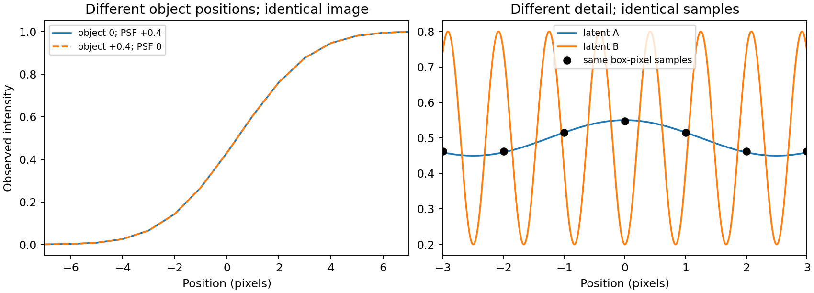
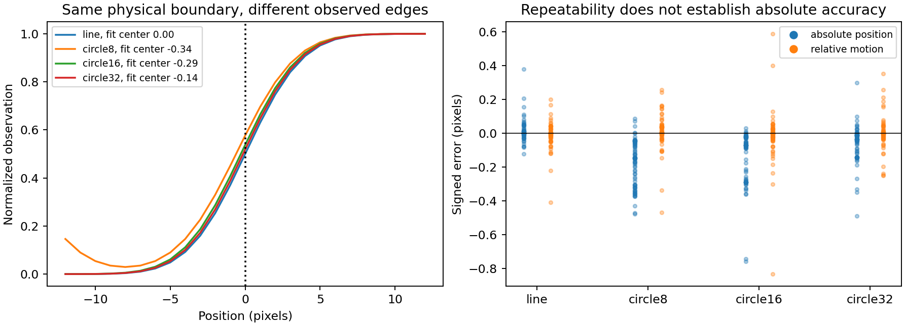

# R122 — 原理驗證與論文模型資料追查

2026-09-08。已完成這輪診斷；沒有訓練或交付新模型。

**決定：新模型不以超越 V42 為主要目標。先建立真正能分開控制位置、寬度與細節的連續影像表示，並以資料來源獨立的真實答案驗證。V42 在下列論文資料上的成績，應視為同樣品適應／重用資料上的結果，不能作為未見樣品的證據。**

這輪完成的是縮小問題、驗證反例、訂出可執行的設計契約；不是宣稱所有物理原因已經解決。正式 COMBO 身分未變，R119 因果更正與 R121 不採用結論持續有效。

## 1. 論文模型的答案重用有直接證據

追查對象是實際被論文結果使用的 **V42 epoch 120**，而非同名試跑。其檔案指紋為 `89942bc9b31125e836a17b6a3490d078126807e1c8bd179b73588a38c2301f83`。正式訓練紀錄指定 `grouped_seed1337_val120`：9,857 個訓練項目、1,397 個驗證項目；加權抽樣每輪 12,321 次，共完成 120 輪。起始權重與教師來自 V41，並非從零訓練。

| 後來的位移評估組 | 評估影像數 | 可追到訓練清單的影像數 | 入選評估影像對／兩張都有訓練來源 |
|---|---:|---:|---:|
| 50x，0.5 µm | 51 | 51 | 30 / 30 |
| 50x，1 µm | 50 | 50 | 30 / 30 |
| 20x，0.5 µm | 50 | 50 | 30 / 30 |
| 20x，1 µm | 50 | 50 | 30 / 30 |
| 合計 | 201 | 201 | 120 / 120 |

這是原始影像來源的重合，不只是檔名相似：四組中 **835 個訓練裁切與評估原圖對應區域逐像素完全相同**。衍生資料還包括同影像教師答案、真實／模擬位移對。只把評估的量測區域選得公平，不能消除上游訓練來源重用。

尺寸部分更直接：正式訓練清單中有 **623 筆 SEM 尺寸答案資料**，其中 **378 筆來自真實顯微影像裁切**；來源就是後來論文尺寸量測使用的 `20260618_100MG` 靜態影像。全部 623 個輸入與原始 R60 訓練包相同；611 個答案檔案也完全相同。另外 12 個答案有差異，恰好全部列在 V42 已宣告的邊緣軟化清單；本輪沒有重建那個軟化步驟，不把它描述為已逐像素重現。

論文目前中心九柱使用的 **9 / 9 個 SEM 半徑數值，都在正式訓練目標中出現**，每個有 7–10 筆對應資料，來源 SEM 編號也一致。後來論文曾修正水平鏡射的對應關係，因此這個核對證明尺寸答案被使用，並不表示每個舊訓練裁切都採用了後來修正後的正確位置對應。

內部驗證也不是按原始影像獨立：訓練與驗證各自可追到的 301 個目標影像來源，交集同樣是 **301 個**。不同資料角色的分組名稱把共同來源拆開了。進一步只執行原訓練程式的讀檔／影像配對部分，得到正式設定下 **1,000 / 1,000 個序列驗證影像對，同時在兩條序列／位移訓練清單內**；裁切方式可不同，但影像對相同。

**判讀界線：**有訓練標準答案是正常的監督式學習。問題在於，把同樣品、同拍攝影像或同尺寸答案用於訓練後，又稱這些結果能證明未知資料的恢復能力。現有證據足以否定上述資料的獨立性；不需要推定任何人的動機。這輪核對的是實際使用的資料清單和讀取方式，歷史上沒有保存每一次抽樣的完整清單，所以不宣稱逐筆知道每個項目在哪一個批次被取用。V41 及其他教師更早的完整訓練歷史未重建，故也不宣稱已查完所有可能的來源重用。

數字依據：[實際訓練與評估來源摘要](../results/v42_provenance_summary.json)、[九個尺寸答案與輔助訓練核對](../results/v42_provenance_extension.json)、[逐裁切像素核對](../results/v42_source_pixel_checks.csv)、[完整重合來源清單](../results/v42_training_evaluation_ancestry.csv)。讀取與核對程式：[資料追查](../scripts/audit_provenance.py)、[進一步來源驗證](../scripts/extend_provenance.py)。

## 2. 「位置」與「變窄」可以在數學上分開，但現有像素操作不等於純粹平移

對有唯一中點的連續單調剖面，使用 `J(c + g*(t-c-delta))`，正確中點 `c` 會移到 `c+delta`，10–90% 寬度變成原來的 `1/g`。這是已知參數的操作測試，不代表模型能從影像自行估準參數。

本輪各測 **3,888 組**，包含三種對稱／不對稱剖面、四種寬度、九個像素相位、兩種明暗方向、兩種對比，以及不同位移與壓縮量。事先門檻：位置誤差 0.02 px、寬度誤差 0.03 px。

| 實作 | 位置失敗 | 寬度失敗 | 最差位置誤差 | 最差寬度誤差 |
|---|---:|---:|---:|---:|
| 連續剖面、高密度讀值 | 0 / 3,888 | 0 / 3,888 | 0.0000183 px | 0.000264 px |
| 原始像素上直接線性插值 | 1,028 / 3,888 | 3,120 / 3,888 | 0.1293 px | 0.7240 px |

所以不能因為連續公式正確，就把像素插值版本宣稱為位置／寬度已分離。零操作的兩種版本均回到原圖，浮點差異低於 `4e-16`；這也說明「能回到原圖」本身不足以證明非零操作正確。獨立差分核對三種剖面的參數反應，符合連續公式，最大差異約 `1.14e-4`。

另外兩個反例限制了設計：

- 壓縮中心若估錯 0.3 px，即使只做 1.5 倍變窄，中點仍會漂移 0.1 px。正確公式不能補救錯誤的定位依據。
- 一個總量幾乎為零的細節補償，仍讓邊界中點移動約 0.0749 px。「零均值」「高頻」不等於不改位置。無限制細節分支也能抵消位移，讓最後影像完全一樣；最後影像的損失不足以說明每個分支真正學到什麼。

完整測試：[操作條件與逐筆結果](../results/operator_matrix.csv)、[數值摘要](../results/operator_summary.json)。

## 3. 單張影像有不能靠訓練消除的歧義

以下是本地建立、可重跑的成像反例，不是用另一個模型當答案：

1. 物體不動、光學中心偏移 0.4 px，與物體移動 0.4 px、光學中心不偏移，可以有完全相同的影像。沒有光學中心的獨立依據，就無法只靠那一張圖區分。
2. 物體本身的邊緣寬度與光學模糊可以互換組合而產生相同觀測。把一切寬度都當成模糊來移除，可能移除物體本來的結構。
3. 不同細節經過像素面積積分後，可以得到一樣的每個像素值。這輪反例的連續物體強度差達 0.35，像素差小於 `8e-16`。這是明確的取樣反例，不表示每種儀器都有相同頻譜或所有細節都無法恢復。

這些反例界定的是「沒有額外假設時，答案不唯一」。模型仍可依據可信校準、已驗證的適用範圍和資料先驗做有用估計，但必須交代依據和不確定性，不能把先驗猜測等同新量測。

## 4. 位置偏差與位移穩定是不同事情

另外實跑 **360 組二維成像條件**：直邊、半徑 8 / 16 / 32 px 的圓形，三種光學模糊、五種位置、兩種對比、三種雜訊，以及固定光學下的真實 0.4 px 位移。物體先移動，光學模糊與像素積分在後。以不知道真實位置的簡單直邊成像擬合器估位置，故圓形刻意測試形狀假設不符的情況。

第一版以 8 倍網格的二值形狀畫圖，本身將移動量離散化，造成無雜訊直邊位移誤差約 0.1 px。保留該版本作失敗記錄；正式物理解讀採用 **area_render_v2**：先積分小網格內的形狀覆蓋面積，再做光學模糊。不變更條件、亂數、擬合器或判準。36 組 8 倍／32 倍重算的最大位置差降到 **0.0000245 px**。另以解析直邊積分、圓面積驗證模擬器。

修正後無雜訊組，每種形狀各 30 例：

| 形狀 | 最差絕對位置誤差 | 最差相對位移誤差 |
|---|---:|---:|
| 直邊 | 0.0000241 px | 0.0000246 px |
| 圓，半徑 8 px | 0.3730 px | 0.03920 px |
| 圓，半徑 16 px | 0.2885 px | 0.0000302 px |
| 圓，半徑 32 px | 0.1425 px | 0.0000334 px |

半徑 16 px 的例子非常清楚：**位移可以量得穩，絕對邊界仍明顯錯位**。曲率改變模糊後的邊緣剖面；共同偏差可在位移相減時抵消。半徑 8 px 的另一側邊緣接近量測窗口，因此還有相鄰邊緣／窗口影響，不能把全部誤差只歸因曲率。

加入雜訊後仍有實際失敗，沒有藏起來：全 360 組以 0.1 px 判準計算，位置 **119 組**失敗，位移 **47 組**失敗；最差分別為 **0.7591 px、0.8328 px**。全部數值擬合都有結束，這恰好證明「演算法跑完」不等於「量測正確」。擬合殘差小也不足以保證正確的物理邊界。

這個簡單擬合器是可解釋的參考與反例工具，未被宣稱可普遍使用。[修正後完整資料](../results/area_render_v2/physical_fit.csv)、[模擬收斂與檢查](../results/area_render_v2/summary.json)、[修正理由](../config/area_render_v2.json)。

## 5. 下一個模型的具體方向

詳細規格見 [模型設計契約](MODEL_DESIGN.md)。

- 先完成可核對的二維連續表示與像素積分，證明平移、變窄、細節各自做了什麼，再訓練預測這些量。
- 位置修正要有獨立成像依據；對無法分辨的條件保留不確定性，不能靠答案重用學出表面上很準的尺寸。
- 訓練、開發、最後確認從物體／樣品／拍攝來源就分開，包括所有裁切、位移、教師及起始權重。記錄每一條訓練路徑實際拿到哪些資料。
- 同時檢查形狀、真正位移、真實細節、失敗率與最差情況。新模型只要在清楚且有實用價值的適用範圍內改善 Raw，就值得研究；不必追著 V42 的重用資料成績跑。

本輪已實作來源檢查器，能拒絕同樣品／共同祖先／來源缺失，並以 V42 的 301 個重合影像來源驗證會拒絕。它檢查宣告的來源資料，不能取代來源的真實性審查或獨立保管確認集。[可執行來源檢查器](../scripts/split_guard.py)。

## 6. 驗證、保留與範圍

獨立重算 7,776 筆操作記錄與原始 360 筆物理擬合統計；以不同的積分方式檢查 36 個像素模型值，最大差約 `1.34e-15`；9 個額外解析輸入的擬合位置誤差低於 `7e-16`。修正後 360 筆及其模擬收斂另見最終核對記錄。

3,510 個本轮讀取保護來源的指紋未變；舊 R109/R119 比較留下的 130／132 個保護清單也逐項通過原值核對（兩張清單重疊，不相加）。舊確認集的 manifest 僅作完整性核對，沒有讀取確認影像作新評估。未改舊 R118/R119 保護檔案、收據或期待值。

保留首個來源排序失敗：最初追查只列 BMP，漏了 30 個 TIFF；後依原訓練讀檔方式補齊副檔名，才恢復 11,254 個來源的完整排序一致性。這是稽核程式修正，沒有變更訓練資料或分割結果。另完整保留第一版模擬的離散化問題及數字。

本輪沒有建立訓練權重、沒有新確認集結論、沒有修改論文歷史數字，也沒有宣稱模型已能處理任意場景。当前狀態與新設計需引用本報告，舊文檔中的較強說法不構成這輪背書。

Related primary evidence, used as context rather than local proof: learned reconstruction may be unstable or miss structures ([Antun et al., 2020](https://arxiv.org/abs/1902.05300)); uncertainty was tested for reliability and misuse detection in structured illumination microscopy ([Liu et al., 2025](https://www.nature.com/articles/s41467-025-60093-w)). Neither paper establishes performance of the proposed model here.
