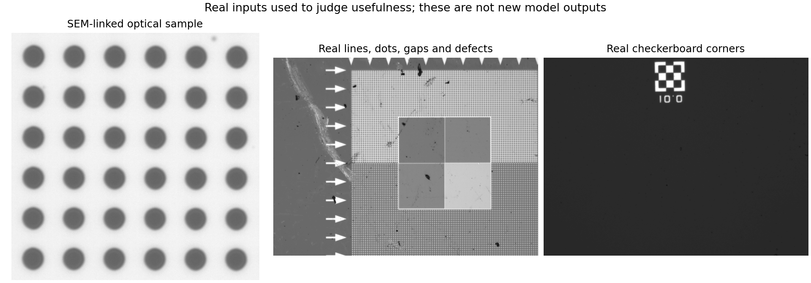

# R123 — 資料設計與真實場景驗證契約

2026-09-08。使用者指定真實顯微影像與 SEM 為優先驗證。本報告把「能用來訓練」「能用來校準」「已使用的真實開發資料」「全新確認」分開，不以重新命名取得獨立性。

## 1. 已核對、能立即用於真實開發的資料

| 面板 | 現有範圍 | 主用途 | 真值限制 |
|---|---|---|---|
| SEM 對應柱體 | 12 張曝光 ×36 柱，原始 SEM 九張 | 輪廓、尺寸、面積、向內／向外偏差及暗曝光安全 | 同一個已使用樣品群；不能當 432 個獨立樣品。資料夾的 50x 名稱沒有完整倍率證據 |
| 六组全視野位移 | 5x／20x／50x，各兩種移動條件，共 301 張 | 真實位移、跨物件一致性、線條、間隙與複雜內容保持 | 平台命令不是獨立量到的真實位移；資料已被多輪開發使用 |
| 真實棋盤 | 51 張 | 角落、直線、共同位移與不應改壞的部分 | 主要比較 Raw 幾何及重複性，不是 SEM 絕對角落答案 |
| 論文靜態 100MG | 1 張光學影像及 SEM 尺寸資料 | 補充尺寸檢查、歷史來源重用案例 | V42 已用過該原圖裁切與九個評估尺寸答案 |

前三項合計 **364 個光學影像檔案**。非柱體內容來自同一份 301 張全視野影像，不再重複加進總數。檔案數不等於獨立樣品數；不同日期與資料夾的物理樣品關係也不能擅自認定。

此外核對 39 張同圖衍生 CAD 來源，以及 25 張待資格判定的光學校準來源。CAD 參考是从光學原圖產生，不能當獨立物理答案。舊 101×101×1×100 PSF 集和三輪 11×11 位置的重複性資料是不同來源與用途，不能合成一張未核對的儀器真值。

完整位置、指紋和基本影像資訊見 [來源清單](../results/real_source_inventory.csv) 與 [來源角色設定](../config/real_sources.json)。所有這些資料目前均禁止進入下一版的訓練、教師或訓練答案路徑；可以公開作為已使用的開發驗證來決定方向。

R73、R74 是合成資料，不是實拍，明確排除在主要真實面板之外。舊 144 場景確認已使用過，本輪沒有讀取其影像內容。

## 2. 先固定區域，不等候選修漂亮了才選

本輪重新執行 R68 原本只看 Raw 第一張影像的區域選法，六組各 24 區，**144 個區域身分與舊紀錄完全一致**；座標、尺寸、來源指紋已寫入 [固定區域清單](../config/frozen_real_rois.json)。這些適合全視野位移與結構保持的共同檢查。

它們是以舊的局部內容分數選出的區域，不是每一區都已由人工確認為角落、間隙或缺陷。特定結構的成效主張，還需在新候選出現前，只看 Raw 和用途建立固定語義標記及有效規則。SEM 物體身分、歷史尺度與另一套全局柱距尺度、Raw 決定的共同平移繼續固定；不按模型或每顆物件縮放。

R68 原有的百分比允收值是該輪的試驗門檻，本輪只重用區域身分，不直接借用它們作新產品驗收值。

## 3. 第一版訓練資料如何設計

**目前可立即建造的是新且獨立的生成資料；新實拍訓練組與獨立 SEM 訓練物件尚未取得或通過來源審核。** 因此第一輪的正確描述是「生成資料訓練、真實場景主導開發驗證」，不是宣稱已有乾淨的實拍訓練組。

初始場景配比是工程提案，不是已證明最佳：不規則曲線物體 20%、角落／線條／交會 20%、密集相近或接觸結構 20%、帶紋理邊緣與內部 20%、已經清楚的影像 10%、平坦負例 10%。這樣不讓圓柱或最容易產生漂亮分數的孤立邊緣主導。

物體尺寸、邊界固有過渡、紋理、明暗方向、對比／中點、照明、光學寬度／方向／不對稱、噪聲與位移分別取樣。覆蓋真實觀察到的失敗類型，但不複製評估樣品的像素、SEM 輪廓、固定尺寸或物件模板。生成中心區實際包含什麼要逐筆記錄，不能只憑場景名稱推定。

同一物體的連續觀測按順序建立：物體先移動 → 固定同一段序列的光學條件 → 像素面積積分 → 相機響應、噪聲與量化。不同曝光是另外宣告的條件，不把每幀不同光學模糊混稱同一條物理序列。較細取樣只是數值近似，必須做收斂檢查。

可擴充的真實訓練來源：

- 新樣品的獨立重拍影像可教去噪，但要確認噪聲條件與運動；模糊重拍平均不等於清晰幾何答案。
- 新樣品的光學–SEM 配對可教可信的幾何，不能拿 SEM 灰階直接教光學紋理。
- 新樣品的高品質光學參考可教細節，但對齊、照明及樣品變化需先核對。

訓練、開發、確認在樣品／拍攝／祖先來源層級先分開，再產生裁切、位移、教師或增強。從零初始化，不使用 V42 或其他來源未完整審核的舊權重。獨立儀器校準可明確共用，但它必须與被評估樣品無關，並將「同校準下的新樣品」和「新儀器條件」兩種主張分開。

## 4. 真實影像如何決定是否有用

每個短候選都必須直接跑同一份真實面板，不由合成分數篩掉真實驗證。必要程式正確性檢查仍要先做，不能讓座標錯誤或讀檔錯誤進入科學比較。

| 問題 | 主要觀察 | 必須避免的錯誤 |
|---|---|---|
| 形狀與尺寸真的更準？ | 已資格判定的共同座標 SEM 邊界距離，同列有號偏差、尺寸／面積、95百分位與最大錯誤 | 按結果挑 ACM 或中點；以模型內部幾何當自己的答案 |
| 位移有沒有被改壞？ | 真實序列的重複性、不同物件的一致性、與命令及 Raw 的差異 | 把命令步長等同獨立量到的實際位移 |
| 真實結構是否保留？ | 固定非柱體區域、線／角／間隙、跨幀結構、假細節與缺失檢查 | 把變窄或更像 SEM 灰階當作光學細節正確 |
| 是否只是保持原圖或只挑容易例子？ | 全部輸入的實際輸出、接受修正部分、退回 Raw 部分及拒絕原因 | 只算高信心子集；全部拒絕也給成功 |
| 不確定性有沒有用？ | 真實答案涵蓋率、區間寬度、錯而自信的比例與最差例子 | 小觀測殘差當成真值資格；把區間無限放寬 |

SEM 材料輪廓與光學邊界的對應目前還沒有完整資格判定。因此 ACM 与半對比位置暫時是兩個不可替換的觀察：方向矛盾就記為讀法／對應未解，不能投票或選有利者。最陡點維持固定設定與有效率；原來約 41% 的三方有效覆蓋不能靠改尺度或移除 Raw 補成成功。

同一物體跨曝光先作配對摘要，再在拍攝批次／物理樣品層級彙整。36 柱 ×12 曝光仍是同樣品的重複資料，不是 432 個獨立成功案例。只有一個樣品時，不估未知樣品的成功率。

## 5. 決策時間與容差

第一輪固定 1024 次更新的影像作主要架構比較，0／256／512 是可見的開發診斷；不是隱藏確認，也不能事後挑某組最好的時點來比較。

最低有用改善、幾何／位移／細節可允許的退步、最低修正覆蓋、重大失敗上限及區間可用寬度，都需以用途與獨立參考不確定性設定。R121 的 +0.01 px／2% 或 R122 的 0.02／0.03 px 不能直接移植成應用標準。

當這些值尚未設定，短試驗只能探索，不能自動觸發長訓練。若要據某輪真實短測晉級，主效益及界線必須在該輪任何候選結果第一次可見之前固定。若效果比參考不確定性還小，判為尚無法分辨。若只贏合成、真實不改善，停止扩大該方案；若主讀法互相矛盾，先處理量測與成像假設。

最終對未知樣品的主張需要新的物理樣品／拍攝批次，最好包含非圓結構、可信光學–SEM 同位置對應及獨立位移量測。現有資料不能靠重新切分回復未看過狀態。這不阻止現在做原型與真實開發比較，但限制能聲稱的範圍。

完整可檢查契約：[validation_contract.json](../config/validation_contract.json)。
