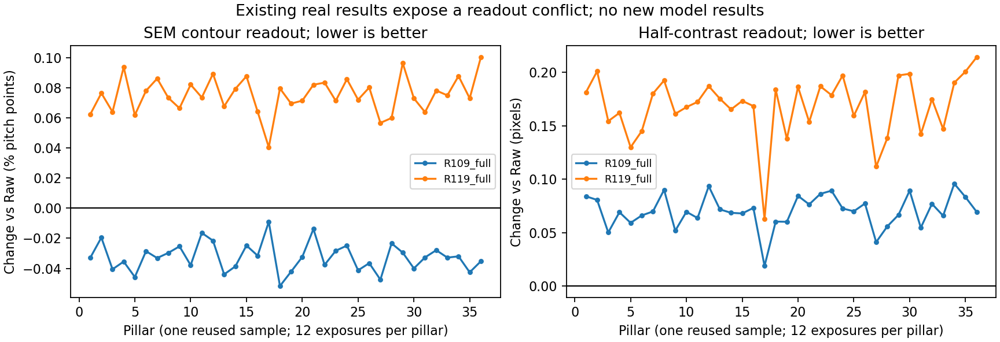

# R123 — 本輪實際完成的設計與核對

2026-09-08。**完成下一代架構、資料與真實驗證設計；沒有訓練新模型，也沒有宣稱新模型已改善任何影像。**

## 決定

選擇「完整二維影像、四步共享重建、每步觀測核對、獨立幾何診斷」作第一個原型方向。它保留任意形狀與紋理的重建能力，不強迫位置、寬度、細節三個名稱代表互相獨立的真實機制。

真實顯微／SEM、真實連續影像及真實困難結構，從每個短候選一開始就參與開發評估。合成只可作資料來源與操作正確性檢查，不能代替真實表現。V42 不作教師或必須超越的比較。

## 實際執行與產物

1. 重新核讀 R61／R109／R119／R121／R122 的設定、程式與更正後結果，並由三個獨立審查方向交叉挑戰架構、資料與量測邏輯。
2. 直接讀取並核對 **438 個影像檔案**：364 個主要真實開發光學檔案、9 個原始 SEM、1 張補充靜態光學、39 張同圖 CAD 來源，以及25張待資格判定的校準來源；未把同一份全視野的不同用途重複加總。
3. 重現 Raw 決定的六組、各24區，共 **144個區域身分**；全部與 R68 原有區域一致，保存了座標與原圖指紋。它們仍是已使用開發資料，不是144個新樣品或新確認場景。
4. 從既有逐筆真實數據重新計算兩套參考、每套36柱×12曝光的配對結果。輸出144筆「模型／參考／柱」摘要和48筆曝光摘要，沒有生成或捏造新模型圖像。
5. 實跑小型觀測算子的正反向、梯度與初始化检查。反向內積差約 `3.56e-15`、手算與自動梯度完全一致，有限差分差約 `1.49e-13`。一次觀測更新的測試誤差由 `0.0602243` 降至 `0.0450704`；這只證明簡單算子的運作，不是實拍改善。
6. 視覺檢查實拍面板與逐柱配對圖。完整設計設定、來源與驗證契約已保存，可在實作前檢查一致性。

## 既有真實結果如何阻止錯誤的成功判斷

下面是在全局柱距參考下，先對每顆柱子取12曝光的配對差，再對36柱取中位數；負值較 Raw 好。它和直接相減兩個總體中位數不同。

| 舊模型 | 輪廓差（柱距百分點） | 半對比位置差（像素） | 正確的解讀 |
|---|---:|---:|---|
| R109 | −0.03278 | +0.06961 | 輪廓讀法改善、中點讀法退步；材料／光學對應未解，不能宣稱物理邊界恢復 |
| R119 | +0.07433 | +0.17399 | 這兩個真實觀察均退步，不能當作下一版已有效的證據 |

兩套參考均保持此方向，36柱的方向也一致。**這張表沒有比較新模型，亦沒有把 R109／R119 判成所有用途都沒有價值。**

## 交叉審查後實際改了哪些設計

- 將不足的192像素周邊改成256；完整依賴鏈的保守解析範圍248，訓練輸入相應改成640、中間監督128。實作分塊與記憶體仍待測。
- 移除單次更新中實際梯度為零的近接項，寫清真正會執行的觀測步驟。
- 將初始化恆等、完整模型恆等及退回原圖分開；不要求模糊影像在有效去模糊時也完全不動。
- 說明潛在影像是取得影像前的光學強度，不是 SEM 圖，也不重複施加光學模糊。
- 允許來源獨立的儀器校準跨樣品共用，但禁止從評估物件偷取校準答案。
- 將應用容差的固定時間提早到「要作晉級決策的真實結果第一次可見前」。未定容差只允許探索，不自動進長訓練。
- 固定主要比較為1024次更新，早期點只作共同診斷；共同初值需逐張量核對，不能只看亂數種子相同。
- 明確說明新的實拍訓練組尚未取得；第一輪是獨立生成資料訓練、真實場景評估。

初稿和問題保存在 [設計審查記錄](../results/initial_design_review.json)，沒有刪掉或重寫成「原本就正確」。

## 完成範圍與下一步

已完成的交付是可落實的設計與來源／數據核對。模型仍未實作；校準資格、實拍讀法對材料的對應、應用容差、特殊結構標記、完整分塊／記憶體，以及獨立樣品確認仍未完成。

下一步依此規格建立原型和固定真實量測入口，再執行受限的小型比較。若某種成像假設不適用，就保留未具資格狀態，不靠調測試答案、換讀法或重設期望值通過。

- [架構與實作契約](R123_DESIGN.md)
- [資料與真實驗證契約](R123_DATA_AND_VALIDATION.md)
- [來源及真實結果重算](../results/real_panel_audit.json)
- [數學檢查範圍](../results/operator_math_checks.json)
- [設計一致性與來源完整性核對](../results/design_verification.json)

本輪不更動任何舊模型或保護證據，不存取舊確認影像，不改歷史數字。R123 取代的是 R122 的「下一步架構與驗證優先順序」，不是推翻 R122 已驗證的反例與失敗紀錄。
