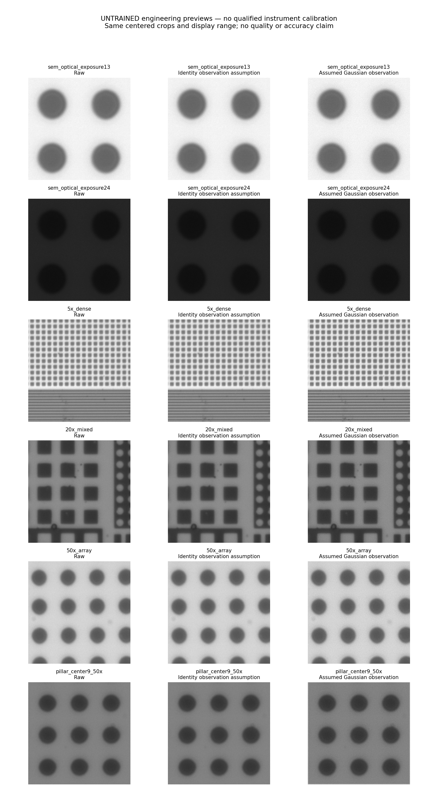
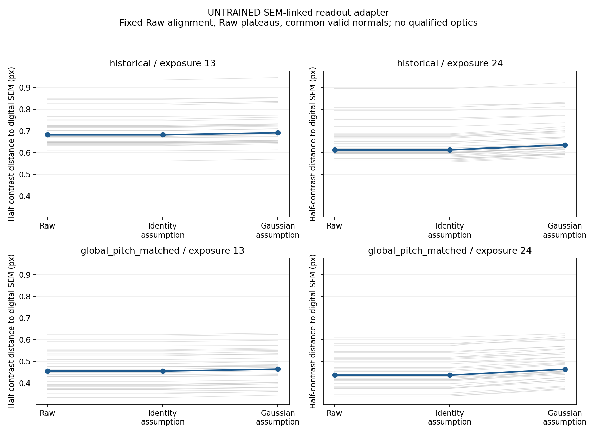

# R124 — 模型原型已實作並實際跑通

2026-09-08。**完成的是可執行、可追查的未訓練原型。没有正式訓練、沒有參數更新，也沒有證明重建或量測已改善。**

## 已完成的模型與使用入口

實作了完整二維影像表示、四步共享重建、每步成像核對與亮度範圍投影，以及另外讀取的形狀診斷。四步的輸入、提出的修正、成像差異、實際校正與結果均可匯出；形狀診斷不能另外改寫影像。

模型有301,212個可學習參數，使用時仍是一張灰階顯微影像，輸出維持原始像素大小與座標。提供單圖／資料夾輸出、浮點影像、PNG、初始化保存及重新載入。实际命令列重載後的浮點輸出完全相同。[使用方式](../README.md)、[實作契約](R124_IMPLEMENTATION.md)。

兩個預設成像設定分別為不加光學模糊與假設Gaussian模糊，**都只是工程測試設定，沒有拿真實影像或SEM去擬合，也沒有儀器校準資格**。程式拒絕只靠更改標記就聲稱已校準。形狀與可信範圍輸出同樣尚未學習／校準。

## 運算與行為驗證

| 檢查 | 實際結果 | 範圍 |
|---|---|---|
| 成像、梯度、模型行为及檔案重載 | **26項測試全部通過** | 不對稱核方向、正反運算、非零梯度、逐步紀錄、幾何不能改圖、重算一致性、無效設定拒絕 |
| 完整大小的反向運算 | **兩張640×640實拍輸入，最高22.57GiB配置、23.90GiB保留** | 內部1280×1280、64通道、四步、FP32、使用重算節省記憶體；沒有優化器更新，權重不變 |
| 非零修正下的分塊一致性 | **最大差1.19×10⁻⁷**，約0.0000304灰階 | 完整64通道／四步，兩種分塊大小與起點，包含原圖最外邊界 |
| 光學核最大支援範圍 | **最大差1.19×10⁻⁷** | 保留四步運算、16原像素核半徑、256像素周邊；此項單獨使用8通道，不冒稱已測完整64通道最大核記憶體 |
| 故意拿掉分塊周邊的反例 | 最大差0.1543，約39.36灰階 | 證明周邊處理確實必要，不是所有測試都靠原圖不變過關 |
| 真實輸入及逐步輸出 | **6張實拍 ×2設定 =12份输出** | 包含2個SEM對應曝光及5x／20x／50x複雜內容；保存浮點、PNG與兩份四步紀錄 |

完整大小單次前向／反向約4.44秒，僅為這次暖機環境與工程檢查的量測，不推估實際訓練吞吐或總時間。測試中用非零隨機修正啟動網路路徑，沒有把那組測試參數存成訓練成果。

依實際核大小計算周邊：恆等設定64像素、目前小Gaussian設定80像素、最大支援核256像素。這些結果只驗證本版固定局部運算；改增加步數、支援範圍或全圖運算，需要重新核對。

## 真實顯微與SEM介接

實際輸出圖已檢視。原圖保持模式的浮點輸出等同模型收到的浮點原圖；假設Gaussian模式的變化目前只來自成像校正，**不是模型已學會恢復細節**。

另外把曝光13／24的實際輸出接上固定SEM參考的半對比讀法：36柱、兩套SEM參考、Raw與兩個原型設定，得到**432筆**物體／方法記錄。使用固定Raw決定的對齊與亮暗基準，每柱720條剖面。144組Raw逐點位置與有效性完全重現舊記錄；與舊表摘要的最大差約5.56×10⁻¹⁷像素。

兩套參考、兩個曝光中，未訓練Gaussian假設輸出的SEM參考距離均略增加。例如全局柱距參考下，曝光13由Raw的0.45565變成0.46461像素，曝光24由0.43678變成0.46421像素。這些是目前未訓練、未校準輸出的診斷值，不能當成模型優劣結論或任意調參依據。

曝光13每柱有720條共同有效剖面；曝光24最少為歷史參考699條、柱距參考700條。各方法無效剖面與原因完整保留，總計1009個無效方法／參考觀察，沒有隱藏。它們是重複觀察，不是1009個獨立物體或樣品。

這次只有半對比介接，**未跑完整ACM驗證，也未做全301張位移序列或學習成效比較**。材料邊界與光學讀法的物理對應仍需獨立校準。

## 過程發現與保留的問題

1. **純黑白邊緣不一定能證明光學校正會改圖。** 在亮度上下限投影下，它可以合理地保持不變。初始測試輸入改為未飽和0.2／0.8亮度，原始失敗紀錄保留；沒有修改模型來強迫該例變動。
2. **較細網格的總誤差不必單調下降。** 初始取樣檢查忽略了固定光學核支援範圍的截斷誤差。原始18筆和失敗程式保留，再加較長核的獨立敏感度檢查。4像素核支援下，2x／4x／8x最差誤差約0.000102／0.0000286／0.0000470灰階；6像素支援下為0.0000995／1.94×10⁻¹²／4.22×10⁻¹²灰階。這些平滑直邊數字不代表任意圖像的物理精度；本網路仍只支援2x。
3. **舊邊界讀法對接近水平的平台很敏感。** 四個Raw剖面的過渡增量接近機器精度，其中一例只有1.67×10⁻¹⁶；舊公式的除數下限會讓位置與普通線性插值差0.12498像素。沒有改舊公式、舊分數或放寬正常區間的核對容差；保留失敗版本，另列下限啟動記錄與共同有效範圍的敏感度檢查。正常區間的獨立插值核對最大差4.45×10⁻¹⁶像素。

舊Raw讀值以原始8位元資料正規化，而模型輸出保存為FP32。即使原圖保持模式逐像素等同模型的FP32輸入，極小的表示差仍可影響接近平台的舊有效性判定；不把這種數值差描述成模型真的移動了邊界。後續正式量測介面需固定資料精度並明確處理平台歧義。

## 下一個工作邊界

原型可运行、可計算學習所需的梯度、可分塊、可保存重載，並能接到實拍／SEM讀值。**尚未完成的是独立訓練資料、正式訓練目標與抽樣紀錄、實際儀器校準、可信範圍校準，以及真實場景上的改善證據。**

下一步可以在保留這些原型檢查的前提下，接上R123規劃的小型獨立資料訓練與固定真實評估。未校準的觀測假設不能自動取得物理資格，也不能因原型能跑就宣布訓練或科學目標完成。

本輪不更新舊證據的期望值、不改任何舊模型，不讀取舊確認影像。完整性與交付核對見 [最終驗證](../results/final_verification.json)。
