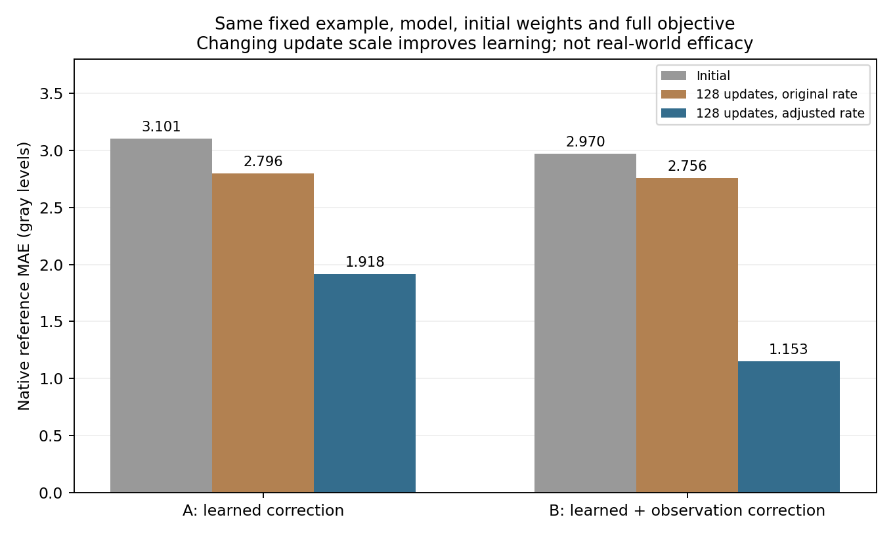
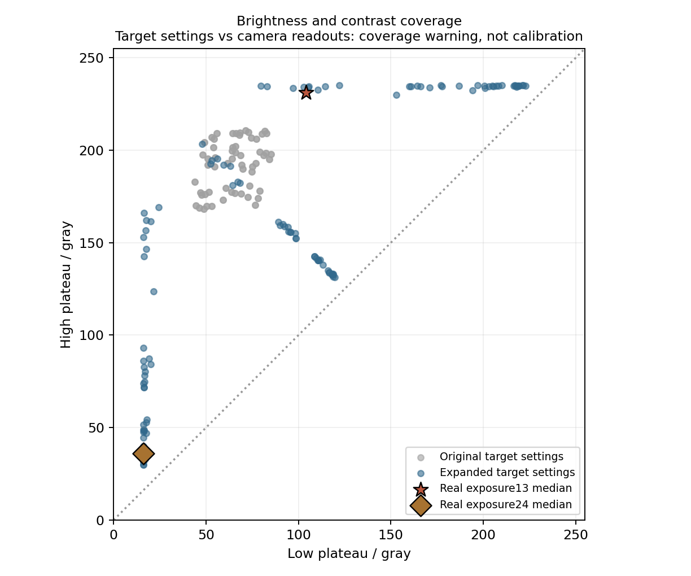
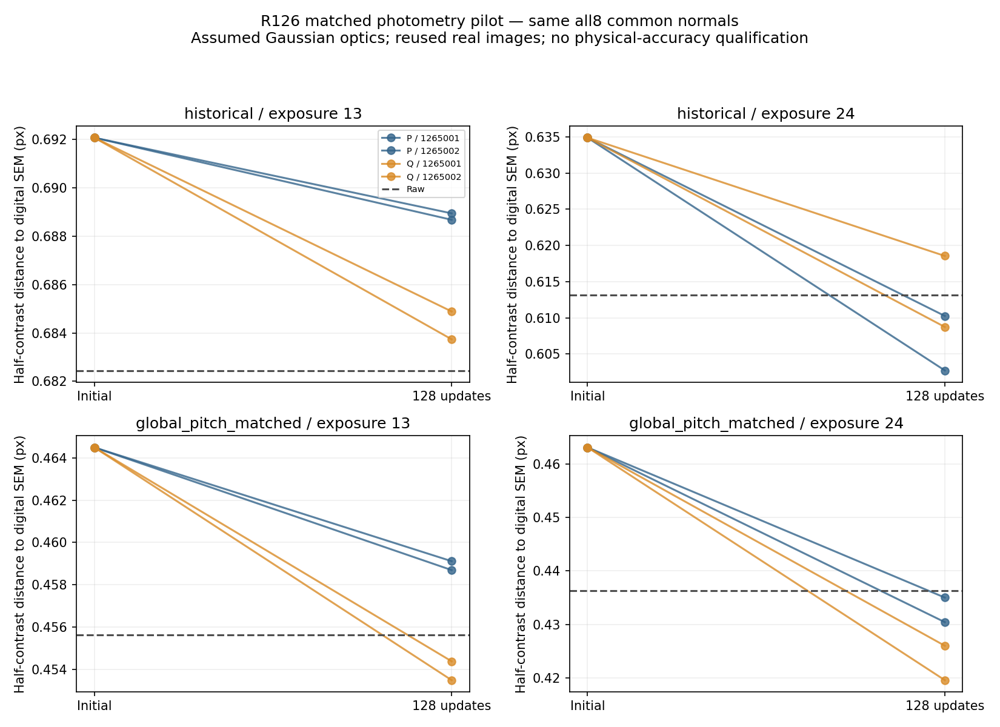
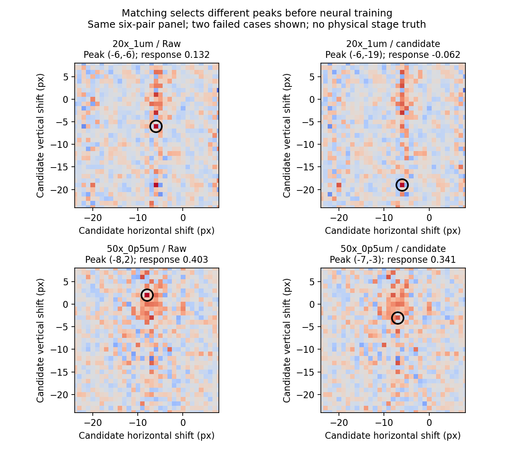

# R126 — 學習已改善，亮暗補足有幫助；實拍量測仍未可靠

2026-09-08。**這輪確認並修正了短試跑學得太慢的問題，也完成四組資料對照與全部實拍評估。擴充亮暗範圍有改善訊號，但目前不採用任何模型，也不擴大訓練。**

現在的主要限制已更清楚：能學會模擬例子，不等於能可靠量測實拍影像。SEM的兩種對照方式仍會給出不同結論；影像匹配也會跳到另一個位置。這些問題必須與模型學習分開解決。

## 1. 已確認原設定在短試跑中學得太慢

使用同一個獨立生成的簡單形狀、同一份雜訊、同一組初始權重，分別測試只學影像和同時滿足原本多項要求。四組各更新128次，誤差只下降約6%～10%，兩種要求的結果相近。

接著另行鎖定對照，只把每次參數調整幅度加大十倍，其餘保持相同：

| 固定例子的模型 | 原設定的誤差下降 | 調整後的誤差下降 |
|---|---:|---:|
| A：只有學到的修正 | 9.84% | **38.13%** |
| B：另加成像一致性修正 | 7.21% | **61.17%** |

影像與高密度參考的誤差都下降，數值微分也確認更新方向有接通。這是同一固定例子上的因果對照，**不是38%～61%的真實影像改善率**；也沒有證明這個設定對所有資料都最佳。原先四組不足的結果完整保留。

## 2. 亮暗資料已修正，而且確實送進模型

四組新試跑是「原亮暗範圍P／擴充範圍Q」各使用兩個起始狀態，每組128次更新。形狀、模糊、位移與雜訊抽樣成對保持一致，只比較亮暗與對比範圍。這輪沿用64個來源獨立的生成場景，各呈現兩次；沒有把既有顯微影像、SEM答案或舊模型答案拿去訓練。

擴充資料涵蓋低、中、高亮度和四種對比強度。變化先作用在乾淨的光學影像，再加入感測雜訊，並保留真實周邊內容。256個成對條件、512個觀測全部通過原本的數值相容性限制；另外獨立重算12個觀測，最大差異僅0.00000844灰階。

用相同的暗、低對比例子比較所有模型，Q的平均影像誤差比P降低約**18%～19%**，兩個起始狀態方向一致。這些例子的形狀已用於訓練，所以只支持亮暗適配改善，不能稱為未知場景驗證。

也保留了負面結果：對原本已正確的乾淨例子，P平均引入約0.129灰階誤差，Q約0.391灰階。**加入「保持原樣」的訓練例子，仍沒有保證模型真的保持原樣。**

圖中訓練點是目標設定，實拍點是固定原圖的明暗平台估計；這是涵蓋範圍檢查，不是儀器已校準的證明。

## 3. 真實SEM對照有改善訊號，但結論尚不一致

所有模型使用同一批36顆柱子、正常／暗曝光、兩種SEM參考，並在全部8次評估共同有效的位置比較。沒有空集合或低於90%覆蓋的個案。

以下是擴充資料Q相對原圖的誤差變化：先逐柱配對，再取中位數。負值較好，正值較差，單位是像素；兩個數字分別對應兩次起始狀態。

| SEM對照方式 | 正常曝光 | 暗曝光 |
|---|---:|---:|
| 以整體柱距匹配的參考 | −0.00261／−0.00164 | −0.01587／−0.02378 |
| 過去使用的參考 | +0.00205／+0.00345 | +0.00784／−0.00067 |

更直接比較Q與相同訓練設定下的P：整體柱距參考下，Q兩種曝光、兩次起始狀態都較好；但歷史參考的暗曝光下，Q兩次都較差，36柱中分別35柱、21柱退步。**不能因為某一套參考對新模型較有利，就把另一套結果移除。**

這些是固定半對比讀值與數位SEM輪廓的距離，不是已認證的物理材料邊界誤差。完整ACM、全部301幀與新的獨立實拍確認都未在這輪執行。

## 4. 位移判讀仍不可靠，不能作為可採用模型

在六組固定影像對中，P每次有兩組低反應，Q每次有一組。Q在50倍那組影像中，與原圖的位移讀值差約**36.83／36.94像素**。這不能說成物體真的被模型移動了37像素。

我把匹配計算拆開重算：最終Q其中一次選到的位置約為(29,2)，原圖則約為(−8,2)，差異在選擇匹配位置時已經出現。原先猜測的「局部重心計算跑出視窗」在這些例子中不成立。未訓練模型也已有其他匹配跳值；小於一個灰階的平均影像改變就足以觸發部分跳值。

這解釋了讀值跳動的數值來源，**沒有證明實際位移被保留**。原圖本身也沒有獨立的實際平台位移答案；較高的反應值同樣不能單獨保證配對正確。舊讀值、低反應與全部失敗仍保留。

## 5. 已完成的核對與透明記錄

- 六組固定例子診斷共768次更新；四組資料對照共512次，合計**1,280次實際更新**。這不是一次1,280步的正式訓練，也不是完整R123研究。
- 四個初始實拍評估全部早於資料對照的第一次更新；四個最終模型全部完成同樣評估。共144份實拍浮點輸出、1,152筆共同SEM記錄、48筆位移記錄。
- 用另一份未引用訓練資料處理器的計算，重建256份實際輸入，再核對全部512筆資料對照更新。初始權重、裁切、來源、固定部分、最終權重及實際輸出均相符。
- 3,431個舊來源與成果檔案保持不變，其中包含原來132個R119保護項目。沒有讀取舊確認影像，也沒有更換舊證據的預期指紋。
- 兩個實拍512像素視窗的嚴格單精度檢查中，已訓練模型分塊／整窗運算差異不超過0.000000239。暗曝光的四階段修正已逐項保存，合計可還原最後影像；這是可追溯的計算分解，不是純位置／寬度的物理因果分解。
- 最後追蹤核對發現訓練檢查與實拍評估的運算精度設定不同。原失敗保留；四種設定對照定位原因後，以實拍原本的相同設定重算，與原輸出完全一致。原模型、原結果及限制都未調整，詳見[執行與失敗記錄](R126_EXECUTION_NOTES.md)。

## 判斷與下一個工作重點

**保留這次已證明有效的學習調整與亮暗擴充方式，但不採用這四個模型。** 現有資料已更適合做來源清楚的模型研究，仍不足以代表完整真實使用條件。

下一個工作應先固定SEM與光學影像之間可獨立核對的尺寸換算、對齊與邊界定義，同時建立能識別錯配的位移檢查。模型方面，要針對「已正確影像仍被修改」設計可驗證的保留機制，再做新的小型對照。這些基礎成立後，才值得擴大資料與訓練。

正式基準COMBO、過去論文結果模型V42及這輪研究模型的身分保持分開；這輪沒有替換正式或論文模型。

可核對資料：[完整方法](R126_METHODOLOGY.md)、[學習與量測原理分析](R126_LEARNING_AND_READOUT.md)、[逐柱資料對照](../results/photometry_paired_comparison.csv)、[獨立執行審查](../results/execution_audit.json)、[最終核對](../results/final_verification.json)。
