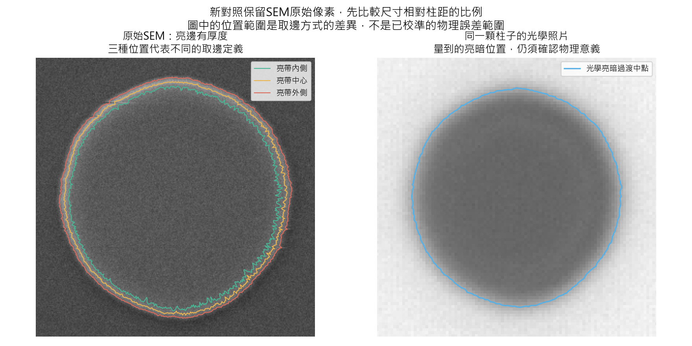
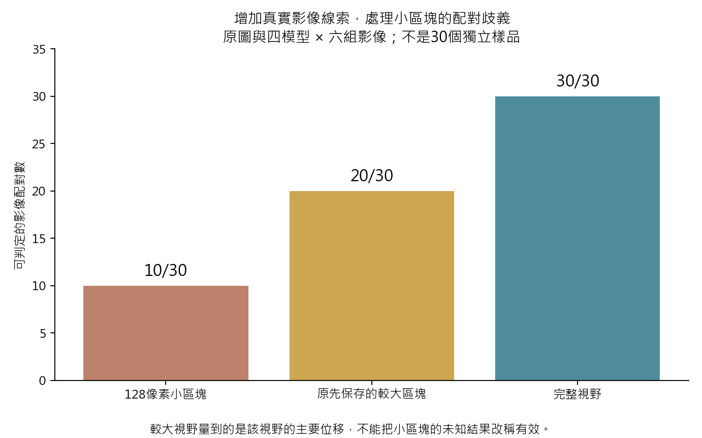
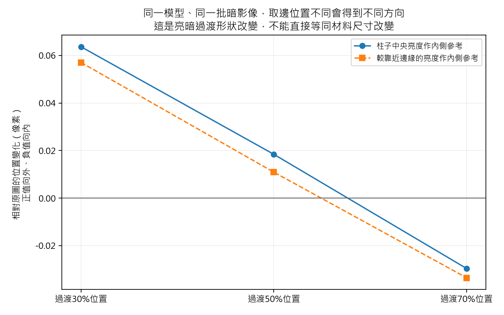

# R127 — 三項修正已實跑；量測跳值已釐清，物理尺寸仍需獨立對照

2026-09-08。**已完成現有資料上可驗證的修正：重建SEM比較方式、修正位移讀法、加入有明確條件的原樣保留規則。** 本輪使用既有照片與凍結的R126模型，沒有新拍攝或重新訓練，也沒有採用新模型。

最重要的新結論是：**先前約37像素的跳值，不能再當作模型破壞全圖位移的證據。** 四個原模型在完整視野重算後，處理前後的主要位移估計很接近。另一方面，模型確實會改變亮暗過渡的形狀，這與材料實際尺寸是否更準仍是不同問題。

## 1. SEM對照：拆開尺度與取邊方式

舊程式在P-01到P-09配對區段宣告`mag=3.2507`，實際縮放卻固定使用`1/3.230`，沒有使用該變數。這能解釋舊結果如何重現，不能自動當成這批資料已完成尺度校準的證據。

我直接在九張原始SEM圖上量柱子中心間距，並在原始光學照片上獨立重算中心間距，完全不使用模型輸出來選比例：

| 項目 | 重算結果 |
|---|---:|
| 光學圖柱距中位數 | 134.4284原生像素 |
| SEM圖柱距中位數 | 431.0545原生像素 |
| SEM轉到光學像素的相對比例 | 0.3118594 |
| 相對舊固定比例的修正 | 約+0.7306% |

R121從縮圖後的中心估計得到約+0.9233%；兩種估計都指出舊比例偏小，但方法間仍有差異，不能把其中一個小數值宣告成無誤的物理真值。SEM原圖均有2.5μm標示，影像的96DPI則是顯示資訊，未用來換算實際尺寸。

另外，舊兩套參考不只是改比例：它们還重新縮圖、重新取輪廓。扣除純尺度效應後，面積仍有約−0.625%到+0.546%的差異。因此，把兩套輪廓當成兩把同等可靠的物理尺，再要求模型同時勝出，會混入不同的問題。

**現在新增的比較保留SEM原始像素，先量尺寸相對同組柱距的比例，並同時列出SEM亮帶內側、中心和外側的定義差異。** 這個範圍是取邊方式的敏感性，不是統計信賴區間，也不是材料邊界的物理誤差範圍。兩套舊參考與舊結果全部保留。

在36柱、兩曝光、原圖及四模型的360筆共同資料中，至少保留703/720個共同有效方向。新的相對尺寸檢查仍不支持採用Q：暗曝光下，兩次Q模型都讓36/36柱的光學尺寸指標往較大的方向改變，在這次選定的SEM定義範圍內也沒有改善。這是固定定義下的尺寸指標結果，並非已認證的材料直徑誤差。

## 2. 位移讀法：先確認有足夠線索，再報數字

舊方法在很小的影像區塊尋找匹配位置，條紋、重複圖案和弱線索會讓它選到另一個位置。我改成不環繞影像邊界的比對，檢查亮度與有方向的邊緣是否同意、是否存在近似的另一個答案，並做前後反向核對。判斷不足時不輸出位移數字。

初版並沒有直接通過：曾出現約0.319像素的已知答案誤差，以及過多拒絕。這些失敗保留。修正了位置細算方式後，小區塊的誤差已低，但條紋區塊仍無法可靠辨認二維位移；後續增加同一對照片實際存在的周邊資訊，沒有放寬原來的誤差限制。

最後另外鎖定第三組新位移、雜訊與連續場景參數作驗證。**72/72個有答案案例通過，最大誤差約0.016像素；平坦、完全週期性及無關影像的反例全部拒絕。** 這是新的參數測試，既有實拍底圖仍是重用資料，不是新取得的獨立實拍確認。

回到既有實拍後，原圖與四模型乘上六組影像，得到：

| 可用影像範圍 | 可判定的配對 |
|---|---:|
| 原先128像素小區塊 | 10/30 |
| 原先保存的較大區塊，扣除運算邊緣 | 20/30 |
| 完整視野 | 30/30 |

數量包含相同照片經不同模型處理的重複比較，不是30個獨立樣品。較大視野量到的是該視野的主要平移；原先小區塊的未知結果仍保持未知。

為公平比較，我將四個凍結模型全部重算在六組原始影像的前兩幀，共48份完整視野輸出。**48個原先小區塊與R126保存值逐像素完全一致。** 四模型的24組完整視野位移估計均通過本輪一致性檢查，與同一讀法下的完整原圖最大差約**0.000511像素**。

這支持「這批影像的全圖主要位移在處理前後一致」，**不代表實際位移誤差是0.000511像素，也不能代替每個局部物體的量測或位移台的獨立位置讀數**。本輪只處理六組序列的前兩幀，未執行完整301幀評估。

這項較完整的檢查更新了R126跳值的解讀：舊數字是真實存在的舊讀法輸出，但不足以單獨否定模型的全圖位移保留能力。舊數字和拒絕個案沒有移除。

## 3. 原樣保留：把可保證的條件寫清楚

若已知成像沒有模糊、增益與偏移不改變數值，而且實際感測雜訊為零，原生解析度的輸入已是答案，不需要再經過神經修正。本輪加入依這些成像條件決定的原樣保留規則，不靠影像名稱或「看起來清楚」判斷。

- 六組既有無模糊、無雜訊控制，加上100個新任意輸入，全部逐像素保留。
- 有雜訊的直接觀測仍會修復：測試平均誤差2.396→1.992灰階。
- 有模糊但無感測雜訊的影像仍會修復：測試誤差3.632→3.245灰階。
- 所有非保留分支都與原R126模型輸出相同，權重完全未變。
- 六張既有實拍影像的拍攝條件未獲可靠確認，規則沒有把它們自動宣告為「已經正確」。

目前精確保留的保證只驗證於已知生成條件；真實儀器條件的准入尚未實作。這不是通用的乾淨影像辨識器。同一張照片可以是直接成像的正確答案，也可以是另一個物體模糊後的結果；我已用相同輸入、不同成像條件的例子確認這個資訊限制。

## 4. 剩下的模型問題，現在能說得更明確

同一批暗影像、同一個Q模型，沿亮暗過渡的不同位置量到：

| 取亮暗過渡的位置 | 相對原圖的平均徑向變化，36柱中位數 |
|---|---:|
| 30%位置 | 約+0.064像素，向外 |
| 50%位置 | 約+0.018像素，向外 |
| 70%位置 | 約−0.030像素，向內 |

這說明模型改變了過渡的形狀和寬度，不能把其中一個位置的改善直接當成材料尺寸改善。這組診斷是在看到新尺寸結果後追加，保留兩種內側亮度定義與全部三個過渡位置，沒有挑其中較有利的一種作選模標準。

**接下來模型真正需要的，是與實際量測目標一致的成像與邊界對照。** 本輪把計算錯配、尺度混用和條件下的原樣保留處理清楚；還沒有證明光學亮暗位置就是SEM材料邊界，也沒有新的獨立平台位置真值。因此仍不採用R126模型，也不因某一個分數變好就擴大訓練。

## 完整性與可用成果

已獨立核對有限範圍比對的計算、原生尺度、360筆尺寸資料、24組全視野差值及48份輸出；5,242個舊來源與成果保持不變。沒有重新訓練、改寫舊期待值、讀取舊確認影像或宣告新的未見確認成功。正式基準COMBO、過去論文模型V42及研究模型的角色保持分開。

- [可直接使用的影像配對操作說明](R127_USAGE.md)
- [各版失敗與修正記錄](R127_EXECUTION_NOTES.md)
- [下一批實測資料需求](R127_ACQUISITION_PLAN.md)
- [獨立修正核對](../results/repair_verification.json)
- [完整視野配對結果](../results/fullfield_motion/summary.csv)
- [原生尺寸比較](../results/native_size_comparison/measurements.csv)
