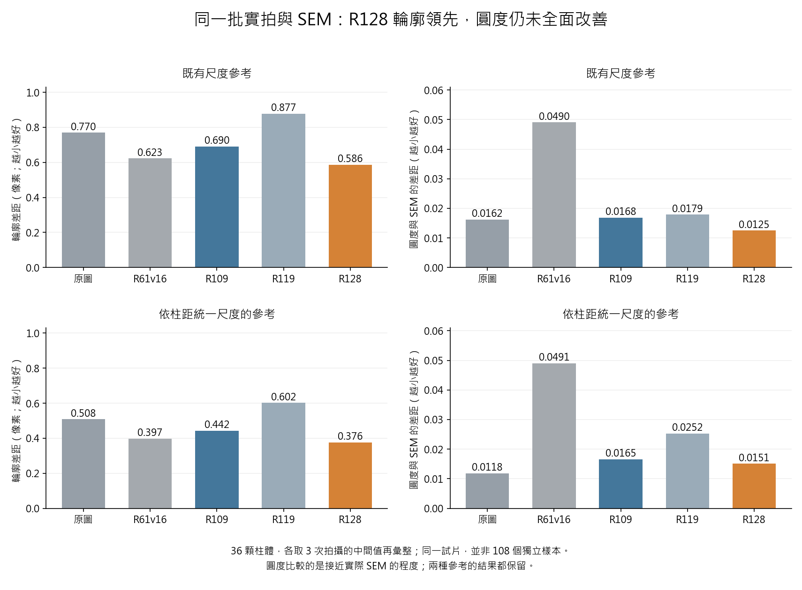

# R128 與近期模型：LSC、完整輪廓與圓度的同條件盤點

2026-09-10。結論：R128 是值得繼續驗證的單一候選。在目前正常拍攝的配對柱體上，它的整體外輪廓、面積、周長比所列舊候選更接近既有 SEM 參考；但圓度改善會隨參考輪廓改變，局部最差距離也未全面改善，而且尚無相同正式流程的 R128 LSC 成績。因此不能宣稱它已是全能量測冠軍。

正式專案基準仍是 COMBO；V42 是歷史論文結果模型，R61v16 是另一個歷史重建候選，兩者不能混為同一份權重。R109 E48 是有既有 LSC 成績的研究比較對手；R119 B E42 的因果審查修正仍優先於舊完成宣稱；R128 P_s1285002 step8192 仍是唯一保留的研究試用候選。此次不修改模型、訓練資料或舊預期雜湊。

## 比較怎麼做

使用同一試片的 36 顆配對柱體、正常拍攝照片 13/14/15。各方法都沿用既有完整外輪廓，使用同一個由原圖決定的平移，不各自重新對齊，也不為任何模型調整尺寸。原圖輪廓、SEM 輪廓及柱體對應在三個來源間完全相同。這是已有資料的回顧比較，不是新試片或未見確認集。

以下先對每顆柱體取三張照片的中間值，再對 36 顆柱體彙整。改善顆數也按這 36 顆計算；不能理解成每次拍攝都改善。所有照片逐項結果、每顆結果及不利結果均保留。兩種 SEM 尺度參考同時呈現，不選擇對模型較有利的一種。

R128 表示既有實際試用輸出，包含原本的影像外圍保留機制；中央 16 顆完全由模型重建的柱體另行比較，整體輪廓的優勢仍成立。

## 完整外輪廓與形狀

表內除了重疊程度，其他指標皆越小越好。圓度差距是與 SEM 柱體圓度之差，並非與完美圓的差距。

### 既有尺度參考

| 方法 | 輪廓差距（像素） | 面積差距（%） | 周長差距（%） | 圓度差距 | 重疊程度 |
| --- | --- | --- | --- | --- | --- |
| Raw | 0.7699 | 5.379 | 2.889 | 0.01619 | 0.94846 |
| R61v16 | 0.6227 | 4.263 | 4.999 | 0.04905 | 0.95651 |
| R109_E48 | 0.6903 | 4.838 | 2.947 | 0.01679 | 0.95310 |
| R119_E42 | 0.8774 | 6.077 | 3.887 | 0.01787 | 0.94246 |
| R128_P_s1285002 | 0.5858 | 3.977 | 1.779 | 0.01249 | 0.96001 |

相對原圖，R128 的輪廓差距降低 23.91%，面積差距降低 26.06%，周長差距降低 38.42%。相對 R109，輪廓差距降低 15.13%。這些百分比是上述整體中間值之比，不是每顆都進步同樣百分比。

| 比較對象 | 指標 | 改善顆數 | 退步顆數 | 持平顆數 |
| --- | --- | --- | --- | --- |
| Raw | mean_boundary_px | 36 | 0 | 0 |
| Raw | perimeter_error_pct | 32 | 4 | 0 |
| Raw | circularity_error | 21 | 15 | 0 |
| R109_E48 | mean_boundary_px | 33 | 3 | 0 |
| R109_E48 | perimeter_error_pct | 32 | 4 | 0 |
| R109_E48 | circularity_error | 25 | 11 | 0 |
| R61v16 | mean_boundary_px | 26 | 10 | 0 |
| R61v16 | perimeter_error_pct | 36 | 0 | 0 |
| R61v16 | circularity_error | 33 | 3 | 0 |

### 依柱距統一尺度的參考

| 方法 | 輪廓差距（像素） | 面積差距（%） | 周長差距（%） | 圓度差距 | 重疊程度 |
| --- | --- | --- | --- | --- | --- |
| Raw | 0.5082 | 3.502 | 2.121 | 0.01177 | 0.96461 |
| R61v16 | 0.3968 | 2.416 | 4.145 | 0.04906 | 0.97101 |
| R109_E48 | 0.4424 | 2.983 | 2.193 | 0.01654 | 0.96831 |
| R119_E42 | 0.6019 | 4.204 | 3.096 | 0.02522 | 0.95898 |
| R128_P_s1285002 | 0.3757 | 2.100 | 1.028 | 0.01506 | 0.97346 |

相對原圖，R128 的輪廓差距降低 26.07%，面積差距降低 40.04%，周長差距降低 51.56%。相對 R109，輪廓差距降低 15.08%。這些百分比是上述整體中間值之比，不是每顆都進步同樣百分比。

| 比較對象 | 指標 | 改善顆數 | 退步顆數 | 持平顆數 |
| --- | --- | --- | --- | --- |
| Raw | mean_boundary_px | 36 | 0 | 0 |
| Raw | perimeter_error_pct | 31 | 5 | 0 |
| Raw | circularity_error | 17 | 19 | 0 |
| R109_E48 | mean_boundary_px | 33 | 3 | 0 |
| R109_E48 | perimeter_error_pct | 32 | 4 | 0 |
| R109_E48 | circularity_error | 20 | 16 | 0 |
| R61v16 | mean_boundary_px | 25 | 11 | 0 |
| R61v16 | perimeter_error_pct | 36 | 0 | 0 |
| R61v16 | circularity_error | 31 | 5 | 0 |

R128 兩種參考下皆有 33/36 顆的外輪廓比 R109 更接近 SEM。相對 R61v16 則為 26/36 與 25/36 顆。不能把整體排名第一說成所有柱體、所有位置都勝出。

## 圓度與局部輪廓為何不能宣稱已過關

既有尺度下，R128 圓度差距的整體值從原圖 0.01619 降到 0.01249；但按柱距統一尺度後，從 0.01177 升到 0.01506，36 顆中 19 顆退步。中央 16 顆的相同問題也存在，不能歸因於外圍保留原圖。

兩個參考來自同一批 SEM；另一尺度的流程會重新縮放 SEM 照片並抽取輪廓。確認模型本身的圓度在兩個參考間完全相同，但每顆 SEM 參考圓度的絕對差異中間值約 0.01459，已與欲宣稱的模型改善量同級甚至更大。這支持「目前的圓度判斷對參考輪廓建立方式敏感」，不支持實物圓度已得到可靠改善。幾何上的等比例縮放不應改變圓度；此處含有影像重取樣、像素輪廓與輪廓抽取的影響，尚未完成物理參考資格確認。

整體貼合更好也不代表每段輪廓更好：依柱距統一尺度的所有觀察中，最差局部距離由原圖 2.236 像素增至 R128 的 2.828 像素；既有尺度下是 3.000 → 3.162 像素。這些不利值均保留。

## LSC：舊模型確實有進步，R128 尚未同規則測量

以下重新由原始逐對紀錄計算：四組真實 20×/50× 位移序列，每組同樣 30 對原圖事先選定的影格，總計 120 對。各模型沿用相同影格，並未重新挑對自己有利的影格。原始選法偏向原圖較穩定的 30 對，故也不是所有場景的無條件成績。

「位移波動」是先計算每組量到步距的波動，再平均四組；「柱體間不一致」是同一對影格中九顆柱體量出位移的分散程度。越小代表越穩，但不能等同於獨立位置真值證明的準確度。

| 方法 | 相同影格對數 | 位移波動（奈米） | 與設定步距差距（奈米） | 柱體間不一致（奈米） | 橫向偏移（奈米） |
| --- | --- | --- | --- | --- | --- |
| Raw | 120 | 9.745 | 8.388 | 13.966 | 6.009 |
| Wiener | 120 | 7.392 | 6.387 | 6.041 | 4.141 |
| V42 E120 | 120 | 6.923 | 6.253 | 4.663 | 4.947 |
| R109 E48 | 120 | 7.003 | 6.347 | 4.398 | 5.312 |
| R119_B_E42 | 120 | 7.261 | 6.655 | 5.013 | 4.227 |

R109 的位移波動相對原圖約減少 28%，柱體間不一致約減少 69%；R119 的位移波動約減少 25%。R119 在四組中的三組波動略低於 R109，但在 20×、1 微米那组較差，整體未勝過 R109。傳統 Wiener 處理已有 7.392 奈米的位移波動，R109 相對它的整體改善約 5.3%，所以它也必須留在後續比較中。

V42 的表內數字保留以維持歷史完整性，但先前已查明其訓練資料含這批評估影像的衍生資料與 SEM 半徑答案；這些是同來源適應成績，不能當未見資料的公平冠軍證據。此處不推斷動機，也不將該特定重疊稽核擴大套到其他權重。

R128 目前沒有這套 LSC 的結果。前次約 0.01319 像素是原圖與重建之間，另一套整幅影像位移讀法的變動；不能換算後塞入本表，更不能當作 LSC 提升成績。

## 下一個有意義的判斷

保留現在這一個 R128，先讓它走與原圖、Wiener、R109 相同的 120 對影格、同樣柱體、同樣 LSC 計算，逐組檢查位移波動、柱體間一致性、橫向偏移和最差案例。此項本次未啟動，不能寫成已完成。無需為此再訓練四個模型。

若 R128 的 LSC 能接近或超過 R109，且不以不合理改形狀換穩定，它才具備「輪廓更好、量測也更好」的直接支持。圓度則先確定同一實物邊界及參考建立方式的穩定性，再決定是否需要針對模型改善；不能直接把柱體強行修圓。最終仍是一個模型。

## 這次核對的範圍與重現資料

獨立逐筆重算全部 1,080 筆輪廓比較，距離與面積等數值和原流程相符；432 筆原圖與 R128 既有結果重現。圓度採用同一版本的既有輪廓量測函式，另核对與 SEM 圓度相減的定義。舊 LSC 的 25 列摘要皆由逐對紀錄重現，未重新運行舊模型、訓練或讀取舊封閉確認影像。這是計算與比較資格核對，不是新的訓練因果審核或物理準確度資格確認。

- [比較規則與來源](../results/competitive_review/plan.json)
- [完整核對記錄](../results/competitive_review/verification.json)
- [逐顆、跨三張照片的結果](../results/competitive_review/per_pillar.csv)
- [逐張照片彙整](../results/competitive_review/per_exposure.csv)
- [每顆勝負比較](../results/competitive_review/paired_comparisons.csv)
- [LSC 重新彙整的結果](../results/competitive_review/LSC_recomputed.csv)
- [先前完整輪廓疊圖與限制](R128_FULL_CONTOUR_SEM.md)
