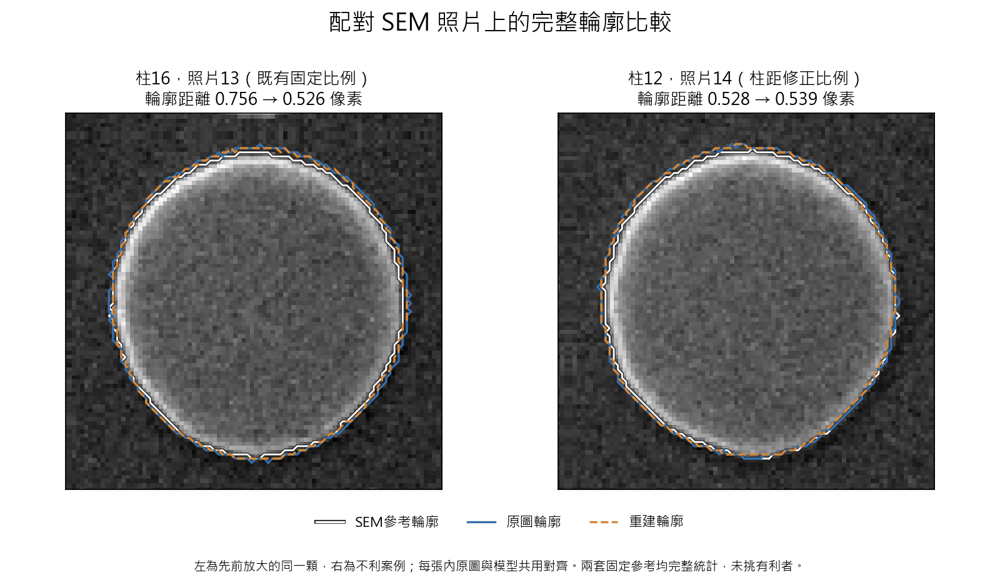

# 完整Contour是否真的更貼近SEM

2026-09-10。**本次補做完整輪廓後，可以確認：在這批一般亮度附近的pillar實拍照片上，重建後的整體外輪廓，確實比原圖更貼近目前逐顆配對的SEM參考。** 這不等於每個局部凹凸或所有精細形狀指標都變好。

先前「36／36改善」來自尺寸比例讀值，不能直接拿來證明整條Contour。這次另外把原圖、重建圖的整圈輪廓提取出來，再與同一顆柱體的SEM輪廓比較。

## 這次怎麼比

只使用目前唯一保留的模型，以及已指定的一般亮度照片13、14、15，每張都保留36顆。

原圖與模型使用同樣的輪廓提取方式。對齊位置只由原圖決定，兩者共用；沒有替重建結果單獨移動、旋轉或縮放來改善分數。既有SEM輪廓沒有重畫，兩套已固定的SEM尺度都完整報告。

也用事先固定的三組輪廓提取設定重做，另比較實際PNG輸出與較高數值精度的輸出。整體輪廓改善的方向仍一致，並非只在某一組參數或儲存格式下出現。

## 完整輪廓結果

下表先對每顆柱體計算整圈的平均雙向距離，再列36顆的中位數；越低代表越貼近該SEM參考。單位是光學影像像素。

| 固定SEM參考 | 照片 | 原圖輪廓距離 | 重建輪廓距離 | 改善顆數 |
|---|---:|---:|---:|---:|
| 既有固定比例 |13|0.776|0.596|36／36|
| 既有固定比例 |14|0.791|0.594|36／36|
| 既有固定比例 |15|0.772|0.573|36／36|
| 柱距修正比例 |13|0.514|0.363|36／36|
| 柱距修正比例 |14|0.513|0.382|35／36|
| 柱距修正比例 |15|0.508|0.365|36／36|

輪廓包圍區域與SEM的重疊程度也改善。以照片13的柱距修正參考為例，重疊比例的中位數從96.51%增加至97.41%。完全位於模型有效區域的中間16顆，在兩套參考、三張照片下全部改善，所以結果不只来自外圈保留原圖。

## 直接疊在对应的SEM照片上

白線是所用的SEM參考輪廓，藍線是原圖輪廓，橙虛線是重建輪廓。左邊是先前放大展示的同一顆pillar，右邊保留本次不利案例；每張內兩種光學輪廓共用對齊。

右側照片14的柱12，在柱距修正參考下，平均輪廓距離從0.528變成0.539像素，略為退步。這顆沒有被排除。

[查看照片13全部36顆的疊圖](figures/full_contour_all36.png)

## 還不能宣稱什麼

整體外框改善，不代表每段細節都改善。周長誤差多數降低，但每張仍有部分物件退步；圓度等細部形狀指標沒有一致改善，局部較大偏差也有個別退步。

例如照片13在柱距修正參考下，36顆之中最差的單點輪廓距離，原圖約2.24像素、重建約2.83像素。因此「平均更貼近」不能寫成「最差局部也全部改善」。本次是完整外輪廓的比較，沒有用它證明內部紋理或孔洞都正確。

兩套SEM參考是既有的固定對照定義，不是新完成的絕對尺度或材料邊界認證。圖上的SEM背景依既有對應流程整理到光學尺度，不是把原始SEM像素尺寸直接拿來比較。SEM亮邊如何對應光學材料邊界，仍保留原有限制。

三張照片是同一批36顆的重複觀察，来自一個樣品；不能當108個獨立樣品，也不是新的未看過確認集。

因此，對「這類一般亮度pillar的整體外輪廓有沒有實際效益」，答案是有。對「任何局部尺寸、尖角或其他樣品是否都已更準」，目前不能如此保證。這項補測加強了單一模型在pillar用途上的支持，不會把先前的清楚角落風險改寫掉。

## 如何核對，原紀錄有沒有改

- MATLAB完整輪廓提取共產生1,944筆對照，全部有效；沒有刪除失敗顆數。
- 原圖主要設定的108份輪廓，與原有歷史輪廓逐像素完全相同。
- 兩套SEM遮罩與原本固定檔案完全相同。
- 另以Python重新計算平均輪廓距離、較大偏差、重疊比例與面積誤差，與MATLAB表格吻合；差異小於0.000001，來自數值精度與表格輸出格式。
- 沒有輪廓碰到允許區域外圈，未靠裁掉邊界來取得改善。
- 新模型、原始照片、舊SEM參考與舊結果均未修改，沒有重新訓練。

本次第一個準備程序誤以為新引用的MATLAB輔助程式已在舊保護清單中，因此在計算前停止。兩個歷史SEM參考的原雜湊都吻合，沒有更換舊預期值。之後將新引用程式另行固定，並保留原圖輪廓逐像素重現作為獨立核對。初次準備失敗與日誌都保留。

可重現來源位於analysis/full_contour，完整資料位於results/full_contour，主要包括plan.json、measurements.csv、masks.mat、independent_metrics.csv、summary.json、verification.json與context_summary.json。
