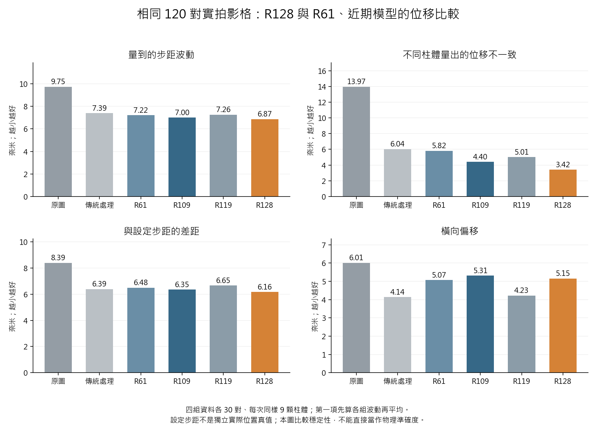
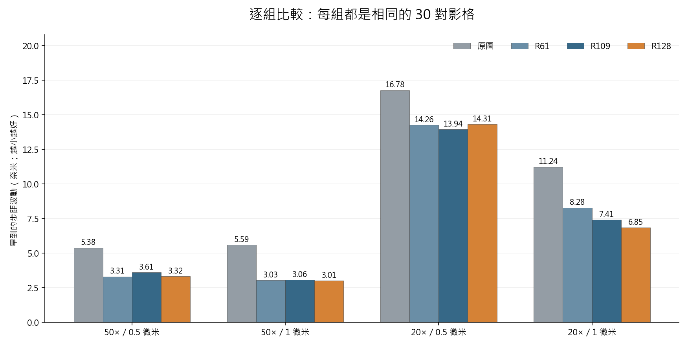
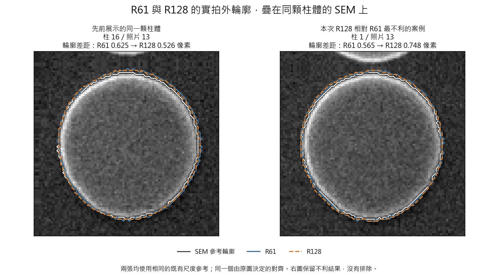

# R128 與 R61、近期模型：完整同條件位移比較

完整同條件比較已完成。R128 相對 R61 的整體位移波動由 7.220 降至 6.873 奈米，改善約 4.8%；不同柱體量出位移的不一致由 5.823 降至 3.416 奈米，改善約 41%。結合較好的配對 SEM 輪廓、周長與圓度表現，R128 是更值得保留的單一綜合研究候選，但橫向偏移、個別影格及圓度相對原圖仍有退步或不確定性，沒有正式精密量測升級。

- 在完整 120 對主比較中，R128 的整體步距波動、與設定步距的平均差距、柱體間不一致，均低於所列 Raw、Wiener、R61、R109、R119。相對 R109，步距波動僅改善約 1.85%，柱體間不一致改善約 22.34%；不能將小幅步距差異描述成全面大勝。
- 對 R61 最清楚的進步是柱體間一致性：120 對中 106 對較好、14 對較差。相對 R109 則為 98 對較好、22 對較差。這些是重複影格的描述，並非獨立樣本的顯著性宣稱。
- 與 R61 比，50×、0.5 微米及 20×、0.5 微米的步距波動略高；50×、1 微米略低；主要改善來自 20×、1 微米的 8.277 → 6.848 奈米。整體橫向偏移中間值 5.071 → 5.153 奈米，退步約 1.6%；最大橫向偏移 55.023 → 59.392 奈米，也必須保留。
- 與設定步距的平均差距相對 R61 約改善 4.96%，但逐對比較是 57 對改善、63 對退步；不能宣稱多數照片在這一項都勝出。最不利的是 20×、1 微米影格 34→35：與設定值的差距從 R61 的 2.845 奈米增至 R128 的 17.375 奈米。這一對已用正式試用入口重新推理，輸出逐像素相同，LSC 也重現。它位於完全使用模型的範圍，不能歸因於邊緣保留原圖。
- 上述最不利案例中，R128 的九顆柱體反而量得較一致，且其他方法也量到不同於命令的位移。這說明『接近設定步距』和『接近真正位移』不能直接畫等號；沒有獨立實際位置記錄，無法在該個案判定哪個模型的絕對位置最準。

## 版本與比較範圍

正式專案基準仍是 COMBO。本次 R128 P_s1285002 step8192 是現有唯一研究試用候選；R61 是 2026-06-23 v16 的 best_tradeoff、既有 PSF-off 使用設定；R109 是 E48，R119 是 B E42。V42 E120 為歷史論文結果模型，與 R61 是不同權重。此次沒有新訓練或更換任何模型。

四組 20×/50× 真實位移序列，159 張不同影格構成原先固定的 120 對相鄰影格，每組 30 對、每次 9 顆相同柱體。沒有替模型重新挑影格；原先名單偏向原圖較穩定的影格，因此這不是所有拍攝條件的無條件成績。相鄰影格對會共用照片，不視為 120 次獨立實驗。

R128 新處理 150 張完整照片，另外 9 張使用同權重、來源一致且已核對的既有輸出。R61 使用 159 張既有重建，另以原本推理設定重新處理每組一張、共四張完整照片，皆逐像素重現當年結果。兩者都先處理整張照片，再使用相同位置取出相同柱體進行 LSC。

## 位移比較

全部越小越好。「步距波動」先計算各組 30 次步距的標準差，再平均四組；「柱體間不一致」是同一對照片中九顆柱體量出位移的分散程度，再彙整全部 120 對。設定步距是平台命令，並非另一台儀器記錄的實際位置真值。

| 方法 | 步距波動（奈米） | 與設定步距差距（奈米） | 柱體間不一致（奈米） | 橫向偏移（奈米） |
| --- | --- | --- | --- | --- |
| 原圖 | 9.745 | 8.388 | 13.966 | 6.009 |
| 傳統處理 | 7.392 | 6.387 | 6.041 | 4.141 |
| R61 | 7.220 | 6.485 | 5.823 | 5.071 |
| R109 | 7.003 | 6.347 | 4.398 | 5.312 |
| R119 | 7.261 | 6.655 | 5.013 | 4.227 |
| R128 | 6.873 | 6.163 | 3.416 | 5.153 |

V42 的歷史對應數字另保留：步距波動 6.923 奈米，柱體間不一致 4.663 奈米。先前已查明其訓練資料包含這批評估照片的衍生資料與 SEM 半徑答案，不能當作未見資料上的公平勝出證據。此處不推斷動機，也不把該特定重疊結論擴大套到其他權重。R119 的後續因果審查修正仍優先於舊完成與因果宣稱，這次只保留其可重現的量測成績。

## 直接與 R61 比

| 項目 | R61（奈米） | R128（奈米） | R128 改善（%；負值為退步） |
| --- | --- | --- | --- |
| 量到的步距波動 | 7.220 | 6.873 | 4.81 |
| 不同柱體量出的位移不一致 | 5.823 | 3.416 | 41.35 |
| 與設定步距的差距 | 6.485 | 6.163 | 4.96 |
| 橫向偏移 | 5.071 | 5.153 | -1.61 |

### 各組步距波動

| 拍攝／設定步距 | 原圖 | 傳統處理 | R61 | R109 | R119 | R128 |
| --- | --- | --- | --- | --- | --- | --- |
| 50×／0.5 微米 | 5.380 | 3.327 | 3.307 | 3.608 | 3.591 | 3.324 |
| 50×／1 微米 | 5.589 | 3.264 | 3.033 | 3.059 | 2.828 | 3.011 |
| 20×／0.5 微米 | 16.777 | 14.397 | 14.264 | 13.937 | 13.447 | 14.309 |
| 20×／1 微米 | 11.235 | 8.579 | 8.277 | 7.406 | 9.177 | 6.848 |

### 最差情況也保留

| 方法 | 95%位置的步距差距（奈米） | 最大步距差距（奈米） | 最大橫向偏移（奈米） |
| --- | --- | --- | --- |
| 原圖 | 22.955 | 36.069 | 43.240 |
| 傳統處理 | 22.754 | 38.729 | 46.182 |
| R61 | 21.181 | 32.309 | 55.023 |
| R109 | 21.413 | 31.927 | 53.811 |
| R119 | 21.519 | 28.805 | 45.378 |
| R128 | 19.216 | 31.962 | 59.392 |

逐對勝負是重複影格的描述，不是獨立樣本的顯著性檢定。所有逐對及逐柱結果都保存，最不利案例沒有剔除。

## 完整外輪廓、面積、周長與圓度

這部分使用先前已核對的同一 SEM 配對試片，36 顆柱體、三張正常拍攝照片；與上述位移序列不是同一批實物對應，因此不能把該 SEM 當成位移影像中柱體的同顆真值。每顆先取三張照片的中間表現，再彙整 36 顆；數字是與 SEM 的差距，越小越好。

| SEM 參考 | 項目 | 原圖 | R61 | R128 | 相對 R61 改善（%） |
| --- | --- | --- | --- | --- | --- |
| 既有尺度 | 輪廓差距（像素） | 0.76990 | 0.62273 | 0.58581 | 5.93 |
| 既有尺度 | 面積差距（%） | 5.37881 | 4.26284 | 3.97695 | 6.71 |
| 既有尺度 | 周長差距（%） | 2.88876 | 4.99905 | 1.77897 | 64.41 |
| 既有尺度 | 圓度差距 | 0.01619 | 0.04905 | 0.01249 | 74.53 |
| 依柱距統一尺度 | 輪廓差距（像素） | 0.50820 | 0.39684 | 0.37571 | 5.33 |
| 依柱距統一尺度 | 面積差距（%） | 3.50208 | 2.41566 | 2.09992 | 13.07 |
| 依柱距統一尺度 | 周長差距（%） | 2.12125 | 4.14518 | 1.02758 | 75.21 |
| 依柱距統一尺度 | 圓度差距 | 0.01177 | 0.04906 | 0.01506 | 69.31 |

R128 相對 R61 的輪廓差距整體減少約 5–6%，面積差距減少約 7–13%，周長差距減少約 64–75%，圓度差距減少約 69–75%。這不是每顆都改善同樣百分比；外輪廓較好的柱體在兩種參考下分別為 26/36 與 25/36 顆。

雖然圓度比 R61 更接近 SEM，但按柱距統一尺度後，R128 的圓度仍不如原圖；不同參考會改變它是否勝過原圖的判斷。完整輪廓平均貼合也不能保證所有局部邊緣都更準。

## 影像邊緣保留原圖的影響

R128 原本的試用設定會在整幅照片邊緣保留原圖並逐漸過渡到重建。這次先依原圖決定的量測範圍核對：50× 兩組所有量測範圍均完全使用模型；20×、0.5 微米有 180/306 個柱體影格範圍完全使用模型、27 個完全保留原圖；20×、1 微米則為 333/360 與 3 個，其餘包含過渡區。主成績完整保留這個实际使用設定。

另外只移除最後的邊緣原圖保留，使用同一次推理已保存的模型直接輸出重算，作為原因檢查；這不是另一個訓練模型，也沒有直接改成使用這個版本。

| 方法 | 步距波動（奈米） | 與設定步距差距（奈米） | 柱體間不一致（奈米） | 橫向偏移（奈米） |
| --- | --- | --- | --- | --- |
| R128_P_s1285002 | 6.873 | 6.163 | 3.416 | 5.153 |
| R128_no_FOV_guard_diagnostic | 6.809 | 6.086 | 3.248 | 5.153 |

取消最後的邊緣保留，整體步距波動僅從 6.873 降至 6.809 奈米，約差 0.9%；20×、0.5 微米改善，但 20×、1 微米反而稍差。這不是足以直接取消邊緣保護的證據。
完全使用模型的 95 對共同子集中，R128 步距波動為 6.159 奈米，R61 為 6.873，R109 為 5.698。R128 的柱體间一致性仍較好，但 R109 在此子集的步距波動較低。這個排名差異保留，不能只挑對 R128 有利的範圍。
對 1,278 個完全使用模型的柱體影格範圍，原有輸出與取消邊緣保留的圓心及半徑完全相同，確認此診斷的變動集中於邊緣範圍。

依原圖範圍決定、兩張照片的九顆柱體都完全使用模型的共同子集為 95 對（四組分別 30、30、9、26 對），所有對手使用同一子集，僅作補充診斷；不拿這個較小子集替代完整 120 對的主結果。

## 已完成的核對與下一步

原圖 159 張、1,431 顆次的圓心及 120 對位移全部重現歷史結果。Raw、R61、R128、R128 邊緣診斷共 5,724 個圓心，以保存的完整邊緣點另行擬合，並獨立重算逐對位移與彙整；所有 159 張 R128 輸出的來源、灰階匯出和原圖保留計算也逐張核對。四組 R61 代表圖重建完全重現。

所有原始模型、來源照片、舊預期雜湊和既有報告都保留；沒有重訓，也没有讀取或重新命名舊封閉確認集。

決斷：繼續保留既有 R128 P_s1285002 作為唯一綜合研究試用候選，不再因此重訓四個模型，也不為了改善分數直接取消邊緣保護。R61 保留為歷史比較，R109 保留為位移比較對手；這不是同時交付多個使用模型。
實際量測時優先把目標及所需周圍影像留在畫面中央，並持續保留原圖。下一個升級判斷應使用新實物／新次拍攝、独立實際位置記錄，以及穩定的同實物 SEM 邊緣定義。這些尚未由本次重複資料比較完成，不能用既有已使用資料宣稱新的封閉確認。
現有模型已具備可量化的輪廓與量測一致性優勢。剩下的重點是釐清少數局部偏移、橫向最差案例與圓度參考，而不是先更換架構或擴大訓練。

- [固定的照片、模型與比較方法](../results/lsc_comparison/plan.json)
- [逐項核對結果](../results/lsc_comparison/verification.json)
- [全部模型的逐對位移](../results/lsc_comparison/combined_pairs.csv)
- [各組與整體數字](../results/lsc_comparison/combined_summary.csv)
- [相對 R61 最不利的各對影格](../results/lsc_comparison/worst_pairs_vs_R61.csv)
- [原圖位置決定的邊緣範圍檢查](../results/lsc_comparison/source_boundary_context.csv)
- [完全使用模型範圍的共同子集](../results/lsc_comparison/fully_neural_subset_summary.csv)
- [此前的完整輪廓比較與限制](R128_COMPETITIVE_REVIEW.md)
