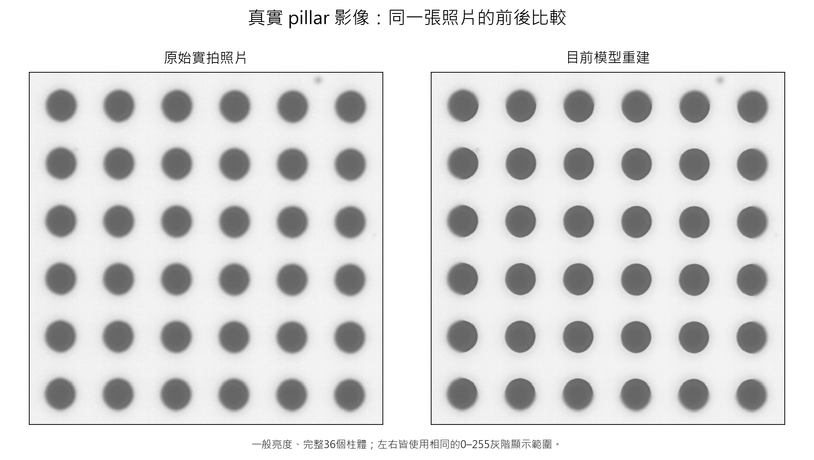
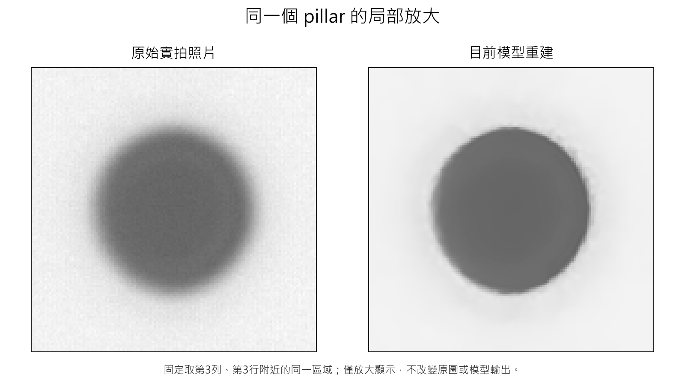
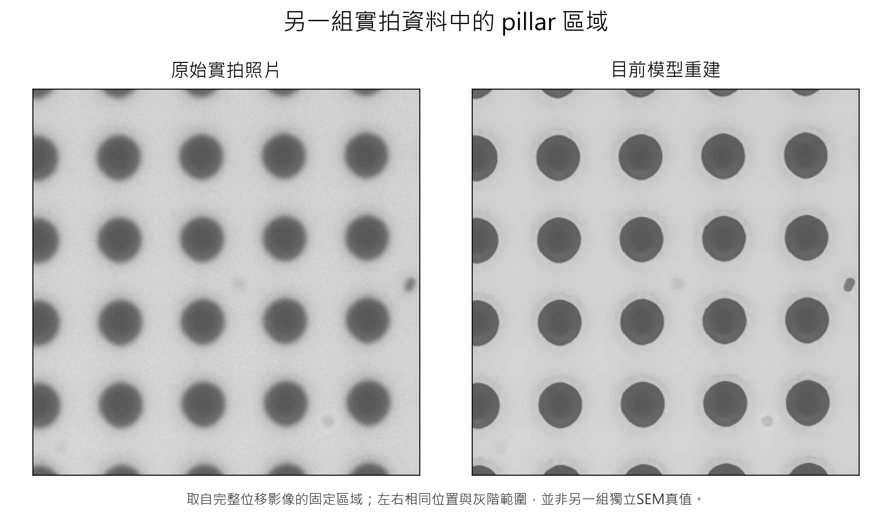

# 現有模型夠不夠用，以及真實pillar效果

目前已完成訓練，只有一個保留的試用版本。它已能處理正常拍攝的pillar照片，並有實拍改善證據；但還不是所有細部量測都已證明可靠的正式量測工具。

## 可以怎麼用

正常拍攝條件下的pillar影像修復、觀察和保留原圖的對照研究，已經可以開始試用。在已測的三張相近一般亮度照片中，同一批36個物件的尺寸比對都改善。這些是目前SEM取邊定義下的結果，不能外推成所有樣品的絕對精度保證。

若要完全相信每一個修復後的細線寬、尖角或局部尺寸，仍然不夠。先前的清楚控制影像显示模型可能修圓角落；那是已知答案控制測試的風險證據，不代表每張真實pillar都存在相同大小的誤差。

## 真實照片的完整前後比較

左側為原始光學拍攝，右側為目前唯一模型的輸出，來源與模型檔案均已核對。兩側使用相同灰階顯示範圍。

模型目前在照片外圍保留部分原圖，因為那裡缺少完整周邊資訊；因此外圈改善較少。這張全圖保留了這個限制，沒有只展示中間較明顯的部分。

## 同一位置的放大

可看到背景顆粒減少、模糊邊界變窄。畫面變清楚是實際可見的效果，但不能單憑外觀宣稱輪廓就是物體真正邊界。

## 另一組實拍資料

這張取自完整位移影像的固定pillar區域。它提供另一個實拍外觀例子，但不是另一組已逐顆配對的SEM真值。

目前不需要從頭換掉模型。後續工作集中在同一個版本的清楚內容保留、局部量測穩定性與實際使用範圍驗證。

[單一模型試用說明](../trial/README.md) · [結構檢查結果](R128_STRUCTURE_CHECK.md)

影像來源、固定放大位置、模型身分與產圖程式記錄於results/pillar_visual_review/manifest.json。主圖來自可與SEM逐顆對應的歷史光學照片，倍率未被額外推定；原始照片與既有模型輸出均保持不變。
