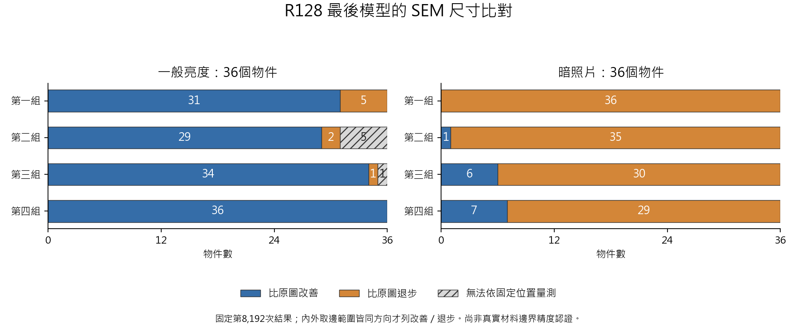
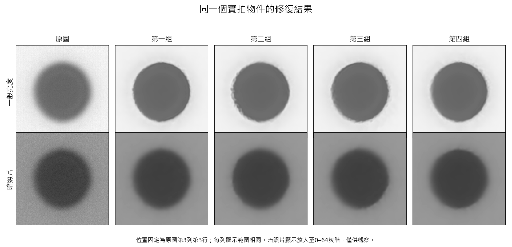

# R128 完整訓練結果與單一模型決定

四組訓練與預定檢查已於2026-09-09 21:55（台灣時間）全部跑完，實際更新、最後存檔、照片來源與檢查輸出也已逐項核對。

**本輪決定：只保留第四次訓練得到的版本作為後續修正主線；目前沒有一份可以宣稱已達成可靠的最終量測模型。** 最後應用仍只交付一個模型，選擇由助理負責。

## 訓練確實完成了什麼

每組完成8,192次不同步驟，合計32,768次。兩次中斷重算了224步，保留新舊紀錄且沒有重複計入進度；實際計算次數因此為32,992次。

四組讀到的練習照片、雜訊與順序相同，兩種教法的差別符合原定設定。768個場景的資料保持不變，5,403份歷史受保護檔案也保持不變。另從16遍練習中抽取64次，獨立重建實際讀到的照片，全部吻合。

所有中途檢查、最後128個生成測試場景，以及真實顯微影像與SEM檢查都有完整結果。這些既有真實影像仍是研究用的對照資料，不是新的未看過確認資料。

## 實拍結果與選擇

以下比較都使用各組事先固定的第8,192次結果，以及相同的物件、位置和量法。灰色區代表原本固定位置在修復後無法可靠讀值，沒有把它們刪掉。

第四個版本保留作後續修正，理由是：

- 一般亮度下，36／36個物件的尺寸比對都比原圖改善。
- 兩個曝光的72個物件都有讀值；第二與第三個版本分別有5個、1個無法依固定位置量測。
- 六組實拍位移檢查都保持與原圖一致，最大差約0.00586像素。這是影像一致性，還不是位移台真實精度。

**它尚未達標的地方同樣明確：暗照片仍有29／36個物件比原圖退步。** 其中完全位於模型有效範圍內的16個物件，在四個版本裡全部退步。因此不能把外圍保留原圖的效果，當成模型已解決暗照片量測。

這個選擇是後續工作的工程判斷，不是宣稱第二種教法普遍優於第一種，也不是選出一個已獲實際精度認證的最強模型。

## 照片看起來如何

下面是固定同一位置的實拍物件。一般亮度下輪廓變得較清楚，暗照片的雜訊變少；但是外觀上的變化不能取代尺寸比對。

生成測試場景中，第四個版本的平均影像誤差從原圖的4.294降到1.544灰階。這證明它學會了一部分修復能力，不能當成真實影像改善64%的證據。原本完全清楚的6個生成控制場景，也全部被模型改動；「已經正確的照片應保持正確」仍有缺口。

## 結果怎麼再次驗證

除了檢查檔案身分，還重新算了四個版本最後的全部288筆SEM尺寸比對，與原結果一致。第四個版本另重新處理整張暗曝光實拍圖，輸出逐像素完全相同；最大位移差的實拍影像對也重新計算並吻合。

完成驗證可支持「四組按計畫跑完」與本頁的比較結果；不足以支持「最終量測模型已經完成」。

## 下一個具體問題

後續只沿第四個版本處理暗照片的尺寸偏差與清楚影像保留。先分清楚亮暗變化、修復本身和量測定義各自造成多少偏移，再決定需要修正哪個部分。SEM亮邊與光學材料邊界的對應仍需要合適依據，不把某個SEM取邊值直接當成訓練答案。

本輪沒有自動增加訓練長度，也沒有替換正式基準。原失敗與兩次中斷紀錄均保留：

- [訓練與比較的完整核對依據](R128_FINAL_AUDIT.md)
- [原先進度讀寫中斷及修正](R128_RECOVERY_20260909.md)
- [第二次中斷與獨立啟動](R128_RUNTIME_CHECK_20260909.md)
- [模型、資料與原定訓練方法](R128_METHODOLOGY.md)
