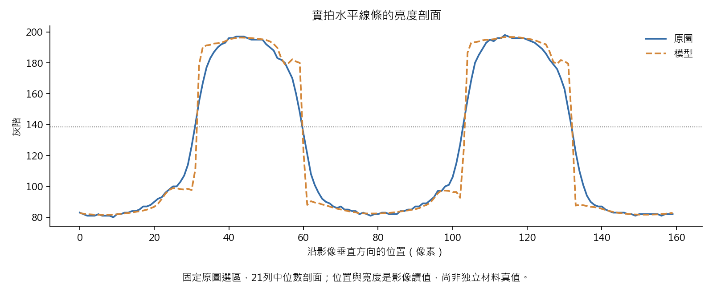
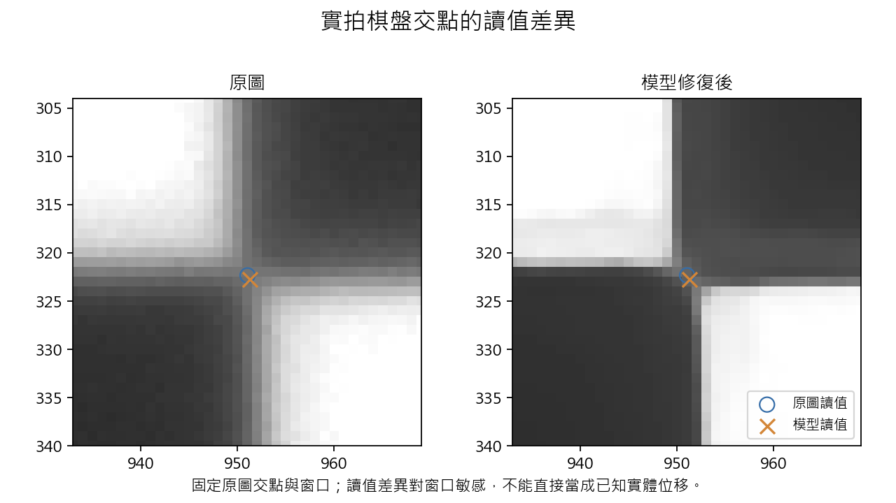
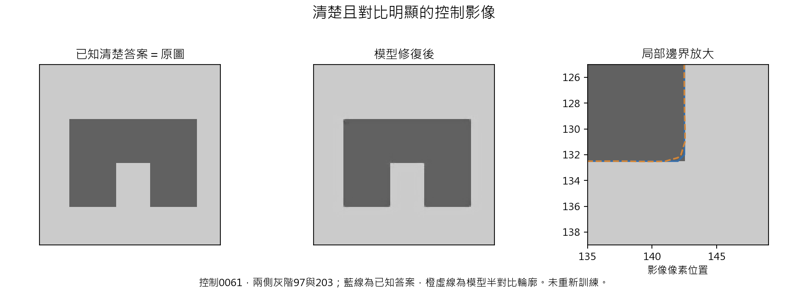

# 正常條件下的結構與位移檢查

2026-09-10。本次只使用唯一保留的第四個版本，完成27張實拍影像的檢查，其中12張沿用已核對的完整輸出、15張重新處理；另外檢查58個有清楚參考答案的生成場景。沒有重新訓練或改動模型。

**結論：全視野位移相當穩定，但局部細節還不能直接當作可靠的精密量測輸入。下一個優先修正項目是保護本來清楚的邊界與角落，而不是增加極暗曝光能力。**

## 位移：這次檢查保持穩定

六段實拍各取開頭與結尾的相鄰影像，共12組。全部通過原先的原圖相對一致性檢查；修復前後的最大讀值差約0.0132像素。

這支持這些影像的整體平移沒有被明顯破壞。它不是位移台真實位置的獨立認證，也不能替每一個局部角落背書。

## 線條與間隙：沒有確認消失，但讀值會變

先只看原圖固定12條直線與間隙剖面，再使用相同位置比較。中點讀法下，已配對邊界與原圖的最大差約0.51像素；部分線寬與間隙寬度也改變。這是影像讀值變化，沒有獨立線寬真值時，不能直接判成變好或變壞。

原先某些剖面出現「少一條邊界」的警示。補上原檢查框外的實際影像後，原本可見的邊界都能配對，差異來自邊界移到檢查框之外。在三個取邊位置、兩種亮度標準下的12筆數量警示，均完成這項核對；原警示數字保留，沒有改寫成原本就通過。

因此，這些剖面沒有提供內部線條或間隙消失的證據，但不能據此宣稱任何細線、間隙都完全保真。

## 角點：讀值對修復與取樣範圍敏感

實拍棋盤有12個已確認的交點。固定同一個取樣窗口時，讀值最大改變约0.47像素；換取樣窗口，結果會跟著改變。因此不能把這個數字直接當作物體真的移動了0.47像素，也不能假設現有角點量法已經穩定。

另外檢查了方格區內32個自動偵測的特徵點。原程式將這一類暫稱為方格角點，但實際可能含有小斑點；最大約2.24像素的差異就對應小斑點，不能宣稱方格角落真的被推走2.24像素。這32點保留作輔助診斷，真正棋盤交點的結論另列，不混在一起。

## 清楚影像：確實有不必要的改動

六個清楚控制場景的原圖就是已知正確答案，模型仍全部作了改動。這裡有確定的影像參考，與前述沒有獨立真值的實拍讀值不同。

| 控制影像的明暗差 | 平均邊界誤差（像素） | 局部最大誤差（像素） |
|---:|---:|---:|
|27灰階|0.0534|0.470|
|174灰階|0.0099|0.178|
|106灰階|0.0137|0.258|
|20灰階|0.0503|0.499|
|113灰階|0.0151|0.245|
|15灰階|0.0547|0.536|

即使是對比明顯的清楚影像，仍會出現小幅圓角或邊界變化；不能把問題全部歸因於極暗曝光。這些誤差能否接受，須和實際量測容許值一起判斷，本次沒有臨時編造一條應用通過標準。

模糊轉角與交會的26個場景，平均影像誤差與平均邊界距離改善，但其中11個的邊界距離變差。密集結構的26個場景，有25個可按同一輪廓規則比較，其中9個變差；另1個不能按固定中點讀出目標邊界。該例原圖也幾乎無法辨認目標輪廓，不能描述成模型刪掉了原本清楚的結構。

這表示目前的學習能讓整體影像更接近答案，同時仍可能犧牲局部幾何；平均分數改善不足以證明每個角落都正確。

## 已排除的誤判

- 密集結構的邊界按順序配對時，可能配到不同的邊，所以原先出現的數十像素差異不能當作物體位移。最後改用完整周邊資訊與真正的輪廓線段距離核對，原始數字保留。
- 初始輪廓點取樣近似會帶入沿輪廓方向的誤差；最後採用精確點到線段距離。把取樣間距減半後，清楚控制的平均誤差差異小於0.00001像素，最大誤差不變。
- 一個密集場景多出的連通區只有1像素，位於裁切邊界。加上真實周圍影像後，它連回框外原有的243像素結構，不能當作模型憑空產生一個新物體。
- 初次彙總未處理「沒有可讀輪廓」的情況而停止。保留那次程式與輸出，再將無法量測的案例明列，沒有把它丟掉或填成零。

## 現在的可用範圍與決定

目前可支持：在已檢查的正常明亮柱體照片上作修復研究試用，以及這些全視野影像的原圖相對位移一致性研究。

目前不能直接保證：細線寬、微小間隙、尖角與本來清楚的邊界都不失真。暫不把修復圖當成無須原圖對照的精密尺寸或角點量測依據。

只保留同一個候選與原有單一試用入口。下一步先針對清楚邊界／角落保留做有對照的修正，再重做這組檢查；不盲目加大模型、增加輪數或重新擴大曝光範圍。這些已用於診斷的控制案例保留作回歸檢查，不重新稱作未看過的確認資料。

## 可重現資料

所有新記錄在results/structure_check，分析程式在analysis/structure_check。主要記錄：

- plan.json、inference.json：原圖選區、影像範圍與固定模型。
- real_profiles.json、real_corners.csv、motion.json：完整實拍讀值，包含原始警示。
- controls.json、exact_contour_geometry.json：有已知答案的場景與最後採用的精確輪廓計算。
- profile_flag_resolution.json、flag_followup.json：裁切、配對與取樣窗口敏感性追查。
- verification.json：來源、輸出、數值與原紀錄保持不變的最後核對。

這是既有開發資料的檢查：27張實拍不等於27個獨立樣品，12組位移来自6段拍攝，棋盤12個交點来自3張照片。實拍沒有完整獨立材料真值，因此結果不會被寫成絕對物理精度。
