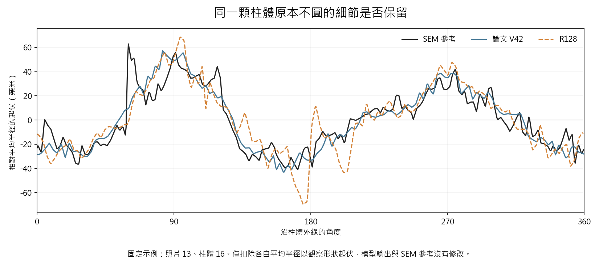
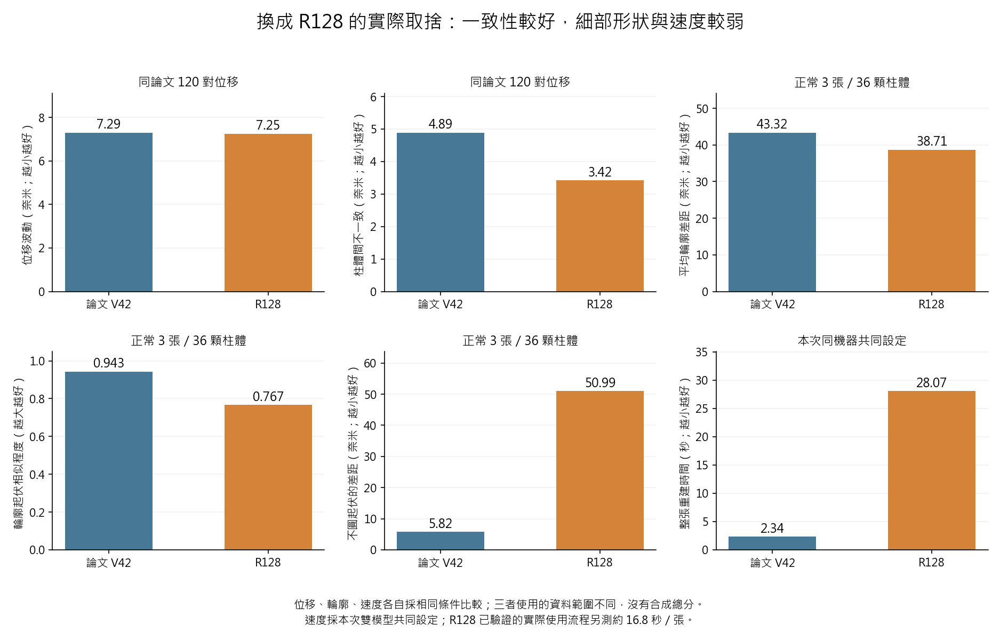

# R128取代v34論文主模型評估

**結論：R128 是更可追溯、也更值得繼續發展的研究候選，但目前不建議直接替換這份 v34 的主模型並沿用原有論述。** 依論文真正使用的資料與量法補測後，R128 改善柱體間量測一致性與平均輪廓位置；對原本不圓的細部形狀，卻較不接近既有 SEM 參考，計算成本也明顯增加。它是不同取捨的新模型，還不是舊模型所有主要優勢的完整接替者。

評估日期：2026-09-12。來源為使用者指定的「論文_v34_SEM與不利論述_完整標註版.docx」。已閱讀七章正文、表格與公式、111筆參考文獻條目、252則現存註解及附後索引，查看60個嵌入圖像，並核對關鍵方法與結果頁面的顯示。原稿以共享唯讀方式取得固定副本，沒有修改原稿。

本次另做了三项有直接判斷價值的補測：按v34真正的120對位移補齊R128影像；以論文最大梯度輪廓與參考圓量法補比正常拍攝照片；在同一機器重測V42與R128速度。沒有新訓練，也沒有更換任何已選模型或改寫舊結果。

## 我對這篇論文的理解

這篇論文不是一般影像變清楚的研究。它把影像重建放在量測流程中：先描述與校正光學模糊，再用單張同尺寸模型重建，接著以固定的完整輪廓與圓心求出尺寸、形狀和相鄰照片的位移。真正想證明的是「重建可以讓幾何量測更一致，而且不任意改變實物形狀」。

目前v34的主模型是V42第120週期，不是R61。整篇最重要的證據有五組：配對SEM的完整形狀；LSC與MZC的用途選擇；固定實拍位移；抗混疊上取樣的兩次配對訓練對照；八種模型的量測與速度。題名雖含關鍵尺寸，正文已將尺寸放在輔助位置，主要故事是完整輪廓、位移穩定與運算成本的平衡。

這也解釋為什麼不能只用「比R61好」決定替換：R61並非本文主模型，本文的輪廓量法也比先前的粗輪廓比較多了一層定位。

## R128是否也具備論文所說的特色

| 項目 | R128的實際狀態 | 對論文的影響 |
| --- | --- | --- |
| 單張輸入與同尺寸輸出 | 有 | 研究用途與共同座標可以保留 |
| 以原圖為起點並限制修正 | 有，但改為四次共享的受限更新 | 不能沿用舊版固定35%高頻注入的公式與圖 |
| 位移一致性訓練 | 有，由合成物理影像配對及參考誤差約束建立 | 可保留目標，需重寫實际訓練方法 |
| 光學成像資訊 | 用於資料生成及訓練約束；使用時只讀影像 | 不能寫成實測多組PSF在R128內直接融合 |
| 原版抗混疊上取樣 | 不是同一模組；R128使用另一種多尺度表示與取樣 | 舊版消融不能當作R128的因果證明 |
| 原版影像品質調節 | 沒有原文那個明確的品質分數與縮放公式 | 原第4.4.5節不能直接沿用 |
| 每一步完整物理解釋 | 未建立這種保證，修正仍由學習取得 | 可主張資料與過程可追查，不可說每一處修正皆已物理辨識 |

因此，R128確實延續量測導向的理念，但不是保留原文所有部件、再加強訓練的同款模型。把兩者都稱為MOSR可以表示研究系列，不能因此把架構、公式、光學模組與實驗證據混成同一版本。

## 先前比較為何不能直接搬進v34

第一，兩份都寫120對位移，但只有87對相同，33對不同。v34實際涉及166張不同影格，先前研究庫的R128比較是159張。本次補做22張新R128推理，另外144張由來源相同、權重相同且已核對的完整影像重用，才覆蓋論文真正的166張。

第二，v34的輪廓主结果採最大梯度定位後的亞像素點，計算720角度的徑向形狀、輪廓相關、LSC直徑及MZC圓度差距。先前R128的完整輪廓比較主要是粗ACM輪廓，圓度則是面積與周長形成的數字。兩者不是同一量測，百分比不可互換。

第三，v34的主SEM表彙整12張曝光照片；目前使用者的應用重點是正常拍攝，所以本次直接補比固定的13、14、15三張。以下SEM數字只屬這三張，不是假裝完成原表的全部12張。若論文改為正常拍攝主範圍，必須明確界定，並保留較暗照片的結果作使用界限。

第四，舊位移讀取程式的曲線平滑有隨處理順序交替的內部狀態，先前R128研究庫則每顆重設。本次按v34順序與起點重播，使Raw和V42共2988個圓心重現原論文；最大位置差約4.55×10⁻¹³像素。這讓下面的V42與R128比較可直接對照，並不混用兩版讀值。下一版應將這個狀態明確寫入可重現流程。

## 按論文相同條件補測後的位移結果

| 指標 | 論文V42 | R128 | 判讀 |
| --- | ---: | ---: | --- |
| 位移波動（奈米） | 7.292 | 7.250 | 幾乎相同，R128約低0.6% |
| 與設定步距的平均差距（奈米） | 5.743 | 5.767 | R128約高0.4%，不構成明顯勝負 |
| 不同柱體量出的位移不一致（奈米） | 4.886 | 3.416 | R128約改善30.1% |
| 橫向偏移中間值（奈米） | 6.551 | 6.764 | R128約增加3.2% |

R128最明確的位移優勢，正好對應論文原本較弱的跨pillar一致性。若以R128取代V42、與原七種外部架構组成八模型表，三項主排名會是第3、第1、第3；原V42是第3、第1、第7。若把兩者都保留為九模型比較，R128則為第3、第2、第3。這些是固定輸出在此資料上的數字排名，不是統計顯著或純架構勝出。

七種舊外部模型仍使用舊的訓練資料、目標與推理設定；R128則使用來源分離的合成訓練。這是有價值的實際方法比較，但不能寫成所有模型已接受完全相同訓練。尤其原本的正式影格出現在舊訓練封裝，資料重用限制仍須保留。

## 真實樣本不圓時哪些形狀更好

本次使用相同36顆柱體、相同正常三張照片與相同SEM參考，重播論文的真正輪廓量法。Raw與V42的216筆原結果重現，之後才接受R128的比較。以下先在每顆柱體內取三張的中間值，再彙整36顆。

| 方法 | 平均徑向輪廓差距 nm | 輪廓起伏相似程度 | 直徑差距 nm | 不圓起伏差距 nm |
| --- | --- | --- | --- | --- |
| Raw | 46.35 | 0.584 | 88.20 | 95.91 |
| 論文V42 | 43.32 | 0.943 | 86.30 | 5.82 |
| R128 | 38.71 | 0.767 | 76.65 | 50.99 |

相對V42，R128的平均徑向輪廓差距降低約10.7%，直徑差距降低約11.2%；但輪廓相關在36顆中全部較低，MZC圓度差距在33顆中較大。相對原圖，R128仍改善平均輪廓、相關、尺寸與多數圓度結果，因此不是無效模型；只是尚未保留V42在這批樣本上的細部形狀優勢。

**這裡的圓度不是要求樣本變成完美圓。** SEM實物本來就不圓，我們比較的是那種起伏是否被正確保留。這批SEM的起伏中間值約94奈米，V42約90奈米，R128約144奈米。問題不是R128不夠圓，而是按此量法，部分不圓起伏被估得太大、形狀也較不相似。

為釐清為何平均輪廓距離較好、細節卻較差，本次另外扣除各自平均半徑，只比較剩下的形狀起伏。其平均絕對差距中間值為Raw24.30奈米、V426.81奈米、R12816.12奈米。這項額外診斷支持：R128減少平均尺寸偏差的效果較好，但不代表非圓形細節同時更忠實。它不是用來替換原主指標的新分數。

V42的這些高分仍受已知資料重用限制，不能據此判定它在新樣本一定優於R128。反過來，R128訓練來源較乾淨，也不能當作它已重現v34所有形狀成果的證明。下一步應使用事先保留的新物件確認非圓形保留能力，不應把這批SEM加入訓練來追求已見資料的漂亮分數。

## 運算成本不能由參數量推斷

本次在同一RTX A6000，以同一2048×1536影像、相同切片及批次方式、相同明確的嚴格FP32設定重新比較兩模型；共同設定做2次暖機與8次整圖計時。這是新的雙模型配對測試，不直接拿新數字和原表未明示全部算術旗標的七個舊時間重新排名。

| 本次新測量 | V42 | R128 |
| --- | ---: | ---: |
| 參數總數 | 4,024,238 | 301,832 |
| 共同設定整圖中位時間 秒 | 2.34 | 28.07 |
| 共同設定峰值記憶體 MB | 947 | 2385 |

R128的參數約少92.5%，但共同設定下約慢12.0倍。它反覆在較大的內部影像表示上運算，少參數不等於少計算。另按R128原本已驗證的實際使用流程計時，中位時間約16.83秒／張，輸出與先前保存結果完全一致；此流程與共同設定不同，不能混成同一速度排名。

因此，原文的1.10秒、速度第4及比EDSR快5.23倍不能移植到R128。離線研究仍可能接受這種成本，但若保留「量測與效率兼具」為主要貢獻，就必須先優化並重新驗證速度與輸出一致性。原表列可訓練參數，本次表列總參數，約4.021M與4.024M的差異也應依定義說清楚。

## 哪些章節保留哪些必須改

| 範圍 | 處理 | 理由 |
| --- | --- | --- |
| 題名 摘要 第一章 | 重整主張 | 明確以可追溯的成像訓練與量測一致性為主，不沿用實測PSF直接融合及原效率排名 |
| 第二章 第三章 | 大部分保留並調整重点 | 光學成像、取樣、平移一致性與量測理論仍有用；U-Net與舊上取樣不再當R128主幹說明 |
| 4.2 4.3 5.1至5.3 6.1 | 保留有來源的系統與校正工作 | 相機、平台、SEM、尺度、100位置PSF與Wiener仍是有價值的系統研究；需說清楚它們與新模型的實際關係 |
| 4.4至4.6 5.4 | 必須重寫 | R128架構、資料、訓練目標、更新方式與選模皆不同；原公式和架構圖不能改名字沿用 |
| 4.7 6.2.3 | 保留共同量法並補新模型適用檢查 | 共用求解器驗證有用；不能把舊影像初始化與有效性測試自動算成R128已通過 |
| 6.2.4 SEM形狀 | 重做或限縮明確範圍 | 新正常三張已有直接結果，顯示細部形狀退步；12張總結尚未由本次重做 |
| 6.2.5 位移 | 可使用本次同v34名單的補測 | 不能搬先前不同名單的6.87奈米；也需統一Wiener及曲線平滑狀態的讀值版本 |
| 6.2.6 模組對照 | 改成R128真正的對照 | 舊上取樣消融屬V42家族；可利用已完成的R128兩種訓練目標及兩次起點，補以同論文量法評估 |
| 6.2.7 八模型 | 更新數字並保留訓練差異 | 本次替換表可得第3 第1 第3；仍是固定方法比較，不是等資料等預算的純架構試驗 |
| 6.2.8 效率 | 重新撰寫成本取捨 | 本次新測已顯示明顯變慢，原速度優勢不能保留 |
| 第七章 | 跟隨新證據重寫 | 主張可追溯訓練與量測一致性，保留細部形狀、時間與物理參考的限制 |

原先做過的光學實驗不需要丟掉。需要改變的是它在論文中的角色：已實測的系統特性與傳統校正仍可保留，但不能寫成已存在於R128内部的功能。如果後續確實將独立校正所得的PSF用於新訓練或推理，再以實作與新對照支持相應主張。

## 標註中最值得真正修正的地方

最關鍵的是資料來源的一致性：第4.5.4及4.6.3節寫物理來源隔離，第5.4.3節卻已正確揭露正式影格存在訓練裁切；這不只是措辭強弱，必須統一。也要區分「沒有直接回歸最終CD」與「完全沒使用SEM幾何」：兩句不同，原資料追查已確認幾何資訊曾進入舊訓練。換成R128可以根據實際新資料重新敘述，不能只刪舊模型的事實。

部分標註則是合理提醒、重複措辭或已被修改的句子。例如目前正文已把「不生成未記錄細節」改為較弱的「不傾向生成」，相關舊註解未必仍對應原句；方法的限制也不等於該方法無效。新版可把適用條件集中交代，正文正面說明實際方法和證據，讓論述有力而不反覆防禦。

## 我的決斷與下一步

**現在先不改原稿的主模型。保留R128作為下一版研究主線，但先處理非圓形細節保留與計算成本。** 本次已不只是缺少幾個測試，而是實際量到两項原論文強項變弱；因此我修正先前較樂觀的直接替換建議。

最有價值的下一步是：固定新物件與正常拍攝條件，檢查平均輪廓位置和細部起伏是否能同時保留；同時优化R128的計算方式，並確認优化前後得到相同影像與量測。如果這兩點改善成立，再把論文方法與結果整套換成R128。若不以速度和精細輪廓為主要貢獻，也可改寫成「來源可追溯的合成訓練與位移一致性研究」，但那是一篇主張重新整理的論文，不是原文全部優勢照搬。

R128的來源分離與可追溯性是真正優點；它目前仍是已測正常條件下可用的研究模型。這些優點值得繼續發展，同時也必須接受同條件測試揭露的不足。正式COMBO角色不變，原V42和既有結果保留歷史，不做默認升級。

## 可核對的證據

- [本次來源與讀取紀錄](../results/thesis_v34_review_20260912/source_capture.json)
- [兩份位移名單的差異](../results/thesis_v34_review_20260912/pair_population_comparison.csv)
- [同論文條件的V42與R128位移](../results/thesis_v34_review_20260912/v34_bridge/three_method_summary.csv)
- [替換後的八模型比較](../results/thesis_v34_review_20260912/v34_bridge/eight_model_replacement_comparison.csv)
- [正常三張的完整細輪廓結果](../results/thesis_v34_review_20260912/normal_sem_fine_v2/summary.csv)
- [每顆柱體的形狀勝負](../results/thesis_v34_review_20260912/normal_sem_fine_v2/paired_counts.csv)
- [新的雙模型速度測量](../results/thesis_v34_review_20260912/paired_runtime/results.json)
- [補測與獨立計算核對](../results/thesis_v34_review_20260912/bridge_verification.json)
- [既有訓練資料追查](../../R122_OperatorPrinciples/reports/R122_RESULTS.md)
