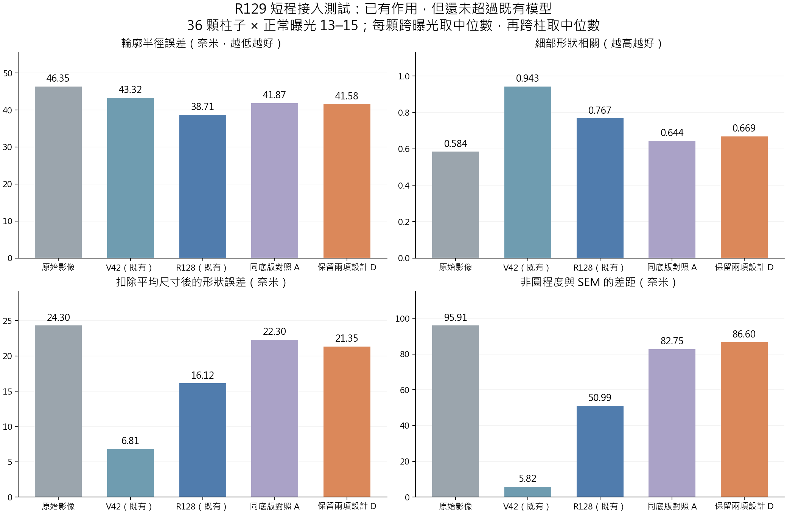
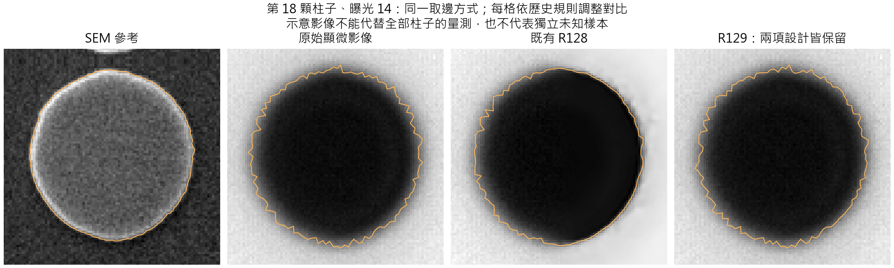

# R129：保留 V42 主要設計的接入測試

日期：2026-09-12。身分：完成短程接入與實測的研究原型；不是完整重訓後的正式替代模型。

已把實測光學融合、V42 式改善上取樣，以及參照原始影像的輸出限制接入新版本，保留兩項主要模組的 D 組為後續架構。四組只用來分辨作用，最終仍只部署一個模型。這次不因個別成績不佳而偷偷移除使用者要求的設計，也不把「存在於模型」寫成「已證明改善」或「已證明學術新穎性」。

實際結果：模組能運作、能訓練；相對同底版 A 組，D 組有 27/36 顆的細部形狀誤差降低，但並非全面改善。D 目前的真實 SEM 細節仍不及原 R128，更不及既有 V42。此次只有每組 24 次更新，不能用來否定完整訓練後的潛力，也不能據此替換論文主模型。原 R128 沒有顯示足以跳過這些論文設計的全面優勢；本輪也沒有建立 R128 或 R129 的新穎性證明。

## 實際加入了什麼

| 設計 | R129 的實際做法 | 與 V42 的關係及限制 |
|---|---|---|
| 實測光學資訊融合 | 使用 V42 保存的 25 個 101×101 核之平均，以及其中 4 個候選；在原生輸入上融合固定光學反推結果 | 僅取光學緩衝資料，沒有移植 V42 學到的神經權重。位置改為輸入端，並明確校正光學原點與直流增益，並非逐層照抄 |
| 依影像選擇光學候選 | 影像統計決定全圖四種混合權重，融合強度可學習且有正值下限 | 有實際計算及梯度，但候選核太相近，實拍中尚看不到選擇權重的額外價值；不是逐像素的空間光學校準 |
| 改善上取樣 | 雙線性放大、反射邊界的固定二項濾波、可學習卷積 | 固定相同卷積權重時，單一上取樣模組前向輸出與 V42 的 ShiftSafeUpsample 完全相同 |
| 原始影像參照與品質調整 | 只把受限的高頻修正加回原圖，修正平均亮度；影像统计限制修正強度 | 保留設計原則，品質統計經簡化，不是完整 V42 複製或已校準的信心值；所有四組共用，沒有獨立證明這一項的效益 |

新版本保留 R128 的共享四步重建主幹。為接入新上取樣方式，四组共用新的輸出頭，初值由 R128 四個輸出相位的權重平均取得。這個轉換不能保持原 R128 輸出不變；另外新增的原圖參照也會改變輸出。因此 **A 組不是原 R128**，D 對原 R128 的總差異不能全部歸因於兩項加入的模組。

原始 V42 E120 的 `state_dict` 內，`weak_psf_block.beta_scale=0`。按預設載入的這個權重，該自適應分支的有效輸出強度是零；不能僅憑程式存在就稱它在這份模型中提供了改善。這不等於證明所有歷史執行都沒有額外改寫該值。新模型把分支設為實際作用並記錄強度，沒有改動舊權重。

實际匯入資料為 25×101×101 與 4×101×101；不沿用論文中未由這份權重證實的核數／尺寸。核以強度質心定義光學原點，保留原始核形狀；反推正則值 0.0565 沿用既有 Wiener 校準，而非 V42 原層的 10/30。這是明確記錄的改寫，不是原 V42 光學層數值等價。

## 同條件試驗與完成範圍

| 組別 | 實測光學融合 | 改善上取樣 | 用途 |
|---|---|---|---|
| A | 關 | 關 | 同底版對照 |
| B | 開 | 關 | 分辨光學融合的作用 |
| C | 關 | 開 | 分辨改善上取樣的作用 |
| D | 開 | 開 | 保留兩項設計的主要原型 |

四組從完全相同的初始數值開始，依相同順序消耗 24 個既有 R128 合成訓練來源，每筆兩張影像、相同雜訊；各 24 次更新，共 96 次。種子 1295001、AdamW 1e-5、權重衰減 1e-5、梯度限幅 5、FP32、TF32 關閉、確定性運算。目標為原生影像誤差＋0.2 梯度誤差＋0.2 影像對殘差，不冒稱與舊 R128 完整訓練目標相同。開發資料固定 8 筆，未用實拍／SEM 影像答案訓練。

四組開發誤差皆小幅下降：A 3.28119→3.25343，B 3.27693→3.25005，C 3.31420→3.28455，D 3.30642→3.27756。這只證明可學習，沒有收斂或充分訓練的結論。新光學先驗不是每個合成場景的真實模糊，也沒有依 20×／50× 分別校準；這些資料適合接入與可訓練性測試，尚不足以稱為新模型的完整、儀器匹配訓練方案。

每組在第 0 與第 24 次更新各實測一次：

- 正常拍攝曝光 13、14、15 三張 821×821 完整配對光學影像，對照同一批 36 顆 SEM 柱子，共 864 筆細輪廓讀值，864/864 成功，無刪除失敗。
- 四種位移序列各取事先固定的一對影像，共八張原圖選定的九柱區域；各方法讀取相同區域。這是四對的短測，不能估計跨時間位移波動，不能替代論文 120 對完整視野測試。
- 神經計算使用完整輸入直接推論；距輸入邊界 80 像素內保留原圖，之後 16 像素過渡，各組相同。部分 20× 柱子靠近保留區，不可聲稱九柱都完全由模型處理。光學分支使用全圖運算，也不能把主幹的有限邊界範圍當成整體模型的分塊等價保證。

## 真實 SEM 結果

使用原本的粗輪廓加最陡邊緣讀法、每格 `im2uint8(mat2gray(cell))`、180 個 SEM 點／144 個光學點及 720 方向半徑。先對每顆取三張中位數，再跨 36 顆取中位數。下表單位為奈米，相關值除外。

| 模型／組別 | 輪廓半徑誤差 ↓ | 細部形狀相關 ↑ | 尺寸誤差 ↓ | 去除平均尺寸後的形狀誤差 ↓ | 非圓程度差距 ↓ |
|---|---:|---:|---:|---:|---:|
| 原始影像（既有同讀法） | 46.354 | 0.5843 | 88.204 | 24.303 | 95.909 |
| V42（既有同讀法） | 43.324 | 0.9428 | 86.295 | 6.810 | 5.816 |
| R128（既有同讀法） | 38.705 | 0.7674 | 76.647 | 16.119 | 50.990 |
| A：第 0 次 | 42.432 | 0.6327 | 80.201 | 22.515 | 82.939 |
| A：第 24 次 | 41.869 | 0.6436 | 80.607 | 22.304 | 82.747 |
| B：第 24 次 | 42.241 | 0.6458 | 81.782 | 21.679 | 79.946 |
| C：第 24 次 | 41.949 | 0.6362 | 81.228 | 21.979 | 85.932 |
| D：第 0 次 | 41.650 | 0.6485 | 79.774 | 21.368 | 82.208 |
| D：第 24 次 | 41.579 | 0.6689 | 80.679 | 21.352 | 86.605 |

「非圓程度差距」是對實際 SEM 形狀的 MZC 差距，不是要求樣本变成正圓。36 顆是同一個配對場景的柱子，三張曝光不是三個獨立場景，864 次讀值也不是 864 個獨立樣本。

第 24 次 D 對 A 的逐顆配對結果：形狀相關 28/36 改善，去尺寸形狀誤差 27/36 改善；但輪廓半徑只有 16/36 改善、20/36 變差，尺寸只有 15/36 改善、21/36 變差。配對形狀誤差改善中位數約 0.718nm。D 的整體非圓程度差距中位數較差（86.605 對 82.747），即使逐顆配對有 23/36 改善；這兩種統計不是同一件事，不能任選有利者。

單獨光學融合 B 對 A：25/36 顆去尺寸形狀改善；在有上取樣改善時 D 對 C 為 26/36。單獨上取樣 C 對 A：21/36；D 對 B 為 20/36。這是一個種子、短程訓練、既有場景上的小幅差異，沒有跨場景或統計顯著性的主張。

示意固定選第 18 顆、曝光 14，沒有按有利結果挑圖。金色為實际讀取的輪廓；各格依歷史規則調整對比，圖像已經過各自的 SEM／光學配對，不用此圖宣稱絕對位置對齊。

## 位移短測結果

下表是固定四對的平均值（奈米），不是時間波動的標準差。目標位移為名義設定值，沒有新增独立實際位置真值。

| 方法 | 與名義位移的差距 ↓ | 同圖九柱位移分散 ↓ | 橫向偏移 ↓ |
|---|---:|---:|---:|
| Raw | 10.682 | 14.340 | 8.604 |
| A 第24次 | 6.942 | 8.434 | 7.245 |
| B 第24次 | 7.044 | 8.452 | 7.410 |
| C 第24次 | 7.035 | 8.659 | 6.697 |
| D 第24次 | 6.746 | 8.828 | 6.933 |

D 相比 A 並非全勝；D 在 20×、0.5μm 這一對的名義誤差 15.168nm，反而高於 Raw 的 11.564nm。不能把四對平均改善寫成每種場景改善，也沒有在此表混入舊 V42／R128 的完整視野、不同對數成績。

## 機制檢查與完整性

在第 24 次 D 的實拍曝光 14，保持權重不變而關閉光學融合，輸出最大改變 0.005235、平均 0.00013194；只關閉上取樣濾波，最大 0.006994、平均 0.00011963（0–1 灰階）。兩項確實有作用。

但把學到的四種光學混合权重換成完全均分，這張圖最大只差 1.1921e-7、平均 3.5019e-9。四種候選本來非常相近，而且以質心對準；光學自適應分支目前幾乎等同固定平均融合。這個結果只能支持「光學資料接入」，不能支持「自適應選擇具有額外優勢」。融合強度 α=0.0999316、β=0.0199316；兩者與選擇器都有梯度，但梯度存在不代表可辨識或實用價值。

初版 GPU 確定性反向運算失敗，原始 `hybrid.py` 與計畫不覆寫。另立 `hybrid_v2.py` 修正邊界／上取樣的反向計算，保留原前向定義；CPU 雙精度導數差 8.88e-16、有限差分檢查通過，前向完全相同。後續 GPU 模組活動、常量保留、單點光學核恆等、V42 上取樣等價、梯度、保存／載入皆通過。分析初次因 Windows 預設文字編碼失敗，明定 UTF-8 後才成功，沒有更改判準。

交付前重新讀取實際權重與紀錄：四組初值逐項完全相同、96 次實際更新與優化器步數一致；24 個實际輸入全部由原資料重新建立並核對。864 筆 SEM 點用獨立的兩參數圓擬合重算四項量，最大差異 6.78e-6nm；MZC 仍使用歷史共用最佳化器，未宣稱獨立重寫。36 個方法×位移對的算術全部重算，最大差 7.85e-11nm。D 完整曝光 14 浮點輸出重跑完全一致，公開單圖入口的 PNG 也完全一致。51 個已記錄來源的雜湊核對一致；這是限定來源集合，並非掃描全專案每一個舊檔。

## 決斷與下一步

保留 D 作為架構原型，保留兩項主要設計。這輪沒有足夠成績把它升為論文或實用主模型，也沒有理由把 R128 當成已具明顯全面優勢而捨棄原論文設計。

下一階段先處理兩個已見到的問題：

1. **接入時沒有保住原 R128 的細節能力。** A 在尚未短訓練時就已比原 R128 差，表示新增共用輸出方式與權重轉換本身需要檢查；不能把全部退步都推給光學融合或上取樣，也不能只期待長訓練自然解決。後續應在保留兩項設計下，先分開檢查輸出參照與放大層轉換，使用合成來源做轉換適配並檢查實拍，再決定充分訓練方案。
2. **光學候選欠缺可辨識差異。** 應核對實際儀器與倍率的校準來源，驗證候選是否代表有意義且不同的成像條件；不可為讓自適應看似有效而捏造差異。若實際條件本就穩定，就如實保留固定光學融合價值，將自適應的作用列為未證實。

完整訓練仍需足夠資料覆蓋、合適初始化與訓練策略、多個起點的同條件比較、完整實拍位移及同物理邊界參考。新增模組或混合既有設計本身不自動構成學術新穎性；本輪沒有文獻新穎性審查。V42 的既有同來源成績也不是未知樣本優勢證明；此處沒有讀取舊 144 張封存確認集，更没有把它重新當作未知測試。舊 R119 因果更正仍優先於更早收據。

## 使用與證據入口

- 主要原型：`runs/D/step24.pth`，SHA256 `13d73d34f7aafc806bd2d56b7b1ac845d0b150d28fdc2fa9a07acc29cea838ee`。
- 單圖入口：`scripts/infer_image.py --input <8bit灰階影像> --output <新PNG路徑>`；至少 193×193、完整影像推論，預設 GPU，可指定 `--device cpu`。輸出旁附來源紀錄，不覆寫既有成果。這是試用原型，不是正式量測保證。
- 訓練：`runs/A..D/updates.jsonl`、`results/pilot_training.json`。固定設計：`config/plan.json`、另立的 `config/implementation_v2.json`。
- 真實輪廓全數：`results/sem/per_measurement.csv`、`per_pillar.csv`、`factor_contrasts.csv`；訓練前結果也完整保留。
- 位移全數：`results/motion_pairs.csv`；獨立重核：`results/verification.json`；光學來源：`data/PSF_PROVENANCE.json`。
- 舊比較來源：R128 的 `results/thesis_v34_review_20260912/normal_sem_fine_v2`，以唯讀方式引用。原論文、舊權重、舊結果與收據的預期雜湊未為此重設；僅新建研究原型與更新目前索引。

正式基準仍為 COMBO；V42 是既有論文結果模型，R128／R129 是研究線。本輪沒有正式模型升級或完整訓練完成宣告。

## 2026-09-12 架構整理補充

[完整架構與各部分作用清單](R129_ARCHITECTURE.md) 已完成。整理後使用同一份 D 權重，八份既有權重的輸出／梯度一致，11 張既有實拍輸出逐像素一致；可查看四次修正而不改變結果。没有新增訓練或功能，也没有改寫以上短程實測結論。R129 保留作後續架構主體，缺少的分支與未證實的作用均另列。

## 2026-09-12 獨立套件與長訓練

[套件與啟動實測](R129_STANDALONE_TRAINING.md) 已完成，使用者要求的一個8192次D延續訓練正在執行。資料、公開入口、搬動與實際暫停續訓已核對；未宣稱訓練完成或改善，以上短測結果保持原義。

## 2026-09-13 長訓練完成結果

[完整長訓練核對](R129_LONG_TRAINING_RESULTS.md)：8192次及所有指定驗證完成。36/36顆細形狀改善，但31/36顆尺寸誤差增加，位移有取捨。保留架構與研究結果，不採用最後模型；這是後續研究結果，不改寫前面的短程成績。

## 2026-09-13 完整連續影像LSC

[201張重建與完整LSC結果](R129_CONTINUOUS_LSC_RESULTS.md) 已完成。固定120對同舊模型比較；完整194對與3次重新定位另外保留。這項位移補測不代表上一輪尺寸退步已解決，未更換模型。
