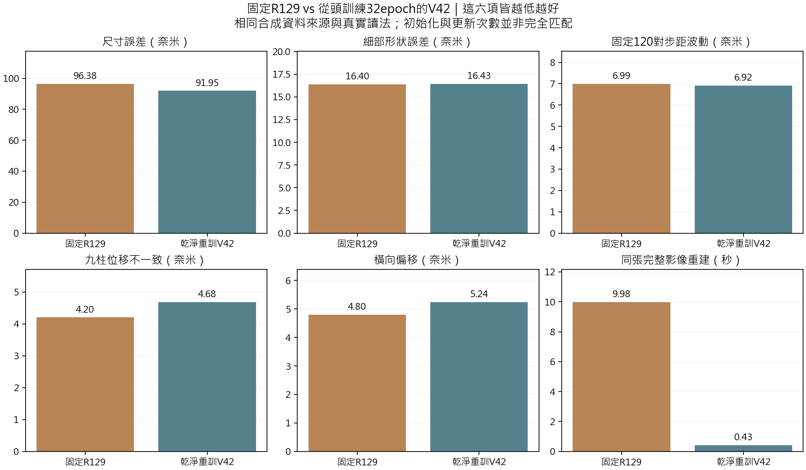
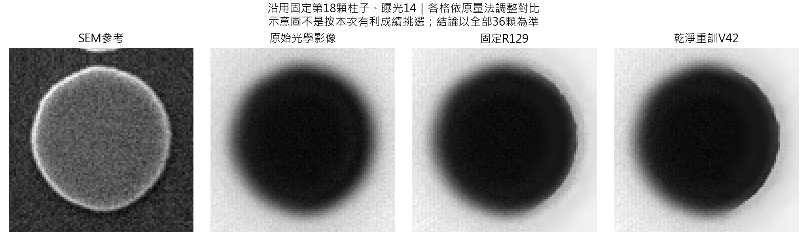

# R130：乾淨重訓 V42 與固定 R129 的真實影像比較

## 完成與主要結論

使用者要求的單一V42獨立訓練已完成：**32epoch、4096個有效更新、16384組來源影像對**。没有使用舊V41/V42/R129神經權重或教師，沒有將評估照片或SEM尺寸答案放進訓練目標。R129沒有重訓或改動，仍是既有第8192次模型。

比較正常拍攝的同36顆SEM柱子，以及全部201張連續光學影像。**乾淨V42與目前R129能力相近，互有取捨，舊V42很大的細節優勢沒有在這次重現。**這不等於R129全面勝過V42，也不等於差異全由答案重疊造成。

- 乾淨V42的尺寸誤差較小（91.95 vs96.38nm），輪廓半徑誤差較小，細形狀相關較高。
- 細部形狀誤差幾乎相同（16.425 vs16.397nm）；逐顆配對有25/36顆V42較好，不能只用兩個總體中位數的微小差距判輸贏。
- 固定120對步距波動也很接近（V42 6.919 vsR129 6.991nm）。R129的九柱一致性與橫向偏移摘要較好。
- 在同機、同張完整影像、相同精度的速度測試，V42約0.428s，R129約9.976s。這是實際部署計算的明顯成本差異，不是參數少就一定快。
- 兩者的尺寸誤差仍高於同讀法原圖88.204nm，未因此取得絕對量測資格。保留兩份研究結果，不自動替換模型。

## 固定終點的主要結果

距離單位為奈米，相关與時間另標；距離誤差及波動皆越低越好。SEM先逐顆取三曝光中位數，再跨36顆取中位數；LSC使用原固定120對，四序列步距標準差取平均，九柱／橫向為120對中位數。

| 指標                   |   固定R129 |   乾淨重訓V42 |
|:-----------------------|-----------:|--------------:|
| 輪廓半徑誤差           |    49.5231 |       46.3921 |
| 細形狀相關（越高越好） |     0.6919 |        0.7473 |
| 尺寸誤差               |    96.3803 |       91.9514 |
| 扣除平均尺寸的形狀誤差 |    16.3972 |       16.4255 |
| 非圓程度與SEM差距      |    62.6507 |       66.3513 |
| 固定120對步距波動      |     6.9911 |        6.9194 |
| 與名義步距差距         |     6.3025 |        6.1999 |
| 九柱位移不一致         |     4.2037 |        4.6821 |
| 橫向偏移               |     4.7983 |        5.2371 |
| 完整影像重建秒數       |     9.9757 |        0.4279 |

## 逐顆與完整連續影像

相對R129，V42的輪廓半徑與尺寸各29/36顆改善、細形狀相關27/36改善、扣除平均尺寸的形狀25/36改善、非圓程度差距24/36改善。雖然V42的非圓程度總體中位數較差（66.35 vs62.65nm），多數配對反而較好；總體中位數相減與配對差的中位數不是同一統計，兩者皆保留，不任挑有利摘要。

完整194對同拍攝段落的相鄰影格，步距波動為V42 29.3076nm、R129 29.0977nm；九柱不一致為4.7107 vs3.9710nm，橫向偏移為8.0584 vs7.9743nm。較大跳動仍存在，不能只看原圖篩選的120對。

全部201張构成197對相鄰影格，其中3次原始紀錄的重新定位另外保存。沒有按新V42或R129的結果刪除其他較差影格。各序列與逐對數據在results/continuous與results/audit；120對中的位移差距V42有65對較小、51對較大、4對相同，九柱不一致48對改善、72對退步。

## 舊V42分數為何另列

既有V42在相同正常SEM讀法下，細部形狀誤差約6.810nm、尺寸86.295nm、非圓程度差距5.816nm。這份舊模型有已證實的評估來源／尺寸答案重用，不能作公平的未知資料排名。

新V42的細形狀誤差16.425nm，與R129相近，沒有重現舊模型的巨大差距。這支持重新檢視先前以舊V42分數判定R129較差的做法。**但本次也改了起始方式、訓練資料組成、訓練要求與推論方式，因此不能把全部差距百分之百歸因於移除答案。**

## 這次怎樣訓練、哪些條件沒有完全匹配

保留原V42的48通道U形主幹、改善上取樣、方向感知受限邊界、原圖參照與品質調整；没有插入R129四次共享重建。全部神經參數從建構器重新初始化，只讀取舊模型的結構設定及固定光學資料。前向運算與原始V42建構器完全相同的初始化對照通過；GPU反向所需的反射與雙線性操作採等價的確定性計算。

訓練用R129同一批512合成來源，128開發／128合成測試，分組幾何來源不重疊。32epoch，每次4組來源／8張圖，AdamW最高3e-4後下降到1e-5；共同目標為影像＋0.2邊緣＋0.2配對殘差。16384組來源對接近R129沿革的8192R128＋24短測＋8192延續=16408，但批次、優化步數、歷史目標及R129先前選模仍不相同。這是依使用者快速要求的實用比較，不是完整匹配的架構因果實驗，也不是完整重演舊V42四組損失／教師流程。

兩者共用舊光學校準。其歷史獨立性沒有重新建立，不稱整個系統完全沒有SEM先驗。V42的弱光學分支由新建構器初始化為有效尺度0.35，而不是複製舊E120保存的0；它在新訓練中確實有梯度，最終beta約0.05643、有效beta約0.01975。這項新初始化設定差異也明確保留。

真實驗證不更新權重；以原生完整影像推論，V42僅按編碼器補足8倍尺寸再裁回，兩者使用相同80/16影像邊界保護。相同SEM／LSC讀法與影格名單固定。真實影像都是既有開發資料，不稱新未知驗證，也沒有取用舊144張封存確認集。

## 所有預定實拍時點

|   epoch |   radial_nm |   correlation |   diameter_error_nm |   MZC_error_nm |   centered_shape_nm |
|--------:|------------:|--------------:|--------------------:|---------------:|--------------------:|
|  0.0000 |     43.0381 |        0.5968 |             82.7358 |        94.0724 |             24.1791 |
|  8.0000 |     51.5544 |        0.6800 |            101.1090 |        71.7669 |             20.0180 |
| 16.0000 |     47.3054 |        0.7141 |             93.2297 |        63.1467 |             17.2713 |
| 24.0000 |     43.4795 |        0.7338 |             85.6588 |        61.1935 |             16.1216 |
| 32.0000 |     46.3921 |        0.7473 |             91.9514 |        66.3513 |             16.4255 |

第24epoch有些SEM摘要較好，但本輪事先指定32為主終點，沒有事後改挑24。完整32epoch訓練、每epoch開發檢查及最後合成測試都已完成。

## 完成與完整性核對

- 初始模型能由相同種子、純建構器逐項重現，沒有接續舊神經權重；最終模型及優化器步數4096。
- 每個epoch的512個來源全數使用，順序及雜訊種子與設定一致；64個更新批次／256組來源另外重新建立，與紀錄相同。
- 第12epoch後發生Windows進度檔鎖定，保存的1536步權重完整。保留失敗、舊進度与原凍結程式；另以程序內寫檔重試續跑，沒有重設舊來源雜湊或更改學習計算。實際讀鎖測試通過。
- 原1537、1538兩步從保存點重算，來源及loss完全相同；實際呼叫4098次，但有效訓練軌跡4096步，沒有把重算當作額外epoch。8次前置試跑更新另存並丟棄其權重，不混入正式模型。
- 五次SEM面板共540筆，最後108筆的四項量由保存的輪廓點獨立重算；201張／1809個LSC圓心以獨立圓擬合核對，最大差異4.557581e-06px。SEM非圓程度仍沿用原共用演算法，未宣稱獨立重寫。
- 最後SEM14用公開單圖入口重建，與保存影像逐像素相同。模型、資料與比較來源的原指紋通過；R129權重、程式與既有結果沒有修改。
- 速度在同張1536×2048圖、FP32／TF32off、1次暖身／3次重複下測量，不含讀寫檔；每次輸出一致。只是一個代表視野的同條件測試，不是跨硬體速度保證。

## 使用與後續判斷

新模型位於runs/v42_clean/checkpoints/step04096.pth；單圖入口是scripts/infer_image.py。完整201張重建及圓心／輪廓點位於results/continuous/images。主要摘要在results/comparison.csv，核對紀錄在results/audit/verified.json，設計詳見R130_DESIGN.md。

這一輪已足以說：**不能再拿舊V42受資料重疊影響的成績，直接判定R129架構明顯較差；乾淨重訓V42本身也可以做到可追溯。**接下來的選擇應依實際量測取捨與成本，而不是預設某架構必須勝出。單一種子與既有場景仍不足以作普遍結論；兩者都須繼續釐清尺寸偏差及物理參考，這次不自動採用或替換模型。
