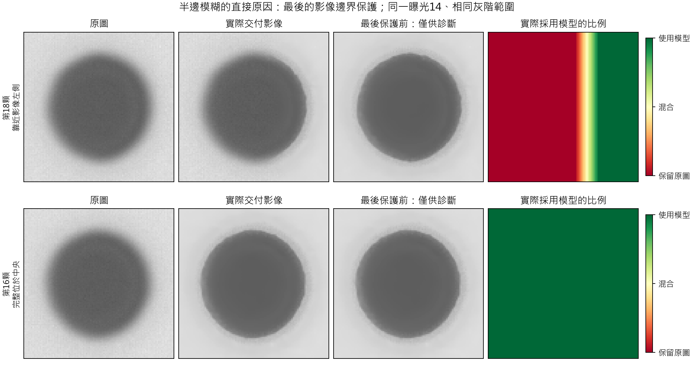
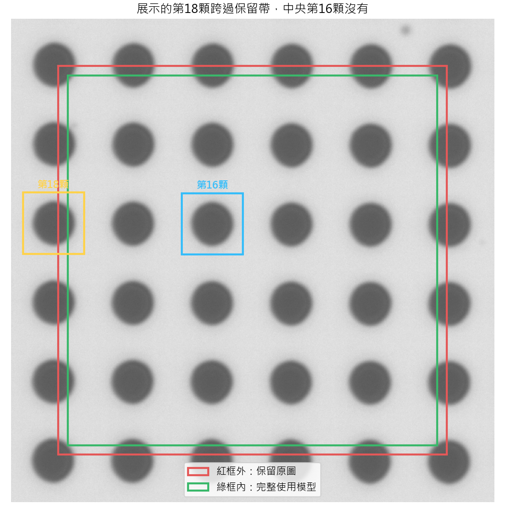

# R131：為何展示影像只有半邊變清楚

2026-09-14。針對使用者指出的「半邊重建、半邊模糊」，重新處理三張正常曝光，並檢查既有展示的第18顆與中央第16顆。原模型、原圖表、四次比較數字均保持不變。

## 已確認原因

第18顆位於完整821×821影像的左側，展示中心約為零起算座標(72,347)。展示裁切橫向涵蓋x=20至123，而最後的輸出規則是：距整張影像邊界80像素內保留原圖，其後16像素逐漸轉成模型結果，距邊界96像素起完整採用模型。

因此該104×104展示裁切的組成是：

| 區域 | 裁切面積比例 | 最後實際使用什麼 |
|---|---:|---|
| 左側保留區 | 58.65% | 完全原圖 |
| 中間過渡區 | 14.42% | 原圖與模型混合 |
| 右側有效區 | 26.92% | 完整模型結果 |

這些是**展示裁切面積**的比例，不是柱子面積或輪廓長度比例。三張曝光的空間比例完全相同。

模型實際已計算整張影像。在最後保護之前，第18顆保留區內原本有約3.28–3.37灰階的平均改動；套用保護後，該區與原圖逐像素完全相同。這直接證明眼前的左右差異來自最後輸出規則，不能歸因為網路漏算左半邊。

上排是先前一直展示的第18顆；下排是完全位於中央的第16顆。所有照片使用同一灰階顯示範圍。第三欄只是查原因的保護前結果，不是已驗證可取代原流程的新交付版本。

## 對前一輪解讀的影響

36顆裡，中央16顆的整個量測裁切完整使用模型；外圍20顆的裁切含有原圖保留區。先前四次比較一律使用同一規則，所以原結果仍是相同實際輸出流程的比較；但不能把36顆都說成完整由模型修復，也不應用未標示保留區的第18顆作為完整重建的直觀代表。先前展示欠缺這項清楚標示，容易造成誤解。

本次另將已保存的中央16顆結果分開整理，沒有重選模型、重算新輪廓或更換主評估人口：

| 次數 | 細形狀差距中位數nm | 尺寸差距中位數nm |
|---|---:|---:|
| 0 | 25.813 | 88.578 |
| 1 | 21.860 | 97.863 |
| 2 | 13.146 | 106.439 |
| 3 | 9.384 | 106.032 |
| 4 | 8.676 | 102.637 |

四次相對三次，這16顆的細形狀、尺寸及徑向輪廓差距都各有16/16顆改善。這個來源位置決定的補充分析支持第四次的收益確實存在於完整使用模型的物件；但不能把中央16顆數字取代原36顆主結果，更不能拿它與其他模型的36顆摘要直接排名。尺寸偏大的問題依然存在。

## 為何有這項保護，以及目前不能直接做的推論

這項規則原本用來防止影像邊緣缺少周邊內容而造成不可靠修復。它是輸出端的保護安排，不是用SEM答案决定哪裡可以修復，也不是每顆物件各自只修半邊。

不過，歷史上有設這項規則，不等於目前80像素的保留範圍已證明最適合R129。現在已改用全圖光學／影像狀態配合局部運算，是否仍需同樣大的保留帶，需要另外比較邊緣物件的真實輪廓與位移。單憑取消保護後看起來完整，不能宣稱量測也已可靠。

目前展示已補上保護範圍與完整中央例子；原設定未改。這份診斷解釋的是本次第18顆的半邊現象，不保證所有其他位置的方向性模糊都來自同一原因。

## 實際核對

- 曝光13、14、15重新計算，保護後浮點結果與原R131四次輸出完全相同，PNG也逐像素相同。
- 用另一份NumPy計算重建最後的混合比例與影像，結果完全相同。
- 保留區實际輸出與原圖最大差為0；保護前則存在非零模型改動。
- 第16顆整個裁切的採用比例為1，沒有半邊被混回原圖。
- 原模型數值、引用來源與原展示／摘要檔案前後未改。

來源：[直接驗證紀錄](../results/edge_diagnostic/verified.json)、[三曝光全部36顆採用範圍](../results/edge_diagnostic/all36_crop_coverage.csv)、[中央16顆的原結果分組](../results/edge_diagnostic/inner16_per_pillar.csv)、[可重跑的原因檢查](../scripts/diagnose_half_image.py)。
