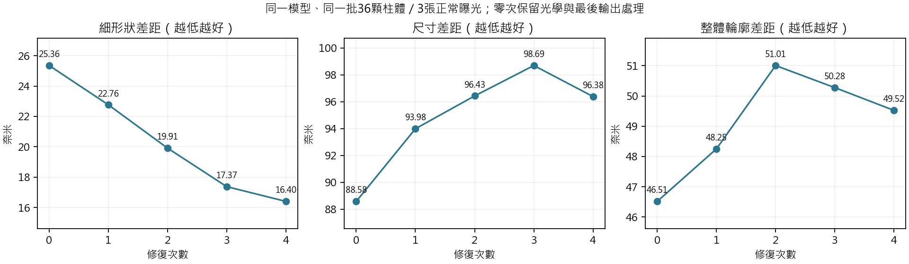
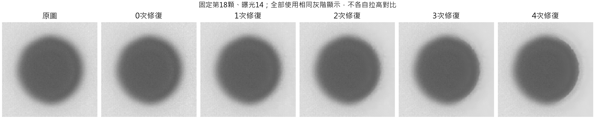
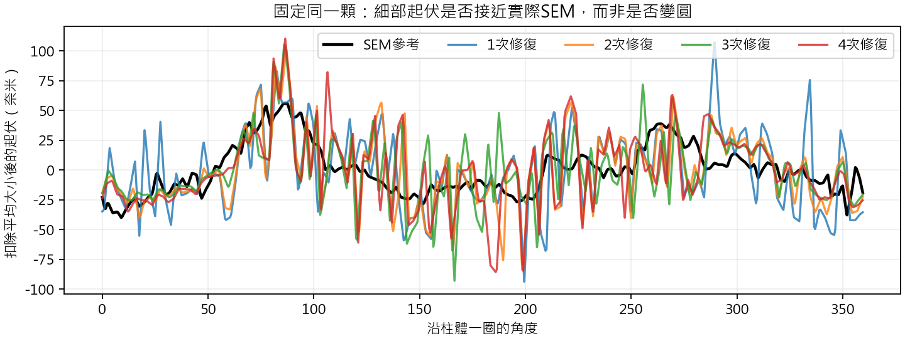
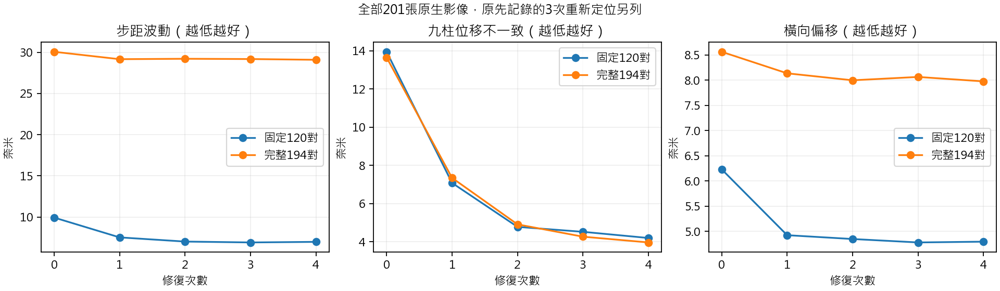

# R131：R129 四次反覆修復的實際驗證

## 完成範圍與可以回答的問題

同一份 R129 長訓練第8192次權重，保持光學、輸入、每次作用量及最後輸出方式不變，分別停在零、一、二、三、四次修復。完成正常SEM對應照片13–15、全部36顆柱，以及完整201張原生連續影像。共1020張輸出、540筆SEM量測及9045個LSC圓心；全部保存。

本次沒有重新訓練、修改原R129或採用新模型。它能回答「目前這份模型提前結束會有什麼得失」，不能證明重新訓練的一／二／三次架構上限，也沒有測試五次以上是否更好。因此不能把這份結果寫成四次已是理論或全域最佳。

零次仍保留同一套光學與最後原圖參照處理，並非完全原圖。每個中間狀態各自經相同最後處理；這些展示輸出不會被回灌下一步。逐次修復共享同一套網路，並不是四個模型。

固定計畫：[比較方法](R131_METHODOLOGY.md)、[原始條件與保護來源](../config/protocol.json)。全部資料都是已使用的實拍開發資料，沒有讀取或重命名舊144場景確認集。

## 正常SEM：第四次仍帶來細形狀收益，尺寸問題較早已出現

先對每顆柱取三曝光中位數，再跨36顆彙整。誤差越低越好，形狀相關越高越好。

|   修復次數 |   輪廓差距nm |   尺寸差距nm |   細形狀差距nm |   非圓起伏差距nm |   形狀相關 |
|-----------:|-------------:|-------------:|---------------:|-----------------:|-----------:|
|     0.0000 |      46.5150 |      88.5781 |        25.3555 |          97.7272 |     0.5575 |
|     1.0000 |      48.2506 |      93.9843 |        22.7649 |          88.8382 |     0.6192 |
|     2.0000 |      51.0059 |      96.4255 |        19.9093 |          71.1529 |     0.6666 |
|     3.0000 |      50.2759 |      98.6859 |        17.3707 |          65.5912 |     0.6792 |
|     4.0000 |      49.5231 |      96.3803 |        16.3972 |          62.6507 |     0.6919 |

同量法既有原圖的輪廓差距為46.3543nm、尺寸差距88.2038nm。零次仍會處理影像，因此與原圖數值略有差別。五組尺寸偏差的中位數都顯示光學輪廓比SEM參考大，但並非每增加一次修復就更大；這是固定SEM／光學讀法的差異，不是已認證的材料尺寸誤差。

三次到四次，整體細形狀差距降低約5.60%；逐顆33/36顆改善，尺寸差距30/36顆改善。第四次對非圓起伏量則只有16/36顆改善、20/36顆退步，儘管整體中位數較低；配對差與兩個總體中位數相減不同，兩者都保留。

| metric            |   median_candidate_minus_reference |   improved |   worsened |   tied |   worst_candidate_minus_reference |
|:------------------|-----------------------------------:|-----------:|-----------:|-------:|----------------------------------:|
| radial_nm         |                            -1.5079 |         29 |          7 |      0 |                            2.9393 |
| diameter_error_nm |                            -2.9884 |         30 |          6 |      0 |                            5.8963 |
| centered_shape_nm |                            -0.7955 |         33 |          3 |      0 |                            0.4224 |
| MZC_error_nm      |                             1.7176 |         16 |         20 |      0 |                            9.0956 |
| correlation       |                             0.0182 |         26 |         10 |      0 |                            0.0443 |

「非圓」是對實際SEM起伏的差距，不是要求變成正圓。尺寸差距在第一次就增加，前面幾次逐漸變大，第四次反而略拉回。因此不能把現有尺寸問題單獨怪在第四次，也不能以細形狀改善宣布尺寸已解決。

## 位移：同一固定120對

|   次數 |   步距波動nm |   與名義步距差距nm |   九柱不一致nm |   橫向偏移nm |
|-------:|-------------:|-------------------:|---------------:|-------------:|
| 0.0000 |       9.9397 |             8.5764 |        13.9486 |       6.2321 |
| 1.0000 |       7.5352 |             6.8530 |         7.0853 |       4.9268 |
| 2.0000 |       7.0264 |             6.2472 |         4.7864 |       4.8510 |
| 3.0000 |       6.9211 |             6.1911 |         4.5270 |       4.7832 |
| 4.0000 |       6.9911 |             6.3025 |         4.2037 |       4.7983 |

四組序列各30對，沿用原圖事先決定的同一份名單。步距波動為四序列標準差的平均，其餘欄依既有共同量法計算。相鄰影格會共用照片，不視為120次獨立試驗。平台名義設定不是獨立量到的真實位移。

逐組步距波動如下，欄0–4代表修復次數，單位奈米。各組都保留，不以整體摘要掩蓋反向結果。

| sequence    |       0 |       1 |       2 |       3 |       4 |
|:------------|--------:|--------:|--------:|--------:|--------:|
| 20x_0p5um   | 16.8965 | 14.7296 | 14.5505 | 14.5684 | 15.0305 |
| 20x_1um     | 11.1574 |  8.0105 |  6.8193 |  6.5681 |  6.4776 |
| 50x_x_0p5um |  6.1905 |  4.1808 |  3.7075 |  3.6555 |  3.5309 |
| 50x_x_1um   |  5.5144 |  3.2199 |  3.0284 |  2.8925 |  2.9252 |

這份固定120對中，三次的步距波動6.9211nm低於四次6.9911nm，與名義步距差距及橫向偏移也略低；四次的九柱不一致則由三次4.5270降至4.2037nm。第四次不是所有位移指標的共同最佳。20倍0.5微米那組，四次步距波動15.0305nm，高於三次14.5684nm；其他組的方向也全部列出。

## 位移：完整194對同拍攝段落

|   次數 |   步距波動nm |   與名義步距差距nm |   九柱不一致nm |   橫向偏移nm |
|-------:|-------------:|-------------------:|---------------:|-------------:|
| 0.0000 |      30.0675 |            15.5641 |        13.6506 |       8.5605 |
| 1.0000 |      29.1710 |            14.1023 |         7.3491 |       8.1343 |
| 2.0000 |      29.2210 |            13.9005 |         4.9168 |       7.9960 |
| 3.0000 |      29.1872 |            13.8821 |         4.2722 |       8.0624 |
| 4.0000 |      29.0977 |            13.9048 |         3.9710 |       7.9743 |

201張形成197對相鄰影格；原始紀錄的3次重新定位全數另存，不當作正常小步距。194對保留原固定120對以外的較差影格，沒有依任一修復次數剔除資料。

完整194對中，四次的步距波動與九柱一致性又比三次略好，名義步距差距仍略高。這是不同範圍的描述性結果，不以其中一張表取代另一張，也不把小數差宣稱為跨樣品的顯著勝負。

各倍率、步距與最差案例見[全部摘要](../results/motion_summary.csv)、[逐對得失](../results/motion_paired_changes.csv)、[最差與錯方向數量](../results/motion_worst.csv)。主結果含原定邊界保護；五組一律相同80像素保留、16像素過渡，沒有為較少次數改規則。

## 速度：真正提前結束的流程

|   次數 |   中位秒數 |   最短秒數 |   最長秒數 |
|-------:|-----------:|-----------:|-----------:|
| 0.0000 |     0.0157 |     0.0155 |     0.0162 |
| 1.0000 |     2.5141 |     2.5133 |     2.5158 |
| 2.0000 |     5.0121 |     5.0078 |     5.0161 |
| 3.0000 |     7.5099 |     7.5069 |     7.5128 |
| 4.0000 |    10.0103 |    10.0063 |    10.0112 |

同一完整2048×1536影像、同一RTX A6000、FP32／TF32關閉，每種先暖身一次、正式量三次，順序打散；不計讀寫與中間圖匯出。三次相對四次節省約24.98%的此次中位時間。另有SEM大小影像的完整數值；不是跨硬體速度保證。

用來计時的程式僅改原流程的反覆次數，最後處理只算一次。兩種尺寸的零至四次共10份影像與正式保存PNG完全相同。不能拿本次保存五份中間圖的總時間，當作只輸出一次的使用成本。

## 獨立核對及保留的失敗

- 隨機奇數尺寸的每個中間狀態，另由原模型觀察到的狀態重建；最大差在事先1e-6浮點容差內。完整四次的SEM測試精確重現原流程。
- 全201張的第四次PNG逐張與既有R129完全相同；1809個第四次圓心／半徑與既有結果重現，沒有換量法來製造收益。
- 540筆SEM用另一種圓擬合與起伏插值重算，最大指標差9.08728549e-06。非圓起伏的原演算法共用，沒有宣稱獨立重寫。
- 9045個保存邊界點集合另外擬合圓心，最大差3.95084612e-06px；1585筆位移表算術及各序列／整體摘要重算相符。位移只算下一張圓心減上一張圓心一次。
- 初始前置檢查曾把不同大小卷積的浮點結果誤要求逐位一致而停止；差異約1.19e-7。原錯誤檢查與失敗保存，改按原計畫已明定的1e-6比較，沒有放寬原定條件。正式201張第四次PNG的一致要求保持不變。
- 所讀取的R129模型、既有成像與量测程式及固定來源核對未變，沒有刷新任何舊驗收的期待值。

完成核對：[量測獨立覆算](../results/analysis_verified.json)、[計時與一致性](../results/runtime_verified.json)、[全部影像完成紀錄](../results/inference_complete.json)。

## 判讀界線

第四次已顯示真實輪廓上的額外作用與多數柱體收益，不能當作已證明可直接刪掉的冗餘。不過每項指標沒有全勝，整體仍有尺寸偏差與計算成本。前幾次是從四次訓練模型截取的中間結果，不能宣稱較少次數從零訓練也只能做到這些。

這次的具體判斷是：保留四次作目前R129的完整研究參考。它以更多時間換取較好的細形狀、較小的三次終點尺寸差距及較好的九柱一致性；三次則是值得進一步公平訓練比較的效率選項，並在固定120對的一些位移摘要較好。本次不足以宣稱四次已最優或自動把預設改成三次。

本輪不更換套件預設、不推廣到正式基準、不重寫R129的歷史結果。後續若要縮減次數，必須以本次實拍得失為依據，再用相同資料與明確成本條件訓練較少次數的對照；不可單凭少參數、速度或某一漂亮分數作決定。
