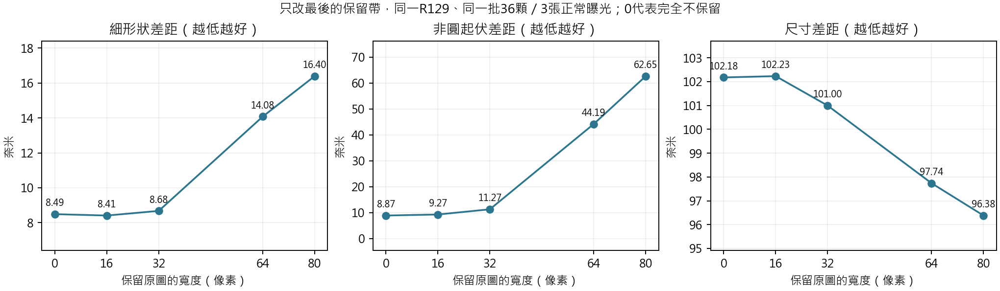
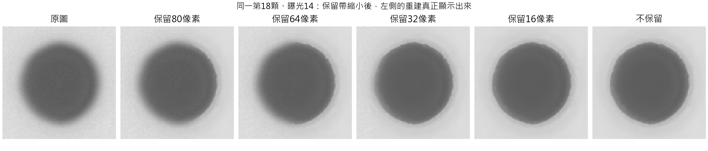
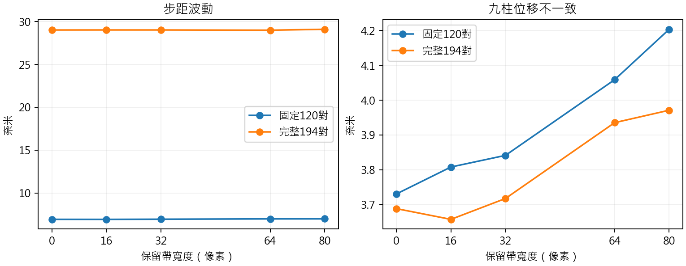
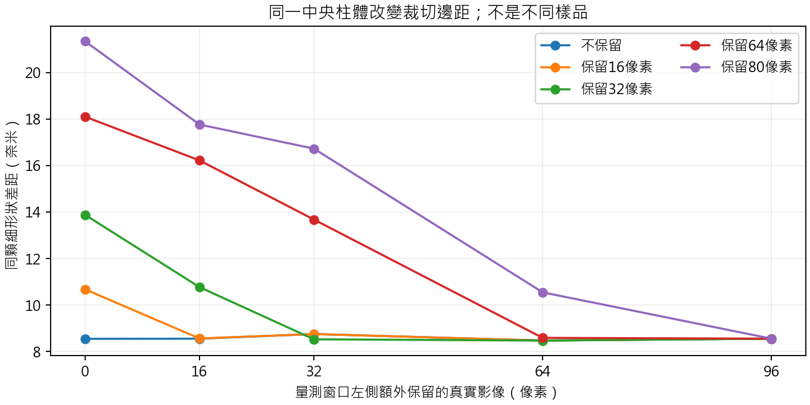

# R132：邊緣保護是否過度，以及模型真正剩下的問題

## 結論與決定

**在目前正常拍攝的已知使用場景中，80像素保留帶過於寬廣，明顯犧牲外圍柱體的形狀重建。選擇16像素保留、16像素過渡作下一步研究試用輸出；原R129權重及套件預設保持不變。**

但縮小保護帶沒有解決一切：细形狀變好、部分位移摘要改善，尺寸差距卻增加。這是模型本身的尺寸偏差被更完整地顯示出來。大範圍混回原圖能讓尺寸數字較小，並不等於模型已學會正確尺寸；此處描述的是數值效果，不推定原設計有任何掩飾意圖。

16不是經未知樣品確認的最佳值。它與完全不保留的形狀表現接近，仍留下最外側的保護，因此作為有限範圍研究選項；不能把這次結果宣稱為任意貼邊、截斷物件或任意顯微影像的可靠性認證。

## 實際做了什麼

固定同一R129長訓練8192次權重及四次修復，只改最後將原圖混回去的寬度：80／64／32／16／0像素。非零寬度全部有16像素過渡；0代表完全不混回原圖，沒有隱藏的16像素過渡。

- 全201張原生2048×1536連續影像，五種輸出共1005張；全部9045個圓心完成。
- 正常曝光13–15、36顆柱體、五種保護，共540筆SEM對照。
- 同一中央第16顆，在三曝光各切出五種左側邊距，實際重新跑模型15次，再比較五種保護，共75筆額外SEM讀值。
- 615筆SEM全部有效；9045個圓心及615筆主要SEM量值另以保存的取邊點獨立覆算。

整批影像使用先前保存的「最後原圖保護之前」浮點結果。該結果已包含光學、四次學習修正與原圖參照，不是未完成的中間影像。每份來源均核對；80像素版本的全部201張浮點／PNG重現，舊SEM摘要及1809個圓心也重現。另以目前模型重新處理完整代表影像，確認保存值的意義。這使主要比較能單獨歸因於最後保留帶，沒有同時更換模型或資料。

固定方法：[原定計畫](R132_METHODOLOGY.md)、[來源及比較條件](../config/protocol.json)。全部仍是已使用的開發資料，沒有重新開啟舊144場景確認集。

## 一、保護带确实压低了外圍細形狀能力

同顆先跨三曝光取中位數，再彙整36顆：

| 保留寬度px | 細形狀差距nm↓ | 形狀相關↑ | 非圓起伏差距nm↓ | 尺寸差距nm↓ | 整體輪廓差距nm↓ |
| --- | --- | --- | --- | --- | --- |
| 80 | 16.3972 | 0.6919 | 62.6507 | 96.3803 | 49.5231 |
| 64 | 14.0768 | 0.7408 | 44.1867 | 97.7367 | 50.2339 |
| 32 | 8.6759 | 0.8885 | 11.2721 | 100.9963 | 51.0607 |
| 16 | 8.4106 | 0.8889 | 9.2677 | 102.2322 | 51.5286 |
| 0 | 8.4901 | 0.8894 | 8.8674 | 102.1780 | 51.4496 |

80縮至16時，細形狀差距減少約48.71%，非圓起伏差距減少約85.21%。這裡是貼近實際SEM起伏，不是要求柱體變成正圓。

原本完全使用模型的中央16顆，所有五種保護的量值都不變。改善集中在外圍20顆：20/20顆細形狀、形狀相關及非圓起伏都改善；同時20/20顆尺寸差距增加，19/20顆整體徑向輪廓差距增加。不能只報有利的一半。

外圍20顆細形狀差距從17.6849降至8.3499nm，尺寸差距卻從91.5884增加到101.9497nm。這分開指出「形狀起伏較忠實」和「平均尺寸仍偏大」兩件事。





上圖延續之前固定第18顆、曝光14，全部使用同一灰階範圍。它不再只是右側顯示修復；原圖、所有保留帶及不保留結果一起列出，沒有替換歷史示意圖或刪掉不利輸出。

## 二、位移多數摘要改善，但不是每項都改善

### 原先固定120對

| 保留寬度px | 步距波動nm↓ | 名義步距差距nm↓ | 九柱不一致nm↓ | 橫向偏移nm↓ |
| --- | --- | --- | --- | --- |
| 80 | 6.9911 | 6.3025 | 4.2037 | 4.7983 |
| 64 | 6.9858 | 6.3065 | 4.0588 | 4.7771 |
| 32 | 6.9469 | 6.2632 | 3.8413 | 4.7771 |
| 16 | 6.9292 | 6.2508 | 3.8078 | 4.7771 |
| 0 | 6.9330 | 6.2575 | 3.7303 | 4.7771 |

80到16：步距波動6.9911→6.9292nm，九柱不一致4.2037→3.8078nm。兩組50倍的量測範圍遠離影像邊緣，因此不應把差異歸為它們突然更會重建；實際改變集中於靠近邊緣的量測窗口。

### 全部194對同拍攝段落

| 保留寬度px | 步距波動nm↓ | 名義步距差距nm↓ | 九柱不一致nm↓ | 橫向偏移nm↓ |
| --- | --- | --- | --- | --- |
| 80 | 29.0977 | 13.9048 | 3.9710 | 7.9743 |
| 64 | 28.9918 | 13.8666 | 3.9353 | 8.0675 |
| 32 | 29.0187 | 13.8100 | 3.7173 | 8.0692 |
| 16 | 29.0194 | 13.7974 | 3.6573 | 8.0692 |
| 0 | 29.0158 | 13.8034 | 3.6882 | 8.0692 |

三次原始紀錄的重新定位完整保留並另列。194對包含沒有入選120對的較差影格，不按新模型輸出再刪除。

完整194對的九柱不一致改善，但橫向偏移由7.9743增加到8.0692nm；固定120對的最大橫向偏移也由59.0883增加到60.2916nm。不能宣稱取消／縮小保護後位移每項都更好。平台設定步距不是獨立量到的真實位移，小幅差異不作跨樣品的顯著性宣稱。

1809個柱體影格中，1548個量測窗口完全離開原96像素保留／過渡範圍，全部中心保持不變。其餘261筆中，16像素版本相對80像素版本的圓心變化中位數約0.0759px，最大0.2833px。這些是讀值改變，不等於物體真的移動了該距離。



## 三、靠近畫面邊緣，是否真的需要保留80像素

裁切測試固定同一顆中央第16顆，只移動左側裁切位置。五種數字0／16／32／64／96是104像素量測窗口外額外保留的真實照片寬度，不是物件到邊界的距離。最窄案例中的實際光學輪廓仍距新畫面左側約14.6–15.4像素，因此沒有測到輪廓被畫面直接截斷的情況。

在窗口外沒有额外內容時，保護前輸出與完整視野參考的窗口平均差，三曝光最差約0.188灰階、單點最大14.90灰階；窗口外多留16像素後，平均最差降到0.00495灰階、單點最大0.01953灰階。最外側的數值效應確實存在，不能由此推論完全不保護適用所有邊界。

但同顆SEM細形狀並沒有因為缺少80像素周邊而崩潰。不保留時，五種裁切邊距的中位細形狀差距約8.48–8.76nm；80像素保留卻在窄邊距下把同顆的細形狀差距推到21.33nm，隨裁切位置變動大。這些照片是同一個物件，原始量測區像素不變，變動來自整個處理流程及保留區的位置。



此項裁切會同時改變全圖光學與品質統計，所以是實際使用時的裁切敏感性測試，不能單獨歸因於神經網路邊界填補。它只有一個柱體、三個曝光，不是所有邊界與材質的驗證。

## 四、目前真正需要修的問題與使用原則

1. **保護範圍要縮小並清楚標示。** 目前80像素沒有展現足以抵銷細形狀損失的必要性；16像素保留加16像素過渡是下一步研究選項。
2. **尺寸偏差需獨立解決。** 縮小保護後，所有物件更完整顯示模型行為，尺寸差距反而增加。後續要檢查光學／SEM尺度與邊界定義，以及模型對過渡位置的改動；不能直接利用這批SEM反向教固定內縮量。
3. **量測對象與周圍窗口應完整位於有效區。** 16像素版本從距邊32像素起完整採用模型，但這只是輸出比例，不是精度合格線。靠得更近的物件仍可能被部分混回原圖。未建立自動完整物件准入；不把比例圖當成信心圖。
4. **舊模型比較不能混用新規則。** R131四次比較與R130乾淨V42比較使用原80像素規則。不能把本輪16像素R129直接插進舊表，宣稱公平超過其他模型；對手若比較，需接受相同輸出條件。

這一輪排除了「模型只會修半顆」的理解，也證明原本展示與整體摘要被大範圍保留帶明顯影響；但沒有把R129重新宣告為尺寸已正確或可取代論文全部成果。

## 已完成的研究試用入口

保留相同R129權重與四次計算，只提供新的保留帶選擇；預設16，不改原套件。

```powershell
& 'C:\Users\Rio\anaconda3\python.exe' -B 'D:/GMM_2_Final/Experiments/R132_BoundaryPolicyStudy/scripts/infer_trial.py' --input 'C:\path\image.bmp' --output 'C:\path\new_output.png'
```

輸出附模型採用比例圖與來源說明；不覆寫既有檔案。SEM完整影像與2048×1536代表影像均由此入口重跑，與本輪16像素保存PNG逐像素一致。這是研究試用功能，不是新精密量測認證，也未自動更換原本使用入口。

## 驗證與保存

- 615筆SEM／9045個圓心全部有效，615筆SEM主要量值最大重算差7.27010664e-06，圓心最大差3.95084612e-06px。非圓起伏算法仍共用舊程式，未宣稱獨立重寫。
- 1585筆位移表算術及主要摘要另行重算；所有政策的來源、影像及固定規則核對。
- 舊80像素結果完整重現，所有原模型、舊指紋與結果保持不變；沒有新訓練、沒有讀取舊確認影像。

來源：[獨立核對](../results/audit_complete.json)、[全部SEM與分組](../results/all_sem/summary.csv)、[逐顆得失](../results/all_sem/paired_effects.csv)、[全部位移](../results/motion_summary.csv)、[位移最差案例](../results/motion_worst.csv)、[裁切差異](../results/context/differences.csv)、[公開入口重跑](../results/public_replay/verified.json)。
