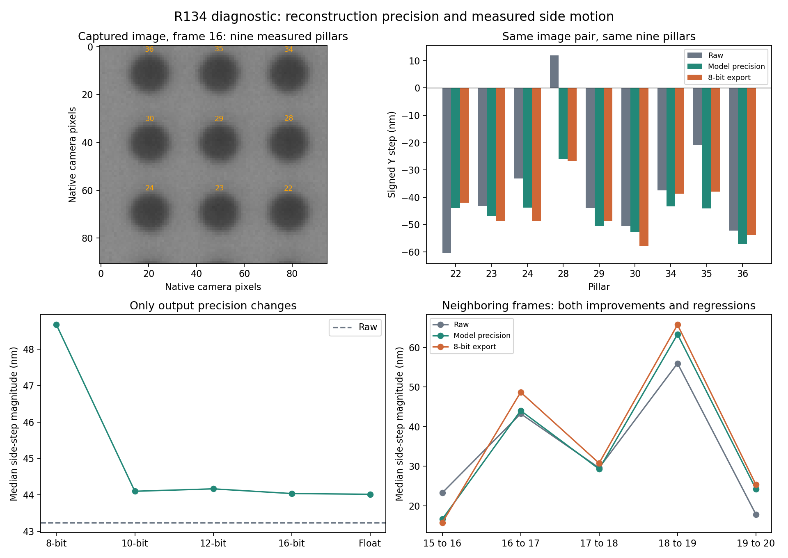

# R134：第16至17張側向偏移的原因

2026-09-15。這是針對已知未通過例子的事後診斷，不是新未知資料驗證。原始長訓練判定、門檻、模型、影像及量測記錄均保留。

## 查明的主要原因

同一個C模型、同一對20倍實拍影像，保持量測方法不變，僅改變輸出精度：

| 量測來源 | 九柱側向偏移中位數的絕對值（nm） |
|---|---:|
| 原始相機影像 | 43.240395 |
| 模型原本計算結果 | 44.019181 |
| 模型結果轉成256階灰階圖片 | 48.665763 |
| 模型結果保留1024階 | 44.101492 |
| 模型結果保留4096階 | 44.167678 |
| 模型結果保留65536階，實際存檔再讀入 | 44.039084 |

本例新增的5.425369nm中，保存為256階圖片後增加4.646583nm，約占85.65%；保留計算精度後，相較Raw仍多0.778786nm。總差距相當於0.03145個相機像素。85.65%是此例、此聚合方式的順序干預分解，不能推廣成所有影像的固定比例。

模型輸出是細緻的灰階數值，轉成一般圖片時捨去小數。輪廓位置又根據少數邊界像素的亮暗變化求出；捨入雖不到半個灰階，仍可改變量到的小數像素位置。這裡每像素對應172.5nm，所以肉眼幾乎不可見的改變，也足以形成數奈米差距。保留計算精度不代表憑空增加真實光學資訊，只是避免再次丟失模型已算出的數值。

## 不是只看一個漂亮結果

第二個獨立起點的C模型同样由保存256階後48.329089nm，降至保留計算精度的44.454555nm。兩個起點都顯示同樣現象。

但相鄰影格並非全部恢復：

| 影格 | 原始影像（nm） | 保留模型精度（nm） | 256階輸出（nm） |
|---|---:|---:|---:|
| 15→16 | 23.264 | 16.601 | 15.724 |
| 16→17 | 43.240 | 44.019 | 48.666 |
| 17→18 | 29.554 | 29.276 | 30.754 |
| 18→19 | 55.954 | 63.285 | 65.703 |
| 19→20 | 17.798 | 24.217 | 25.307 |

後兩對保留精度後仍相較Raw多7.331nm及6.418nm；因此「改存檔就完全解決」不成立。這六張是事後選定的鄰近區段，不能當全201張的新資格判定。

原本完整的256階結果也不是全面退步：固定120對有72對側向偏移降低、48對增加；全部同次拍攝194對有106對降低、88對增加。這些數字只描述量到的偏移，並不是有獨立真值的準確率。

## 已排查的因素

- **不是重建結果無法重現或單純算術錯誤。** 6張完整影像重建逐像素重現原輸出，Raw當前重測與原中心最大差4.55e-13像素。另用獨立求解重算全部702個診斷中心，最大差1.28e-6像素以內。
- **本例不是外框保留原圖所造成。** 輪廓離影像外緣至少63.30像素，全部在16像素保留區與16像素過渡區之外。這不能排除所有可能的網路邊界效應，但排除了這個輸出保留區直接覆蓋輪廓的說法。
- **關閉實測光學提示沒有消除保留精度時的偏移。** C原本44.019nm，關閉後44.154nm；不能把本例主要原因歸到光學模組，或用此例要求移除它。
- **不能根據256階结果認定第四次修正有害。** 第三次保留精度時47.448nm，第四次44.019nm；但存成256階後卻是第三次42.066nm、第四次48.666nm。這是同一模型的固定前綴診斷，並非重新訓練的三次／四次架構比較。
- **增加輪廓取樣點數不是充分解法。** 同時對Raw及C使用128、256、720點，C的256階結果仍較Raw偏移大。這些只是敏感度對照，不取代原先64點的資格量測。

## 有已知移動量的對照

將第16張已拍攝影像人工只向水平方向平移，再重建，保留原本計算精度：

| 已知水平影像平移 | Raw量到的側向變化（nm） | C量到的側向變化（nm） |
|---|---:|---:|
| −3.0像素 | 0.000 | 約0.00001 |
| −2.89855像素 | 4.555 | 0.266 |
| −2.5像素 | 5.640 | −0.124 |

這些對照不支持「模型固定把水平方向的移動轉成側移」。相反，在這組有限的純影像平移對照，C的額外側向響應較小。非整數平移使用三次插值，並未重新經過完整光學成像或產生獨立相機噪聲；不能當作真實位移精度認證。

## 需要修正的解讀

我們沒有此刻真實Y向位移的獨立量測，Raw也不能直接當Y向真值。

另用整個九柱區域的剛性影像配準做敏感度對照，Raw與C保留精度的側移分別為53.697nm與53.896nm，只差約0.20nm；原來的輪廓圓心法則分別為43.240nm與44.019nm。不同讀法在Raw上的差距約10.46nm，比最初卡關的5.43nm還大。這個配準結果同樣不是地面真值，不能擇其有利者取代原量測。

因此，原始256階輸出**確實未通過事先工程条件**，此判定不改；但把這件事進一步解釋為「模型本體增加5.4nm真實誤差，因此不值得訓練」超出了現有證據。

## 後續應怎麼做

1. 優先讓量測保留模型計算精度，另存256階看圖副本。已實測65536階PNG的完整寫入／讀回，其本例量測與原模型數值只差0.020nm。讀取端必須保留原型別、按65535換算，不能再次用一般灰階讀圖方式壓回256階。
2. 為此輸出修正建立獨立的新比較記錄，以同樣201張、相同配對、相同量測方法，重新檢查平均、最差值與位移穩定性；不能將這個局部診斷當全體通過，也不覆寫原判定或放寬門檻。
3. 對保留精度後仍有差異的影格，區分真實拍攝移動、噪聲／邊界讀法與模型影響，再設計針對性的训练比較。現有訓練資料確實含小圓盤，不能聲稱完全沒有小物件；然而訓練平移範圍約±0.9像素，與本實拍約2.9像素不同，值得在新資料設計中補足。這個覆蓋差異尚不是本例的已證實原因。
4. 確認新的完整流程合格，才進入本代獨立包的長訓練。當前沒有新增訓練或模型升級。

## 可重算證據與保留的問題

- `results/cross_axis_diagnosis/`：4個匹配短訓練模型、光學關閉、固定前綴、讀法敏感度、已知水平影像平移；468筆中心記錄。
- `results/cross_axis_precision_v2/`：精度級別、6張鄰近影格、實際65536階存檔讀回、原圖中心重播；234筆中心記錄。
- `results/cross_axis_analysis/`：獨立702中心重算、九柱分解、完整原始配對背景、精度與鄰近影格圖表。
- 首次精度對照用了不同的浮點乘法精度，造成4個像素在半灰階附近的捨入與原輸出不同，驗證立即失敗。保留原腳本及`cross_axis_precision/`，第二版使用與原輸出完全相同的乘法及捨入，再做完整重播。這不是更改研究門檻。

