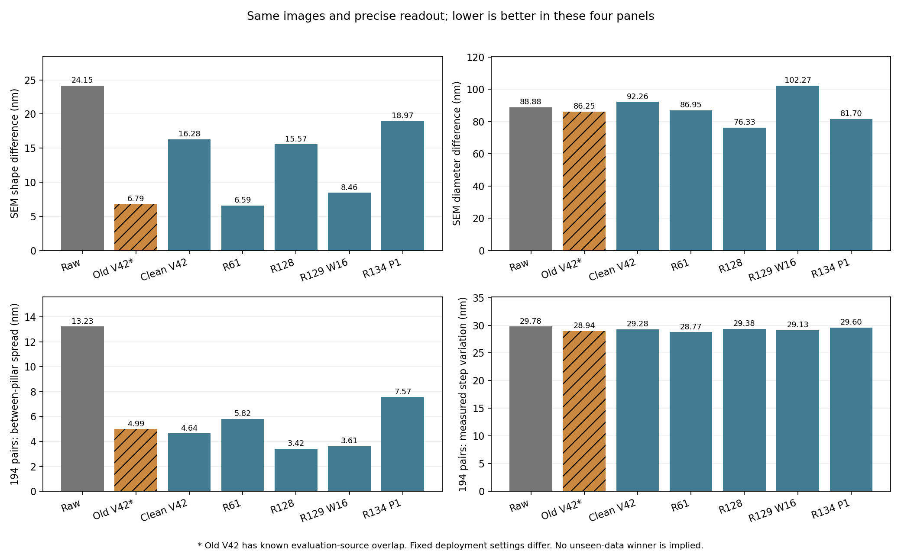
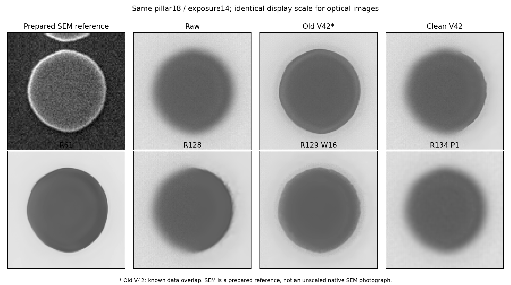

# R135：包含舊V42的統一比較

目前：complete，完成7/7組。記錄時間2026-09-16T09:08:50.931876+00:00。

比較舊V42 E120、乾淨重訓V42固定32epoch、R61 v16 PSF-off、R128 P_s1285002 step8192、R129長訓練／邊緣16、R134 P1長訓練，並列原圖。沒有新訓練、另挑最佳權重或模型升級。

所有版本使用同一批201張完整相機影像、原先固定120對與全部194對同次拍攝配對；3次重新定位另列。正常SEM照片13/14/15、36顆，使用同一參考與保存精度。輪廓讀法與每柱的狀態重設相同；不直接搬用舊論文的分數。每模型保留已選定的原始推論／邊緣設定，所以這是實際系統比較，不是排除全部前後處理差異的純架構比較。

**舊V42的分數完整保留，但已確認訓練資料有評估來源及尺寸答案重用。它可以顯示在這批影像上的能力，不能以此單獨證明未知影像的優勢，也不據此推斷動機。其餘模型同樣是在已用過的開發影像上比較，不是新確認集。**

## 同一精度的SEM比較

| 模型 | 細形狀差距nm | 尺寸差距nm | 形狀相關↑ | 與SEM非圓起伏差距nm | 重建秒數 |
|---|---:|---:|---:|---:|---:|
| 原圖 | 24.145 | 88.878 | 0.5832 | 95.467 | — |
| 舊V42（資料重疊） | 6.792 | 86.254 | 0.9427 | 6.307 | 0.457 |
| 乾淨重訓V42 | 16.278 | 92.263 | 0.7515 | 62.712 | 0.437 |
| R61 | 6.587 | 86.948 | 0.9475 | 5.448 | 0.415 |
| R128 | 15.567 | 76.326 | 0.7733 | 51.659 | 10.035 |
| R129（邊緣16） | 8.460 | 102.265 | 0.8902 | 9.937 | 9.998 |
| R134 P1長訓練 | 18.967 | 81.704 | 0.6746 | 56.532 | 9.984 |

## 固定120對

| 模型 | 步距波動nm | 與設定步距平均差距nm | 九柱不一致nm | 側向偏移nm |
|---|---:|---:|---:|---:|
| 原圖 | 9.745 | 8.388 | 13.966 | 6.009 |
| 舊V42（資料重疊） | 6.886 | 6.230 | 4.663 | 4.972 |
| 乾淨重訓V42 | 6.903 | 6.203 | 4.578 | 5.041 |
| R61 | 7.244 | 6.507 | 5.822 | 4.993 |
| R128 | 6.848 | 6.139 | 3.411 | 5.138 |
| R129（邊緣16） | 6.943 | 6.234 | 3.836 | 4.730 |
| R134 P1長訓練 | 7.826 | 6.914 | 7.468 | 5.541 |

## 完整194對

| 模型 | 步距波動nm | 與設定步距平均差距nm | 九柱不一致nm | 側向偏移nm |
|---|---:|---:|---:|---:|
| 原圖 | 29.782 | 15.414 | 13.229 | 8.539 |
| 舊V42（資料重疊） | 28.945 | 13.829 | 4.992 | 7.836 |
| 乾淨重訓V42 | 29.276 | 13.967 | 4.643 | 7.932 |
| R61 | 28.768 | 13.860 | 5.822 | 8.074 |
| R128 | 29.380 | 14.015 | 3.417 | 7.915 |
| R129（邊緣16） | 29.130 | 13.814 | 3.614 | 8.104 |
| R134 P1長訓練 | 29.598 | 14.326 | 7.569 | 8.005 |

數字均為這批重複觀察的摘要，未以單一加權總分選冠軍。設定步距不是独立實際位置真值，側向偏移亦不等於已知真誤差。尺寸與SEM有材料邊界對應限制；非圓程度是與樣本比較，不要求變成正圓。速度使用同一張完整影像、相同FP32設定、一次暖身三次計時，包含各模型必要的前後處理，不含存檔與量測。

每張保存未取整的數值與看圖副本；量測使用前者。歷史浮點結果只在來源及雜湊吻合、代表整張重新推論相同時重用。全部中心另做獨立擬合與配對算式核對，失敗不刪除。原模型、旧完成記錄及144場景均不改動。

## 相同影像的比較圖

舊V42的這次輸出採共同嚴格FP32計算。四張代表圖與歷史8bit影像最多差1灰階；允許舊式TF32近似時差異大幅縮小但未完全歸零。這次已逐張由原生推論程式驗證新共同設定，不冒充歷史PNG完全重播；算術敏感度對照另存於results/legacy_arithmetic。

R61適配的兩次執行失敗另存results/failures：舊推論沒有外部原圖混合步驟，以及部分新比較影格沒有歷史R61檔可對照。修正只對齊原生推論與允許歷史參考不存在，仍重建全部201張；未修改R61權重或原始程式，未刪除量測失敗例子。
