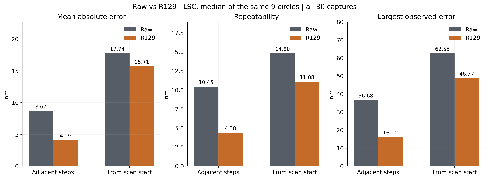
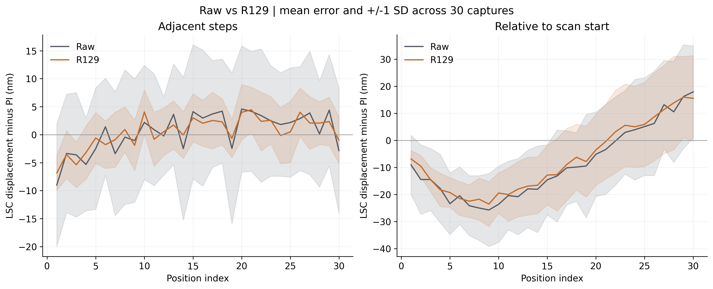
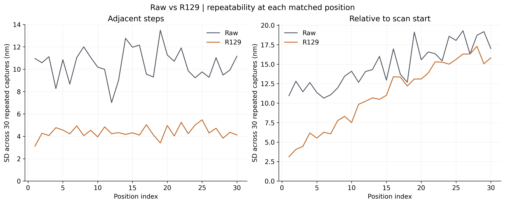
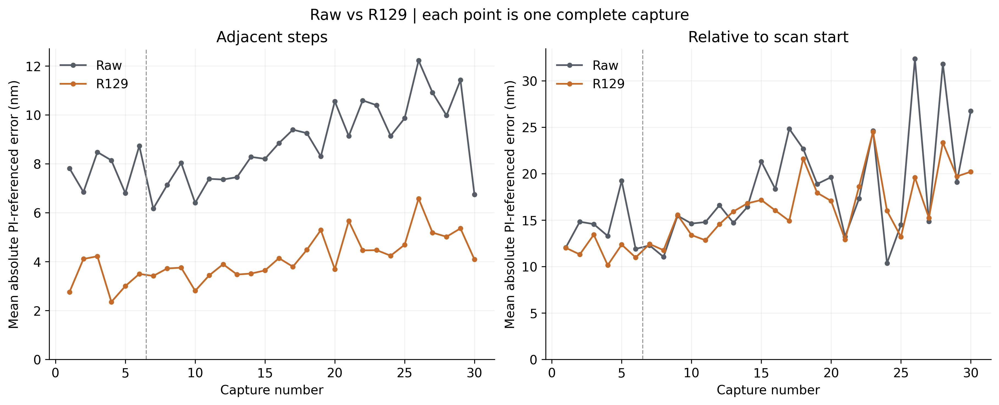
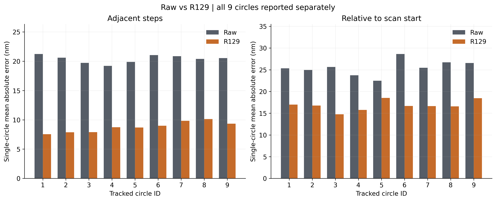
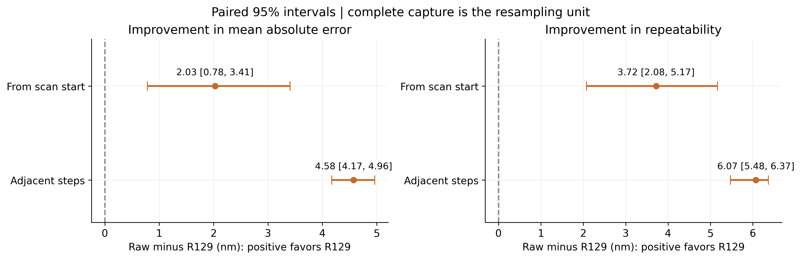
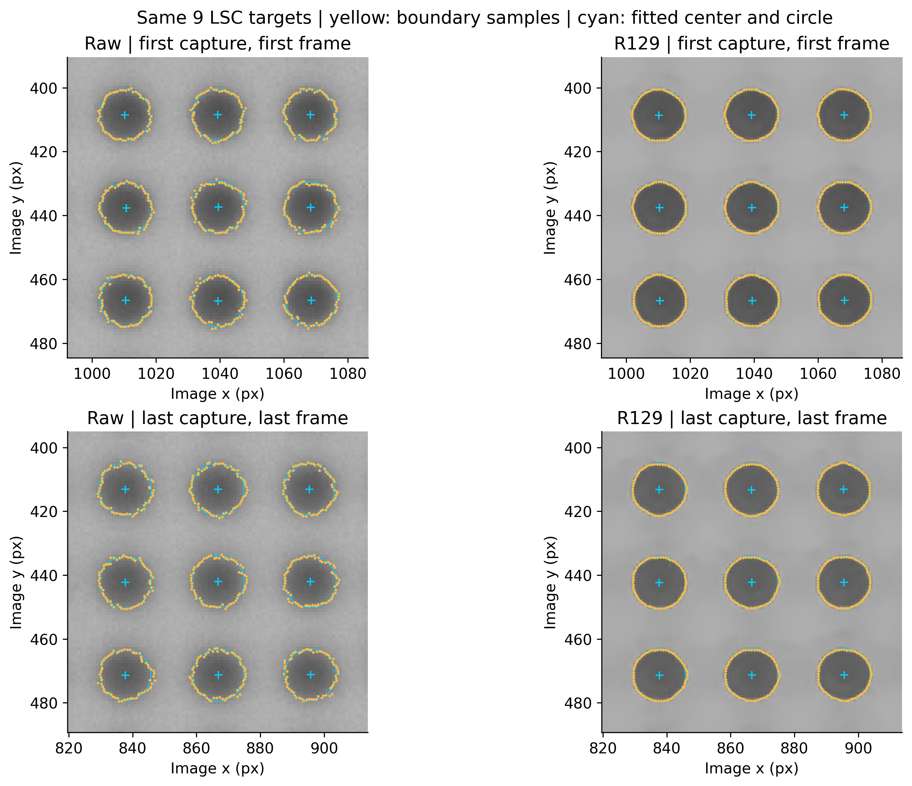

# Raw與R129：LSC比較圖表

本圖集只含Raw與R129，使用已完成核對的全30次LSC資料。每方法930張、8370圓心；主要位移為9顆圓位移的中位數，名義尺度0.1725μm/px。

PNG為300dpi圖片，SVG可放大編輯。主結果僅限本批20倍樣品及LSC量法。

## 01_summary
主要結果：平均誤差、同一位置重拍的波動及本批最大誤差。柱狀圖從零開始，數字單位為奈米。

## 02_position_error
各位置的平均有向誤差；陰影為同一位置30次重拍的正負1個標準差，不是平均值95%範圍。

## 03_repeatability
同一位置重拍30次的波動。數值越小，這批重複拍攝的讀值越一致。

## 04_capture_comparison
30次掃描逐次比较。虛線區隔前6次與後24次拍攝；每個點代表一次完整掃描。

## 05_individual_circles
各顆圓各自量測的平均絕對誤差，尚未合併成9圓讀值。9顆圓共享拍攝條件，不算9個獨立實驗。

## 06_improvement_intervals
平均改善量與95%範圍，以完整掃描重抽樣；正值表示R129較小。範圍不代表完整量測不確定度。

## 07_circle_localization
實際LSC定位。兩方法使用相同9顆圓、相同顯示亮度與共同座標範圍；展示首末拍攝案例。

