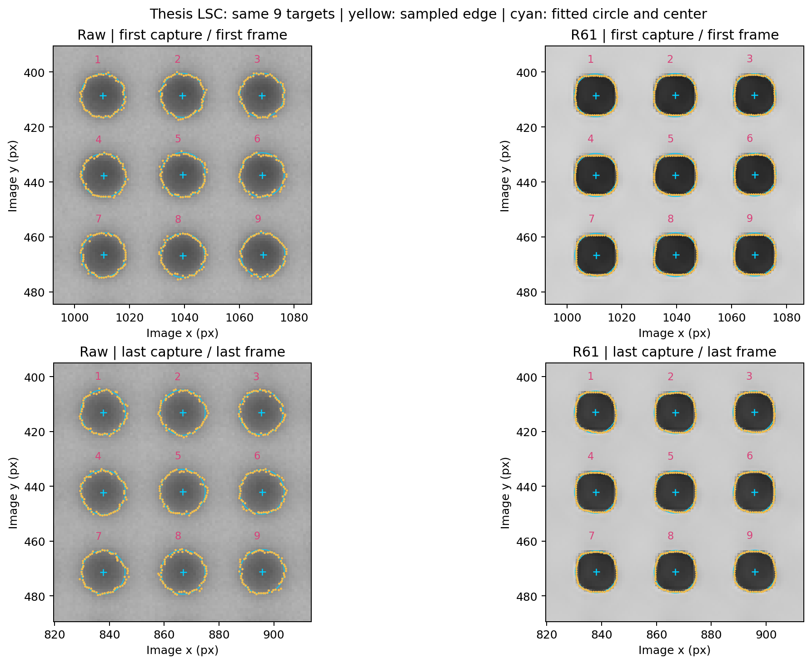
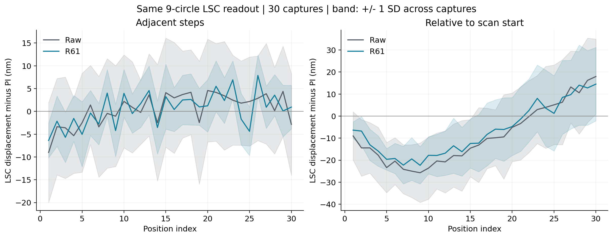
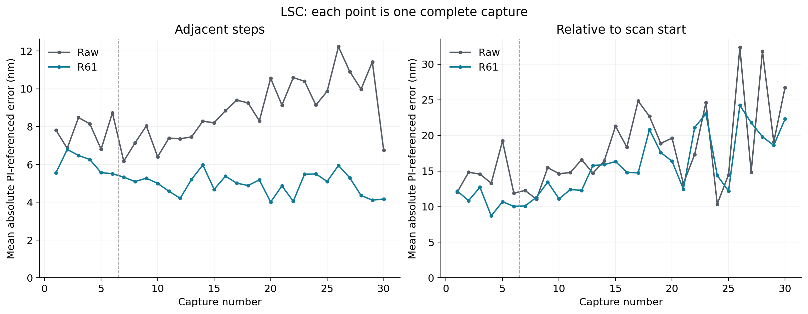
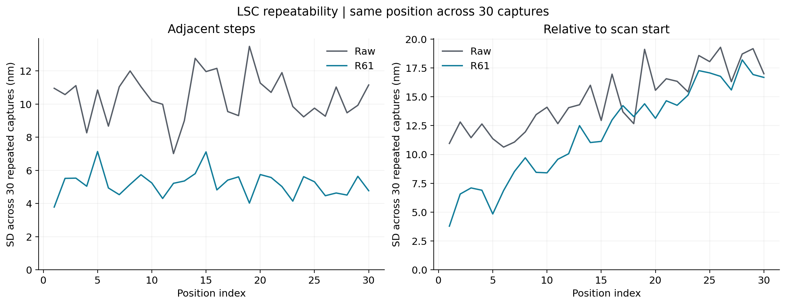
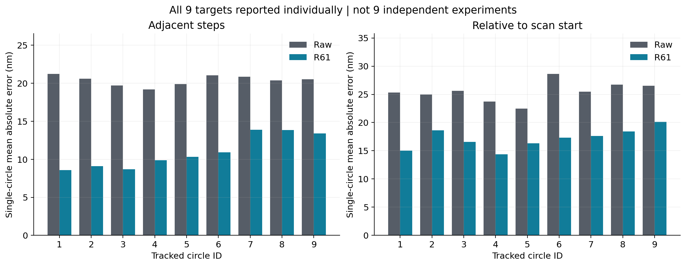

# R136：LSC圓心定位的30次位移比較

**這份才是LSC主結果。**直接沿用論文的取邊與最小平方圓心定位程式，對同一組9顆圓逐張量測，再將前後圓心座標相減。前面的影像區域比對報告另外保留為方法比較，不能當作LSC結果。

## 完成範圍與主要數值

每個方法均完成30次掃描、930張影像、8370筆圓心定位。每一步900段、相對起點900筆；以下是9顆圓位移合併後的結果。合併沿用論文：分別取9顆圓X與Y位移的中位數。不能把這些數字說成單顆圓的定位能力。

| 位移     | 方法   |   平均絕對誤差nm |   重拍波動nm |   最大誤差nm |
|:---------|:-------|-----------------:|-------------:|-------------:|
| 每一步   | 原圖   |            8.667 |       10.452 |       36.676 |
| 每一步   | R61    |            5.160 |        5.195 |       19.990 |
| 相對起點 | 原圖   |           17.738 |       14.796 |       62.553 |
| 相對起點 | R61    |           15.267 |       11.870 |       47.432 |

- R61 每一步：平均絕對誤差改善40.46%，重拍波動改善50.30%；30次中30次改善、0次退步。平均改善量95%範圍[2.880, 4.140]nm；連續3次成組重抽為[2.581, 4.468]nm。負改善代表退步。
- R61 相對起點：平均絕對誤差改善13.93%，重拍波動改善19.78%；30次中24次改善、6次退步。平均改善量95%範圍[1.089, 3.891]nm；連續3次成組重抽為[1.323, 3.655]nm。負改善代表退步。

重拍波動：在每個相同位置，計算30次誤差的標準差，再取30個位置的平均。不是把同一掃描的30步混算，也不是除以√30後的平均值不確定度。95%範圍以完整掃描重抽10000次；9顆圓不當作9個獨立實驗。

## 個別9顆圓與同張影像的一致性

下表為每顆圓各自的平均絕對誤差（nm），未先合併9顆圓。

| kind     |   pillar_id |    R61 |    Raw |
|:---------|------------:|-------:|-------:|
| 每一步   |           1 |  8.601 | 21.245 |
| 每一步   |           2 |  9.097 | 20.611 |
| 每一步   |           3 |  8.678 | 19.731 |
| 每一步   |           4 |  9.883 | 19.211 |
| 每一步   |           5 | 10.326 | 19.881 |
| 每一步   |           6 | 10.908 | 21.049 |
| 每一步   |           7 | 13.871 | 20.869 |
| 每一步   |           8 | 13.851 | 20.395 |
| 每一步   |           9 | 13.409 | 20.532 |
| 相對起點 |           1 | 15.042 | 25.340 |
| 相對起點 |           2 | 18.600 | 24.961 |
| 相對起點 |           3 | 16.562 | 25.645 |
| 相對起點 |           4 | 14.391 | 23.716 |
| 相對起點 |           5 | 16.319 | 22.476 |
| 相對起點 |           6 | 17.341 | 28.642 |
| 相對起點 |           7 | 17.607 | 25.455 |
| 相對起點 |           8 | 18.415 | 26.717 |
| 相對起點 |           9 | 20.121 | 26.547 |

- R61（adjacent）：9顆圓中9顆平均誤差改善。
- R61（start）：9顆圓中9顆平均誤差改善。

每一段的9顆圓位移不一致程度保存在within_grid_variation.csv。它反映同張影像內的分散，不能直接等同與PI的真實誤差。

## 尺度與分開檢驗

相機Basler acA2040-120um、20倍，名義尺度0.1725μm/px。只用前6次原圖LSC位移估計方向與尺度，得到0.172520749μm/px，固定給所有方法後24次使用；R61或R129結果不參與校正。

| 位移     | 方法   |   平均絕對誤差nm |   重拍波動nm |   最大誤差nm |
|:---------|:-------|-----------------:|-------------:|-------------:|
| 每一步   | 原圖   |            8.892 |       10.678 |       36.560 |
| 每一步   | R61    |            4.952 |        5.128 |       19.198 |
| 相對起點 | 原圖   |           18.424 |       15.659 |       62.685 |
| 相對起點 | R61    |           16.155 |       12.831 |       51.047 |

## 定位方式與驗證

- 原圖影像中的黑色連通區只用來辨識同一顆圓所在範圍，不作最終位移值。未利用PI答案決定圓心，未把原圖圓心複製給重建圖。
- 每張影像對每顆圓獨立取邊，再作幾何最小平方圓擬合。20倍沿用64個等弧長輪廓點、13次粗輪廓演化、法線兩側2.4像素搜索，並重設輪廓演化順序以保證重算一致。
- 樣品不同於舊論文拍攝，初始圓的位置與約8.33像素半徑由本批原圖取得。共用同一組9顆圓及相同設定，沒有依哪個模型分數較好另選目標。
- 全部16740組保存邊界點用另一個幾何圓心求解重算，最大圓心差2.62e-06像素；逐顆座標相减、代表影像重跑、PI換算均已核對。
- 圓心及每顆圓的完整取邊點皆保存，可直接畫回影像核對；未剔除不利影格或圓。

## 結論的範圍

這是同一樣品、同次20倍拍攝、指定9顆圓及LSC流程的PI參照結果。改善不能直接外推到其他形狀、倍率、不同天，也不等於已認證圓的真實直徑或形狀。影像中的側向只作補充，沒有獨立X方向行程來認證完整二維尺度。

PI校正證書、獨立有效倍率不確定度與殘餘拍攝／回授時間差未提供，因此本報告呈現重拍散布及PI差距，不捏造完整量測不確定度。前6次與後24次拍攝節奏不同，時間分段與趨勢也保留在表格中。

## 圖表

## 表格與資料

- [主要結果總表](../02_統計表/CSV/readable_lsc_summary.csv)
- [每次掃描及指標](../02_統計表/CSV/per_scan.csv)
- [各位置30次的變動範圍](../02_統計表/CSV/per_position.csv)
- [配對改善與95%範圍](../02_統計表/CSV/paired_comparisons.csv)
- [所有圓心座標](../02_統計表/CSV/all_circle_centers.csv)
- [每顆圓逐段位移與PI對照](../02_統計表/CSV/all_individual_circle_pairs.csv)
- [每顆圓的統計](../02_統計表/CSV/individual_circle_summary.csv)

舊影像區域比對報告不改數字，但必須與本份LSC報告分開引用。

R129重建及LSC定位仍在背景接續，本份僅交付已完整完成的原圖／R61比較。
