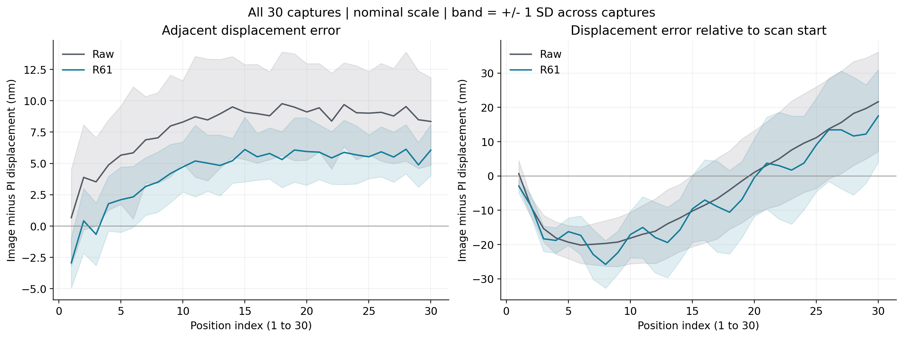
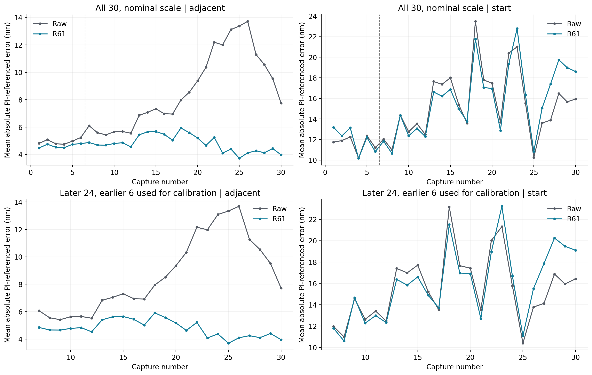
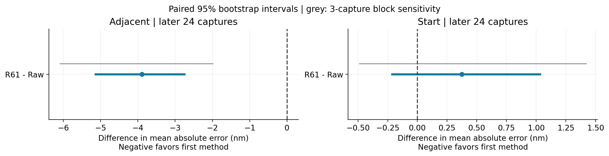
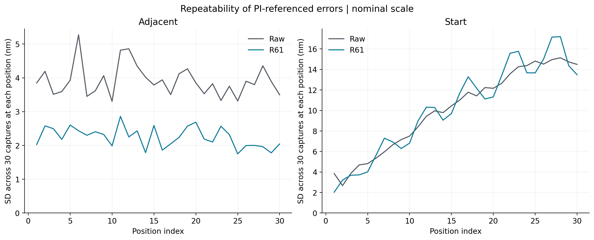
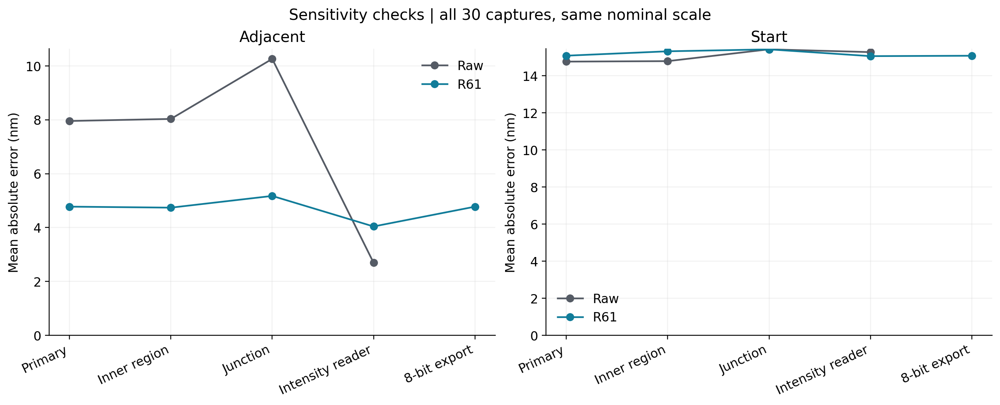
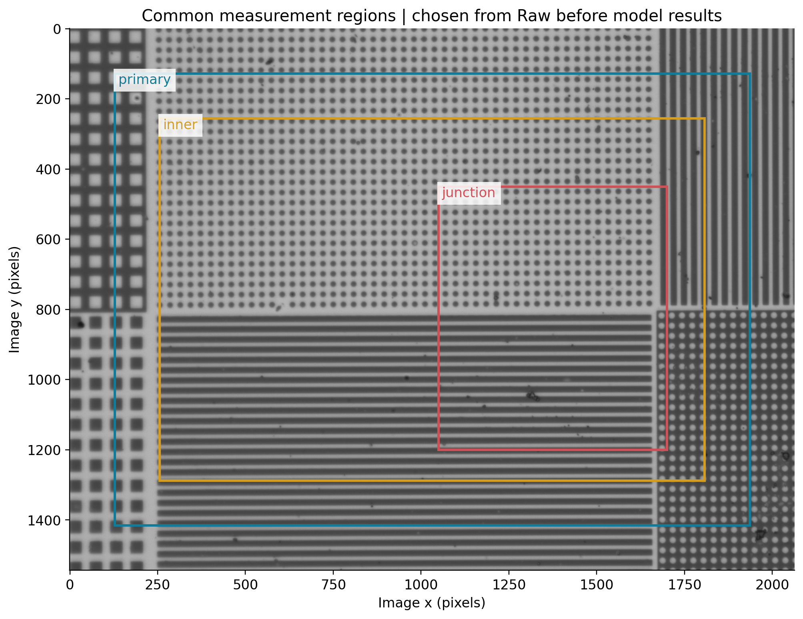
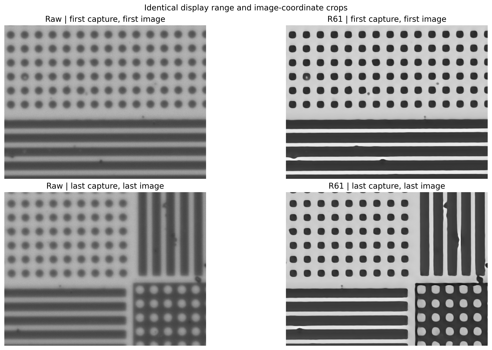

# R136：R61與原圖的30次重拍統計

> 方法說明：本份使用影像區域比對，不是LSC圓心定位。論文LSC主結果請見[LSC完整比較](../05_定位與分析紀錄/原分析報告.md)。

**本次結論：R61在原定的細節讀法下，改善相鄰短步位移，但相對起點的長距離誤差與重複程度沒有明確提升。換成直接亮度讀法後，原圖反而較準；改善與量法有關，不能寫成重建全面提高位移準確度。**

直接亮度讀法的每步平均絕對誤差為原圖2.696nm、R61 4.041nm，30次R61皆較差。完整逐次核對見reader_sensitivity_paired.csv。這個反向結果與主結果同等保留。

本份先交付完整原圖／R61比較。R129仍另行執行，不把它尚未完成的結果混入排名。以下「誤差」均指與PI回授的差距，適用於本次100MF樣品、Basler acA2040-120um、20倍拍攝與指定影像讀法。

## 主要結果

| 位移讀法   | 方法   |   平均絕對誤差nm |   重拍散布nm |   最大誤差nm |
|:-----------|:-------|-----------------:|-------------:|-------------:|
| 每一步     | 原圖   |            7.957 |        3.917 |       21.382 |
| 每一步     | R61    |            4.777 |        2.246 |       14.348 |
| 相對起點   | 原圖   |           14.769 |       10.090 |       50.958 |
| 相對起點   | R61    |           15.088 |       10.229 |       45.905 |

共30次掃描、每次31張；原圖930張及R61重建930張。每種方法各有900段相鄰位移及900筆相對起點位移，全部納入。表中重拍散布是在每個相同位置計算30次誤差的標準差，再對30個位置取平均；不是一個掃描內不同步距的標準差。

- **每一步位移**：平均絕對誤差降低39.96%；30次中30次改善、0次退步。R61減原圖的平均誤差差距95%區間為[-4.313, -2.137]nm；連續3次成組重抽為[-5.165, -1.512]nm。兩種區間都低於零，支持本批資料中平均誤差較小。
- **相對起點位移**：平均絕對誤差增加2.16%；30次中18次改善、12次退步。R61減原圖的平均誤差差距95%區間為[-0.158, 0.840]nm；連續3次成組重抽為[-0.384, 1.171]nm。區間包含零或對時間分組敏感，不能把平均差距說成穩定改善。

## 後24次的分開檢驗

相機感光像素3.45μm，20倍名義尺度為0.1725μm/px。只用前6次原圖與PI估計方向及尺度，得到0.172494521μm/px，再固定給兩種方法的後24次使用。模型結果不參與校正。

| 位移讀法   | 方法   |   平均絕對誤差nm |   重拍散布nm |   最大誤差nm |
|:-----------|:-------|-----------------:|-------------:|-------------:|
| 每一步     | 原圖   |            8.681 |        3.837 |       21.350 |
| 每一步     | R61    |            4.788 |        2.228 |       14.315 |
| 相對起點   | 原圖   |           15.555 |       11.047 |       50.004 |
| 相對起點   | R61    |           15.928 |       11.195 |       45.014 |

全30次名義尺度與後24次校正尺度是兩個不同範圍，不能混用其樣本數或把校正用的6次也算成獨立檢驗。此校正使用同一PI參考，並非獨立尺度校正證書。

## 所有主要指標的範圍

平均值的95%範圍與跨次波動都保留在summary.csv；逐次數值在per_scan.csv；各位置的30次平均、標準差、觀察到的最小／最大值在per_position.csv。平均表現的範圍不是下一次量測的保證範圍。完整掃描是重抽樣單位，不把900段相鄰位移當成900個獨立實驗。位置的重拍散布包含此次時間漂移，不等同純隨機雜訊。

下表呈現全30次主要指標（nm）。「單次內誤差波動」是掃描內30個位置誤差的標準差；與上表跨次重拍散布不同。

| 位移     | 方法   | 指標                 |   30次平均 |   次間標準差 |   平均值95%下限 |   平均值95%上限 |
|:---------|:-------|:---------------------|-----------:|-------------:|----------------:|----------------:|
| 每一步   | R61    | 有向偏差             |      4.351 |        0.672 |           4.110 |           4.591 |
| 每一步   | R61    | 平均絕對誤差         |      4.777 |        0.554 |           4.583 |           4.978 |
| 每一步   | R61    | 較重視大誤差的綜合值 |      5.332 |        0.583 |           5.130 |           5.541 |
| 每一步   | R61    | 單次內誤差波動       |      3.095 |        0.371 |           2.968 |           3.231 |
| 相對起點 | R61    | 有向偏差             |     -6.431 |        9.444 |          -9.696 |          -3.082 |
| 相對起點 | R61    | 平均絕對誤差         |     15.088 |        3.389 |          13.931 |          16.285 |
| 相對起點 | R61    | 較重視大誤差的綜合值 |     17.423 |        3.834 |          16.080 |          18.756 |
| 相對起點 | R61    | 單次內誤差波動       |     13.413 |        4.174 |          11.983 |          14.942 |
| 每一步   | Raw    | 有向偏差             |      7.845 |        2.994 |           6.823 |           8.914 |
| 每一步   | Raw    | 平均絕對誤差         |      7.957 |        2.896 |           6.975 |           8.997 |
| 每一步   | Raw    | 較重視大誤差的綜合值 |      8.556 |        2.867 |           7.577 |           9.590 |
| 每一步   | Raw    | 單次內誤差波動       |      3.318 |        0.571 |           3.129 |           3.528 |
| 相對起點 | Raw    | 有向偏差             |     -4.088 |        9.166 |          -7.239 |          -0.825 |
| 相對起點 | Raw    | 平均絕對誤差         |     14.769 |        3.298 |          13.646 |          15.954 |
| 相對起點 | Raw    | 較重視大誤差的綜合值 |     17.203 |        4.113 |          15.795 |          18.667 |
| 相對起點 | Raw    | 單次內誤差波動       |     14.323 |        4.148 |          12.900 |          15.827 |

## 區域、讀法、時間及存圖的影響

| 位移     | 區域     | 讀法      | 精度   |   原圖MAE_nm |   R61_MAE_nm |   差值nm |
|:---------|:---------|:----------|:-------|-------------:|-------------:|---------:|
| adjacent | inner    | highpass  | full   |        8.033 |        4.740 |   -3.294 |
| adjacent | junction | highpass  | full   |       10.261 |        5.175 |   -5.087 |
| adjacent | primary  | highpass  | 8bit   |        7.957 |        4.776 |   -3.181 |
| adjacent | primary  | highpass  | full   |        7.957 |        4.777 |   -3.180 |
| adjacent | primary  | intensity | full   |        2.696 |        4.041 |    1.346 |
| start    | inner    | highpass  | full   |       14.793 |       15.324 |    0.531 |
| start    | junction | highpass  | full   |       15.431 |       15.429 |   -0.002 |
| start    | primary  | highpass  | 8bit   |       14.769 |       15.084 |    0.316 |
| start    | primary  | highpass  | full   |       14.769 |       15.088 |    0.319 |
| start    | primary  | intensity | full   |       15.280 |       15.064 |   -0.216 |

8位列只表示把R61結果另存成一般灰階圖之後的讀值；原圖本來就是8位。正式量測保留R61完整計算精度。不同區域和讀法全部保留，不挑最有利者當主結果。

另以不同的亮度配準方式核對代表及最差案例，與主讀法最大差38.014nm。它使用不同空間權重與亮度模型，顯示讀法本身會影響數值；本報告的模型比較必須連同固定讀法解讀，不能把全部差異歸因於網路。逐案數值見independent_reader_checks.csv。

前6次每掃描約20.5秒，後24次約26.4秒，中間有約11分鐘空檔。各時段與順序趨勢保留在time_blocks.csv及time_drift.csv；直接起點位移與逐步加總的差別保留在path_closure.csv。

| model   | kind     | time_block   |   mae_nm |   error_sd_nm |
|:--------|:---------|:-------------|---------:|--------------:|
| R61     | adjacent | early6       |    4.630 |         3.072 |
| R61     | adjacent | late24       |    4.814 |         3.101 |
| R61     | start    | early6       |   11.980 |        11.321 |
| R61     | start    | late24       |   15.865 |        13.936 |
| Raw     | adjacent | early6       |    4.940 |         3.006 |
| Raw     | adjacent | late24       |    8.711 |         3.396 |
| Raw     | start    | early6       |   11.613 |        11.933 |
| Raw     | start    | late24       |   15.558 |        14.920 |

## 實際做過的核對與限制

- R61全部930張完整精度結果均已讀回、確認尺寸和有效數值；代表性16位圖片存取一致。原圖、模型權重保持不變。
- 從保存的像素位移重新換算誤差，再核對平均數；代表與最差案例重跑主讀法。
- 初版細搜尋誤跳到重複格點的結果保存在readouts_v1。修正為影像粗對齊後的局部細搜尋，所有方法統一重算；未利用PI答案定位、未選擇性刪除壞結果。已知移動的數值測試最大差0.001像素，不代表物理準確度已達0.001像素。
- 此資料主要沿PI Y移動，側向只報影像中垂直於主移動方向的變化，沒有獨立認證PI X的正負方向與尺度。
- PI校正證書、有效光學尺度的獨立不確定度及殘餘拍攝時間差尚缺，因此不聲稱已得到完整量測不確定度。
- 這是同一樣品與同次拍攝的表現；不代表不同樣品、不同天或不同倍率也必然改善。R61歷史資料來源的其他限制不因這次新比較而消失。

## 圖表

## 成果入口

- [容易閱讀的主要統計表](CSV/readable_statistics.csv)
- [全部平均值與範圍](CSV/summary.csv)
- [30次逐次結果](CSV/per_scan.csv)
- [每個位置的重拍散布](CSV/per_position.csv)
- [逐段位移及PI對照](CSV/all_measurements.csv)
- [配對改善與時間分組範圍](CSV/paired_comparisons.csv)
- [改換讀法時的完整配對比較](CSV/reader_sensitivity_paired.csv)
- [核對紀錄](../05_定位與分析紀錄/phase_verification.json)

[相機規格](https://www.baslerweb.com/en/shop/aca2040-120um/)；[重複觀測的不確定度說明](https://physics.nist.gov/cuu/Uncertainty/typea.html)；[其他不確定度來源](https://physics.nist.gov/cuu/Uncertainty/typeb.html)。
