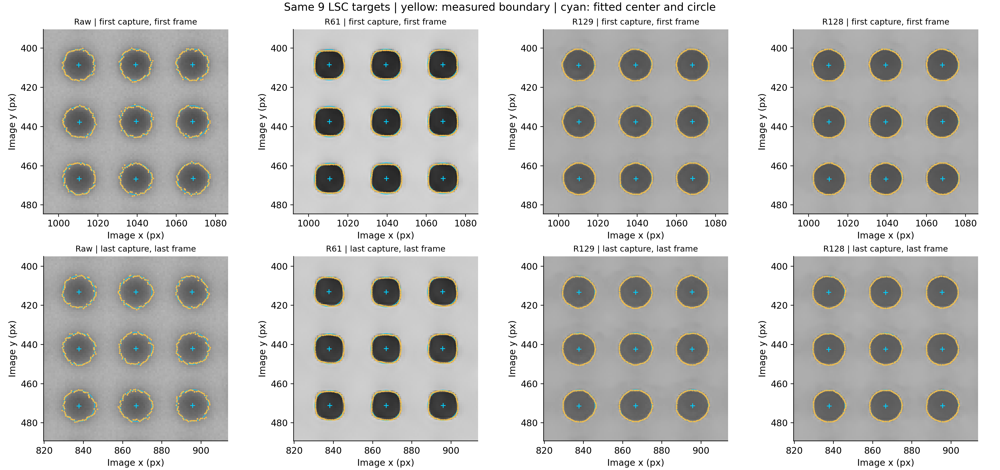
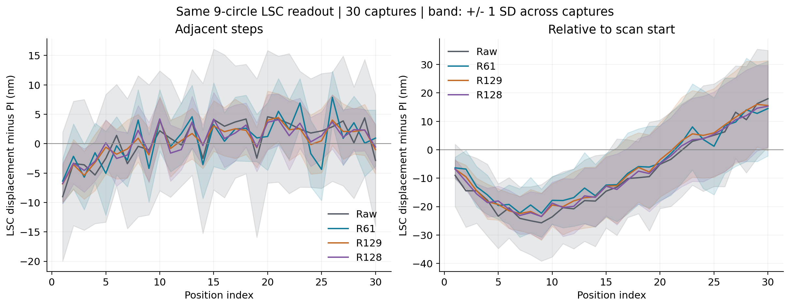
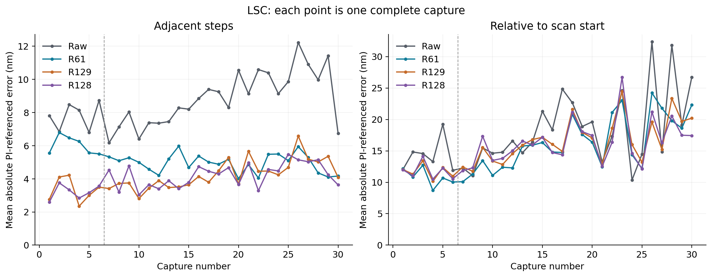
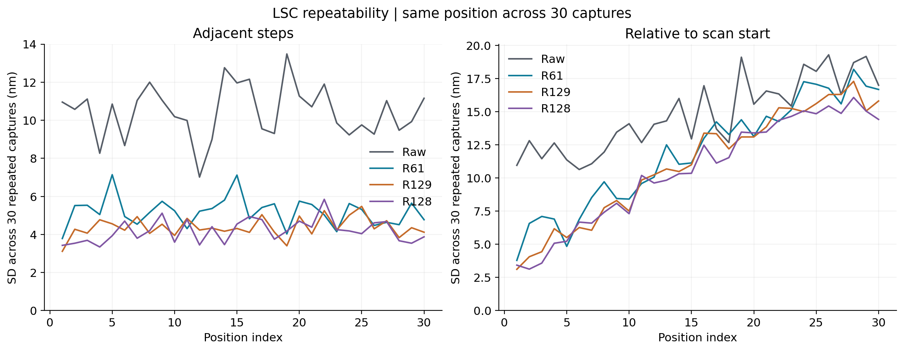
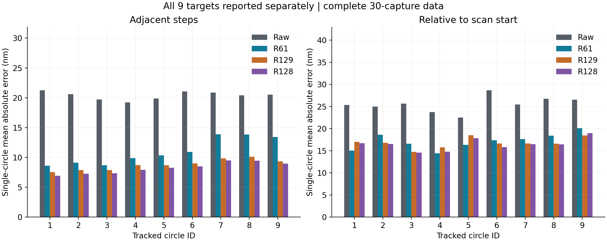

# R136：原圖、R61、R129、R128的完整LSC位移比較

**這份才是LSC主結果。**直接沿用論文的取邊與最小平方圓心定位程式，對同一組9顆圓逐張量測，再將前後圓心座標相減。前面的影像區域比對報告另外保留為方法比較，不能當作LSC結果。

## R128追加後的主要結論

四組都已完成全部30次、930張與8370筆圓心。R128相對原圖的短步平均誤差降低53.57%，重拍波動降低59.99%；相對起點誤差降低12.64%，波動降低28.57%。短步30次全改善，相對起點24次改善、6次退步。

R128和R129非常接近。R128短步平均誤差4.025nm，R129為4.092nm，只差0.067nm；兩者逐次比較各有15次較好，平均差的95%範圍包含零。R128長距離平均誤差與重拍波動數字略低於R129，但差異範圍同樣包含零，不能宣稱已證明R128全面勝過R129。短步的最大誤差反而是R129較低（16.104nm，R128為17.305nm）。

相對R61，R128短步平均誤差較小且波動較低；長距離平均誤差沒有明確優勢，R61的平均及最大誤差數字仍略低。R128的長距離重拍波動則較低。各指標需分開看，不自動更換正式模型。

以下差值皆為R128減比較對象，負值表示R128較小。

- Raw／adjacent平均誤差差：-4.642739nm；95%範圍[-5.112564,-4.171667]，3次成組範圍[-5.177960,-4.109498]；R128改善30次、退步0次。
- R61／adjacent平均誤差差：-1.135836nm；95%範圍[-1.526990,-0.763531]，3次成組範圍[-1.735110,-0.602833]；R128改善26次、退步4次。
- R129／adjacent平均誤差差：-0.067201nm；95%範圍[-0.292950,0.145944]，3次成組範圍[-0.288409,0.156087]；R128改善15次、退步15次。
- Raw／start平均誤差差：-2.242005nm；95%範圍[-3.704160,-0.917127]，3次成組範圍[-3.775773,-0.825148]；R128改善24次、退步6次。
- R61／start平均誤差差：0.228611nm；95%範圍[-0.583077,0.966412]，3次成組範圍[-0.728023,1.132459]；R128改善9次、退步21次。
- R129／start平均誤差差：-0.215537nm；95%範圍[-0.665346,0.214354]，3次成組範圍[-0.733427,0.207390]；R128改善16次、退步14次。
- Raw／adjacent重拍波動差：-6.269986nm；95%範圍[-6.612566,-5.596492]。
- R61／adjacent重拍波動差：-1.013116nm；95%範圍[-1.282396,-0.687663]。
- R129／adjacent重拍波動差：-0.197190nm；95%範圍[-0.394238,0.022552]。
- Raw／start重拍波動差：-4.226711nm；95%範圍[-5.898379,-2.335210]。
- R61／start重拍波動差：-1.300598nm；95%範圍[-2.423852,-0.144953]。
- R129／start重拍波動差：-0.507974nm；95%範圍[-1.080377,0.083764]。

## 完成範圍與主要數值

每個方法均完成30次掃描、930張影像、8370筆圓心定位。每一步900段、相對起點900筆；以下是9顆圓位移合併後的結果。合併沿用論文：分別取9顆圓X與Y位移的中位數。不能把這些數字說成單顆圓的定位能力。

| 位移     | 方法   |   平均絕對誤差nm |   重拍波動nm |   最大誤差nm |
|:---------|:-------|-----------------:|-------------:|-------------:|
| 每一步   | 原圖   |            8.667 |       10.452 |       36.676 |
| 每一步   | R61    |            5.160 |        5.195 |       19.990 |
| 每一步   | R129   |            4.092 |        4.379 |       16.104 |
| 每一步   | R128   |            4.025 |        4.182 |       17.305 |
| 相對起點 | 原圖   |           17.738 |       14.796 |       62.553 |
| 相對起點 | R61    |           15.267 |       11.870 |       47.432 |
| 相對起點 | R129   |           15.712 |       11.078 |       48.773 |
| 相對起點 | R128   |           15.496 |       10.570 |       47.751 |

- R61 每一步：平均絕對誤差改善40.46%，重拍波動改善50.30%；30次中30次改善、0次退步。平均改善量95%範圍[2.880, 4.140]nm；連續3次成組重抽為[2.581, 4.468]nm。負改善代表退步。
- R129 每一步：平均絕對誤差改善52.79%，重拍波動改善58.10%；30次中30次改善、0次退步。平均改善量95%範圍[4.174, 4.963]nm；連續3次成組重抽為[4.163, 4.992]nm。負改善代表退步。
- R128 每一步：平均絕對誤差改善53.57%，重拍波動改善59.99%；30次中30次改善、0次退步。平均改善量95%範圍[4.172, 5.113]nm；連續3次成組重抽為[4.109, 5.178]nm。負改善代表退步。
- R61 相對起點：平均絕對誤差改善13.93%，重拍波動改善19.78%；30次中24次改善、6次退步。平均改善量95%範圍[1.089, 3.891]nm；連續3次成組重抽為[1.323, 3.655]nm。負改善代表退步。
- R129 相對起點：平均絕對誤差改善11.42%，重拍波動改善25.13%；30次中21次改善、9次退步。平均改善量95%範圍[0.783, 3.407]nm；連續3次成組重抽為[0.786, 3.317]nm。負改善代表退步。
- R128 相對起點：平均絕對誤差改善12.64%，重拍波動改善28.57%；30次中24次改善、6次退步。平均改善量95%範圍[0.917, 3.704]nm；連續3次成組重抽為[0.825, 3.776]nm。負改善代表退步。

重拍波動：在每個相同位置，計算30次誤差的標準差，再取30個位置的平均。不是把同一掃描的30步混算，也不是除以√30後的平均值不確定度。95%範圍以完整掃描重抽10000次；9顆圓不當作9個獨立實驗。

## 個別9顆圓與同張影像的一致性

下表為每顆圓各自的平均絕對誤差（nm），未先合併9顆圓。

| kind     |   pillar_id |   R128 |   R129 |    R61 |    Raw |
|:---------|------------:|-------:|-------:|-------:|-------:|
| 每一步   |           1 |  6.922 |  7.537 |  8.601 | 21.245 |
| 每一步   |           2 |  7.262 |  7.882 |  9.097 | 20.611 |
| 每一步   |           3 |  7.352 |  7.890 |  8.678 | 19.731 |
| 每一步   |           4 |  7.905 |  8.733 |  9.883 | 19.211 |
| 每一步   |           5 |  8.279 |  8.693 | 10.326 | 19.881 |
| 每一步   |           6 |  8.492 |  8.992 | 10.908 | 21.049 |
| 每一步   |           7 |  9.500 |  9.833 | 13.871 | 20.869 |
| 每一步   |           8 |  9.442 | 10.121 | 13.851 | 20.395 |
| 每一步   |           9 |  8.960 |  9.339 | 13.409 | 20.532 |
| 相對起點 |           1 | 16.703 | 16.989 | 15.042 | 25.340 |
| 相對起點 |           2 | 16.550 | 16.778 | 18.600 | 24.961 |
| 相對起點 |           3 | 14.576 | 14.748 | 16.562 | 25.645 |
| 相對起點 |           4 | 14.786 | 15.766 | 14.391 | 23.716 |
| 相對起點 |           5 | 17.808 | 18.511 | 16.319 | 22.476 |
| 相對起點 |           6 | 15.836 | 16.663 | 17.341 | 28.642 |
| 相對起點 |           7 | 16.509 | 16.624 | 17.607 | 25.455 |
| 相對起點 |           8 | 16.434 | 16.580 | 18.415 | 26.717 |
| 相對起點 |           9 | 18.947 | 18.455 | 20.121 | 26.547 |

- R61（adjacent）：9顆圓中9顆平均誤差改善。
- R61（start）：9顆圓中9顆平均誤差改善。
- R129（adjacent）：9顆圓中9顆平均誤差改善。
- R129（start）：9顆圓中9顆平均誤差改善。
- R128（adjacent）：9顆圓中9顆平均誤差改善。
- R128（start）：9顆圓中9顆平均誤差改善。

每一段的9顆圓位移不一致程度保存在within_grid_variation.csv。它反映同張影像內的分散，不能直接等同與PI的真實誤差。

## 尺度與分開檢驗

相機Basler acA2040-120um、20倍，名義尺度0.1725μm/px。只用前6次原圖LSC位移估計方向與尺度，得到0.172520749μm/px，固定給所有方法後24次使用；任何模型的重建結果都不參與校正。

| 位移     | 方法   |   平均絕對誤差nm |   重拍波動nm |   最大誤差nm |
|:---------|:-------|-----------------:|-------------:|-------------:|
| 每一步   | 原圖   |            8.892 |       10.678 |       36.560 |
| 每一步   | R61    |            4.952 |        5.128 |       19.198 |
| 每一步   | R129   |            4.296 |        4.612 |       15.986 |
| 每一步   | R128   |            4.242 |        4.360 |       17.428 |
| 相對起點 | 原圖   |           18.424 |       15.659 |       62.685 |
| 相對起點 | R61    |           16.155 |       12.831 |       51.047 |
| 相對起點 | R129   |           16.515 |       12.155 |       52.147 |
| 相對起點 | R128   |           16.180 |       11.567 |       51.245 |

## 定位方式與驗證

- 原圖影像中的黑色連通區只用來辨識同一顆圓所在範圍，不作最終位移值。未利用PI答案決定圓心，未把原圖圓心複製給重建圖。
- 每張影像對每顆圓獨立取邊，再作幾何最小平方圓擬合。20倍沿用64個等弧長輪廓點、13次粗輪廓演化、法線兩側2.4像素搜索，並重設輪廓演化順序以保證重算一致。
- 樣品不同於舊論文拍攝，初始圓的位置與約8.33像素半徑由本批原圖取得。共用同一組9顆圓及相同設定，沒有依哪個模型分數較好另選目標。
- 全部33480組保存邊界點用另一個幾何圓心求解重算，最大圓心差2.62e-06像素；逐顆座標相減、代表影像重跑、PI換算均已核對。
- 圓心及每顆圓的完整取邊點皆保存，可直接畫回影像核對；未剔除不利影格或圓。

## 結論的範圍

這是同一樣品、同次20倍拍攝、指定9顆圓及LSC流程的PI參照結果。改善不能直接外推到其他形狀、倍率、不同天，也不等於已認證圓的真實直徑或形狀。影像中的側向只作補充，沒有獨立X方向行程來認證完整二維尺度。

PI校正證書、獨立有效倍率不確定度與殘餘拍攝／回授時間差未提供，因此本報告呈現重拍散布及PI差距，不捏造完整量測不確定度。前6次與後24次拍攝節奏不同，時間分段與趨勢也保留在表格中。

## 圖表

## 表格與資料

- [主要結果總表](../results/lsc/four_model_analysis/tables/readable_lsc_summary.csv)
- [每次掃描及指標](../results/lsc/four_model_analysis/tables/per_scan.csv)
- [各位置30次的變動範圍](../results/lsc/four_model_analysis/tables/per_position.csv)
- [配對改善與95%範圍](../results/lsc/four_model_analysis/tables/paired_comparisons.csv)
- [所有圓心座標](../results/lsc/four_model_analysis/tables/all_circle_centers.csv)
- [每顆圓逐段位移與PI對照](../results/lsc/four_model_analysis/tables/all_individual_circle_pairs.csv)
- [每顆圓的統計](../results/lsc/four_model_analysis/tables/individual_circle_summary.csv)

舊影像區域比對報告不改數字，但必須與本份LSC報告分開引用。

## 版本與保存

本份為2026-09-18新增R128後的四組結果。原三組報告、18頁PDF及既有ZIP均保留，不改寫為含R128。R128影像實體保存在H槽，D槽入口保持原樣。另一個訓練程序未停止或修改。
