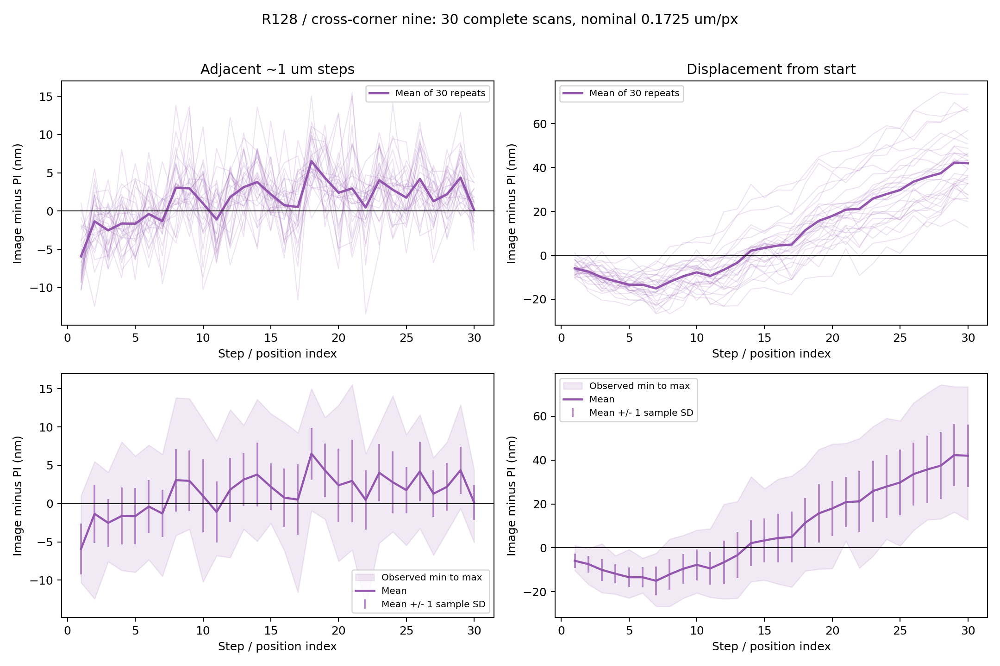
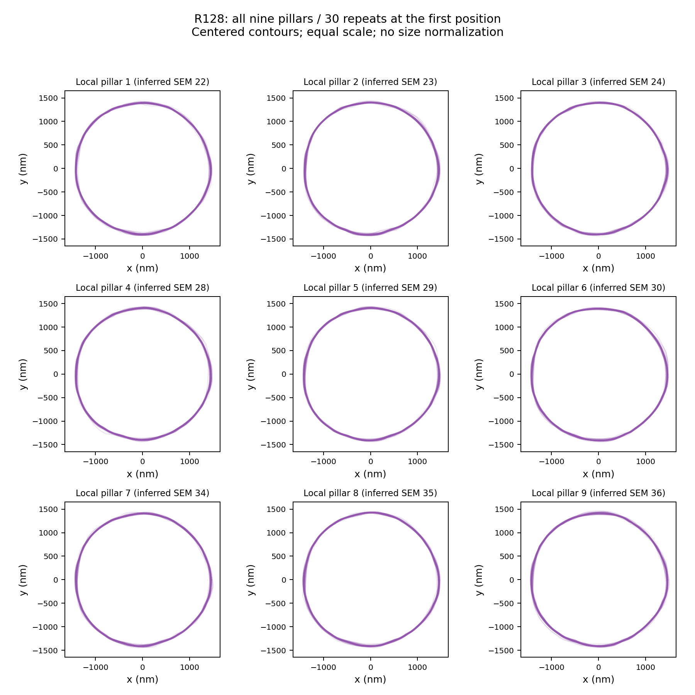
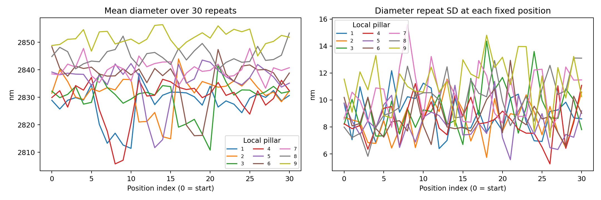
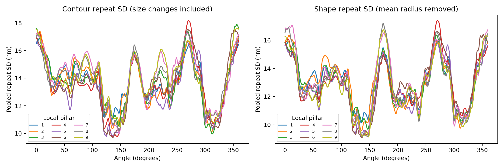

# R128：十字中心附近九顆 pillar 的重複度詳表

本文件只使用最新選定的十字交界九顆。固定R128模型，30次完整掃描、每次31個位置，共930張／8370輪廓。沒有混入之前畫面中央九顆，也沒有重新訓練或改重建。

## 位移

每張以論文LSC找九顆圓心，逐顆相减后取九顆位移向量的分量中位數，再比較同時記錄的PI回授。adjacent為相鄰約1μm步距；start為相對起點約1～30μm。每類900筆。正值為影像量到的位移較PI大。

| kind     |   observations |   scans |   positions |   mean_abs_PI_difference_nm |   mean_signed_PI_difference_nm |   repeat_sd_average_nm |   repeat_sd_pooled_rms_nm |   repeat_sd_min_nm |   repeat_sd_max_nm |   repeat_sd_average_ci95_low_nm |   repeat_sd_average_ci95_high_nm |   max_abs_PI_difference_nm |
|:---------|---------------:|--------:|------------:|----------------------------:|-------------------------------:|-----------------------:|--------------------------:|-------------------:|-------------------:|--------------------------------:|---------------------------------:|---------------------------:|
| adjacent |            900 |      30 |          30 |                      3.7081 |                         1.3591 |                 3.708  |                    3.7618 |             2.2815 |             5.3678 |                          3.2577 |                           3.9454 |                    15.5353 |
| start    |            900 |      30 |          30 |                     17.8638 |                         8.3472 |                10.0951 |                   10.8268 |             3.304  |            15.4529 |                          7.7618 |                          11.7319 |                    74.373  |

repeat_sd_average是30個固定步／位置各自跨30次的樣本標準差之平均，表示平均重拍波動。另列變異數平均後開根號，避免兩種彙整方式混稱。範圍列出各位置最小／最大波動；它們不是誤差上下界。ci95是以完整掃描重抽所得平均波動的95%範圍，不是未來單次量測的保證範圍。圖中的淡色區為本次實際最小至最大，線上誤差棒為±1標準差，並非95%區間。

### 約30μm終點

|   pi_displacement_um |   bias_nm |   repeatability_sd_nm |   observed_min_nm |   observed_max_nm |   mae_nm |
|---------------------:|----------:|----------------------:|------------------:|------------------:|---------:|
|              30.0011 |   41.9661 |                14.193 |           12.6889 |           73.4147 |  41.9661 |

終點和全路徑平均必須分開：可有很小重拍波動，同時存在每次都相似的固定偏差。

## 輪廓、尺寸、形狀

|   diameter_mean_nm |   diameter_repeat_sd_nm |   diameter_repeat_sd_nm_ci_low |   diameter_repeat_sd_nm_ci_high |   contour_repeat_sd_nm |   shape_repeat_sd_nm |   shape_repeat_sd_nm_ci_low |   shape_repeat_sd_nm_ci_high |   diameter_repeat_absmax_nm |   diameter_within_scan_sd_nm |
|-------------------:|------------------------:|-------------------------------:|--------------------------------:|-----------------------:|---------------------:|----------------------------:|-----------------------------:|----------------------------:|-----------------------------:|
|            2836.48 |                  9.5267 |                         7.7724 |                         10.6694 |                13.8347 |              13.0053 |                     11.8432 |                      13.5511 |                     50.1104 |                       9.3779 |

尺寸重拍波動：固定位置與固定顆粒，計算30次直徑變異數，再將31×9組變異數平均後開根號。輪廓重拍波動：去除圓心平移後，固定方向的邊界半徑跨30次波動，保留尺寸改變。形狀重拍波動：再扣除每條輪廓平均半徑，單看形狀改變。每個方向等權，沒有旋轉或縮放配合形狀。

最大尺寸偏離是所有8370次相對各自固定位置／顆粒30次平均的最大絕對直徑差，不是對SEM的最差誤差。diameter_within_scan_sd是一次掃描移動31個位置的尺寸波動，與重拍波動不同。

### 逐顆結果

|   local_pillar |   SEM_id_inferred |   mean_diameter_nm |   diameter_repeat_sd_nm |   diameter_max_deviation_nm |   contour_repeat_sd_nm |   shape_repeat_sd_nm |
|---------------:|------------------:|-------------------:|------------------------:|----------------------------:|-----------------------:|---------------------:|
|              1 |                22 |            2827.66 |                  9.0342 |                     37.2519 |                13.8323 |              13.0947 |
|              2 |                23 |            2831.65 |                  8.613  |                     30.8648 |                13.7428 |              13.0626 |
|              3 |                24 |            2829.93 |                  9.5782 |                     50.1104 |                13.8517 |              13.0188 |
|              4 |                28 |            2829.25 |                  8.5746 |                     32.7026 |                13.6521 |              12.9702 |
|              5 |                29 |            2835.79 |                  8.3801 |                     36.1041 |                13.4229 |              12.7583 |
|              6 |                30 |            2837.13 |                  8.8264 |                     38.3731 |                13.7036 |              12.9859 |
|              7 |                34 |            2840.15 |                 10.6741 |                     42.2274 |                14.2157 |              13.1974 |
|              8 |                35 |            2845.13 |                 10.1463 |                     49.5138 |                13.9887 |              13.0597 |
|              9 |                36 |            2851.62 |                 11.434  |                     44.3828 |                14.0855 |              12.8955 |

SEM編號採左右鏡像工作推定；局部顆粒1～9的追蹤身份固定且不依賴SEM方向。這些統計不因兩個SEM排列候選切換而變化。

## 與SEM尺寸分開解讀

新九顆R128平均直徑2836.478nm；SEM九顆平均2614.439nm，平均偏大222.040nm。這是尺寸差距，不能因尺寸重拍波動僅9.527nm而忽略。單次量測穩定和尺寸接近實物是不同問題。

上述結果採名義172.5nm/px與現有SEM邊界。PI回授、實際倍率、SEM尺度與邊界判讀的不確定度尚未全部合入，不將重拍標準差或其兩倍宣稱為完整總不確定度。這是同一拍攝工作階段的結果，不直接外推其他日期或樣品。

## 圖表

## 明細與核對

displacement_all_1800.csv完整位移；displacement_by_position_60.csv固定位置統計；endpoint_30um.csv終點；worst_displacements.csv最差實際案例；contours_all_8370.csv每個輪廓的圓心、直徑與形狀；nine_pillars.csv逐顆摘要。method_and_sources.json記錄固定模型、量法與來源雜湊。資料來自已核對的33480個四模型獨立圓擬合；本次再次按位置重算R128全部60個標準差、尺寸與形狀彙總，結果一致。
