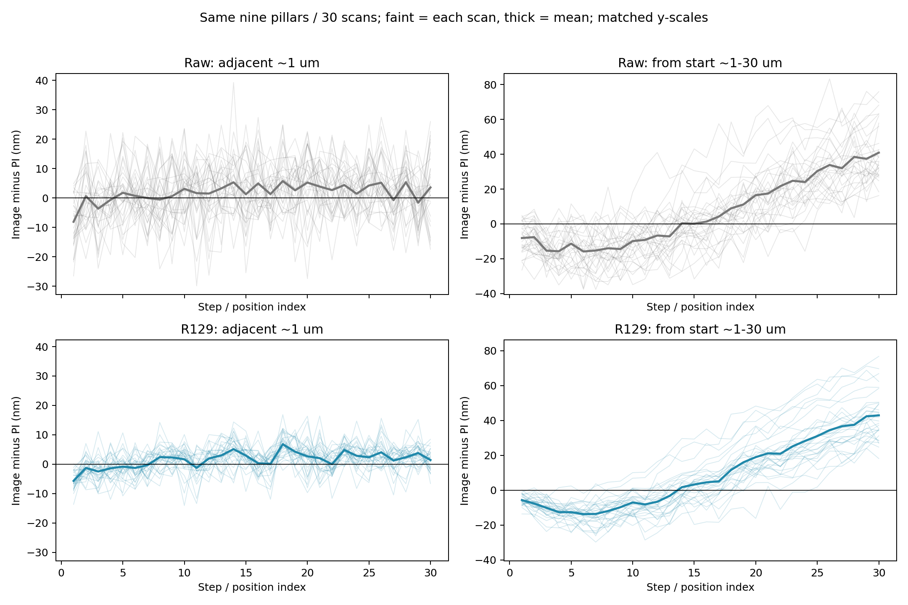
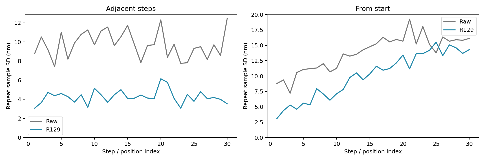
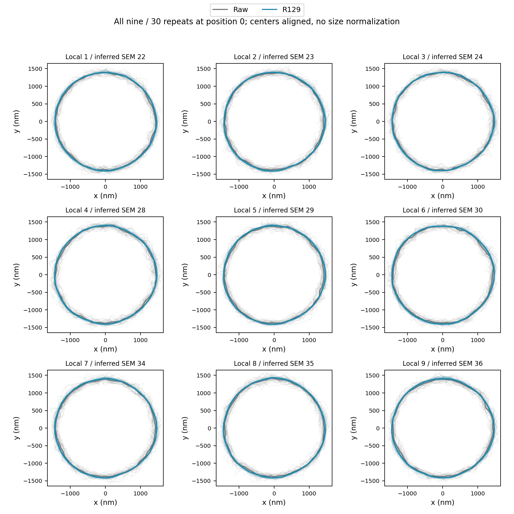
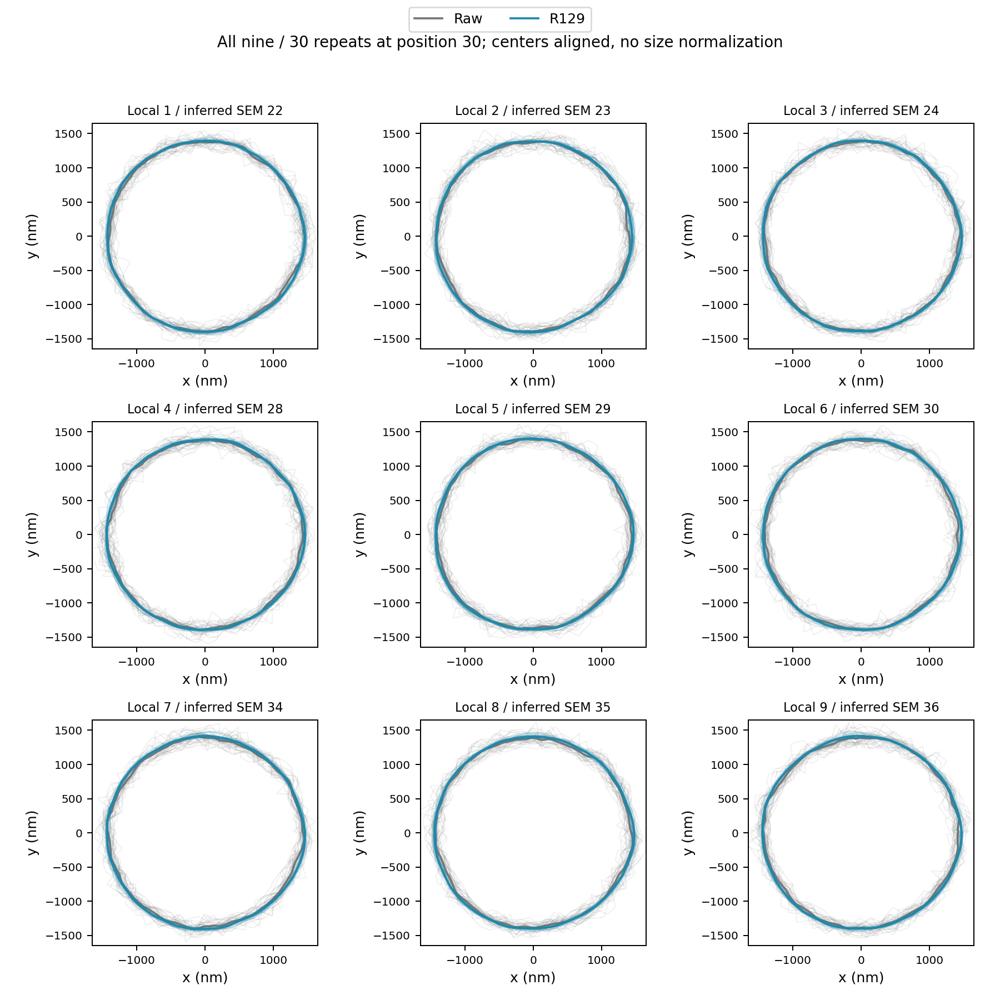
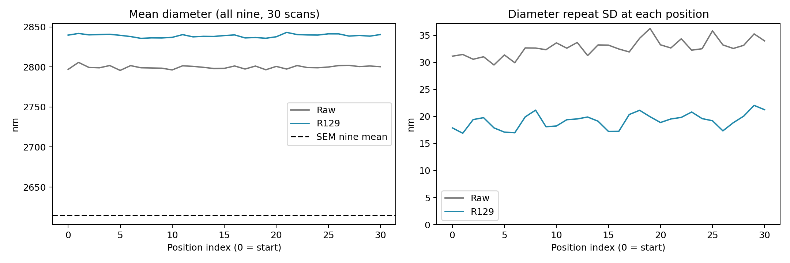
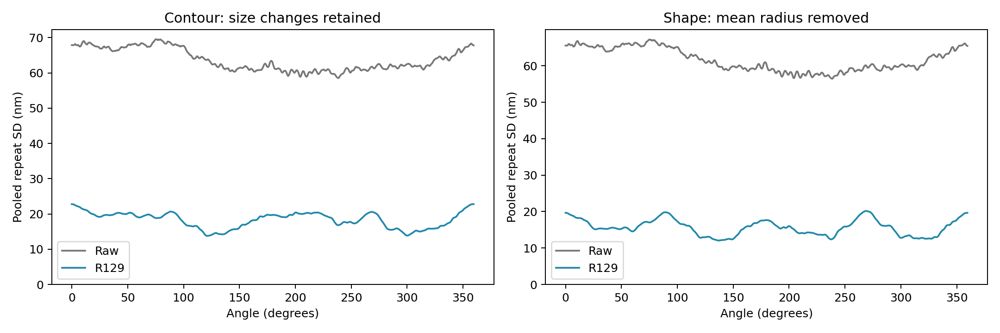
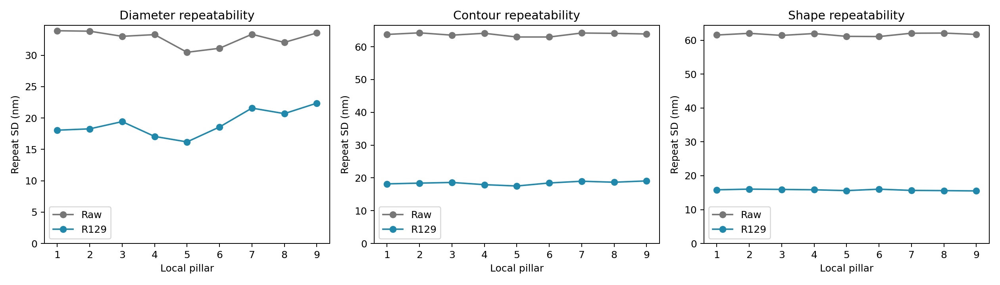
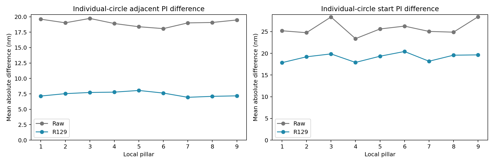
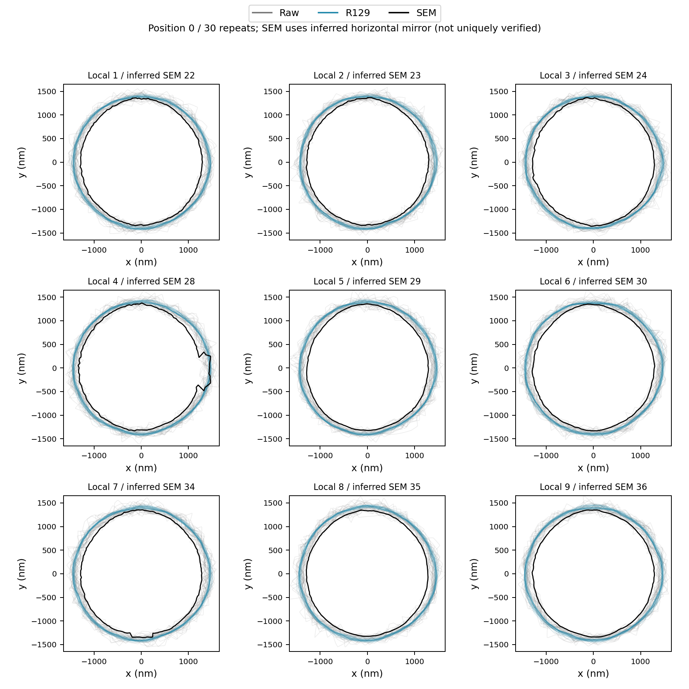
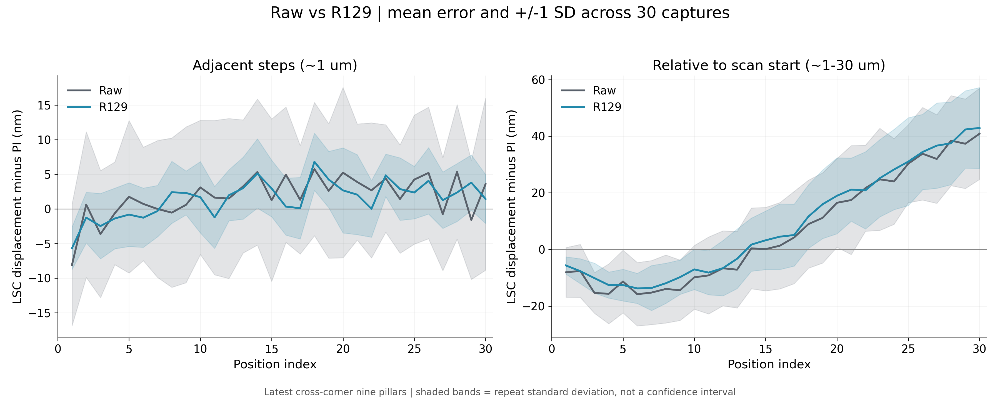

# Raw與R129：最新十字中心九顆的完整比較

相同九顆、相同30次掃描、每次31位置；每組930影像／8370輪廓。所有主要指標重新核對Raw/R129的掃描、位置和PI配對。沿用相同論文LSC邊界與圓心量法，名義172.5nm/px；無新推論、無训练、無剔除最差觀測。

結論：R129明顯降低短步位移與尺寸／輪廓的重拍波動。但九顆平均直徑相對SEM的偏大差距增加，不能把更穩定寫成尺寸更準。長距離位移的平均差距是否改善，另看配對範圍，不能只看平均值的名次。

本次2026-09-20重新驗證：Raw/R129共16740個圓擬合獨立重算，16740條輪廓的720方向重新計算，120組位移統計及60個R129不確定度分量重算，4張影像重播定位通過。重用固定模型已完成的浮點重建，沒有重新訓練或新推論。短步30/30次平均PI差距改善；起點相對全路徑20/30次改善、10次較差。約30μm終點偏差Raw+40.892nm、R129+42.933nm，並未改善。

## 主要比較

下表reduction_percent正值為相對Raw降低百分比；maximum是本次觀察到的最差值，不是未來保證界限。adjacent為相鄰約1μm，start為相對起點約1～30μm。

| scope    | metric                    |   Raw_nm |   R129_nm |   R129_minus_Raw_nm |   reduction_percent |
|:---------|:--------------------------|---------:|----------:|--------------------:|--------------------:|
| adjacent | mae_nm                    |    8.167 |     4.125 |              -4.041 |              49.485 |
| adjacent | repeatability_nm          |    9.725 |     4.251 |              -5.474 |              56.286 |
| adjacent | maximum_error_nm          |   39.299 |    16.868 |             -22.431 |              57.079 |
| start    | mae_nm                    |   19.081 |    17.985 |              -1.096 |               5.746 |
| start    | repeatability_nm          |   13.763 |    10.091 |              -3.672 |              26.68  |
| start    | maximum_error_nm          |   83.264 |    76.798 |              -6.466 |               7.766 |
| contour  | diameter_repeat_sd_nm     |   32.75  |    19.231 |             -13.519 |              41.281 |
| contour  | contour_repeat_sd_nm      |   63.758 |    18.437 |             -45.321 |              71.083 |
| contour  | shape_repeat_sd_nm        |   61.667 |    15.789 |             -45.878 |              74.397 |
| contour  | diameter_repeat_absmax_nm |  183.318 |    77.987 |            -105.331 |              57.458 |

位移repeatability是30個固定步／位置的跨30次標準差之平均。尺寸／輪廓repeatability是固定位置、顆粒與方向的樣本變異數平均後開根號。尺寸是直徑波動；輪廓與形狀是半徑方向波動，不應將其數值直接視為同一量。

## 完整掃描配對的差距範圍

R129減Raw，負值表示變小。以完整掃描為抽樣單位，不把900筆或九顆当独立掃描。保留普通重抽與連續三次掃描成組的範圍，包含零代表本批不足以確認方向。

| kind     |   candidate_minus_reference_mean_nm |   ci95_low |   ci95_high |   block3_ci95_low |   block3_ci95_high |   improved_scans |   worsened_scans |
|:---------|------------------------------------:|-----------:|------------:|------------------:|-------------------:|-----------------:|-----------------:|
| adjacent |                              -4.041 |     -4.408 |      -3.677 |            -4.387 |             -3.713 |               30 |                0 |
| start    |                              -1.096 |     -1.979 |      -0.278 |            -2.032 |             -0.239 |               20 |               10 |

## 約30μm終點（與全路徑平均分開）

| model   |   pi_displacement_um |   bias_nm |   repeatability_sd_nm |   observed_min_nm |   observed_max_nm |
|:--------|---------------------:|----------:|----------------------:|------------------:|------------------:|
| R129    |               30.001 |    42.933 |                14.299 |            18.161 |            76.798 |
| Raw     |               30.001 |    40.892 |                16.124 |            16.274 |            75.88  |

## 各顆尺寸與輪廓

| model   |   local_pillar |   SEM_id_inferred |   diameter_mean_nm |   diameter_repeat_sd_nm |   contour_repeat_sd_nm |   shape_repeat_sd_nm |   diameter_max_deviation_nm |
|:--------|---------------:|------------------:|-------------------:|------------------------:|-----------------------:|---------------------:|----------------------------:|
| Raw     |              1 |                22 |            2793.86 |                  33.906 |                 63.763 |               61.524 |                     118.679 |
| Raw     |              2 |                23 |            2797.62 |                  33.833 |                 64.251 |               62.026 |                     113.299 |
| Raw     |              3 |                24 |            2795.97 |                  33.017 |                 63.544 |               61.413 |                     183.318 |
| Raw     |              4 |                28 |            2798.8  |                  33.286 |                 64.108 |               61.963 |                     131.178 |
| Raw     |              5 |                29 |            2800.94 |                  30.472 |                 62.979 |               61.133 |                     118.437 |
| Raw     |              6 |                30 |            2800.52 |                  31.107 |                 62.978 |               61.072 |                     127.757 |
| Raw     |              7 |                34 |            2799.07 |                  33.341 |                 64.195 |               62.058 |                     129.465 |
| Raw     |              8 |                35 |            2802.32 |                  32.044 |                 64.088 |               62.102 |                     100.842 |
| Raw     |              9 |                36 |            2807.49 |                  33.558 |                 63.9   |               61.701 |                     117.536 |
| R129    |              1 |                22 |            2831.58 |                  18.056 |                 18.181 |               15.838 |                      59.449 |
| R129    |              2 |                23 |            2835.45 |                  18.269 |                 18.409 |               16.041 |                      55.904 |
| R129    |              3 |                24 |            2833.26 |                  19.422 |                 18.612 |               15.954 |                      77.987 |
| R129    |              4 |                28 |            2833.44 |                  17.06  |                 17.94  |               15.847 |                      52.717 |
| R129    |              5 |                29 |            2838.14 |                  16.187 |                 17.532 |               15.604 |                      55.39  |
| R129    |              6 |                30 |            2839.14 |                  18.561 |                 18.453 |               16.025 |                      62.297 |
| R129    |              7 |                34 |            2841.88 |                  21.575 |                 18.985 |               15.664 |                      65.491 |
| R129    |              8 |                35 |            2845.84 |                  20.697 |                 18.683 |               15.603 |                      64.732 |
| R129    |              9 |                36 |            2851.47 |                  22.361 |                 19.081 |               15.514 |                      68.397 |

局部1～9為固定追蹤身份；SEM編號採左右鏡像工作推定，未宣稱已唯一確認方向。起點與終點各提供全部九顆的30次輪廓疊圖，Raw灰色、R129藍色；只對齊圓心，不縮放或旋轉消除差異。

## 尺寸與SEM

| model   |   mean_diameter_nm |   SEM_group_mean_diameter_nm |   group_signed_diameter_difference_nm |   group_difference_between_scan_sd_nm |
|:--------|-------------------:|-----------------------------:|--------------------------------------:|--------------------------------------:|
| Raw     |            2799.62 |                      2614.44 |                               185.182 |                                22.279 |
| R129    |            2838.91 |                      2614.44 |                               224.472 |                                17.075 |

R129比Raw的平均直徑大39.290nm；SEM九顆平均相同，因此整組平均尺寸偏大差距也增加39.290nm（約21.22%）。這項集合平均不受九顆編號排列影響。SEM逐顆方向仍有兩種候選；下表完整保留兩種的輪廓差距，不以較好分數挑方向，也不把去尺寸後的形狀改善當成完整輪廓或尺寸改善。candidate1為目前推定的左右鏡像、candidate2為保留的90度旋轉。radial_mae保留尺寸差；shape_mae扣除平均半徑差，均為nm。兩種方向下，R129形狀差距較小，但含尺寸的完整輪廓差距較大。

| model   |   mapping_candidate |   diameter_mae_nm |   radial_mae_nm |   shape_mae_nm |
|:--------|--------------------:|------------------:|----------------:|---------------:|
| R129    |                   1 |           224.472 |         112.69  |         32.636 |
| R129    |                   2 |           224.472 |         113.357 |         17.243 |
| Raw     |                   1 |           185.182 |          98.511 |         56.348 |
| Raw     |                   2 |           185.182 |          96.765 |         50.994 |

## 圖表

## 明細、範圍與核對

共有3600筆九顆合併位移、32400筆單顆位移、16740輪廓、120個固定步／位置統計；另有每次掃描、前6／後24時段、同一觀測的兩模型最差案例對照、逐顆與逐角度表。最大直徑偏離是相對同位置同顆30次平均，不是對SEM的誤差。

本次重新核對Raw/R129共16740個獨立圓擬合，並重播選定影像的邊界定位。本次另重新核對所有120個位置標準差、兩模型全部尺寸／形狀彙總、掃描鍵及PI完全一致。輪廓插值720方向來自原64邊界點，不增加實際解析度；來源雜湊與驗證紀錄另存。

所有波動只代表本次拍攝工作階段；沒有把PI校正、實際倍率、SEM尺度和邊界判讀未知分量設成零。完整總不確定度尚未建立。更穩定不等同絕對尺寸更準。

<!-- MEAN_SD_OVERLAY -->

## 平均曲線與波動帶疊合圖

灰色Raw、藍色R129，兩組直接疊在同一座標。實線是每個固定位置30次的平均PI差值，半透明帶是平均±1個樣本標準差；帶越窄代表本次重拍越一致。它不是95%信賴區間，也不是最大誤差範圍。左圖相鄰約1μm短步，右圖相對起點約1～30μm。兩圖均使用最新十字中心九顆，不使用範例中的舊R129資料。

PNG可直接閱讀；同名SVG可作向量圖排版。逐點畫圖資料在overlay_mean_sd_plot_data.csv，全部120組平均與標準差均重新由3600筆明細核對。
