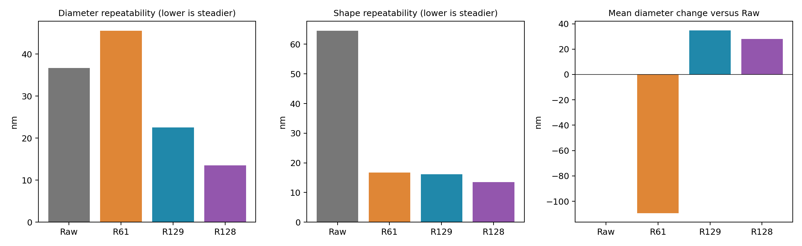
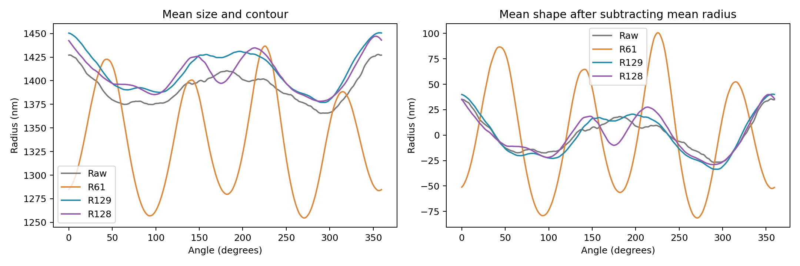
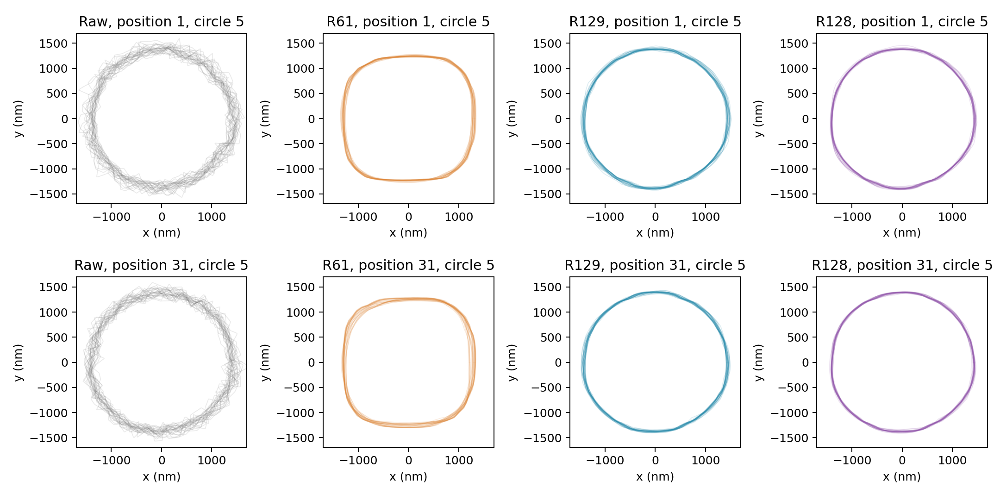

# R136 四組輪廓、形狀與尺寸驗證：重拍部分

2026-09-19。已完成現有 30 次重拍的比較；使用者確認另有同批實物參考，等待提供位置。準確程度的驗證尚未完成。

這批資料中，R128 的尺寸與形狀重拍波動最小，R129 次之。R61 的輪廓呈明顯圓角方形，平均直徑比原圖小約 109 nm；R128、R129 分別比原圖大約 28、35 nm。原圖不是實物真值，因此上述差距不能稱作尺寸誤差。更圓、更平滑也不能直接等於更正確。

| 組別 | 平均直徑 μm | 尺寸重拍波動 nm | 形狀重拍波動 nm | 最大全次尺寸偏離 nm |
|---|---:|---:|---:|---:|
| Raw | 2.7875 | 36.71 | 64.55 | 139.40 |
| R61 | 2.6782 | 45.58 | 16.73 | 136.24 |
| R129 | 2.8224 | 22.53 | 16.20 | 72.17 |
| R128 | 2.8154 | 13.56 | 13.56 | 59.96 |

尺寸與形狀重拍波動越小，代表同一批物體重拍後量到的結果越一致。R128 相較 R129，尺寸波動減少約 40%，形狀波動減少約 16%。配對重抽完整掃描所得差距範圍皆低於零；此證據限定這次拍攝、這九顆物體與目前讀取方法。

## 計算定義與範圍

- 四組使用完全相同的 30 次 ×31 位置 ×9 顆，共 33,480 個已保存邊界；每組 8,370 個。沒有挑掉不利樣本、重新訓練或改模型。
- 使用原論文 LSC 圓心、半徑與 64 個邊界點。直徑為兩倍 LSC 半徑。面積等效直徑、圓形程度、徑向起伏及二階／四階形狀分量保存在逐顆資料表，都是描述值，不是真值誤差。
- 尺度為相機像素 3.45 μm／20 倍，即名義 172.5 nm/px；尚未加入獨立倍率校正或 SEM 尺度不確定度。nm 數值會隨後續尺度校正同比改變。
- 每個相同位置序號、相同顆粒分別計算 30 次樣本變異數，再將 279 組變異數平均後開根號，得到表中尺寸重拍波動。這是每次測量的波動，不是 30 次平均值的不確定度，也不是完整總不確定度。
- 輪廓先以各自 LSC 圓心消除平移，不旋轉、不縮放；以固定影像角度插值為 720 方向。原始邊界仍只有 64 點，插值不增加實際解析度。先扣每條輪廓的平均半徑，再以相同方法計算角度與目標的平均重拍變異，得到形狀重拍波動。未扣平均半徑的完整輪廓波動另存 summary.csv。
- 最大尺寸偏離：每次直徑相對該位置、該顆粒 30 次平均的最大絕對差。不是對實物的最差誤差，也不是保證未來不會超過的界限。
- 另列每次掃描內 31 個位置的尺寸波動，分開呈現移動取樣造成的變化。位置序號對應同一移動程序；沒有強制 PI 實際位置完全相等。
- 範圍估計採 2,000 次完整掃描配對重抽，四組使用同一組抽樣次序，取百分位 95% 範圍；不把 8,370 顆次或 720 角度視為獨立樣本。未剔除時間漂移，結果包含本次工作階段的變動；不能外推不同樣品或不同日期。

## 已完成檢查

逐顆數量、位置與顆粒鍵無重複；理想圓、橢圓及平移不變性檢查通過；33,480 個徑向殘差結果與原有資料一致。另以分組資料表獨立重算尺寸波動、重新載入輪廓重算形狀波動，與摘要一致。三張圖已實際查看。原模型、原影像、先前位移成果與另一項訓練均未修改。

## 待同批參考到位後完成

確認九顆物體與參考一一對應，核對參考尺度及量測定義，再比較直徑差、逐方向輪廓差、局部最差差距及形狀差。形狀對齊只去除剛體位移／有根據的旋轉，不用自由縮放消去尺寸誤差。參考本身的尺度與邊界判讀誤差需獨立列入。既有另一批 SEM 成果不混入本表。

## 圖表與資料

資料位於 results/shape_size：summary.csv 總表、per_contour.csv 逐顆明細、per_scan.csv 每次掃描平均、matched_target_statistics.csv 各位置各顆统计、paired_scan_intervals.csv 配對差距範圍，以及四組徑向輪廓、來源雜湊與核對紀錄。scripts/shape_size_validation.py 可重算，scripts/publish_shape_size.py 核對並發布本成果。
