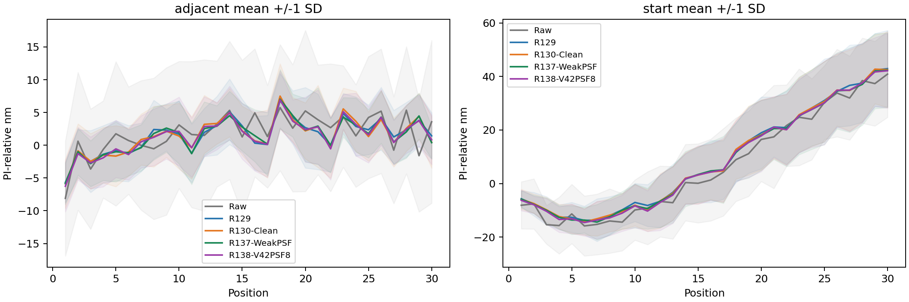
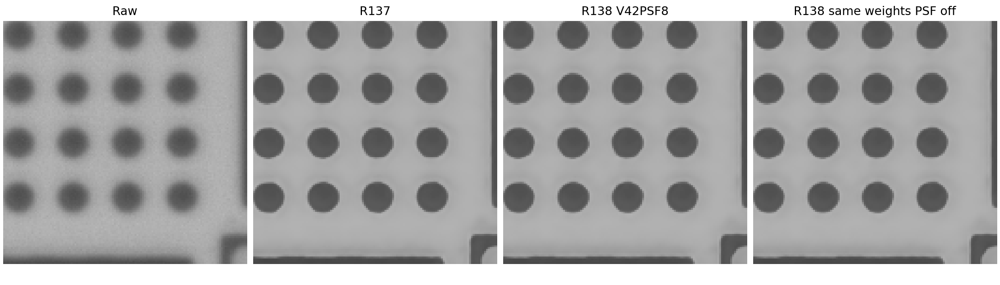

# R138 V42八候選PSF完整結果

完成日期：2026-09-23T04:44:55.724380+00:00。本輪依使用者要求，把原R137的平均PSF特徵改成V42 WeakPSFDeconvBlock，從零完整8192次訓練，再重建930張真實影像及量測8370輪廓。既有模型及正式基準不改。

## 實際模型與公平範圍

使用既有25顆PSF，未假設視野網格，自動等間距取索引0,3,7,10,14,17,21,24；網路依64通道輸入特徵給八顆混合權重。模組類別與V42原始程式相同，接在R137主幹stem、SiLU前，每個迭代回合使用一次，共四次。不是整個網路變成V42。

原V42正則值30、頻率遮罩比例0.25、softmax溫度1.5、clamp處理與FFT原點規則沿用；beta從0.02可學、限制0至0.1；beta_scale_max設1保留初始有效0.02。新增gating末層從零開始，初始八顆等權。全網scratch，沒有V42或R137神經權重匯入。

共享同512/128/128合成資料、噪聲、順序、學習率和三項損失；主幹起點一致，8192更新並固定最後模型。V42模組使用全圖池化與FFT，沒有沿用R130有限依賴半徑、裁切上下文等價或分塊等價的宣稱。訓練320區塊中央128監督，實拍完整1544×2064；訓練/完整視野的全局上下文不同為此設計限制。

参数301278，訓練經過31799.76秒；最後模型SHA256 7775c855524279a55c5d2250fd88abb1b3800b38c902d1d7d798b3828505942a。實際beta=-0.00291351，有效beta=0.00000000。

## displacement_summary

| model        | kind     |    mae_nm |   bias_nm |   repeatability_nm |   maximum_error_nm |
|:-------------|:---------|----------:|----------:|-------------------:|-------------------:|
| R129         | adjacent |  4.125379 |  1.473343 |           4.251368 |          16.867789 |
| R129         | start    | 17.984507 |  8.616078 |          10.090807 |          76.797530 |
| R130-Clean   | adjacent |  4.121476 |  1.500136 |           4.184162 |          20.414296 |
| R130-Clean   | start    | 17.948881 |  8.434741 |           9.971710 |          72.976954 |
| R137-WeakPSF | adjacent |  3.916681 |  1.448317 |           3.905599 |          17.544931 |
| R137-WeakPSF | start    | 17.930924 |  8.230503 |          10.238951 |          74.757564 |
| R138-V42PSF8 | adjacent |  4.094286 |  1.395773 |           4.218772 |          19.505664 |
| R138-V42PSF8 | start    | 18.076518 |  8.075977 |          10.142024 |          73.151789 |
| Raw          | adjacent |  8.166620 |  1.834932 |           9.725348 |          39.299200 |
| Raw          | start    | 19.080973 |  6.429397 |          13.762741 |          83.263940 |

## shape_size_summary

| model        |   diameter_mean_nm |   diameter_repeat_sd_nm |   contour_repeat_sd_nm |   shape_repeat_sd_nm |   diameter_repeat_absmax_nm |
|:-------------|-------------------:|------------------------:|-----------------------:|---------------------:|----------------------------:|
| Raw          |        2799.620660 |               32.750251 |              63.758024 |            61.666738 |                  183.317502 |
| R129         |        2838.910772 |               19.230772 |              18.436707 |            15.788824 |                   77.986558 |
| R130-Clean   |        2833.847223 |               16.421786 |              18.579026 |            16.669974 |                   68.237042 |
| R137-WeakPSF |        2836.821732 |               14.262392 |              17.709881 |            16.201211 |                   54.668392 |
| R138-V42PSF8 |        2834.059119 |               16.518877 |              19.103691 |            17.243365 |                   70.372664 |

## SEM_comparison

| model        |   mapping_candidate |   SEM_mean_diameter_nm |   mean_diameter_difference_nm |   full_radial_difference_nm |   de_size_shape_difference_nm |
|:-------------|--------------------:|-----------------------:|------------------------------:|----------------------------:|------------------------------:|
| Raw          |                   1 |            2614.438543 |                    185.182117 |                   98.510978 |                     56.348315 |
| R129         |                   1 |            2614.438543 |                    224.472228 |                  112.689735 |                     32.636326 |
| R130-Clean   |                   1 |            2614.438543 |                    219.408680 |                  110.447462 |                     28.092678 |
| R137-WeakPSF |                   1 |            2614.438543 |                    222.383188 |                  111.832438 |                     29.845842 |
| R138-V42PSF8 |                   1 |            2614.438543 |                    219.620576 |                  110.347924 |                     30.670294 |
| Raw          |                   2 |            2614.438543 |                    185.182117 |                   96.765500 |                     50.993724 |
| R129         |                   2 |            2614.438543 |                    224.472228 |                  113.356990 |                     17.243175 |
| R130-Clean   |                   2 |            2614.438543 |                    219.408680 |                  110.909184 |                     19.409317 |
| R137-WeakPSF |                   2 |            2614.438543 |                    222.383188 |                  112.461372 |                     18.918890 |
| R138-V42PSF8 |                   2 |            2614.438543 |                    219.620576 |                  111.046845 |                     19.101735 |

## paired_scan_intervals

| reference    | metric                |   difference_nm |   ci95_low |   ci95_high |   improved_scans |
|:-------------|:----------------------|----------------:|-----------:|------------:|-----------------:|
| Raw          | adjacent_mae_nm       |       -4.072335 |  -4.432863 |   -3.713516 |        30.000000 |
| Raw          | start_mae_nm          |       -1.004455 |  -1.778077 |   -0.267731 |        22.000000 |
| Raw          | diameter_repeat_sd_nm |      -16.231374 | -16.767416 |  -15.003634 |       nan        |
| Raw          | contour_repeat_sd_nm  |      -44.654333 | -45.779147 |  -41.817773 |       nan        |
| Raw          | shape_repeat_sd_nm    |      -44.423373 | -45.662738 |  -41.456088 |       nan        |
| R129         | adjacent_mae_nm       |       -0.031093 |  -0.182292 |    0.112616 |        17.000000 |
| R129         | start_mae_nm          |        0.092011 |  -0.101033 |    0.280440 |        13.000000 |
| R129         | diameter_repeat_sd_nm |       -2.711896 |  -3.226098 |   -2.086086 |       nan        |
| R129         | contour_repeat_sd_nm  |        0.666985 |   0.493255 |    0.823401 |       nan        |
| R129         | shape_repeat_sd_nm    |        1.454541 |   1.314669 |    1.550029 |       nan        |
| R130-Clean   | adjacent_mae_nm       |       -0.027191 |  -0.128790 |    0.082026 |        15.000000 |
| R130-Clean   | start_mae_nm          |        0.127636 |   0.022293 |    0.266040 |        11.000000 |
| R130-Clean   | diameter_repeat_sd_nm |        0.097091 |  -0.250991 |    0.376886 |       nan        |
| R130-Clean   | contour_repeat_sd_nm  |        0.524665 |   0.309728 |    0.683282 |       nan        |
| R130-Clean   | shape_repeat_sd_nm    |        0.573391 |   0.373065 |    0.712886 |       nan        |
| R137-WeakPSF | adjacent_mae_nm       |        0.177605 |   0.073813 |    0.292164 |         8.000000 |
| R137-WeakPSF | start_mae_nm          |        0.145594 |   0.002937 |    0.308401 |        11.000000 |
| R137-WeakPSF | diameter_repeat_sd_nm |        2.256485 |   1.395179 |    2.799476 |       nan        |
| R137-WeakPSF | contour_repeat_sd_nm  |        1.393810 |   1.122911 |    1.564319 |       nan        |
| R137-WeakPSF | shape_repeat_sd_nm    |        1.042154 |   0.876616 |    1.173690 |       nan        |

## endpoint_30um

| model        |      mean |       std |       min |       max |
|:-------------|----------:|----------:|----------:|----------:|
| R129         | 42.932539 | 14.299373 | 18.160912 | 76.797530 |
| R130-Clean   | 42.544223 | 14.089260 | 18.080670 | 72.976954 |
| R137-WeakPSF | 42.307907 | 13.871387 | 17.667494 | 73.085921 |
| R138-V42PSF8 | 42.150816 | 14.003372 | 18.233030 | 73.151789 |
| Raw          | 40.892288 | 16.124314 | 16.274059 | 75.880352 |

## PSF參與及查核

|        frame |   replay_max_error |   on_off_rms_gray |   on_off_max_gray |
|-------------:|-------------------:|------------------:|------------------:|
|   0.00000000 |         0.00000000 |        0.00000000 |        0.00000000 |
|  30.00000000 |         0.00000000 |        0.00000000 |        0.00000000 |
| 899.00000000 |         0.00000000 |        0.00000000 |        0.00000000 |
| 929.00000000 |         0.00000000 |        0.00000000 |        0.00000000 |

全部930張×4回合權重另存PSF_all930_iteration_weights.csv；四張實拍與32生成資料做同權重PSF开关檢查，不是完整關閉版930影像或重新訓練消融。若beta退到0或權重近乎一致，應如實解讀為模型未依賴此分支，不能修改門檻或結果硬稱有效。

已核對8192次與R137輸入/噪聲/順序相同、930輸出識別、8370獨立圓重擬合，另從五方法圓心重算9000位移，最大差3.56e-12nm。

## 耗時範圍

本次930張重建中位2.3892秒，含讀寫3.4286秒。本輪裝置依保存進度切換記錄，實際使用見device_history.jsonl，未作受控跨裝置效率比較，不據此聲稱PSF固有速度代價。

## 限制

同一已用過的真實資料集、同一樣本工作階段；PSF有歷史SEM校準來源限制，兩SEM方向候選都保留。重拍穩定與尺寸準確分開，未合成完整系統不確定度，不主張全套XAI或多種樣本泛化。

## 中途續訓及計時範圍

本輪加上獨立版本的裝置與執行緒續訓層，原始執行程式雜湊保留不變。模型、優化器、步数、隨機狀態保存後再切換；全部段落見runs/formal_8192/device_history.jsonl。訓練時間為各更新時間總和，不含開發檢查與停頓，不與前輪总時間直接比較。CPU與GPU浮點差異可使訓練軌跡略不同，混合裝置不能宣稱逐位元等同單裝置訓練。
