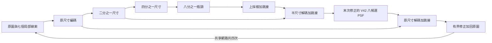

# R139 U-Net 融合設計與驗證界線

## 模型主體

真正的 U-Net 來自多層編碼、解碼和跳接；不是把單一上採樣層改名。選用三層下／上採樣，使整體更接近 V42 的階層方式。固定低通處理下採樣和上採樣，保留高解析度跳接；用原圖參考輸出限制尺寸與位移漂移。沒有 GroupNorm 或全圖亮度條件器，以免引入新的整幅亮度依賴。

七個線索：當前重建 z、原圖 x、z−x、原圖水平與垂直差、拉普拉斯、5×5均值。U-Net 權重在四次修正間共享；每次提出一個通道修正，tanh 後加到累積 r；r 界線為 ±0.35，z=clip(x+r,0,1)。初始輸出頭全零，因此初始為恆等映射。

## PSF 放置與身份

直接採 V42 `WeakPSFDeconvBlock` 類別；以原既有25顆自動取八候選，不自行推定視野對應。V42 預設在解碼器 y2 處理一次；此模型在最末次反覆修正的半解析度解碼層處理一次。這是刻意取捨：保留四次共享修正，但避免 R138 在輸入主幹四次反覆套用光學操作。**它不是逐層等同 V42 的整個 U-Net。**

PSF 的像素尺度仍需審查：原 101×101 核在半解析度特徵使用遵循 V42 的程式語意，但不能直接當成原始影像像素尺度的獨立物理證明。這批核有歷史校準來源，不能把同批 SEM 對照宣稱為完全獨立確認。

## 暫定訓練政策

保留同 512／128／128 合成資料分組、既有三項損失與一對合成位移的殘差一致性。先讓 U-Net 主幹訓練兩個循環，此時 beta_scale=0 且光學參數凍結；第三循環開始 beta_scale=0.12，至第九循環逐步到0.28，光學參數學習率為主幹的5%。beta 的原始值在每次優化後投影到有效區間，使硬截斷不會造成 R138 曾出現的負值死區。這是待正式訓練鎖定的建議策略，目前**未開始正式訓練**。

不能預先假設 PSF 一定有利。訓練時應保存每次 beta、scale、八候選權重及固定開發集表現；若光學支路又趨近零，要按實際結果報告，不因論文創新需求強制保留無效分支。

## 判斷是否值得長訓練

目前只完成架構和可運作檢查。正式訓練前，還須檢查相同128中央監督在較大上下文下的輸出差、已知位移的保持、完整影像記憶體及受控訓練時間。正式候選只能以最後固定模型對同一批930張正常拍攝影像的 PI 位移、尺寸與 ACM 輪廓量測及兩個 SEM 方向候選判斷；相同資料已反覆使用，不能作未見保留集。

不應以原型前向時間當成已訓練模型速度；不應把 U-Net 結構本身或 PSF 有效性寫作已證實的論文創新。所有上一代結果保持原樣。
