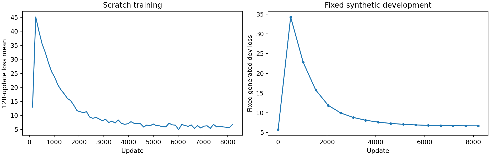
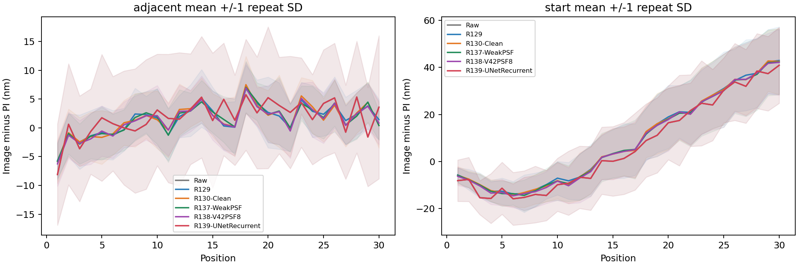
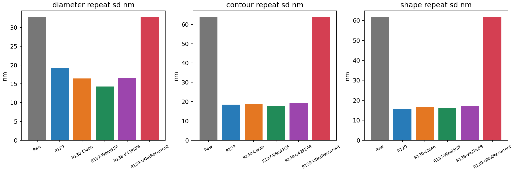

> **結果更正（2026-09-23）**：本輪完整執行，但模型早期輸出飽和並退化為原圖加近乎固定亮度偏移。位移、輪廓及尺寸重拍基本等同 Raw；PSF 開關不改輸出。此模型不可採用。完整機制與數據見 [R139 因果審查](R139_CAUSAL_AUDIT.md)。以下原始自動表格保留實際測量值，不能單憑「完成」解讀成能力提升。

# R139 U-Net 反覆修正模型完整結果

完成時間：2026-09-23T08:19:41.440861+00:00。真正三層U-Net加四次共享修正，使用同一批合成資料從零8192次訓練；V42八候選PSF放半尺寸解碼層，在末次修正啟用。訓練前固定最後checkpoint及共同真實驗證方法。

## 主要判讀

R139短步平均PI差8.167nm，R137為3.917nm；R139直徑重拍32.747nm、輪廓重拍63.758nm，R137分別14.262與17.710nm。各指標分開解讀，未自動替換論文或正式模型。

模型參數：1442910；最終checkpoint SHA256：9964488510500255bf4f171d0483179a22af30989324fd5baca0c691487f4d98。實際光學參與：False；原始beta=0.020000、scale=0.280000、有效beta=0.005600。若光學無作用應如實說明，不把可關閉介面當成PSF有效性。

## 位移

| model              | kind     |    mae_nm |   bias_nm |   repeatability_nm |   maximum_error_nm |
|:-------------------|:---------|----------:|----------:|-------------------:|-------------------:|
| R129               | adjacent |  4.125379 |  1.473343 |           4.251368 |          16.867789 |
| R129               | start    | 17.984507 |  8.616078 |          10.090807 |          76.797530 |
| R130-Clean         | adjacent |  4.121476 |  1.500136 |           4.184162 |          20.414296 |
| R130-Clean         | start    | 17.948881 |  8.434741 |           9.971710 |          72.976954 |
| R137-WeakPSF       | adjacent |  3.916681 |  1.448317 |           3.905599 |          17.544931 |
| R137-WeakPSF       | start    | 17.930924 |  8.230503 |          10.238951 |          74.757564 |
| R138-V42PSF8       | adjacent |  4.094286 |  1.395773 |           4.218772 |          19.505664 |
| R138-V42PSF8       | start    | 18.076518 |  8.075977 |          10.142024 |          73.151789 |
| R139-UNetRecurrent | adjacent |  8.166610 |  1.834932 |           9.725338 |          39.299165 |
| R139-UNetRecurrent | start    | 19.080970 |  6.429398 |          13.762736 |          83.263986 |
| Raw                | adjacent |  8.166620 |  1.834932 |           9.725348 |          39.299200 |
| Raw                | start    | 19.080973 |  6.429397 |          13.762741 |          83.263940 |

## 尺寸與輪廓重複性

| model              |   diameter_mean_nm |   diameter_repeat_sd_nm |   contour_repeat_sd_nm |   shape_repeat_sd_nm |   diameter_repeat_absmax_nm |
|:-------------------|-------------------:|------------------------:|-----------------------:|---------------------:|----------------------------:|
| Raw                |        2799.620660 |               32.750251 |              63.758024 |            61.666738 |                  183.317502 |
| R129               |        2838.910772 |               19.230772 |              18.436707 |            15.788824 |                   77.986558 |
| R130-Clean         |        2833.847223 |               16.421786 |              18.579026 |            16.669974 |                   68.237042 |
| R137-WeakPSF       |        2836.821732 |               14.262392 |              17.709881 |            16.201211 |                   54.668392 |
| R138-V42PSF8       |        2834.059119 |               16.518877 |              19.103691 |            17.243365 |                   70.372664 |
| R139-UNetRecurrent |        2799.619481 |               32.747428 |              63.758068 |            61.667058 |                  183.317392 |

## SEM 對照 兩方向候選

| model              |   mapping_candidate |   SEM_mean_diameter_nm |   mean_diameter_difference_nm |   full_radial_difference_nm |   de_size_shape_difference_nm |
|:-------------------|--------------------:|-----------------------:|------------------------------:|----------------------------:|------------------------------:|
| Raw                |                   1 |            2614.438543 |                    185.182117 |                   98.510978 |                     56.348315 |
| R129               |                   1 |            2614.438543 |                    224.472228 |                  112.689735 |                     32.636326 |
| R130-Clean         |                   1 |            2614.438543 |                    219.408680 |                  110.447462 |                     28.092678 |
| R137-WeakPSF       |                   1 |            2614.438543 |                    222.383188 |                  111.832438 |                     29.845842 |
| R138-V42PSF8       |                   1 |            2614.438543 |                    219.620576 |                  110.347924 |                     30.670294 |
| R139-UNetRecurrent |                   1 |            2614.438543 |                    185.180938 |                   98.510534 |                     56.348429 |
| Raw                |                   2 |            2614.438543 |                    185.182117 |                   96.765500 |                     50.993724 |
| R129               |                   2 |            2614.438543 |                    224.472228 |                  113.356990 |                     17.243175 |
| R130-Clean         |                   2 |            2614.438543 |                    219.408680 |                  110.909184 |                     19.409317 |
| R137-WeakPSF       |                   2 |            2614.438543 |                    222.383188 |                  112.461372 |                     18.918890 |
| R138-V42PSF8       |                   2 |            2614.438543 |                    219.620576 |                  111.046845 |                     19.101735 |
| R139-UNetRecurrent |                   2 |            2614.438543 |                    185.180938 |                   96.765125 |                     50.993966 |

## 整趟配對區間

| reference    | metric                |   difference_nm |   ci95_low |   ci95_high |   improved_scans |
|:-------------|:----------------------|----------------:|-----------:|------------:|-----------------:|
| Raw          | adjacent_mae_nm       |       -0.000010 |  -0.000014 |   -0.000006 |        23.000000 |
| Raw          | start_mae_nm          |       -0.000003 |  -0.000007 |    0.000001 |        17.000000 |
| Raw          | diameter_repeat_sd_nm |       -0.002823 |  -0.008843 |   -0.000082 |       nan        |
| Raw          | contour_repeat_sd_nm  |        0.000044 |  -0.000083 |    0.000394 |       nan        |
| Raw          | shape_repeat_sd_nm    |        0.000321 |  -0.000075 |    0.001196 |       nan        |
| R129         | adjacent_mae_nm       |        4.041231 |   3.702672 |    4.412933 |         0.000000 |
| R129         | start_mae_nm          |        1.096463 |   0.314606 |    1.962668 |        10.000000 |
| R129         | diameter_repeat_sd_nm |       13.516655 |  12.542593 |   14.020281 |       nan        |
| R129         | contour_repeat_sd_nm  |       45.321361 |  42.511962 |   46.449882 |       nan        |
| R129         | shape_repeat_sd_nm    |       45.878235 |  42.852931 |   47.046745 |       nan        |
| R130-Clean   | adjacent_mae_nm       |        4.045134 |   3.681546 |    4.412477 |         0.000000 |
| R130-Clean   | start_mae_nm          |        1.132089 |   0.389416 |    1.916168 |         8.000000 |
| R130-Clean   | diameter_repeat_sd_nm |       16.325642 |  14.997151 |   16.894864 |       nan        |
| R130-Clean   | contour_repeat_sd_nm  |       45.179042 |  42.157626 |   46.424091 |       nan        |
| R130-Clean   | shape_repeat_sd_nm    |       44.997085 |  41.889827 |   46.294591 |       nan        |
| R137-WeakPSF | adjacent_mae_nm       |        4.249929 |   3.894172 |    4.613032 |         0.000000 |
| R137-WeakPSF | start_mae_nm          |        1.150046 |   0.410846 |    1.928080 |         9.000000 |
| R137-WeakPSF | diameter_repeat_sd_nm |       18.485036 |  16.618918 |   19.315658 |       nan        |
| R137-WeakPSF | contour_repeat_sd_nm  |       46.048187 |  42.933945 |   47.356702 |       nan        |
| R137-WeakPSF | shape_repeat_sd_nm    |       45.465847 |  42.366794 |   46.809888 |       nan        |
| R138-V42PSF8 | adjacent_mae_nm       |        4.072324 |   3.713507 |    4.432857 |         0.000000 |
| R138-V42PSF8 | start_mae_nm          |        1.004452 |   0.267726 |    1.778074 |         8.000000 |
| R138-V42PSF8 | diameter_repeat_sd_nm |       16.228551 |  15.003450 |   16.767242 |       nan        |
| R138-V42PSF8 | contour_repeat_sd_nm  |       44.654377 |  41.817695 |   45.779262 |       nan        |
| R138-V42PSF8 | shape_repeat_sd_nm    |       44.423693 |  41.456025 |   45.663093 |       nan        |

每趟是配對重抽樣單位；九顆與720插值方向不是九或720個獨立樣本。新模型僅使用既有30趟、930影像，非未見保留集。相對起點直接算位置j減0，不累加逐段中位數。

## 訓練與來源

完成8192次；開發評估17次；最終既有生成測試{'total': 5.904827868565917, 'image': 4.892381679266691, 'gradient': 3.489607316441845, 'pair': 1.572623805142939}。同R138的資料母場景、順序、噪聲和主要學習率逐筆核對。新架構及PSF訓練政策是本輪刻意改變，不能歸因為U-Net單一元件效果。

## 速度與範圍

本輪930張GPU完整重建中位1.053秒；含讀寫中位1.546秒。沒有同時控制其他程序的跨模型速度測試，因此不做固有效率排名。

獨立檢查核對930張輸出SHA、8370次新模型圓重擬合、10800筆六方法位移重新計算及歷史來源不變。PSF開關機制只在4張固定實拍與32組既有生成資料上額外檢查，不是重訓消融。SEM舊核來源未證明與同一資料完全獨立；沒有完整量測不確定度合成。

