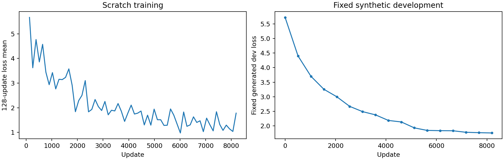
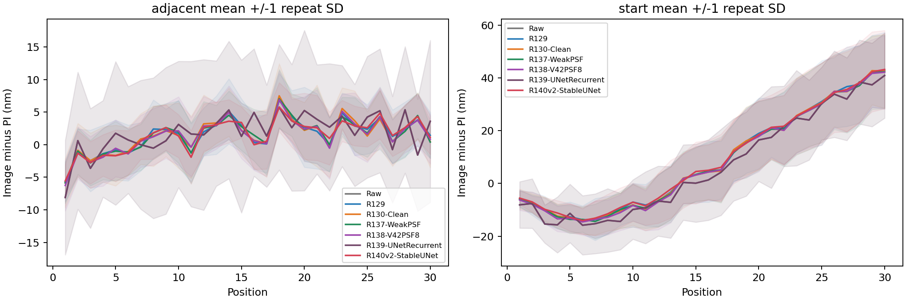
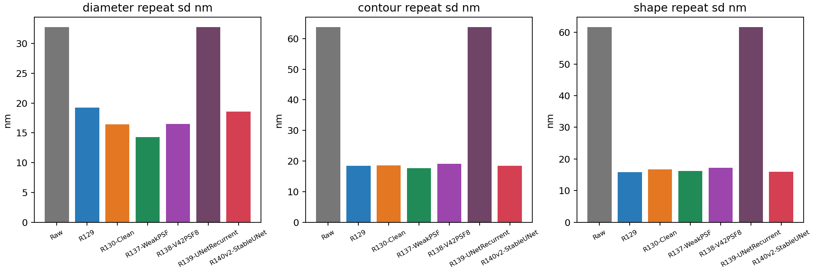

# R140v2 U-Net 反覆修正模型完整結果

完成時間：2026-09-23T10:53:37.389987+00:00。真正三層U-Net加四次共享修正，使用同一批合成資料從零8192次訓練；V42八候選PSF放半尺寸解碼層，在末次修正啟用。訓練前固定最後checkpoint及共同真實驗證方法。

## 主要判讀

R140v2短步平均PI差3.640nm，R137為3.917nm；R140v2直徑重拍18.581nm、輪廓重拍18.430nm，R137分別14.262與17.710nm。各指標分開解讀，未自動替換論文或正式模型。

模型參數：1446366；最終checkpoint SHA256：b96980287f02329b36f2188886462e51cadabad2259c8a13018f68e3b3f2650c。實際光學參與：True；原始beta=0.021359、scale=0.280000、有效beta=0.005981。若光學無作用應如實說明，不把可關閉介面當成PSF有效性。

## 位移

| model              | kind     |    mae_nm |   bias_nm |   repeatability_nm |   maximum_error_nm |
|:-------------------|:---------|----------:|----------:|-------------------:|-------------------:|
| R129               | adjacent |  4.125379 |  1.473343 |           4.251368 |          16.867789 |
| R129               | start    | 17.984507 |  8.616078 |          10.090807 |          76.797530 |
| R130-Clean         | adjacent |  4.121476 |  1.500136 |           4.184162 |          20.414296 |
| R130-Clean         | start    | 17.948881 |  8.434741 |           9.971710 |          72.976954 |
| R137-WeakPSF       | adjacent |  3.916681 |  1.448317 |           3.905599 |          17.544931 |
| R137-WeakPSF       | start    | 17.930924 |  8.230503 |          10.238951 |          74.757564 |
| R138-V42PSF8       | adjacent |  4.094286 |  1.395773 |           4.218772 |          19.505664 |
| R138-V42PSF8       | start    | 18.076518 |  8.075977 |          10.142024 |          73.151789 |
| R139-UNetRecurrent | adjacent |  8.166610 |  1.834932 |           9.725338 |          39.299165 |
| R139-UNetRecurrent | start    | 19.080970 |  6.429398 |          13.762736 |          83.263986 |
| R140v2-StableUNet  | adjacent |  3.640012 |  1.419565 |           3.530462 |          15.374388 |
| R140v2-StableUNet  | start    | 17.926154 |  8.854273 |          10.433301 |          76.302050 |
| Raw                | adjacent |  8.166620 |  1.834932 |           9.725348 |          39.299200 |
| Raw                | start    | 19.080973 |  6.429397 |          13.762741 |          83.263940 |

## 尺寸與輪廓重複性

| model              |   diameter_mean_nm |   diameter_repeat_sd_nm |   contour_repeat_sd_nm |   shape_repeat_sd_nm |   diameter_repeat_absmax_nm |
|:-------------------|-------------------:|------------------------:|-----------------------:|---------------------:|----------------------------:|
| Raw                |        2799.620660 |               32.750251 |              63.758024 |            61.666738 |                  183.317502 |
| R129               |        2838.910772 |               19.230772 |              18.436707 |            15.788824 |                   77.986558 |
| R130-Clean         |        2833.847223 |               16.421786 |              18.579026 |            16.669974 |                   68.237042 |
| R137-WeakPSF       |        2836.821732 |               14.262392 |              17.709881 |            16.201211 |                   54.668392 |
| R138-V42PSF8       |        2834.059119 |               16.518877 |              19.103691 |            17.243365 |                   70.372664 |
| R139-UNetRecurrent |        2799.619481 |               32.747428 |              63.758068 |            61.667058 |                  183.317392 |
| R140v2-StableUNet  |        2842.878055 |               18.580932 |              18.430230 |            15.990536 |                   74.669624 |

## SEM 對照 兩方向候選

| model              |   mapping_candidate |   SEM_mean_diameter_nm |   mean_diameter_difference_nm |   full_radial_difference_nm |   de_size_shape_difference_nm |
|:-------------------|--------------------:|-----------------------:|------------------------------:|----------------------------:|------------------------------:|
| Raw                |                   1 |            2614.438543 |                    185.182117 |                   98.510978 |                     56.348315 |
| R129               |                   1 |            2614.438543 |                    224.472228 |                  112.689735 |                     32.636326 |
| R130-Clean         |                   1 |            2614.438543 |                    219.408680 |                  110.447462 |                     28.092678 |
| R137-WeakPSF       |                   1 |            2614.438543 |                    222.383188 |                  111.832438 |                     29.845842 |
| R138-V42PSF8       |                   1 |            2614.438543 |                    219.620576 |                  110.347924 |                     30.670294 |
| R139-UNetRecurrent |                   1 |            2614.438543 |                    185.180938 |                   98.510534 |                     56.348429 |
| R140v2-StableUNet  |                   1 |            2614.438543 |                    228.439512 |                  114.862414 |                     31.020594 |
| Raw                |                   2 |            2614.438543 |                    185.182117 |                   96.765500 |                     50.993724 |
| R129               |                   2 |            2614.438543 |                    224.472228 |                  113.356990 |                     17.243175 |
| R130-Clean         |                   2 |            2614.438543 |                    219.408680 |                  110.909184 |                     19.409317 |
| R137-WeakPSF       |                   2 |            2614.438543 |                    222.383188 |                  112.461372 |                     18.918890 |
| R138-V42PSF8       |                   2 |            2614.438543 |                    219.620576 |                  111.046845 |                     19.101735 |
| R139-UNetRecurrent |                   2 |            2614.438543 |                    185.180938 |                   96.765125 |                     50.993966 |
| R140v2-StableUNet  |                   2 |            2614.438543 |                    228.439512 |                  115.414219 |                     19.687374 |

## 整趟配對區間

| reference          | metric                |   difference_nm |   ci95_low |   ci95_high |   improved_scans |
|:-------------------|:----------------------|----------------:|-----------:|------------:|-----------------:|
| Raw                | adjacent_mae_nm       |       -4.526609 |  -4.940534 |   -4.115994 |        30.000000 |
| Raw                | start_mae_nm          |       -1.154819 |  -1.972927 |   -0.347508 |        19.000000 |
| Raw                | diameter_repeat_sd_nm |      -14.169319 | -14.986611 |  -13.089112 |       nan        |
| Raw                | contour_repeat_sd_nm  |      -45.327794 | -46.369754 |  -42.641902 |       nan        |
| Raw                | shape_repeat_sd_nm    |      -45.676202 | -46.817954 |  -42.802595 |       nan        |
| R129               | adjacent_mae_nm       |       -0.485367 |  -0.729728 |   -0.254983 |        25.000000 |
| R129               | start_mae_nm          |       -0.058353 |  -0.272561 |    0.153110 |        15.000000 |
| R129               | diameter_repeat_sd_nm |       -0.649840 |  -1.466177 |   -0.015912 |       nan        |
| R129               | contour_repeat_sd_nm  |       -0.006477 |  -0.350564 |    0.259044 |       nan        |
| R129               | shape_repeat_sd_nm    |        0.201712 |  -0.058237 |    0.433667 |       nan        |
| R130-Clean         | adjacent_mae_nm       |       -0.481465 |  -0.674220 |   -0.283404 |        24.000000 |
| R130-Clean         | start_mae_nm          |       -0.022727 |  -0.226158 |    0.184736 |        16.000000 |
| R130-Clean         | diameter_repeat_sd_nm |        2.159146 |   0.735383 |    3.064506 |       nan        |
| R130-Clean         | contour_repeat_sd_nm  |       -0.148796 |  -0.837723 |    0.387236 |       nan        |
| R130-Clean         | shape_repeat_sd_nm    |       -0.679438 |  -1.053240 |   -0.346880 |       nan        |
| R137-WeakPSF       | adjacent_mae_nm       |       -0.276669 |  -0.432127 |   -0.118907 |        23.000000 |
| R137-WeakPSF       | start_mae_nm          |       -0.004770 |  -0.198480 |    0.185714 |        14.000000 |
| R137-WeakPSF       | diameter_repeat_sd_nm |        4.318540 |   2.338314 |    5.533908 |       nan        |
| R137-WeakPSF       | contour_repeat_sd_nm  |        0.720349 |   0.021752 |    1.228206 |       nan        |
| R137-WeakPSF       | shape_repeat_sd_nm    |       -0.210675 |  -0.485684 |    0.047318 |       nan        |
| R138-V42PSF8       | adjacent_mae_nm       |       -0.454274 |  -0.659068 |   -0.255326 |        24.000000 |
| R138-V42PSF8       | start_mae_nm          |       -0.150364 |  -0.400853 |    0.074237 |        17.000000 |
| R138-V42PSF8       | diameter_repeat_sd_nm |        2.062056 |   0.886510 |    2.791488 |       nan        |
| R138-V42PSF8       | contour_repeat_sd_nm  |       -0.673461 |  -1.156281 |   -0.267538 |       nan        |
| R138-V42PSF8       | shape_repeat_sd_nm    |       -1.252829 |  -1.430191 |   -1.042485 |       nan        |
| R139-UNetRecurrent | adjacent_mae_nm       |       -4.526598 |  -4.940524 |   -4.115985 |        30.000000 |
| R139-UNetRecurrent | start_mae_nm          |       -1.154816 |  -1.972920 |   -0.347506 |        19.000000 |
| R139-UNetRecurrent | diameter_repeat_sd_nm |      -14.166496 | -14.981421 |  -13.088986 |       nan        |
| R139-UNetRecurrent | contour_repeat_sd_nm  |      -45.327838 | -46.369793 |  -42.641820 |       nan        |
| R139-UNetRecurrent | shape_repeat_sd_nm    |      -45.676522 | -46.818153 |  -42.802530 |       nan        |

每趟是配對重抽樣單位；九顆與720插值方向不是九或720個獨立樣本。新模型僅使用既有30趟、930影像，非未見保留集。相對起點直接算位置j減0，不累加逐段中位數。

## 訓練與來源

完成8192次；開發評估17次；最終既有生成測試{'total': 1.210855493967756, 'image': 0.9341129264485062, 'gradient': 0.9060646372411156, 'pair': 0.4776481650187634}。同R139的資料母場景、順序、噪聲逐筆核對；降低主幹學習率及加入局部正規化為本輪修正。像素內通道正規化、較小學習率與輸出頭增益是本輪刻意改變，不能歸因為U-Net單一元件效果。

## 速度與範圍

本輪930張GPU完整重建中位1.454秒；含讀寫中位1.951秒。沒有同時控制其他程序的跨模型速度測試，因此不做固有效率排名。

獨立檢查核對930張輸出SHA、8370次新模型圓重擬合、12600筆七方法位移重新計算及歷史來源不變。PSF開關機制只在4張固定實拍與32組既有生成資料上額外檢查，不是重訓消融。SEM舊核來源未證明與同一資料完全獨立；沒有完整量測不確定度合成。

