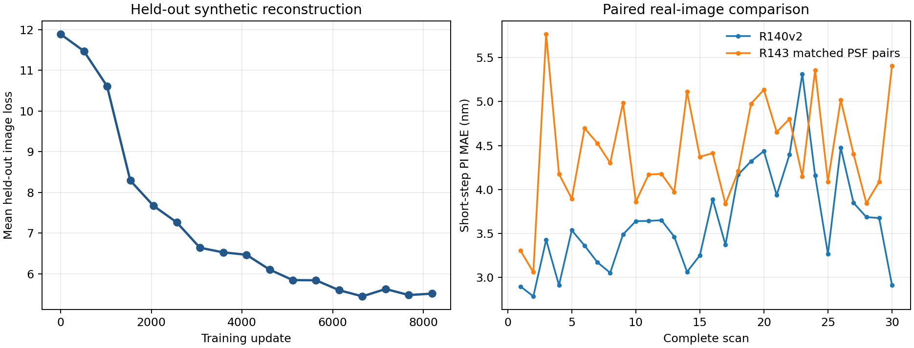
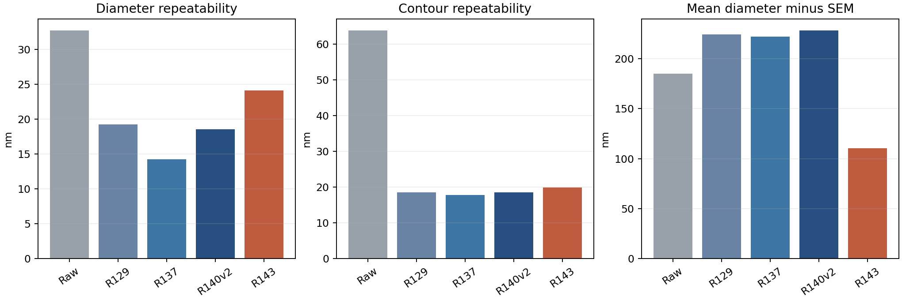

# R143 實測 PSF 配對資料完整訓練結果

完成時間：2026-09-23T19:05:53.521805+00:00。本輪依使用者要求，以 R141 相同模型架構重新從零訓練，將合成配對的模糊來源改為模型所持有的 25 顆實測 PSF。清楚場景、位移、訓練／開發／測試分組、雜訊方法和固定量測讀法保留；已驗證 8192 次更新、930 張完整實拍及 8370 次圓輪廓量測。

## 主要結論

新資料確實改變了模糊輸入，網路也完成完整訓練，但沒有學會辨認 25 顆 PSF：生成測試首選 6/206，全部 930 張實拍都把同一顆排第一。把已訓練模型暫時強制改用另一顆 PSF，四張固定實拍的輸出差只有約 `2.5×10⁻⁶` 個八位元灰階，故不能將本輪成效稱為自適應選擇所致。

實拍短步位移平均差由 R140v2 的 3.640 nm 上升至 4.425 nm；整趟配對差為 +0.785 nm，95% 區間 +0.540 至 +1.042 nm，30 趟中 29 趟較差。直徑重拍波動由 18.581 升至 24.161 nm，配對差 +5.580 nm，95% 區間 +4.466 至 +6.270 nm。長距離平均差 +0.168 nm 的區間跨零，沒有明確改善。

相同舊 SEM 參照下，平均直徑差由 R140v2 的 +228.440 降到 +110.529 nm，兩種方向候選的完整輪廓差也都下降。這是有價值的尺寸對齊線索，但 PSF 的 SEM 來源與物理尺度尚未獨立封閉，且尺寸重拍變差，不能據此宣稱絕對尺寸準確度提高。R143 保留為研究版本，不升級正式基準，也不替換 R140v2 的短步量測用途。

相對 R140v2，R143 量出的直徑在全部 30 趟都較小，平均少 117.911 nm；以整趟為單位的 95% 區間為少 119.139 至 116.624 nm。這說明尺寸對照變小主要是一致的直徑收縮，尚不能判定哪一個影像邊界更接近實物。[整趟直徑差](../results/diameter_shift_paired.json)

後續以固定原模型與保存影像深查位移及尺寸波動，發現偏心 PSF 對應的反向圓心位移、逐圓心對細小影像位移的敏感性，以及模型邊緣過渡位置對跨趟模糊變化的反應；同時把雜訊、單純亮度改變和讀值彙總方式分開檢查。[完整原因診斷](R143_STABILITY_DIAGNOSIS.md)

## 資料和訓練

- 25 顆銀行 SHA-256：`25cc6c95a224caae0e4a0380a88980551586a35cdb34eebde2635639e2c29553`。
- 母場景 512／128／128；非 identity 的 460／116／116 個場景均衡分配 25 顆。原本不模糊的 52／12／12 個場景保留。平坦場景不列為 PSF 分類真值。
- 兩張位移配對影像使用同一顆已知 PSF；其清楚答案逐陣列保持 R128 來源值。原始雜訊可逐張重播；正式訓練依原 R141 規則逐輪重新抽雜訊。
- 本輪將 101×101 PSF 銀行視為原尺寸相機像素核，卷積放在既有感測器面積取樣之後。這改變了原 R128 生成順序；銀行與目前拍攝條件的絕對物理尺度仍待校準。
- 最終 checkpoint SHA-256：`4d52db1d0b125bcf3bf7085a68719471184617751a98d8380f05f1138c11b67e`。生成測試平均重建損失：5.3954。
- 固定生成測試可辨識 PSF 影像 206 張；正確 PSF 第一名 6/206（2.91%）；前四名包含正確 PSF 34/206（16.50%）。兩張同場景影像相關，不能當作獨立樣本。測試集 PSF 標記來自模擬時的指定銀行索引，不是實拍 PSF 真值。

## 30 趟實拍短步位移（nm）

| 方法 | 平均絕對差 | 重拍波動 | 最大差 |
|---|---|---|---|
| Raw | 8.167 | 9.725 | 39.299 |
| R129 | 4.125 | 4.251 | 16.868 |
| R137-WeakPSF | 3.917 | 3.906 | 17.545 |
| R140v2-StableUNet | 3.640 | 3.530 | 15.374 |
| R143-PSF25-MatchedPairs | 4.425 | 4.290 | 17.311 |

## 30 趟實拍起點相對位移（nm）

| 方法 | 平均絕對差 | 重拍波動 | 最大差 |
|---|---|---|---|
| Raw | 19.081 | 13.763 | 83.264 |
| R129 | 17.985 | 10.091 | 76.798 |
| R137-WeakPSF | 17.931 | 10.239 | 74.758 |
| R140v2-StableUNet | 17.926 | 10.433 | 76.302 |
| R143-PSF25-MatchedPairs | 18.094 | 11.212 | 83.524 |

## 尺寸與輪廓重拍（nm）

| 方法 | 直徑波動 | 輪廓波動 | 去尺寸形狀波動 |
|---|---|---|---|
| Raw | 32.750 | 63.758 | 61.667 |
| R129 | 19.231 | 18.437 | 15.789 |
| R137-WeakPSF | 14.262 | 17.710 | 16.201 |
| R140v2-StableUNet | 18.581 | 18.430 | 15.991 |
| R143-PSF25-MatchedPairs | 24.161 | 19.807 | 16.127 |

## 與既有 SEM 參照的尺寸差（方向候選 1；nm）

| 方法 | 平均直徑差 | 完整輪廓差 | 去尺寸形狀差 |
|---|---|---|---|
| Raw | 185.182 | 98.511 | 56.348 |
| R129 | 224.472 | 112.690 | 32.636 |
| R137-WeakPSF | 222.383 | 111.832 | 29.846 |
| R140v2-StableUNet | 228.440 | 114.862 | 31.021 |
| R143-PSF25-MatchedPairs | 110.529 | 58.067 | 29.293 |

方向候選 2 的所有數值保留於 `results/comparison/SEM_comparison.csv`，不因本次新模型重選方向。既有 PSF 的 SEM 校準來源尚未證明與這份 SEM 比較完全獨立；表中是同讀法比較，不是獨立物理尺寸準確度證明。

## 整趟配對差與範圍

以下差值為 R143 減去參照；負值表示 R143 較低。95% 區間以完整 30 趟重抽樣，不把九顆圓或 720 個方向當作獨立趟數。

| 參照 | 指標 | 平均差 | 95% 下界 | 95% 上界 |
|---|---|---|---|---|
| Raw | adjacent_mae_nm | -3.741 | -4.229 | -3.237 |
| Raw | start_mae_nm | -0.986 | -1.725 | -0.269 |
| Raw | diameter_repeat_sd_nm | -8.589 | -10.276 | -7.183 |
| Raw | contour_repeat_sd_nm | -43.951 | -45.328 | -41.202 |
| R129 | adjacent_mae_nm | 0.300 | -0.032 | 0.639 |
| R129 | start_mae_nm | 0.110 | -0.166 | 0.440 |
| R129 | diameter_repeat_sd_nm | 4.931 | 3.085 | 6.015 |
| R129 | contour_repeat_sd_nm | 1.371 | -0.402 | 2.615 |
| R137-WeakPSF | adjacent_mae_nm | 0.509 | 0.239 | 0.794 |
| R137-WeakPSF | start_mae_nm | 0.164 | -0.089 | 0.429 |
| R137-WeakPSF | diameter_repeat_sd_nm | 9.899 | 6.876 | 11.724 |
| R137-WeakPSF | contour_repeat_sd_nm | 2.098 | -0.032 | 3.585 |
| R140v2-StableUNet | adjacent_mae_nm | 0.785 | 0.540 | 1.042 |
| R140v2-StableUNet | start_mae_nm | 0.168 | -0.072 | 0.437 |
| R140v2-StableUNet | diameter_repeat_sd_nm | 5.580 | 4.466 | 6.270 |
| R140v2-StableUNet | contour_repeat_sd_nm | 1.377 | -0.058 | 2.404 |

## PSF 選擇與速度

- 930 張實拍入選第一名分布：`{24: 930}`。實拍沒有逐張已知的正確 PSF 編號，故僅報使用分布，不計實拍選擇準確率。
- 930 張實拍的四個入選權重介於 0.2443 至 0.2563，近乎四等分。四張固定實拍的光學開／關輸出差為 0.058–0.063 個八位元灰階，九顆圓心的 RMS 差 0.035–0.043 nm；強制使用第 0 與第 24 顆之間的輸出差約 `2.5×10⁻⁶` 灰階，圓心差低於 `3.1×10⁻⁶` nm。這是保存模型的後驗敏感度檢查，不是重新訓練消融。[逐張紀錄](../results/real_psf_effect.json)
- 另取 64 個開發／測試母場景，即使把清楚答案提供給辨識程序並合看一對影像，正確 PSF 首選也只有 12/64。這是偏樂觀的可辨識性診斷；不能把它當成實際模型的輸入條件。[診斷明細](../results/oracle_psf_identifiability.json)
- 930 張全尺寸推論的中位時間 1.687 秒；含單張讀寫中位 2.104 秒。與舊輪次執行環境不完全控制，不作固有速度排名。
- `results/selector_evaluation.json` 保留生成資料的選擇明細及前 16 個測試場景關閉光學分支的後驗診斷；開關結果不能代替重新訓練的消融。

## 判讀限制

R143 和 R140v2 同時改變光學挑選架構與訓練影像的模糊來源，因此兩者的效果差不能只歸因於替換訓練 PSF。所用 25 顆核極為相近，且它們與本次 930 張實拍的逐位置對應尚無真值標記。930 張是已用過的同樣樣本與工作階段，不是新的獨立外部保留集。短步位移、長距離、輪廓穩定和尺寸偏差分別判讀；不因訓練或量測流程完成而自動升級正式基準。

資料製作在原尺寸影像上使用銀行核；R141 原架構的光學分支則在半解析度特徵上使用同一大小的核。本輪刻意保留原模型，沒有對兩處核的物理尺度另作轉換或標定，因此不能把新結果解讀為已物理精確配對的 PSF 反卷積效果。

## 完整性

`results/final_audit.json` 已核對 8192 筆更新、930 張重建及收據雜湊、30 趟共 8370 輪廓、8370 次獨立圓重擬合，並重現 Raw/R129 的固定參照算術。原 R141 與 R140v2 檔案未被修改。

另從保存的 30 趟 R143 圓心和原始 PI 位移重新計算短步／起點相對平均差、偏差、波動、最大差，以及直徑平均；與正式比較表的差為 0。[獨立數值重算](../results/independent_metric_recheck.json)

單張推論入口再處理第一張實拍，其浮點影像與正式 930 張流程保存的同一張逐像素完全相同，最大差為 0；來源原 R141 包的 2056 檔驗證亦重新通過。[重播紀錄](../results/cli_replay_check.json)

