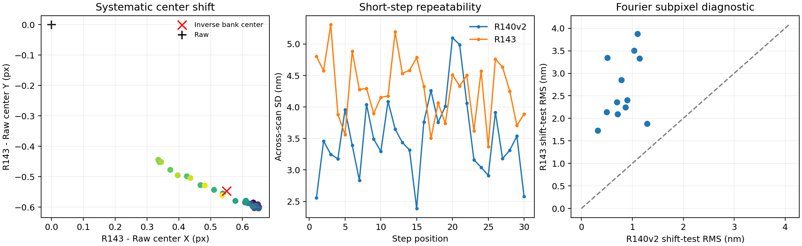
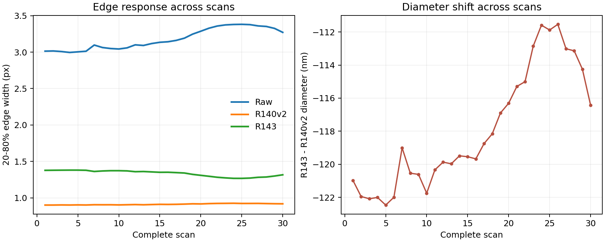

# R143 位移與尺寸穩定性深層診斷

日期：2026-09-24。此報告分析已固定的 R143 第 8192 次模型、原 R140v2、RAW、同一組 30 趟／930 張實拍與保存的 8370 個圓。原訓練、重建與量測結果沒有改動；新增的檢查另存於 `results/stability_diagnosis/`。[可重算摘要](../results/stability_diagnosis/summary.json)

## 結論先說

R143 的短步位移退步來自**每顆圓的影像位置反應較不穩定**。它不是平均位移偏差大幅增加、單一壞趟次、最後九顆取中位數，或「從 25 顆 PSF 挑錯一顆」單獨造成。最有力的機制線索是：新訓練資料使用的 PSF 自帶約半像素中心偏移，R143 在實拍上學出了幾乎等量、反方向的圓心修正；這個修正的固定部分會在相鄰位移相減時抵消，但細小位置與影像外觀改變時的反應並不如前代一致。

尺寸方面，R143 把圓的量測邊界整體往內移，因此與既有 SEM 表更接近；同時，重建後邊界的過渡寬度與過渡位置在重拍間更易變。實拍原圖在不同趟次也有邊緣變寬、對比下降的共同變化，受控模糊檢查顯示 R143 的直徑及邊界反應比前代大。這解釋了為何平均尺寸對照改善，直徑重拍穩定性卻退步。這仍是**影像處理與同批量測機制**的診斷；無獨立物理真值可判定收縮後的邊界一定較準。

## 退步到底有多廣

| 同一 30 趟實拍 | R140v2 | R143 | R143 相對差 |
|---|---:|---:|---:|
| 相鄰步進 PI 平均絕對差 | 3.640 nm | 4.425 nm | +0.785 nm；整趟配對 95% 區間 +0.540～+1.042 |
| 相鄰步進跨趟標準差 | 3.530 nm | 4.290 nm | +0.759 nm；整趟配對 95% 區間 +0.496～+0.988 |
| 起點相對位移跨趟標準差 | 10.433 nm | 11.212 nm | +0.779 nm；區間 +0.014～+1.430，接近零 |
| 直徑重拍波動 | 18.581 nm | 24.161 nm | +5.580 nm；區間 +4.466～+6.270 |
| 輪廓重拍波動 | 18.430 nm | 19.807 nm | +1.377 nm；區間跨零 |

跨趟標準差是在**每個固定步進位置**對 30 趟算標準差，再平均 30 個位置。R143 在其中 25/30 個位置較差；按完整趟次算短步平均絕對差，29/30 趟較差。九顆圓各自量位移時也全部出現波動增加：單顆位移的固定位置跨趟標準差平均由 6.829 升至 8.413 nm。把九顆圓改用平均作後驗診斷，R143 對 R140v2 的標準差差距仍約 +0.654 nm；原規格中位數為 +0.759 nm。因此彙總方法會影響幅度，無法消除來源。R143 的相鄰位移**平均有號偏差**只比 R140v2 高 0.139 nm，退步主要是逐張／逐圓心的額外起伏。[逐位置表](../results/stability_diagnosis/repeatability_by_step.csv) · [重抽樣檢查](../results/stability_diagnosis/repeatability_bootstrap.json)

相對 RAW，R143 的短步跨趟標準差仍從 9.725 降至 4.290 nm，直徑重拍從 32.750 降至 24.161 nm。本報告說的「變差」是相對已完成的 R140v2，不能誤解為比原圖還不穩。

## 第一條線索：模型學到與 PSF 中心相反的位移

這 25 顆 PSF 核的強度中心平均位於核中心的 **x = −0.5497、y = +0.5473 像素**。R143 量出的圓心相對 RAW，30 趟平均移 **x = +0.5510、y = −0.5566 像素**；按完整趟次重抽樣，x 的 95% 區間為 +0.510～+0.588，y 為 −0.574～−0.537。預期的反向 PSF 位移（+0.5497、−0.5473）落在這兩個區間內。R140v2 相對 RAW 僅平均（−0.1264、+0.0814）像素。這是 R143 從新配對影像學到「把模糊核帶來的位置偏移拉回來」的強線索；尚未用重新居中的 PSF 訓練控制組作最終因果隔離。[PSF 與圓心摘要](../results/stability_diagnosis/summary.json)

一個**固定**的整張影像平移會在相鄰兩張圓心相減時抵消，因此不能把約半像素的平均位移直接當作 0.759 nm 標準差退步的原因。真正相關的是修正量隨影像內容與細小位置改變。R143 與 R140v2 的相鄰 PI 誤差之差在 900 對影像中的標準差為 4.263 nm；按九顆圓的共同位移變化作後驗近似，能解釋其中一部分，剩餘部分來自各圓不一致的反應。原圖每張的 PSF 真值未量到，不能把這個起伏全部歸給 PSF。

## 第二條線索：對細小位移的反應

以 12 張橫跨六個早／中／晚拍攝趟次的**同一張**原圖，在記憶體中做 0.25、0.50、0.75 像素水平移動，沒有增加拍攝差異。用反射邊界的頻域平移，R140v2 測得位移的 RMS 偏差為 0.867 nm，R143 為 2.733 nm；12/12 張 R143 都較高。以六趟為單位重抽樣，每張 RMS 差的趟次平均為 +1.827 nm，95% 區間 +1.487～+2.129 nm。這支持 R143 對像素內位置變化更敏感，且幅度足以影響實際短步量測。[逐張結果](../results/stability_diagnosis/subpixel_fourier_by_frame.csv)

**邊界：**這是把既有影像數值移動的壓力測試，不等於實際重新曝光。同樣三張圖用一般線性插值時亦是 R143 較差；改用三次插值時兩模型排名反轉。故此測試可證明**模型反應依賴輸入形成方式**，並支持像素內位置敏感性，不能精確宣稱實拍 0.759 nm 退步中有多少比例由它造成。另一個將相同 1.5 灰階雜訊加入 12 對實拍的檢查，新舊模型新增位移標準差平均為 2.325／2.274 nm，配對差 +0.051 nm；以四趟為單位的區間 −0.591～+0.693 nm，沒有顯示一致的額外雜訊放大。[雜訊檢查](../results/stability_diagnosis/noise_probe_broad_r143.json)

R143 已訓練模型在四張固定實拍上關閉光學分支，圓心 RMS 差最大 0.043 nm；強制在第 0／24 顆 PSF 之間切換，圓心差低於 `3.1×10⁻⁶` nm。另有 930/930 張實拍把第 24 顆排第一，生成保留影像的 PSF 首選只有 6/206。因而目前位移退步的主要來源是**新資料訓練後的影像修正反應**，不是有意義的逐張 PSF 挑選。[四張後驗檢查](../results/real_psf_effect.json)

## 第三條線索：邊界寬度與尺寸波動

用相同的圓邊採樣定義，重建後亮度從 20% 到 80% 的過渡寬度平均為 R140v2 **0.913 像素**、R143 **1.336 像素**；R143 較寬 0.423 像素。R143 的絕對明暗對比較強，容易看起來更銳利，但標準化後的邊緣過渡實際較寬。固定「位置×圓柱」共 279 組的邊寬重拍標準差平均為 0.0277／0.0451 像素，266/279 組 R143 較差。50% 過渡位置的標準差為 0.0479／0.0712 像素，271/279 組 R143 較差；同一組內的 50% 過渡位置與正式圓擬合半徑起伏相關達 0.949／0.967。這把「邊界位置不穩」直接接回直徑量測。R143 的平均 50% 過渡半徑也較 R140v2 往內 0.322 像素，按直徑換算約 111 nm，與正式直徑平均縮小 118 nm 同量級。[邊寬逐圓表](../results/stability_diagnosis/output_edge_width_r143.csv)

RAW 原圖在早期趟次的邊寬約 3.01 像素，在第 24～25 趟約 3.38 像素，圓邊對比也由約 77 降至約 53 灰階。按趟次比較，原圖邊寬與 R143 相對 R140v2 的直徑變化相關約 0.979；這只是同批拍攝的關聯，不能獨自證明光學原因。受控檢查在同一早期影像加入寬模糊，使 RAW 邊寬增加約 0.37 像素：R140v2 輸出邊寬增加 0.026～0.028 像素，R143 反而縮窄 0.103～0.111 像素；R140v2 量得直徑增加 27～29 nm，R143 增加 56～59 nm。這種較強、方向不同的邊界反應能重現尺寸對模糊更敏感的機制。[受控模糊數值](../results/stability_diagnosis/blur_edge_probe_r143.json)

只降低同一張圖的整體對比時，R143 直徑卻往另一方向變化，因此不能把不同趟次的現象簡化為「亮度變了」。原圖邊緣模糊程度與對比在實際拍攝中一起變化；資料無法把焦距、照明、感測器或樣品表面狀態逐一獨立分開。更重要的是，同一趟內相鄰影像的 RAW 邊寬變化，與新增短步誤差的相關只有約 0.09。**跨趟的邊緣變化較能說明尺寸重拍與整體圓心偏移；相鄰步進的額外抖動還需連同像素位置和局部形貌反應理解。**

## 與 RAW 及既有 SEM 表的尺寸比較

| 相同九顆集合的平均直徑 | RAW | R143 |
|---|---:|---:|
| 光學量測平均 | 2799.621 nm | 2724.967 nm |
| 既有 SEM 集合平均 | 2614.439 nm | 2614.439 nm |
| 光學減 SEM | **+185.182 nm** | **+110.529 nm** |

R143 與 RAW 的平均直徑差縮小 **74.654 nm（40.3%）**，但仍是偏大。按完整 30 趟計，R143 量得的直徑每趟都比 RAW 小，平均 −74.654 nm，95% 區間 −75.752 至 −73.568 nm。把九顆逐顆對應到 SEM，兩個既有方向候選下都是 **9/9 顆** R143 比 RAW 更接近；九顆 R143 的差仍全為正（約 +70 至 +138 nm）。[逐顆比較](../results/stability_diagnosis/sem_pillar_comparison.csv)

相對 RAW，R143 直徑重拍波動 24.161 nm 比 32.750 nm 低；相對 R140v2 的 18.581 nm 則高。R143 尺寸差變小主要反映**幾乎所有圓一致縮小**：99.27% 的逐影格圓直徑比 RAW 小，而非獨立 SEM 真值證明。這批 PSF 的來源可能涉及舊 SEM 校準，與本次 SEM 表的答案獨立性及像素物理尺度未封閉，故不得把 40.3% 直接寫成絕對尺寸準確度提升。

## 已排除與尚未隔離

- 已排除主要解釋：單一壞趟次、九顆中位數的選法、單純的有號位移偏差、挑到不同 PSF、以及在抽測 12 對影像上普遍放大少量感測器雜訊。
- 有強證據的機制：新資料的偏心 PSF 與新模型的反向圓心位移相符；R143 的逐圓心／邊界位置更易隨影像變動；RAW 邊緣變寬時 R143 的尺寸反應比前代大。
- 尚未證明的單一因果歸因：R140v2 與 R143 除資料外，也有光學混合方式的結構差異。現有四張關閉光學檢查表明 R143 當下的 PSF 分支作用很小，但要嚴格量化「訓練資料替換」所占比例，仍須同一 R141 架構、同一從零訓練條件下做舊合成 PSF 與新 25 顆 PSF 的配對控制。要判斷是否修正到實物邊界，還需來源獨立、尺度對應的同批參照。

最直接的下一輪控制是先把 25 顆 PSF 的強度中心對齊，並對原尺寸資料與半解析度模型光學分支做同一物理尺度換算；保持其餘場景、雜訊、模型與評估不變，再比較圓心偏移、短步重拍與尺寸穩定性。此處只提出控制條件，尚未宣稱修正後一定改善。

