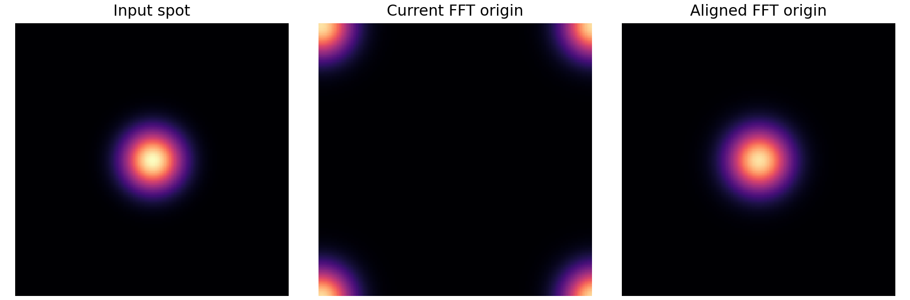

# R145：PSF 擬合良好，重建量測仍受限的原因

日期：2026-09-24。本分析不改動 R145 的訓練資料、8192 次權重、930 張重建或原量測表。它用已保存模型做開關測試，重播 PSF 運算、全數檢查生成保留場景，並把 PSF 拍攝與固定實拍用同一讀法比較。數值來源見文末。

## 結論與證據強度

這 25 顆 PSF 在**擬合照片**上確實比舊參照好：25/25 張的前向影像誤差較低，中位誤差 0.002864，舊 PSF 為 0.005602；相關程度中位 0.972，舊參照 0.949。額外把真實 SEM 外框拿來前向卷積、每張用六顆圓擬合並保留三顆圓的檢查，也顯示新版 PSF 比七月舊 PSF 好：三張照片共九個留出圓外觀的平均差 **0.00238 對 0.00472**。但只用六顆訓練圓調寬度的簡單高斯模糊，在同一批留出圓上又略好，平均差 **0.00220**。因此新 PSF 已抓到這次拍攝的主要模糊程度，**尚未被證明是唯一或最精準的物理 PSF 形狀**；更不保證重建網路會用對它，或其他拍攝日的成像狀態相同。[SEM 真實外框留出檢查](../../../PSF_Fitting/output/20260924_center9_psf/sem_shape_forward_validation/README_TW.md)

目前最直接的阻斷點在**模型使用 PSF 的方式**，而不是來源檔沒有載入：

1. **已證實的運算問題：**模型把以中心為原點的 101×101 PSF 直接填進頻域陣列中央，沒有先把 PSF 中心移到頻域卷積需要的原點。在與訓練相同的 160×160 特徵上，置於 `(80,80)` 的平滑測試點經現有反推運算後，反應峰值跑到 `(1,1)`；僅修正 PSF 原點，峰值就回到 `(80,80)`。NumPy 與模型實際使用的 PyTorch 運算都重現相同結果。[逐項數值](../results/deep_diagnosis/optical_transfer_audit.json)
2. **已證實的作用抑制：**PSF 分支只在四次共享修正中的**最後一次**啟用；最終模型的 PSF 混入比例為 `0.05689 × 0.28 = 0.01593`，約 **1.59%**。正規化 PSF 的零頻強度為 1，但現有反推式使用的常數 30 使這一分量只剩 **1/31 = 3.23%**；作用範圍又只涵蓋約 **5%** 的頻率格點，其餘維持原特徵。這個分支主要在做極弱的低頻改動，沒有有效補回 PSF 模糊吃掉的細節。[運算與參數](../results/deep_diagnosis/optical_transfer_audit.json)
3. **實際輸出證據：**跨早、中、晚趟次的 12 張實拍，開關光學分支使輸出影像的典型差異僅 **0.098 灰階**；每顆圓心差平均 **0.243–0.324 nm**，直徑差平均 **0.346–0.500 nm**，逐顆直徑最大差也低於 **0.974 nm**。這與 R145 相對 RAW 平均直徑 **+22.003 nm**、相對 R143 **+96.657 nm** 不同量級。因此尺寸變化主要是**使用新模糊配對重新訓練後，整個影像修正網路的反應改了**；不是推論時直接選用某顆 PSF 所造成。[12 張開關明細](../results/deep_diagnosis/optical_branch_12.json)

這些結論適用於**目前這個已訓練模型**。不能據此聲稱修正運算後、再從零訓練一定會勝出；那需要新的受控實驗。

## 為什麼選擇器也無法幫上忙

新 25 顆 PSF 並非完全一樣，但兩兩形狀相似度最低仍達 **0.998286**，中位 **0.999820**。把生成保留資料中的 206 個非平坦場景各自用全部 25 顆 PSF 卷積，觀察訓練實際計分的中央區域：相同清晰場景下，不同 PSF 相對銀行平均造成的影像差異中位只有 **0.094 灰階**，而加入的雜訊標準差中位為 **1.5 灰階**。206/206 個場景的典型 PSF 差異低於各自雜訊，202/206 個甚至低於一半雜訊。[全數場景結果](../results/deep_diagnosis/synthetic_psf_observability_summary.json)

這不能證明 PSF 編號在任何條件下都不可能辨認；若事先知道清晰影像，很多像素仍可累積微弱訊號。但目前模型需要從**未知場景的一張模糊圖**推測是哪顆 PSF，場景本身、亮度和雜訊比 PSF 之間的差異更顯著。實際訓練也吻合這個困境：後段 512 次的選擇損失平均 **3.21856**，與 25 類隨機猜測的 **ln(25)=3.21888** 幾乎相同；第 4097 次以後選中的四顆全部固定為初始化偏好的 24、0、16、8。生成測試首選僅 **6/206**；930 張實拍皆把第 24 顆排第一。四張實拍強制從第 0 顆切到第 24 顆，每顆圓心差低於 **0.00005 nm**。實拍沒有逐張已知 PSF 編號，故不能計實拍選擇準確率。

## 物理尺度與放置位置不匹配

製作訓練模糊影像時，101×101 PSF 作用在**原尺寸清晰影像**；模型卻在**寬、高都減半的非線性特徵**上套用同一個 101×101 核。新 PSF 有一半能量落在原圖半徑約 **4 像素**內，在模型分支相當於原圖 **8 像素**；九成能量半徑約 **12.17 像素**則相當於原圖約 **24.33 像素**。核的物理尺度因而放大兩倍。且非線性特徵不是相機原始亮度，不能直接假定仍遵守原照片的線性 PSF 卷積。這是架構推論，與上面的頻域錯位和實際開關效果一起看，足以說明「有載入實測 PSF」不等於「有做到符合物理尺度的去模糊」。

## 好的擬合與驗證照片之間仍有條件差

PSF 來源是 2026-09-24 的 25 張照片；固定量測集是先前 2026-09-03 的 930 張。擬合流程把九顆圓的局部影像整理成 301×301 的亮點陣列，並替每張照片另調亮度；全部 25 張仍是**同九顆實體圓**的不同視角。擬合時另以三張代表照片的三顆圓做局部保留檢查，提供有限的同場景驗證；但如上所述，同條件下簡單高斯仍略勝。最終 25 張全九顆擬合的 12 個自由波前係數中，仍有 **8–10 個**接近預設界限，係數不可當作唯一的物理真值。

用完全相同的圓心附近讀法，PSF 拍攝的 225 顆圓與固定驗證集的 8370 顆圓有以下差異：[逐張與摘要](../results/deep_diagnosis/capture_condition_shift.json)

| 原始照片的局部量 | PSF 拍攝 25 張 | 固定驗證 930 張 |
|---|---:|---:|
| 圓外背景中位灰階 | 238 | 166 |
| 圓內外對比中位灰階 | 111 | 75 |
| 20%–80% 邊界寬度中位 | 3.021 px | 3.147 px |

驗證照片前五趟的邊寬中位約 **3.007 px**，最後五趟約 **3.335 px**。這證明驗證影像的亮度、對比與邊界外觀和擬合拍攝有差，且同一驗證批次內還在變；無法單靠一次 PSF 擬合保證逐張完全匹配。這些觀察**不能單獨指認**焦距、照明、感測器或樣品表面哪一個是原因，也不能據此說擬合出的 PSF 是錯的。

## 為什麼直徑與位移會出現不同取捨

R143 舊銀行的能量半徑中位為 **5.10／16.49 px**（50%／90%）；R145 新銀行為 **4.00／12.17 px**。新銀行本身較集中，保留較多影像細節。[PSF 寬度與頻率比較](../results/deep_diagnosis/bank_bandwidth_comparison.json) · [圖](figures/psf_bandwidth_comparison.png)。在清晰目標、網路架構及訓練順序保持相同的對照中，換 PSF 也換掉了模糊輸入的難度；網路因此學到不同的整體邊界修正。這可以解釋為何 R143 相對 RAW 把平均直徑縮小 **74.654 nm**，R145 卻放大 **22.003 nm**。兩者相差 **96.657 nm**，但直接開關 R145 的 PSF 分支不到 1 nm；因此大部分差異經由**重訓後的主網路**而來。尺寸差異的正負號不能只靠 PSF 寬度單一因素精確預測，仍需專門控制組。

訓練目標主要要求清晰影像像素、影像梯度和合成位移配對的一致性；沒有以真實 PI 位移、逐圓直徑重拍或輪廓穩定性直接計分，也沒有把 SEM 尺寸當作神經訓練答案。PSF 影像擬合變好、生成清晰影像損失下降，均不保證圓邊與圓心在奈米量測上最好。R145 不是全面失敗：相對 RAW，短步 PI 平均絕對差 **8.167→3.990 nm**、直徑重拍 **32.750→21.013 nm**、輪廓重拍 **63.758→16.001 nm**；但它的短步與直徑重拍仍不及 R140v2，且與本輪 PSF 校準所用 SEM 九顆尺寸的平均差 **+191.887 nm**，比 RAW 的 **+169.883 nm** 更大。這個 SEM 同樣本尺寸對照不能宣稱獨立的絕對準確度。

用同張實拍數值平移 0.25、0.50、0.75 像素的測試，R145 位移反應 RMS **1.785 nm**，介於 R143 的 **2.733 nm** 和 R140v2 的 **0.867 nm**；與 30 趟實拍的排名方向一致。然而以另一種三次插值在三張影像測試，R145／R143／R140v2 分別為 **5.889／4.119／5.287 nm**，排名改變。因此這只能證實模型的細位置反應依賴輸入形成方式，不能把實拍的退步比例精確分攤給像素內位移。[三模型同影像摘要](../results/deep_diagnosis/subpixel_comparison.json) · [R145 頻域明細](../results/deep_diagnosis/subpixel_fourier_broad_r145.json)

## 下一個受控修正順序

1. **先修運算並通過簡單物理測試。**在新實驗副本中把 PSF 中心移到頻域原點，讓測試點的反推反應留在原位；校正半解析度尺度，檢查平坦影像不被任意改亮度，並以實際訊號／雜訊量級重定反推強度。先用已知 PSF 的合成圓、細位移和雜訊驗證，再考慮完整訓練。原 R145 權重及結果保留。
2. **暫時拿掉無效的逐張選擇器作公平對照。**用固定或依已知拍攝位置指定的 PSF，保持資料、網路容量和訓練次數一致。若要學逐張選擇，需先證明在未知清晰場景下，25 顆差異足以越過雜訊與拍攝變動；目前的 206 組檢查尚不支持。
3. **讓訓練及評估對準量測目的。**生成資料應覆蓋驗證照片的亮度、對比、邊寬和同批漂移；用合成已知幾何加入圓心、直徑與小位移一致性檢查，而非把 SEM 直徑當成清晰答案。最後仍分開評估短步、長距離、直徑與輪廓；尺寸絕對準確度須另外有來源獨立的參照。

最關鍵的可否證預測：**只修好並重訓光學分支時，開關分支的實拍量測差與不同 PSF 的切換差應從目前接近零的狀態變得可觀測，且在相同 30 趟上改善目標指標；若仍接近零，應停止把模型稱作有效的 PSF 自適應重建。**
