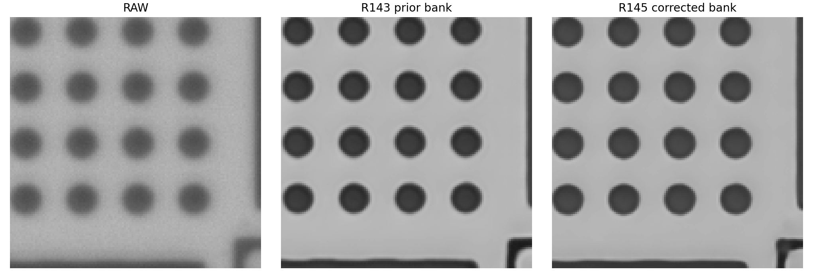

# R145 修正 PSF 後的位移與尺寸穩定性追查

日期：2026-09-24。本報告使用同一組 30 趟／930 張實拍、固定九顆圓，對照 RAW、R140v2、R143 和完整訓練的 R145。主要結果及其收據見 [R145 完整結果](R145_RESULTS.md)；逐圓計算見 `results/position_stability_followup.json`。

## 主要判斷

修正九顆編號後的 PSF 同時替換了訓練模糊資料與模型銀行。R145 的短步位移及尺寸重拍穩定性比 R143 改善，卻仍沒有達到 R140v2 的短步精度與直徑重拍穩定性。輪廓及去尺寸形狀的重拍起伏則比兩者都低。新 PSF 使 R143 的大幅平均圓心修正消失，但 R145 每顆圓對小步進的反應仍比 R140v2 更不穩。

| 同一 30 趟實拍 | R140v2 | R143 | R145 |
|---|---:|---:|---:|
| 相鄰步進 PI 平均絕對差 | 3.640 nm | 4.425 nm | 3.990 nm |
| 相鄰步進重拍標準差 | 3.530 nm | 4.290 nm | 4.016 nm |
| 單顆圓在固定步進的重拍標準差平均 | 6.829 nm | 8.413 nm | 7.933 nm |
| 直徑重拍波動 | 18.581 nm | 24.161 nm | 21.013 nm |
| 輪廓重拍波動 | 18.430 nm | 19.807 nm | 16.001 nm |
| 去尺寸形狀重拍波動 | 15.991 nm | 16.127 nm | 12.153 nm |

相對 R143，R145 短步平均絕對差低 **0.436 nm**，整趟配對重抽樣 95% 區間為 **−0.623 至 −0.237 nm**；直徑重拍波動低 **3.149 nm**，區間 **−3.888 至 −1.968 nm**。相對 R140v2，R145 短步平均絕對差仍高 **0.350 nm**，區間 **+0.177 至 +0.520 nm**；直徑重拍波動高 **2.432 nm**，區間 **+1.836 至 +2.958 nm**。R145 輪廓重拍波動相對 R140v2 低 **2.429 nm**，區間 **−2.791 至 −1.996 nm**。區間均以完整趟次重抽樣。

## 為何位移波動只改善一部分

R143 舊 25 顆 PSF 的強度中心平均偏移為 **(−0.550,+0.547) 像素**，R143 圓心相對 RAW 平均移動 **(+0.551,−0.557) 像素**，方向與量級幾乎相反。R145 新銀行的 PSF 強度中心平均偏移縮至 **(+0.178,−0.005) 像素**；R145 圓心相對 RAW 平均移動 **(−0.234,+0.106) 像素**。這與「替換模糊核後，模型學到的平均位置修正也改變」相符，支持舊 PSF 偏心是 R143 大幅固定圓心修正的重要機制線索。

固定平移本身會在相鄰兩張相減時抵消。真正影響短步重拍的是圓心修正隨影像和位置的變動。將每個固定步進位置與九顆圓分開計算，R145 單顆圓重拍標準差平均 **7.933 nm**，比 R143 的 **8.413 nm** 低 **0.480 nm**；完整趟次重抽樣區間 **−0.632 至 −0.320 nm**。但它仍比 R140v2 的 **6.829 nm** 高 **1.104 nm**，區間 **+0.914 至 +1.223 nm**。270 個固定「步進×圓」組合中，R145 有 **224** 組比 R140v2 更不穩。因而新 PSF 只修復了部分逐圓位置反應，沒有解決全部短步精度退步。

## 選 PSF 的分支仍未發揮逐張作用

合成測試的 206 張已知 PSF 影像只有 **6 張**把真實指派的 PSF 排第一；**34 張**在前四名內。930 張實拍皆把第 24 顆排第一，實拍沒有逐張已知 PSF 真值，不能計準確率。四張固定實拍的後驗開關檢查：關閉光學分支的圓心差約 **0.17–0.23 nm**；強制在第 0／24 顆間切換的圓心差低於 **0.00005 nm**。這表示當下模型的實際重建幾乎不依賴選到哪一顆 PSF；R145 相對 R143 的改善主要應視為**更換訓練模糊資料後整體影像修正反應改變**，不能歸功於模型學會了逐張選 PSF。這是已訓練模型的開關檢查，不等於重訓消融。

## 尺寸：重拍較穩，但平均差更大

R145 平均直徑 **2821.624 nm**，比 RAW 的 **2799.621 nm** 大 **22.003 nm**，比 R143 的 **2724.967 nm** 大 **96.657 nm**。按已核對的九顆編號，R145 的每顆平均直徑都比 RAW 大 **16.36–27.21 nm**；30/30 趟的整趟平均亦都較大。以完整趟次重抽樣，R145 減 RAW 的平均直徑差 95% 區間為 **+20.538 至 +23.405 nm**。所以 R143 曾出現的整體直徑縮小，在換成新 PSF 後反轉成小幅放大。這是為何 R145 雖然直徑重拍更穩，卻失去 R143 在 SEM 尺寸對照上的優勢。

本輪 PSF 擬合實際使用的 Excel 九顆 SEM 平均直徑為 **2629.737 nm**。相同九顆的光學平均減此參照：RAW **+169.883 nm**、R143 **+95.230 nm**、R145 **+191.887 nm**。R145 比 RAW 的差還大 **22.003 nm**。舊輪廓點位換算的九顆 SEM 平均為 **2614.439 nm**，比本輪 PSF 校準值低 **15.299 nm**；兩份數值來源不能混用。SEM 直徑用於估計系統 PSF 是合理的校準步驟，**沒有作神經網路清晰答案**；但這裡再拿同九顆的校準尺寸比較，屬同樣本對照，不能據此宣稱獨立絕對尺寸準確度。

## 尚未隔離的原因與下一步

此輪同時換了 PSF 銀行和由它卷積出的訓練輸入，所以只證明兩者合併後的效果。模型在半解析度特徵上仍使用原 101×101 核，與原尺寸影像製作配對時的物理尺度未對齊。新 25 顆核的第一名選擇又集中到同一顆，不能把目前結果解讀為真正的局部自適應反卷積。若要提高短步穩定性並釐清原因，下一個受控實驗應保持其餘條件不變，分別測試逐顆 PSF 強度中心對齊、核尺度匹配，以及不使用選擇器的固定銀行；以同一 30 趟 PI 和逐圓指標判定，不以合成影像清晰度替代。

