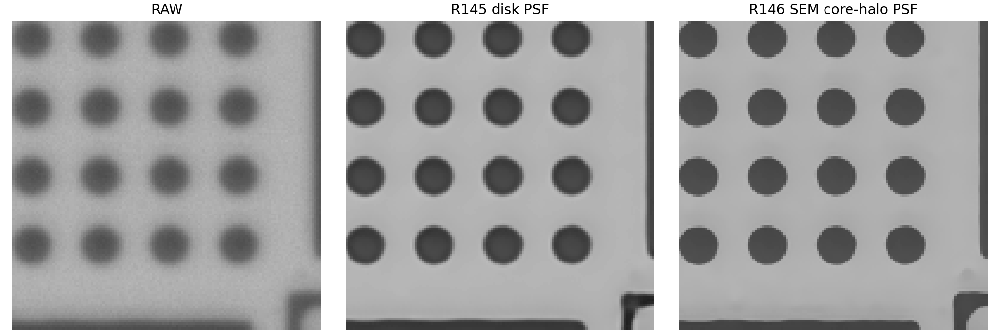
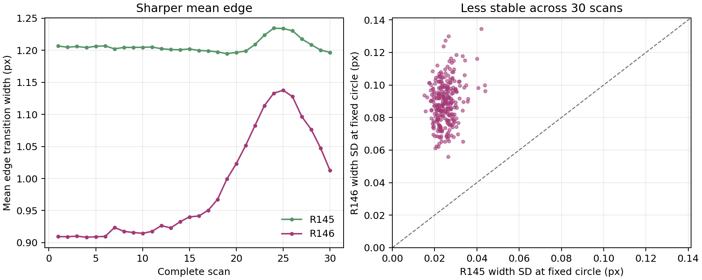

# R146：來源 PSF 預測改善，量測卻退步的原因核對

日期：2026-09-25。此報告使用 R146 固定的第 8192 次模型、30 趟／930 張實拍和 8370 顆圓；不修改來源 PSF、訓練權重或原量測表。[完整結果](R146_RESULTS.md)保存全部方法與指標。

## 先回答：訓練到底有沒有用指定 PSF

**有，而且資料到權重的整條鏈已重算。**指定研究 MAT 的 SHA-256 為 `0d85d63c...`，列優先安裝成 25 顆銀行 `efc9d70d...`。768 組清晰答案與 R145 **逐值相同**；692 組非原本清晰的母場景使用本輪指定的 PSF 編號卷積兩張清晰影像，76 組清晰對照保留不模糊。從原 MAT 和清晰影像重做的 **1536 張無雜訊影像逐值一致**；加入原始雜訊後的 1536 張儲存影像亦逐值一致。全部 **8192 筆訓練紀錄**的母場景與每輪固定順序逐筆相符，訓練設定記錄 `scratch`，最終權重綁定新資料與新銀行；另外抽查七種場景、訓練初期／中期／末期共 **21 個實際批次**，每輪重新抽的雜訊、輸入、清晰答案及 PSF 標籤都逐值相符。[全數資料與訓練鏈](../results/data_training_chain_audit.json) · [實際批次重播](../results/epoch_noise_replay_audit.json)

這證明**新 PSF 確實進入模糊訓練資料，訓練程式也按設定讀取並完成**。它不等於「神經網路的光學反推已符合物理」或「來源拍攝的 PSF 完全等於 930 張另一拍攝批次的逐張 PSF」；這兩件事要分開檢查。

## 直接判定

使用者指定的尖中心加淡尾研究版 PSF，在預先封存的六張照片、18 個未參與擬合的圓外觀上，全部比 R145 所用的原 BADS PSF 和單一高斯更能預測影像：平均平方差 **0.001791**，對照原 BADS **0.002997**、高斯 **0.002105**。這是可信的**同九顆實物、不同視角前向預測改善**；它不是新的獨立樣品，也不直接保證神經重建後的位移與尺寸改善。

R146 以與 R145 相同的 768 清晰母場景、分組、位移、雜訊、逐場景 PSF 編號、網路架構、初始種子及 8192 次更新從零訓練；只更換銀行及其模糊配對。930 張實拍與 8370 次圓量測和既有對照完全相同，最後稽核通過。因此下表是真正可比較的合併效果。

| 同一 30 趟實拍 | RAW | R140v2 | R145 | R146 |
|---|---:|---:|---:|---:|
| 短步 PI 平均絕對差 | 8.167 | 3.640 | 3.990 | **4.313** |
| 短步重拍波動 | 9.725 | 3.530 | 4.016 | **4.459** |
| 起點相對位移平均絕對差 | 19.081 | 17.926 | 18.070 | **18.220** |
| 起點相對位移重拍波動 | 13.763 | 10.433 | 11.216 | **10.369** |
| 直徑重拍波動 | 32.750 | 18.581 | 21.013 | **23.082** |
| 輪廓重拍波動 | 63.758 | 18.430 | 16.001 | **20.371** |
| 去尺寸形狀重拍波動 | 61.667 | 15.991 | 12.153 | **16.837** |

單位為 nm。R146 相對 RAW 仍改善短步與尺寸重拍，不能稱全面失敗；但相對主要配對參照 R145，**短步、直徑與輪廓皆退步**。短步平均絕對差增加 **0.323 nm**，完整趟次配對重抽樣 95% 區間 **+0.094 至 +0.536 nm**，只有 **10/30 趟**較好；短步重拍波動增加 **0.443 nm**，區間 **+0.104 至 +0.728 nm**。直徑重拍波動增加 **2.069 nm**，區間 **+1.365 至 +2.891 nm**；輪廓重拍增加 **4.369 nm**，區間 **+3.915 至 +4.695 nm**。[配對區間](../results/comparison/paired_scan_intervals.csv) · [位移波動完整趟次重抽樣](../results/displacement_repeatability_intervals.json)

R146 的起點相對位移**重拍波動**比 R145 低 **0.847 nm**，完整趟次區間 **−1.311 至 −0.334 nm**；與 R140v2 的差僅 **−0.064 nm**，區間跨零。但起點相對位移的**平均絕對差**比 R145 高 **0.150 nm**，區間 **−0.147 至 +0.465 nm**。因此只能說長距離重拍有局部改善，不能說整體長距離位移已勝出。

## 逐顆圓證據

相同固定步進位置逐顆計算，R146 的單顆短步重拍標準差平均 **8.837 nm**，R145 **7.933 nm**，R140v2 **6.829 nm**。R146 相對 R145 多 **0.904 nm**，以整趟重抽樣的區間為 **+0.524 至 +1.200 nm**；270 個固定「步進位置×圓」組合有 **203 個** R146 較不穩。這證明短步退步不只是九顆取中位數造成。[逐圓摘要](../results/position_stability_followup.json)

R146 的九顆平均直徑 **2833.183 nm**，比 R145 的 **2821.624 nm** 大 **11.559 nm**，比 RAW 的 **2799.621 nm** 大 **33.562 nm**。與 R145 相比，九顆圓及 30/30 趟的平均都增加；按整趟重抽樣，增加量區間 **+10.264 至 +12.829 nm**。[逐顆與趟次檢查](../results/diameter_shift_intervals.json)。以本輪所依據的同九顆 SEM 外框點位換算，平均直徑差為 R146 **+218.744 nm**、R145 **+207.186 nm**、RAW **+185.182 nm**；另用既有 Excel 直徑表則分別是 **+203.445、+191.887、+169.883 nm**。兩套參照的均值相差 15.299 nm，排名與 R146 比 R145 更偏大的結論不變。這些是同九顆校準條件下的尺寸比較，**不是獨立絕對準確度證明**。

## 為什麼來源更好仍未轉成量測改善

1. **研究版 PSF 讓訓練模糊大幅變窄。**R145 銀行的 50%／90% 能量半徑中位為 **4.00／12.17 原尺寸像素**；R146 為 **2.83／7.62**，保留更多細節。[兩版 PSF 寬度與細節圖](figures/psf_bandwidth_comparison.png)。兩輪清晰答案相同，模糊輸入難度因此不同；R146 生成測試影像損失 **1.439** 低於 R145 的 **3.336**，不能直接當成實拍測量比較。平均直徑往外移 11.559 nm、輪廓重拍變差，顯示主網路學到另一種圓邊處理。PSF 形狀與輸出方向間的精確因果仍需控制實驗，不只靠這個相關性定論。
2. **模型的 PSF 分支幾乎沒有直接工作。**R146 最終 PSF 混入比例僅 **0.93%**，比 R145 的 **1.59%** 更弱；反推式仍將正規化 PSF 的零頻壓至 1/31，且沿用已驗證的頻域原點錯位和半解析度尺度不匹配。[相同測試點的運算檢查](../results/deep_diagnosis/optical_transfer_audit.json)。跨早、中、晚 12 張實拍，開關分支的輸出差中位 **0.027 灰階**；每顆圓直徑最大差僅 **0.360 nm**，遠小於 R146 相對 R145 的 **11.559 nm**。因此大部分尺寸變動經由重訓後的主網路，而不是推論時直接套 PSF。[12 張開關明細](../results/deep_diagnosis/optical_branch_12.json)
3. **逐張挑 PSF 仍未學成。**研究銀行在相同清晰場景下的典型 PSF 差異約 **0.146 灰階**，R145 銀行約 **0.094**，但 206 組保留場景仍有 **200 組**的典型差異低於各自雜訊。[可辨識度全數檢查](../results/deep_diagnosis/synthetic_psf_observability_summary.json)。生成測試已知 PSF 的首選只有 **10/206**，前四包含 **34/206**；930 張實拍全把第 8 顆排第一。實拍沒有逐張已知 PSF 真值，不能算選擇準確率；四張實拍強制切換第 0／24 顆時圓心差低於 **0.0001 nm**，表示目前選哪顆對實際輸出幾乎沒有影響。
4. **邊更利落，重拍時卻更不穩。**在全部 930 張、8370 顆圓上用相同的 20%–80% 亮度過渡定義，R146 輸出的邊界寬度中位 **0.955 像素**，R145 **1.205 像素**；R146 平均窄 **0.223 像素**，完整趟次區間 **−0.249 至 −0.194 像素**。但固定位置與圓在 30 趟之間的邊寬起伏，R146 **0.0901 像素**、R145 **0.0253 像素**；差 **+0.0648 像素**，整趟區間 **+0.0496 至 +0.0738 像素**。固定 279 組「位置×圓」中，**279/279 組** R146 邊寬更不穩，並非幾個離群值。原圖邊寬在前五趟平均約 **3.007**、最後五趟約 **3.337 像素**；R146 輸出隨之從 **0.909** 變到 **1.072 像素**，R145 幾乎維持 **1.206→1.211 像素**。R146 輸出邊寬與原圖逐趟邊寬的相關為 **0.968**，R145 為 **0.476**。這支持「新模型對實拍模糊狀態變動較敏感」，與輪廓及直徑重拍退步吻合；它不能單獨判定焦距、照明或樣品哪一個造成原圖變動。[全部逐圓數值](../results/edge_response_r145_r146.csv) · [整趟不確定範圍](../results/edge_variability_audit.json) · [圖](figures/edge_width_repeatability.png)

新 PSF 的留出照片優勢是**來源層級的成功**，R146 量測退步是**模型與資料結合後的實證結果**；兩者可以同時成立。訓練目標仍是合成影像像素、梯度和合成位移配對，沒有直接要求真實 PI 短步、逐圓直徑或輪廓重拍最佳。SEM 真實外框用於 PSF 光學校準是合理的，沒有當作神經清晰答案。

## 下一步與保留範圍

不建議用 R146 取代 R145 或 R140v2 的短步位移、尺寸及輪廓用途。若目標是進一步測試這份來源預測更好的研究 PSF，優先順序為：

1. **先修模型怎樣用 PSF。**在獨立新輪次校正頻域原點、PSF 與特徵的物理尺度以及反推強度；先以已知位置的測試點、平坦影像、已知模糊與雜訊核對「反推點留在原位、亮度不任意漂移、切換 PSF 確實有可量到的作用」，再完整從零訓練。可先用固定或已知位置指定的 PSF，減少無效的逐張選擇器干擾。
2. **讓模糊資料覆蓋實拍狀態變動。**研究版 PSF 較窄；同一 930 張原圖的邊寬隨趟次變寬，R146 輸出也跟著大幅變動。後續模擬需包含來源獨立的不同焦況、對比、亮度和小位移，核對原尺寸成像順序與 PSF 的有效像素尺度，並用另外拍攝的校準照片估計這些範圍；不能只用這批 930 張挑有利設定。
3. **把訓練目標對準量測。**在已知幾何的合成清晰場景加入圓心、直徑和跨張小位移一致性條件，同時保留影像與輪廓品質；不把 SEM 外框或尺寸變成神經清晰答案。每輪均用固定 30 趟分報短步、長距離、直徑與輪廓，尺寸絕對準確度再用來源獨立的 SEM 或其他參照驗證。

需同時保留來源較好卻量測退步這個結果，不應回頭改挑權重或重選實拍趟次。原交付 PSF、R145 及 R146 的所有檔案均保留。

