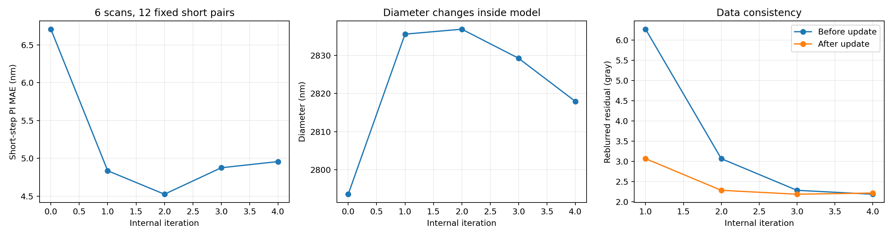
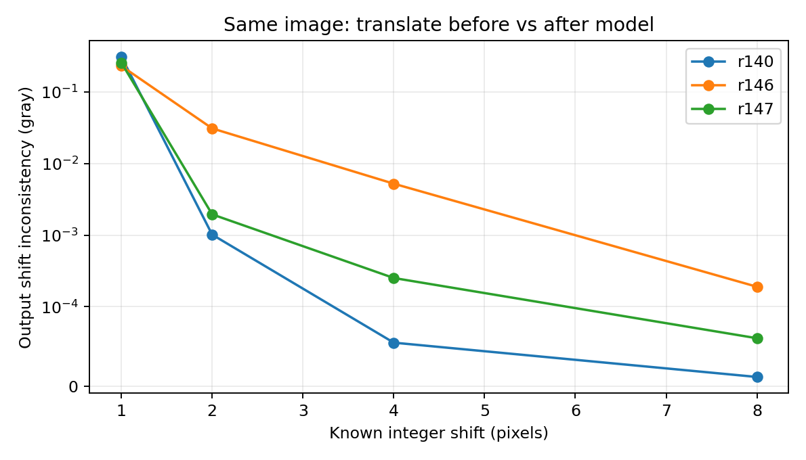
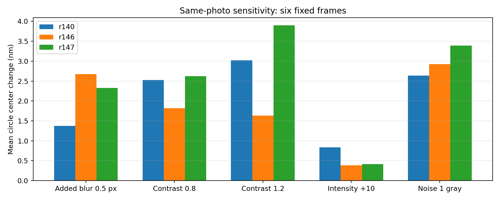

# R147 模型內部、歷史對照與改良優先順序

日期：2026-09-26。原模型、原訓練配對、930 張重建與正式分數全部保留。本輪是已訓練模型的診斷，沒有新訓練或把中途影像升為新模型。

## 結論

目前最有證據支持的限制，是 **網路改邊界時，仍會受取樣位置、對比與雜訊影響；現有訓練對「同一物體在不同拍攝狀態下仍量得一致」要求不足**。PSF 在 R147 已有實際作用，問題不再是單純沒有接通。直接 PSF 修正與網路解讀 PSF 的反應有連鎖依賴，繼續加大前者不保證改善位移。

R147 在全部 30 趟的直徑重拍波動 16.336 nm，確實比 R146 的 23.082 nm 低；短步 PI 平均差 4.537 nm 卻比 4.313 nm 高。新診斷重現了有助於解釋這種取捨的反應，但**不能把正式 0.224 nm 退步全部歸給某一個原因**。下一版應分開比較取樣方式、跨成像條件資料、量測要求，逐項建立改善證據。[具體改良計畫](R147_OPTIMIZATION_PLAN.md)

## 1. 實際完成哪些檢查

固定選六趟：第 1、6、11、16、21、30 趟。逐次拆解使用每趟第 0、1、15、16、30 個位置，共 30 張；位移診斷為 12 個相鄰對和六個 30 μm 終點對。小擾動與裁切使用每趟第 0 個位置，共六張、54 顆圓。這些照片都是已使用的研究資料，不能改稱新保留集。

- 四次原生重建，以及每一步固定當下的「僅網路／僅直接 PSF」對照：4,320 筆圓讀值、120 筆修正分解。最後完整輸出 30/30 張與原浮點影像逐像素差 0，270 顆末步圓心與原表相同。
- R140v2、R146、R147：整數移動 1／2／4／8 像素；水平／垂直半像素移動；另一種水平半像素插值。共 1,134 筆圓讀值。
- 三模型：320／512／768／1024 像素的對齊裁切，另測 320 像素裁切原點差一格，共 810 筆。
- 三模型：增加少量模糊、改對比、改整體亮度、加入同一份固定雜訊，共 1,134 筆。
- R137 原尺寸模型：相同六張、移動 1／8 像素，108 筆。原單張入口與歷史浮點結果再次核對。
- R147 輸出頭作用範圍：24 筆；七種場景各兩個實際末期訓練批次，共 14 組梯度檢查；768 組資料祖源和幾何中繼資料；全部原陣列、來源鎖與驗證鎖複核。

位移表另由圓心逐項重算，最大差 `7.11e-15 nm`。[最後核對](../results/internal_audit/verification.json)；[可重跑的內部檢查](../scripts/audit_internal.py)、[成像擾動檢查](../scripts/audit_nuisance.py)。所有比較均使用原浮點影像，沒有事後銳化、移動圓心或縮放尺寸。

## 2. 尺寸主要在哪裡改變

在固定當下的同一狀態上，加入網路修正的平均圓心變化第一步約 **32.70 nm**；直接 PSF 加回那一步約 **0.049 nm**。第三、第四步網路仍分別帶來約 **4.13、3.14 nm** 的圓心變化；直接加回分別約 **0.031、0.040 nm**。第一步網路讓直徑平均增加 **43.97 nm**，後兩步分別減小 **7.64、11.34 nm**。[局部幾何作用](../results/internal_audit/local_geometry_effect.csv)

這不表示直接 PSF 分支不重要：它會改變下一步輸入，網路隨后再反應。固定權重的整條開關對照如下：

| 六趟、五個固定位置 | 平均直徑 nm | 直徑重拍波動 nm |
|---|---:|---:|
| 完整 R147 | 2817.937 | 11.595 |
| 保留 PSF 資訊供網路讀取，取消直接加回 | 2835.135 | 28.169 |
| 保留直接加回，取消提供給網路的 PSF 資訊 | 2780.353 | 9.376 |
| 兩項均取消 | 2781.277 | 9.365 |

數字支持兩條路徑彼此依賴，並非簡單相加的獨立物理效果。開關後是未按該模式重新訓練的模型，**不能拿較低的某一欄當作可直接採用的版本**。完整 30 趟、全部位置的直徑波動是 16.336 nm，與本表不同範圍不能混用。[逐步圓讀值](../results/internal_audit/trace_circles.csv)

## 3. 後兩次修正有目標衝突

同樣六趟、12 個短步對：

| 次數 | 短步 PI 平均差 nm | 直徑重拍波動 nm |
|---|---:|---:|
| 原圖 | 6.707 | 28.653 |
| 1 | 4.836 | 23.520 |
| 2 | 4.526 | 20.996 |
| 3 | 4.875 | 19.014 |
| 4 | 4.957 | 11.595 |

第四次穩住直徑，短步平均差卻不如第二次。這不是證明二次重訓架構最好；這些中間狀態只接受了以第四次為終點的訓練，沒有各自公平重訓。

把當下影像重新用 PSF 模糊后，與原照片的差依次從 **6.268→3.069→2.287→2.190→2.219 灰階**。第四次在 **18/30 張**使這項差增加，盡管仍遠比原始估計小。最后網路修正均方強度約 **1.437 灰階**，直接 PSF 修正約 **0.125 灰階**；兩者平均方向相關約 −0.080。后段網路沒有被訓練成只追求成像差下降，繼續改邊界而造成取捨并不意外。[逐步摘要](../results/internal_audit/stage_summary.csv)、[修正分解](../results/internal_audit/trace_updates.csv)

## 4. 固定取樣格子會引入額外反應

同一張照片在輸入前平移，與先重建再平移，應保持一致。整數平移沒有半像素插值問題，RAW 的對應圓心變化誤差在這些控制中為 0。

| 模型 | 移 1 像素：平均圓心誤差 nm | 移 8 像素：平均圓心誤差 nm |
|---|---:|---:|
| R137 | 0.000008 | 0.000006 |
| R140v2 | 1.251 | 0.000029 |
| R146 | 0.877 | 0.000617 |
| R147 | 0.865 | 0.000305 |

R147 一像素控制的逐圓最大值 **3.773 nm**，八像素僅 **0.00123 nm**。這與目前網路三次二倍縮圖所形成的取樣格子相符，且 2／4 像素誤差已顯著降低，最先一次縮圖的影響較突出。R137 主網路沒有縮圖，這項控制接近浮點計算差。[移動明細](../results/internal_audit/shift_summary.csv)、[R137 對照](../results/internal_audit/r137_grid.csv)

**這是共享弱點，不是 R147 相對 R140v2 退步的單一證明。**R140v2 在此一像素控制反而較差，但在真實 930 張短步最佳。半像素數值平移的結果也會隨插值、方向與讀法改變；三模型都比 RAW 在對應半像素控制的圓心差低，不能只挑控制排名代替真實 PI。

對齊八像素原點後，R147 320 像素裁切與完整影像的圓心平均差 **0.000315 nm**，逐圓最大 **0.001027 nm**。僅裁切原點差一格，平均差升到 **0.864 nm**、最大 **3.745 nm**；其他較大對齊裁切亦接近數值精度。故現有證據不支持「訓練小圖的邊界影響」是這些九顆的主要原因，反而定位到取樣原點。[裁切檢查](../results/internal_audit/crop_summary.csv)

相關研究也指出一般縮圖會產生移動敏感性，抗混疊可改善但不是嚴格保證；保留取樣相位的上／下採樣可改善重建一致性。這里的實證是本地控制，文獻不替代本模型量測：[Zhang, 2019](https://proceedings.mlr.press/v97/zhang19a.html)、[Chaman and Dokmanic, 2021](https://arxiv.org/abs/2105.04040)。

## 5. R147 的好壞取捨可在成像條件控制中重現

相同六張、54 顆圓；物體沒有另行移動。數字是相對各模型未擾動輸出的平均圓心變化，不是新的真實位置誤差。

| 同照片的已知改動 | R140v2 nm | R146 nm | R147 nm |
|---|---:|---:|---:|
| 額外模糊 0.5 像素 | 1.374 | 2.675 | 2.324 |
| 對比降為 0.8 倍 | 2.526 | 1.815 | 2.620 |
| 對比升為 1.2 倍 | 3.021 | 1.632 | 3.897 |
| 亮度增加 10 灰階 | 0.833 | 0.387 | 0.414 |
| 加入標準差 1 灰階的相同雜訊 | 2.636 | 2.928 | 3.392 |

純對比變化下，RAW 的讀值基本不變；R147 對比提高後，**5/6 張**的圓心變化比 R146 大，逐圓最大 **12.256 nm**。這是可重現的多余位置反應。加少量雜訊后 R147 仍遠低于 RAW 的 12.531 nm，因此不是普遍去雜訊失敗。

增加 0.5 像素模糊時，直徑平均變化 R146 **+6.579 nm**、R147 **+3.543 nm**；R147 的圓心變化在 **5/6 張**較 R146 小。它在此較能抵抗模糊變化，卻較易受對比和小雜訊影響，與真實結果的直徑穩定性改善、短步退步方向相容。**這些是對已采樣照片的數值控制，未獨立分離真實拍攝中的焦距、照明與感測器變化。**[完整條件明細](../results/internal_audit/nuisance_summary.csv)

## 6. 訓練的要求與使用條件尚未對齊

768 組祖源均核對；512 個訓練場景中，45 個是緊鄰小圓，半徑 **2.246–9.749 px**，中心距 **10.133–22.806 px**；另 103 個不規則曲線的主半徑為 **18.359–51.194 px**。當前實拍讀法的半徑約 **8.330 px**、中心距 **28.933 px**。小圓半徑雖有覆蓋，鄰物間距和孤立小曲面的組合缺乏直接覆蓋。這是資料覆蓋缺口，不能單獨解釋模型排名，因為 R140v2 也沿用同一批幾何。

真正有移動的訓練配對位移中位數 **0.736 px**、最大 **1.233 px**；實拍相鄰 RAW 圓心位移中位數 **5.807 px**，PI 每步約 **1.000 μm**。每個母場景的 PSF、對比、照明固定，16 次循環只按規則重抽感測雜訊。沒有同一個物體跨多種模糊／對比狀態的共同訓練要求。

14 個末期實際訓練批次中，扣除平坦與零移動干凈場景后，有十個非零移動批次；現有配對項帶來的參數調整力度中位約影像項的 **7.87%**，五個方向與影像項相反。這個抽測不代表全部更新的比例，但支持目前訓練主要在追求影像像素，而非直接保證量得的位置一致。配對項比較的是誤差影像，兩張同樣尺寸偏大的圖仍可相互一致；R133 已以已知圓形反例實跑。

平均 PSF 與逐場景實際卷積 PSF 的生成測試差，中位只 **0.107 灰階**；232 視圖中 **224** 個低於該視圖注入的雜訊。固定平均不是完全正確，但這項誤差不足以支持把下一步重點繼續放在盲目增加逐張 25 選一分類。[資料覆蓋](../results/internal_audit/data_contract_complete.json)、[資料逐筆表](../results/internal_audit/data_geometry_photometry.csv)、[訓練要求梯度](../results/internal_audit/gradient_summary.json)

## 7. 已排查的歷史原因與應保留的教訓

| 歷史實驗 | 可保留的證據與對本輪的意義 |
|---|---|
| R139／R140v2 | 飽和失效曾被實跑修正。本輪六張四步的輸出作用沒有出現 tanh >0.999 飽和；九顆附近輸出和殘差限幅比例均為 0，不能再套用 R139 的退化解釋。 |
| R137 | 原尺寸共享修正、弱 PSF 提示；同一 30 趟直徑波動 14.262 nm、短步 3.917 nm，且新整數控制接近精確。可作為穩定原尺寸路徑的設計參考，不能說新研究 PSF 換進去一定更好。 |
| R140v2 | 短步 3.640 nm 是本系列當前較好結果。保留其學習穩定性和多尺度形狀能力，不能僅憑某個控制分數否定其實際用途。 |
| R145 | 輪廓波動 16.001 nm 最低；它不是最銳利一版，證明輪廓穩定與視覺銳利不能合成一個目標。 |
| R143 | 平均直徑相對 RAW 縮小 74.654 nm，SEM平均差改善但重拍較差。任意內縮并不是下一版合適的尺寸訓練答案。 |
| R131 | 較早模型不同修正次數也出現尺寸／形狀／位移取捨。該批 201 張與本輪 930 張不是同一評價，數字不能串成統一排名。 |
| R121 | 加亮度／局部位置要求的匹配短測未同時改善輪廓與細節；因此新要求需先通過純寬度、位置和細節反例，不能只靠合理名稱擴大訓練。 |
| R122／R127／R133 | 已證明像素插值不是物理移動；共同偏差可在位移相減時消失；光學亮暗邊界與材料尺寸需區別。新的幾何要求限定于已知生成條件。 |
| R134 | 8-bit 存檔曾放大偏移。本輪全部 FP32、單張／批次一致，因此該存檔問題不是當前主要解釋。 |

完整結果、方法和失敗均引用各輪 canonical 報告；沒有重寫歷史判定。[R137](../../R137_WeakPSFFeature/reports/R137_RESULTS.md)、[R140v2](../../R140v2_StableUNet/reports/R140v2_RESULTS.md)、[R143](../../R143_PSF25_MatchedPairs/reports/R143_STABILITY_DIAGNOSIS.md)、[R145](../../R145_Center9PSF25_CorrectedPairs/reports/R145_RESULTS.md)、[R131](../../R131_RecurrentStepValidation/reports/R131_RESULTS.md)、[R121](../../R121_BoundaryAnchorFactorial/reports/R121_RESULTS.md)、[R122](../../R122_OperatorPrinciples/reports/R122_RESULTS.md)、[R133](../../R133_SizeMechanismDiagnosis/reports/R133_RESULTS.md)、[R134](../../R134_DirectStateRepair/reports/R134_CROSS_AXIS_DIAGNOSIS.md)。

## 8. 長距離與絕對尺寸還有模型之外的部分

30 μm 終點的全30趟有號差：RAW **+40.892 nm**、R140v2 **+43.181 nm**、R147 **+42.969 nm**，多版相近。既有六趟 RAW/PI 尺度估計 **0.1723806 μm/px**，本協議固定讀值 **0.1725 μm/px**，相差約 **0.0692%**，在 30 μm 對應約 **20.8 nm**。這是操作尺度敏感性，不證明全部剩余偏差都來自尺度，也不是獨立計量校準。

因此長距離要結合獨立尺度／方向校準與位置保留驗證，不能要求模型僅靠把邊變銳消除所有終點偏差。既有分數不因這項后驗診斷而重算為更有利值。SEM外框用來校準 PSF 合理；本輪清晰訓練答案仍是獨立生成圖形，沒有將實拍九顆SEM尺寸寫成訓練標簽。尺寸平均差還需清楚的材料邊界與讀法對應；重復穩定本身不等于絕對尺寸準確。

## 9. 獨立核對和執行更正

[核對收據](../results/internal_audit/verification.json)通過：來源／評估鎖未變、全768組陣列和中繼資料未變、末步與歷史讀值一致、位移算術獨立重算。診斷程序初次資料檢查把未模糊對照的 `applied_psf_index=null` 當作整數比較而停止；改成明確處理空值后重算全768組，不改資料或結果。梯度摘要明確排除零移動的干凈場景，不將其計入非零移動力度比例。中途摘要不作為最終結論。

下一步按[改良計畫](R147_OPTIMIZATION_PLAN.md)逐項短測，再決定完整訓練；這次完成的是模型內部與資料要求的深度診斷，沒有新候選通過或模型升級。
