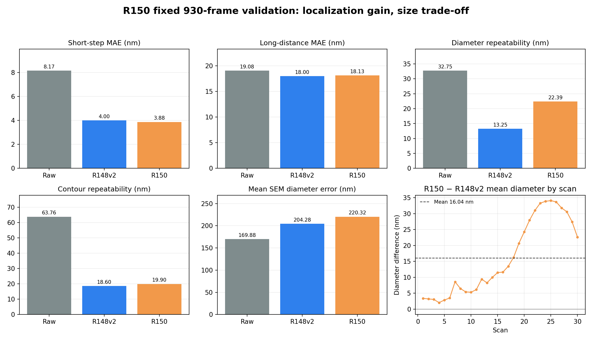

# R150 完整實拍驗證結果

## 完整性

- 正式訓練：8,192次，最終權重雜湊 `1ce02e2c7f25bc88677212d02ee7116bef4dc61c45558f0dc135cee3e2d31e27`。
- 實拍：固定30趟、930張、8,370顆圓。
- 新模型輸出全部重新擬合；獨立重算最大差4.06e-7 px。
- Raw與歷史方法的摘要重算最大差4.97e-9 nm。
- 最後稽核通過。所有數值來自模型原生浮點輸出，沒有後置尺寸或位置修正。

## 分項結果

| 項目（越低越好） | Raw | R148v2 | R150 | R150在13方法中的排名 |
|---|---:|---:|---:|---:|
| 短步PI平均差 | 8.167 nm | 4.003 nm | **3.876 nm** | 2 |
| 短步重拍 | 9.725 nm | 4.135 nm | **3.949 nm** | 3 |
| 短步最大誤差 | 39.299 nm | 22.264 nm | **19.384 nm** | 6 |
| 長距離平均差 | 19.081 nm | **18.002 nm** | 18.134 nm | 10 |
| 長距離重拍 | 13.763 nm | **10.156 nm** | 10.517 nm | 9 |
| 直徑重拍 | 32.750 nm | **13.252 nm** | 22.389 nm | 9 |
| 輪廓重拍 | 63.758 nm | **18.600 nm** | 19.897 nm | 10 |
| 去尺寸形狀重拍 | 61.667 nm | 17.401 nm | **16.483 nm** | 6 |
| 最差直徑偏移 | 183.318 nm | 99.768 nm | **77.925 nm** | 7 |
| SEM平均直徑差 | **169.883 nm** | 204.281 nm | 220.324 nm | 13 |

## 統計判讀

相對Raw，R150的短步、長距離、直徑重拍、輪廓重拍與去尺寸形狀重拍的完整掃描信賴區間都支持改善。

相對R148v2：

- 短步平均差降低0.127 nm，但95%區間為−0.276至+0.017 nm，尚不能證明穩定勝出。
- 長距離平均差增加0.132 nm，95%區間跨過零，屬相近。
- 直徑重拍增加9.137 nm，95%區間+6.626至+10.701 nm，確定退步。
- 輪廓重拍增加1.297 nm，95%區間+0.444至+1.929 nm，確定退步。
- 去尺寸形狀重拍降低0.918 nm，95%區間−1.031至−0.782 nm，確定改善。

短步平均值在13方法中第二，但仍明確落後R140v2；與R137、R145及R148v2的差異沒有穩定分出勝負。長距離則落後R137及R140v2。

## 為什麼生成驗證改善，實拍尺寸卻退步

R150相對R148v2的平均直徑增加16.04 nm，但不是固定加上一個常數：30趟的平均增加量從2.03到34.07 nm，範圍32.05 nm。這種隨拍攝條件變動的放大量直接提高直徑重拍誤差。

將每個位置自己的平均移除後，R148v2對Raw直徑波動的反應斜率為0.255，R150升至0.471；殘餘波動由13.03增加到22.01 nm。也就是R150更容易跟著原圖當趟的表觀寬窄一起變化。

另一方面，去除整體尺寸後的形狀重拍反而改善5.28%，最差直徑偏移也降低21.89%。因此問題主要集中在「整體尺度會隨拍攝條件移動」，不是輪廓形狀全面崩壞或少數單一離群值。

最合理的機制是：實拍尺度圓陣列讓模型更會維持圓心與一般形狀，所以短步與去尺寸形狀改善；但理想程序化清晰邊界仍沒有重現實拍材料邊界、照明與模糊變化。加上模型端全面改用平均PSF後，修正強度更依賴輸入當下的表觀模糊，使直徑跟著Raw波動。R150同時改了資料幾何和模型端PSF政策，目前不能把退步唯一歸因於其中一項。

## SEM界線

R150平均直徑2,850.062 nm，與同九顆SEM表的平均差220.324 nm，比Raw多50.441 nm、比R148v2多16.043 nm。相同趨勢也出現在SEM外框參考。

這些SEM來自同一組用於PSF擬合的樣品，因此可以作同協議尺寸差比較，但不能稱為完全獨立的絕對準確度驗證。即使保留這個界線，R150相對Raw及R148v2的尺寸方向仍確定是退步。

## 結論

R150是有效但偏科的研究模型：相對Raw全面改善，短步平均值與去尺寸形狀優於R148v2；尺寸重拍、輪廓重拍、長距離和SEM尺寸差則不如R148v2。它不取代R148v2、R140v2或正式基準。

若繼續研究，應用兩個缺失的單因素對照拆開原因：

1. 新圓陣列資料＋R148v2原本的混合PSF提示政策。
2. 舊R148v2資料＋全程平均PSF政策。

這兩組可分辨尺寸退步主要來自資料幾何，還是平均PSF政策；在原因分開前不應再增加模型深度或盲目提高邊界權重。
