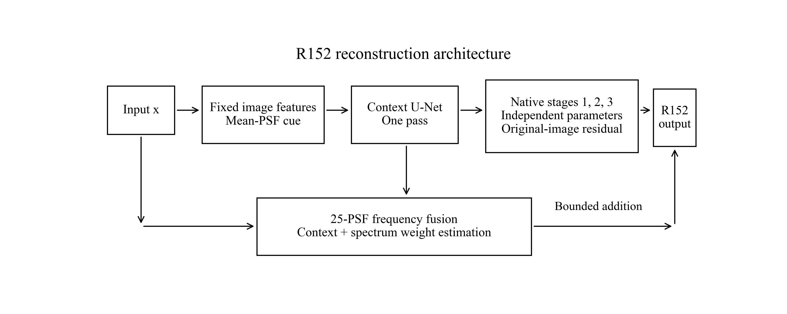
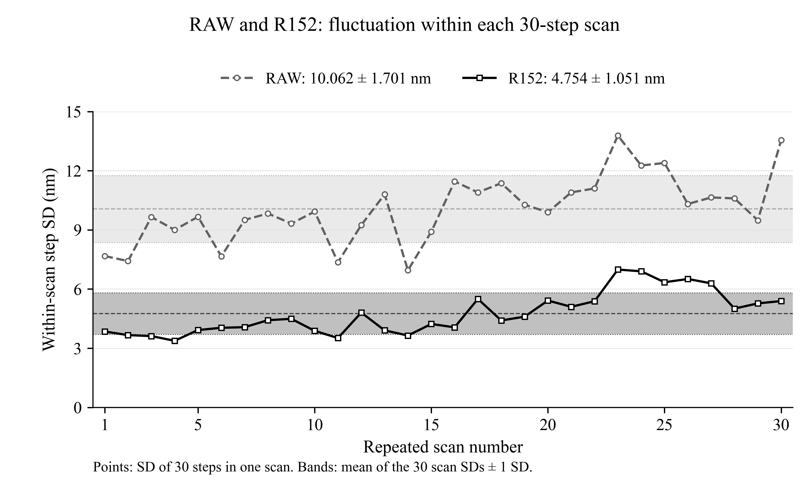
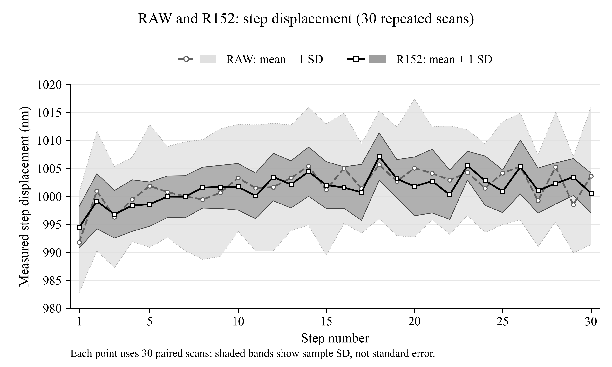
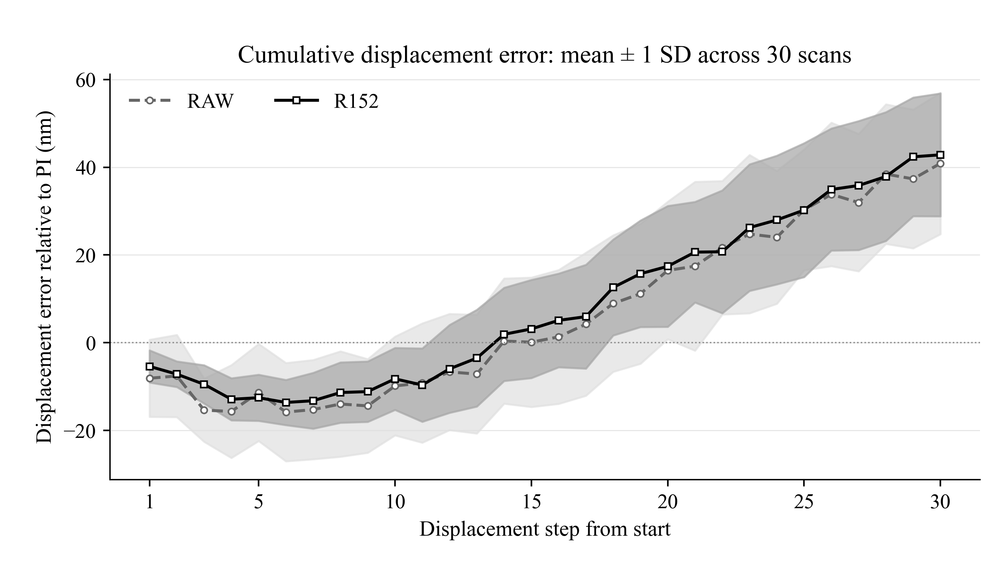
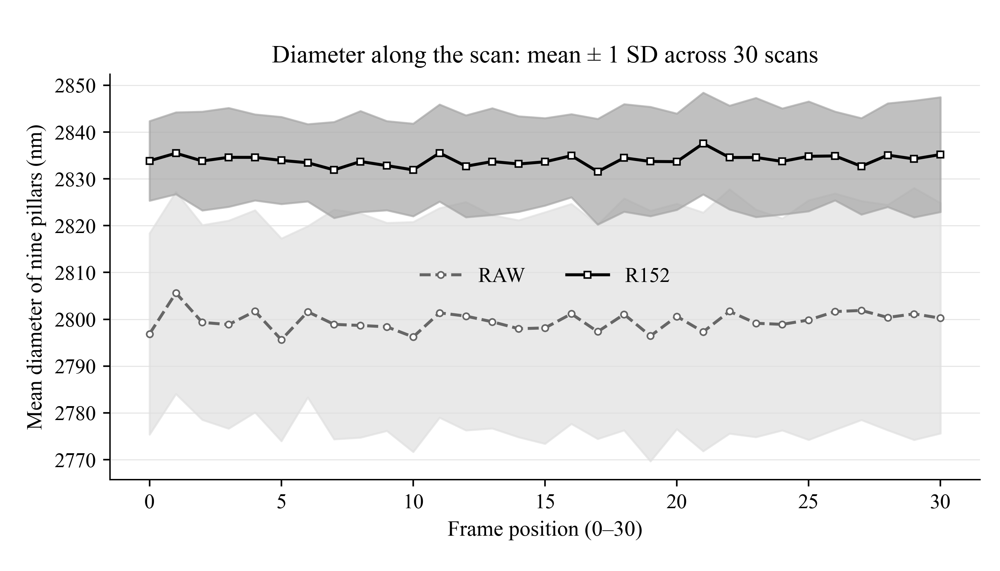
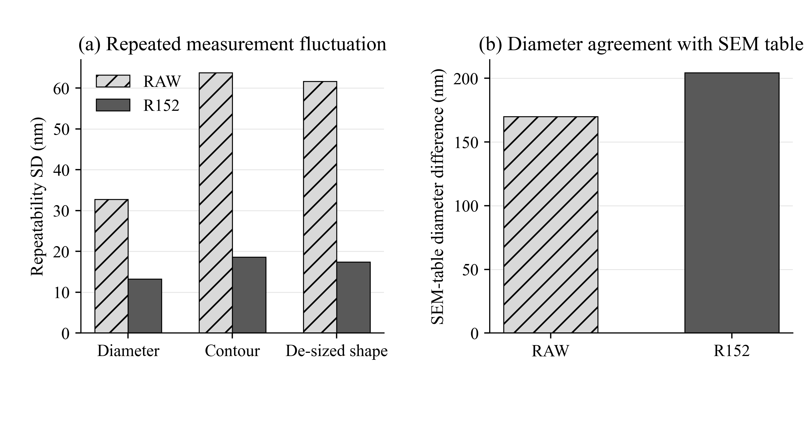

# R152 與 RAW 完整研究設計及驗證紀錄

版本日期：2026-10-02。比較對象只有原始影像 RAW 與 R152。本文供論文撰寫與後續網頁對話閱讀；研究目的、模型形成過程、模型結構、訓練與驗證方法、計算定義、全部主要結果及限制都在本文件內，不依賴之前的聊天內容。

本次工作是對已完成的30趟實拍量測重新完整計算，使用2026年9月3日的照片、2026年9月28日完成的R152權重及9月29日完成的原生重建與量測。10月2日不是新的拍攝或訓練日期。此次逐檔重新核對930張RAW照片和930份R152浮點重建輸出的SHA-256，並由每趟保存的圓心與64個邊界點重算全部位移、尺寸與720方向輪廓統計。

## 1 研究問題及最主要結論

研究關心的是顯微影像重建後，是否能讓單次掃描中的微位移步距更穩定，並讓同一批物體的尺寸與輪廓讀值更容易重現。它同時檢查影像位移相對PI平台回授的差，以及尺寸與SEM參照的差；這幾件事各自計算。

使用者確認的主要指標是「每一趟走30步，這30個影像量得的步距之樣本標準差」。重拍30趟提供30個單趟標準差，用來觀察改善是否一致、改善幅度的範圍及整體估計。本文不把固定某一步跨30趟的標準差代替這個主要指標。

| 指標，單位nm | RAW | R152 | 結果 |
| --- | --- | --- | --- |
| 單趟30步合併波動 | 10.200 | 4.865 | 降低52.3%；30/30趟改善 |
| 單步相對PI平均絕對差 | 8.167 | 4.003 | 降低51.0% |
| 起點相對位移平均絕對差 | 19.081 | 18.002 | 降低5.7% |
| 直徑重拍波動 | 32.750 | 13.252 | 降低59.5% |
| 輪廓重拍波動 | 63.758 | 18.600 | 降低70.8% |
| 去尺寸形狀重拍波動 | 61.667 | 17.401 | 降低71.8% |
| SEM表平均逐顆直徑差 | 169.883 | 204.281 | 增加34.397 nm |
| 走完30步的相對PI平均有號差 | 40.892 | 42.842 | 數值增加1.950 nm；配對區間跨零 |

R152的主要實用改善是單趟步距波動與尺寸／輪廓的重拍波動降低。30趟每一趟的單趟波動都比同趟RAW小，改善幅度為36.9%～64.6%。尺寸讀值更穩定，同時平均直徑相對SEM仍偏大，且偏大的差距比RAW大；因此「重拍穩定」與「尺寸更準」不能寫成同一個結論。

論文採R152作為單一模型，RAW作為共同影像基準。R148v2只在本文作R152已訓練主體的來源說明，不加入模型性能排名。

## 2 為何形成目前的模型

模型設計歷程的關鍵是：保留多尺度U-Net理解較大範圍的影像結構，同時把精細邊界修正放回原始像素格點；再把論文所需的多PSF加權融合支路接入已訓練的主體。R152的模型主體來自R148v2的第8192次更新權重；這些權重在R152擴充訓練時全部凍結，只有新增支路及比例接受訓練。

此形成方式是兩階段訓練：第一階段主體從零訓練8192次；第二階段載入第一階段權重，再訓練擴充8192次。不能把R152描述成全模型在第二階段從零共同訓練，也不能說它是同一個完整U-Net或ResNet連續重跑四遍。實際結構為一次U-Net脈絡，接三個參數不同的原尺寸修正階段，再附加一條受限光學支路。

| 日期 | 發生的事 | 對本文的作用 |
|---|---|---|
| 2026-09-03 | 同一批樣品完成30趟、每趟31張的連續位移拍攝 | 本次唯一實拍比較資料 |
| 2026-09-24 | 研究版25顆PSF完成擬合與封存 | 製作合成模糊及模型光學模組 |
| 2026-09-26起 | 封存主體使用的768個母場景、四視圖及幾何資料 | 訓練、開發、合成測試的共同來源 |
| 2026-09-28 | R152擴充完成8192次更新，開發集選定部署倍率1 | 確定交付權重，之後才做實拍驗證 |
| 2026-09-29 | 930張R152原生輸出、8370顆圓及全部30趟核對完成 | 完整實拍驗證完成 |
| 2026-09-30 | 確認主要指標應是單趟30步波動，修正舊指標混用 | 本文沿用的最新定義 |
| 2026-10-02 | 僅RAW／R152，重新核對來源並完整計算本文全部結果 | 本次報告版本 |

## 3 模型實際結構與參數



### 3.1 輸入與固定特徵

模型一次處理一張單色影像。實拍來源為1544×2064、八位元影像；先除以255變成0～1的FP32張量，形狀N×1×H×W，分塊推論N=1、最短邊至少202像素，輸出維持原尺寸。固定特徵為水平及垂直中央差分、四鄰域Laplacian、5×5局部平均，另加光學提示 x－Blur(x)。提示使用25顆PSF的平均核，光學提示增益為0.1。

U-Net的六個輸入通道為原圖、光學提示及上述四個固定特徵。以下讀值所用的是模型浮點原生輸出，沒有額外銳化、位移、尺寸修正或SEM直徑校正。輸出限制及光學附加支路是模型本身的前向運算。

### 3.2 一次執行的U-Net脈絡

| 部位 | 具體設計 |
|---|---|
| 原尺寸編碼 | 六通道輸入，3×3卷積至24通道，逐像素通道正規化、SiLU、一個殘差區塊 |
| 第一次降採樣 | 固定3×3二項式濾波後stride 2，卷積至40通道及殘差區塊 |
| 第二次降採樣 | 同樣先濾波後stride 2，卷積至64通道及殘差區塊 |
| 解碼 | 雙線性升採樣、固定二項式濾波、卷積，與對應編碼特徵接合，64→40→24 |
| 脈絡輸出 | 3×3卷積得到16通道，再用9×9二項式核平滑；供後續三階段共用 |
| 固定濾波 | 3×3核是外積[1,2,1]／4；9×9核是外積[1,8,28,56,70,56,28,8,1]／256 |
| 正規化 | 同一像素的通道減均值後除以通道RMS，加ε=1e-4，另有學得的通道比例與偏置；不跨整張影像計算空間平均 |
| 殘差區塊 | 兩個3×3卷積，每個接通道正規化，第一個之後為SiLU；區塊輸出為 h＋0.1×修正 |
| 邊界填補 | 手工反射填補；不以零值補影像邊界 |
| 執行次數 | 每張影像一次，16通道脈絡在三個原尺寸階段共用 |

### 3.3 三個獨立原尺寸階段

每階段輸入24通道：當前影像z、原圖x、z－x、固定光學提示共四個，四個原圖固定特徵，再加16通道脈絡。脈絡增益0.05。每階段是3×3卷積至64通道、四個殘差區塊、3×3卷積回一通道；四個區塊的膨脹距離為1、2、4、2。三階段的參數各自獨立。

```text
r_0 = 0; z_0 = x
delta_t = Stage_t([z_(t-1), x, z_(t-1)-x, 0.1*cue, dx, dy, lap, local_mean, 0.05*context])
eta_t = 0.25 * sigmoid(step_logit_t)
r_t = clip(r_(t-1) + eta_t * tanh(0.1 * delta_t), -0.35, +0.35)
z_t = clip(x + r_t, 0, 1), t=1,2,3
```

交付的三個eta依序為0.077756293、0.073991276、0.071194686。每一步都以同一原圖x加累積殘差，避免把前一步輸出作為無限制的新基準。

### 3.4 多PSF頻域加權融合支路

| 項目 | 實際設定 |
|---|---|
| 固定銀行 | 25顆非負、總和為1的101×101核；5×5拍攝順序，索引=row×5+column |
| 權重輸入 | 凍結的16通道脈絡及原圖的16格徑向對數功率頻譜 |
| 脈絡估計器 | 16→24的5×5卷積、SiLU、24通道3×3逐通道卷積、SiLU、1×1卷積、SiLU、全域平均 |
| 頻譜估計器 | 原圖先減空間均值，rFFT功率取log(1+power)，半徑0～0.5 cycles/px分16格；格間正規化後16→24→24兩層線性層與SiLU |
| 融合權重 | 24+24共48維輸入線性層輸出25 logits，softmax溫度1；每張影像只有一組全域權重，25核全部參與 |
| 反濾波 | PSF中心移到FFT原點；G_k=conj(H_k)／(abs(H_k)²+0.03)，頻率遮罩外改成1，增益幅度最多2 |
| 頻率範圍 | 半徑相對Nyquist的比值≤0.25，即徑向頻率≤0.125 cycles/px |
| 填補與還原 | 原圖四周反射50像素，先加權頻域濾波器，再一次逆轉換，裁掉50像素 |
| 修正限制 | q=clip(x_filtered－x, −0.25, +0.25) |
| 模組內比例β | 0.0025～0.03，初值0.01，交付0.0119699407369 |
| 外部比例s | 0～0.25，初值0.01，交付0.0138008007780 |
| 部署倍率d | 開發集預定候選0、0.25、0.5、0.75、1中選到1；實拍之前已固定 |

```text
x_anchor = clip(x + beta*q, 0, 1)
y_R152 = clip(z_3 + d*s*(x_anchor-x), 0, 1)
```

25個候選先在頻域相加再做一次逆轉換，與逐顆逆轉換後用同一權重相加等價。這個支路是模型原生輸出的一部分。本文只記錄其結構與使用狀態，不以RAW／R152整體比較判定單一模組的獨立貢獻。

### 3.5 參數總數及凍結狀態

| 部分 | 參數數量 | R152第二階段更新 |
|---|---:|---|
| 脈絡U-Net | 261280 | 凍結 |
| 每一原尺寸階段 | 311041，三階段共933123 | 凍結 |
| 三個階段比例 | 3 | 凍結 |
| 原主體合計 | 1194406 | 全部凍結 |
| 新頻域融合支路含β | 12698 | 更新 |
| 外部安全比例 | 1 | 更新 |
| R152合計 | 1207105 | 其中12699接受本輪訓練 |

## 4 訓練資料如何製作

768個清晰母場景分成512訓練、128開發、128最後合成測試。每個母場景有四個視圖，合計3072視圖；同一母場景及其視圖不跨分組。開發與合成測試的照片不是實拍30趟。R152唯讀引用原主體封存的資料與幾何，不在第二階段重新做一套不同配對。

資料形成順序為：4倍像素密度的清晰潛在場景 → 施加已知位移及亮度／對比 → 用4倍插值的實測PSF卷積 → 4×4面積積分回到原尺寸 → 依固定種子加噪聲 → 裁至0～1 → 四捨五入成八位元 → 除以255供模型讀取。乾淨答案與幾何邊界來自合成場景；沒有把這批實拍的SEM直徑當成神經網路清晰答案。

| 場景種類 | 母場景數 |
| --- | --- |
| corners_lines_junctions | 154 |
| dense_close_structures | 154 |
| flat_negative | 77 |
| irregular_curved | 155 |
| textured_edges | 152 |
| clean_identity | 38 |
| noisy_identity | 38 |

視圖實際對比範圍為0.85～1.15，亮度偏移−5～+5灰階，噪聲標準差0.5～3.0灰階。位移含0、±0.25、±0.5、±0.75像素等小位移及2、−4、−6、8像素等較大位移；完整23種位移組合見附錄資料摘要。3072視圖中76個為無PSF原樣對照，其餘2996個PSF卷積視圖的25個索引各出現118～123次。

母場景標籤中仍保留較早的來源ID，例如r128_train_0000；這是清晰場景的祖源紀錄，不能據此把R152的模型或實拍保存點認成其他版本。資料實際用的PSF銀行與交付模型一致，以雜湊核對。

## 5 兩階段訓練設定及目標

第一階段主體從零訓練8192次，16輪，每輪512母場景；每次讀四視圖，三個階段有0.25／0.35／0.40的訓練權重。第二階段新增支路訓練同樣8192次與16輪，原主體權重與緩衝值均保持凍結；沒有以實拍結果挑選保存點。

| 項目 | 第二階段R152設定 |
|---|---|
| 最佳化 | AdamW；最高學習率3e-4、最低3e-6、weight decay 1e-5 |
| 排程 | 前128次線性暖身，之後餘弦下降 |
| 梯度 | L2範數裁切至1；非有限梯度直接中止 |
| 精度 | FP32、TF32關閉，確定性設定；RTX A6000 |
| 種子 | 模型1522101，順序1482102，噪聲1481003，訓練觀測PSF1482104 |
| 保存與評估 | 每128次保存，每512次評估全部128開發母場景 |
| 主要範圍 | 384×384輸入中，清晰監督中央96×96，索引[144:240] |
| 觀測範圍 | 中央64×64，索引[160:224] |
| 訓練觀測核 | 每視圖25%機率使用已知核，其他使用平均核；無PSF視圖另有identity算子 |
| 開發／測試觀測核 | 平均核；實拍模型主體提示也固定平均核 |
| 部署倍率選擇 | 五候選先檢查影像、梯度、配對、邊界、觀測各項不得比關閉支路高0.5%，再取任務總量最低者 |

### 5.1 訓練目標的可重現定義

令影像範圍0～1，ε=0.5／255，robust_gray(v)=255×mean(v²／(sqrt(v²+ε²)+ε))。影像與梯度項使用這個函數，故合成訓練數值是灰階尺度，不是實拍位移nm。

```text
L = 1.0*L_image + 0.2*L_gradient + 0.2*L_pair
    + 0.2*L_boundary + 0.01*L_observation
    + 0.2*L_preserve_base + 0.01*L_PSF_descriptor
```

| 項 | 如何計算 |
|---|---|
| 影像 | 中央96×96模型輸出減合成清晰目標的robust_gray |
| 梯度 | 中央差分dx、dy對清晰目標的robust_gray，各取半權重 |
| 配對一致 | 四視圖輸出各減自身均值、除自身標準差後，按已知位移雙線性對齊到第一視圖；中央區robust_gray／255，三個非首視圖取平均 |
| 幾何邊界 | 清晰幾何signed distance；邊界帶權重exp(−abs(sdf)／2)乘影像梯度幅值；比較加權有號位置與0.5倍加權絕對位置的目標差 |
| 觀測一致 | 最終輸出再以指定訓練核模糊，與含噪觀測在中央64×64比較 |
| 原主體保留 | R152輸出對凍結主體輸出之中央96×96差 |
| PSF描述 | 25核二階半徑矩、四階半徑矩及半徑≥15像素的尾部能量，先跨核標準化；加權描述對已知合成核描述的均方差 |

沒有把25分類正確率列入本輪必要條件。這些目標控制影像、位置及邊界行為，並不直接以SEM實拍直徑或實拍平台回授當訓練答案。

### 5.2 訓練過程及合成最後測試

| 輪 | 更新 | 訓練loss平均 | 開發task | 開發total | 安全比例s |
| --- | --- | --- | --- | --- | --- |
| 1 | 512 | 1.818949 | 1.793446550 | 1.803486 | 0.01033352 |
| 2 | 1024 | 1.819933 | 1.793444692 | 1.803483 | 0.01074482 |
| 3 | 1536 | 1.820522 | 1.793442853 | 1.803481 | 0.01114511 |
| 4 | 2048 | 1.818830 | 1.793440813 | 1.803479 | 0.01157745 |
| 5 | 2560 | 1.818981 | 1.793438897 | 1.803477 | 0.01197887 |
| 6 | 3072 | 1.819025 | 1.793437086 | 1.803473 | 0.01235151 |
| 7 | 3584 | 1.819596 | 1.793435466 | 1.803467 | 0.01269127 |
| 8 | 4096 | 1.820464 | 1.793433975 | 1.803465 | 0.01298372 |
| 9 | 4608 | 1.819565 | 1.793432718 | 1.803461 | 0.01322714 |
| 10 | 5120 | 1.820062 | 1.793431768 | 1.803458 | 0.01342156 |
| 11 | 5632 | 1.818923 | 1.793431039 | 1.803457 | 0.01356484 |
| 12 | 6144 | 1.819640 | 1.793430464 | 1.803457 | 0.01367177 |
| 13 | 6656 | 1.820521 | 1.793430130 | 1.803455 | 0.01373686 |
| 14 | 7168 | 1.820320 | 1.793429946 | 1.803455 | 0.01377534 |
| 15 | 7680 | 1.819036 | 1.793429862 | 1.803455 | 0.01379340 |
| 16 | 8192 | 1.819057 | 1.793429832 | 1.803455 | 0.01380080 |

開發task只含影像、梯度、配對、邊界及觀測；total另含保留主體與PSF描述，不能拿total與task混比。8192次訓練序號連續且各數值有限。部署倍率在全部128開發母場景上選定1，之後另外128合成測試母場景評估如下。

| 合成最後測試項 | R152數值 |
| --- | --- |
| task | 1.754515543 |
| total | 1.764611708 |
| image | 1.503325612 |
| gradient | 0.989802439 |
| pair_output | 0.090337211 |
| boundary | 0.114977965 |
| observation | 1.216640898 |
| teacher | 0.000002519 |
| selector_descriptor | 1.009566261 |

這個合成測試是未參與第二階段訓練及部署倍率選擇的場景；不等於跨樣品或跨顯微系統的實拍驗證。

## 6 實拍驗證資料與量測流程

### 6.1 固定資料範圍

30趟完整掃描，每趟31張照片，起點為index 0、之後index 1～30。平台設定每步約1 μm，走完約30 μm。兩方法使用同一930張原始影像、同一PI回授、同一固定3×3九顆物體、同一追蹤種子及同一量測程式。

| 數量 | 每方法 | RAW＋R152總量 |
|---|---:|---:|
| 掃描趟次 | 30 | 30個配對趟次 |
| 原始／對應重建影像 | 930 | 1860個影像版本 |
| 圓心、半徑及輪廓紀錄 | 8370 | 16740 |
| 相鄰步距 | 900 | 1800 |
| 各位置相對起點位移 | 900 | 1800 |
| 原始測得邊界點 | 每輪廓64 | 1071360個二維點 |
| 徑向分析網格 | 每輪廓720方向 | 12052800個插值半徑讀值 |

720方向來自64個保存邊界點的角度插值；不是每顆多量720個獨立邊界點，也不能當成720個獨立重拍。

### 6.2 共用邊界與圓心讀法

1. 在RAW以固定追蹤對應找同九顆位置；兩方法共享種子，不用R152或PI挑比較對象。
2. 以種子為中心裁29×29像素的小區域，固定初始半徑8.330159像素。
3. 主動輪廓做13次粗定位，平滑1；取封閉輪廓，等弧長重取64個點。
4. 對每點沿外法線在±2.4像素取樣，間隔0.1像素，三次插值讀影像；以sigma 0.65像素平滑一維強度剖面。
5. 暗物體取正方向最大強度梯度；峰值附近再做三點拋物線細化，得到64個邊界點。
6. 最小化Σ(||p_i−c||−R)²得到圓心c與半徑R。輪廓讀值保留原來邊界點，沒有縮放成圓形。
7. 圓心以原圖座標保存；直徑=2R×172.5 nm/px。

### 6.3 固定方向與比例

影像主方向單位向量u=(-0.999876624511954, 0.015707824629191)，垂直方向v=(-0.015707824629191, -0.999876624511954)。採固定比例0.1725 μm/px，不因模型改比例。前六趟RAW提供方向校準；其PI推估比例為0.172380588 μm/px，與固定名目比例差−0.069224%，記錄為敏感度，不拿來事後縮放R152使結果變好。

原始平台PI_Y差值作主方向回授參照。垂直方向只反映影像中的橫向讀值，沒有獨立激發與校準PI_X，所以本文不把它稱為經驗證的橫向絕對準度。

## 7 計算方法及各個標準差的差別

令r為第1～30趟，j為第1～30步，k為九顆中的第1～9顆。每步先對同顆圓心相減，再分別對x、y分量取九顆中位數，最後投影；它不是把九個投影位移先取中位數。

```text
delta_c_(r,j,k) = c_(r,j,k) - c_(r,j-1,k)
m_(r,j) = [median_k(delta_c_x), median_k(delta_c_y)]
d_(r,j) = 172.5 * dot(m_(r,j), u)                  # nm，影像量得的相鄰步距
p_(r,j) = 1000 * (PI_Y_(r,j)-PI_Y_(r,j-1))        # nm，平台回授相鄰步距
e_(r,j) = d_(r,j)-p_(r,j)                         # nm，相對PI有號差
```

起點相對位移直接以c_(r,j,k)−c_(r,0,k)做同樣九顆中位數及投影，不把每一步中位數累加。中位數不是線性的，因此兩種算法不必完全相等。

### 7.1 主要指標 單趟30步波動

```text
mean_r = (1/30) * sum_j d_(r,j)
s_r = sqrt(sum_j(d_(r,j)-mean_r)^2 / 29)
s_pooled = sqrt(sum_r sum_j(d_(r,j)-mean_r)^2 / (30*29))
         = sqrt((1/30) * sum_r s_r^2)
```

s_r回答一次走完30步後，該趟30個步距的波動；s_pooled合併30趟的趟內變異。分母29是樣本標準差修正；合併先扣除每趟自己的平均，不把全部900步未分趟直接混算。

30個s_r的算術平均是另一個可理解的摘要；它不是s_pooled。30個s_r彼此的標準差描述重拍之間改善幅度的分布；同樣不能把它當成單趟波動。所有這些標準差都沒有除以√30。

### 7.2 重拍30趟提供的改善範圍

```text
absolute_gain_r = s_RAW,r - s_R152,r
percent_gain_r = 100 * (1 - s_R152,r/s_RAW,r)
```

逐趟範圍是這30趟實際最小與最大改善，不保證下一個樣品或新一趟一定落在這個範圍內。

### 7.3 疊圖所用的平均與標準差

固定步j，取30趟d_(r,j)的平均μ_j與樣本標準差σ_j；線畫μ_j，灰帶畫μ_j−σ_j到μ_j＋σ_j。它回答同一步在不同趟的重拍範圍。此灰帶既不是s_r，也不是μ_j的不確定度或95%信賴區間。

### 7.4 PI差值及終點

單步MAE=mean(|e_(r,j)|)，有號偏差=mean(e_(r,j))，RMSE=sqrt(mean(e²))，最大差=max|e|。起點相對位移也使用其自己的回授差同樣計算。30 μm終點另外報30個量得位移的標準差，以及扣除各趟PI後30個誤差的標準差；這兩個終點數字各有不同意義，都不是單趟30步波動。

### 7.5 尺寸及輪廓重拍

令D_(r,j,k)為直徑，q_(r,j,k,a)為以該輪廓LSC圓心為原點、64邊界點插值到720方向的半徑；a為方向。直接用各自圓心平移對齊，不再以參照形狀自由旋轉、縮放或配準。

```text
diameter_repeat_SD = sqrt(mean_(j,k) var_r(D_(r,j,k), ddof=1))
contour_repeat_SD  = sqrt(mean_(j,k,a) var_r(q_(r,j,k,a), ddof=1))
shape_(r,j,k,a)    = q_(r,j,k,a) - mean_a q_(r,j,k,a)
shape_repeat_SD    = sqrt(mean_(j,k,a) var_r(shape_(r,j,k,a), ddof=1))
max_diameter_deviation = max_(r,j,k) |D_(r,j,k)-mean_r D_(r,j,k)|
```

去尺寸形狀只扣掉同一輪廓平均半徑，讓整體尺寸變化不掩蓋形狀變化；完整輪廓波動仍保留尺寸變化。兩者都不能單靠低波動判定更接近SEM。

### 7.6 SEM對照

SEM工作表九顆平均直徑2629.737382 nm；由SEM輪廓點另外重擬合的九顆平均直徑2614.438543 nm。兩種參照相差15.298839 nm，本文分別列出，不能混成同一尺寸真值。

逐顆工作表差：先對該顆全部30×31個光學直徑取平均，再減該顆SEM工作表直徑；九顆絕對差再平均。輪廓點參照同樣計算。SEM形狀比較保留兩個先前固定方向候選，對全部半徑點計算平均絕對差；去尺寸形狀則分別扣去光學及SEM輪廓的平均半徑。沒有對R152重新挑更有利的方向。

### 7.7 配對區間

固定種子20261002，抽樣20000次。每次抽30個完整趟次，允許重複；RAW與R152共同使用同一趟次名單；每次保留該趟所有步、九顆及方向。重新計算整體指標，取差值分布的2.5%與97.5%為95%配對估計區間。

九顆、31位置與720方向不當作獨立重拍單位。這些區間主要描述同批同時段30趟的重拍抽樣變動，不含PI完整誤差預算、像素比例校準不確定度、SEM參照誤差或跨樣品差異。趟次以整趟抽樣避免趟內相依被打散，但仍假設趟次可交換；同時段漂移可能影響這個假設，故另列前六／後24趟敏感度。

## 8 單趟30步波動的完整結果

| 方法 | 30趟平均s_r | 30個s_r之SD | 中位數s_r | 合併s_pooled | s_r最小～最大 |
| --- | --- | --- | --- | --- | --- |
| RAW | 10.062 | 1.701 | 9.913 | 10.200 | 6.952～13.782 |
| R152 | 4.754 | 1.051 | 4.457 | 4.865 | 3.377～6.989 |

上述均為nm。合併波動減少5.334937 nm，即52.305%。本次20000次完整趟次配對的改善率95%估計區間為49.668%～55.038%；逐趟實際範圍36.9%～64.6%回答的是改善分布，兩者不能互換。



圖中每一點為一趟s_r；灰帶是30個s_r的平均加減這30個數值的樣本標準差。這是重拍分布圖，不把灰帶當成每一趟s_r的估計誤差。

### 8.1 全部30趟逐趟結果

| 趟 | 原始趟次ID | RAW s_r nm | R152 s_r nm | 降低nm | 降低% |
| --- | --- | --- | --- | --- | --- |
| 1 | 001804_XY_0 | 7.674 | 3.848 | 3.825 | 49.85 |
| 2 | 001929_XY_0 | 7.419 | 3.665 | 3.754 | 50.60 |
| 3 | 001956_XY_0 | 9.653 | 3.616 | 6.037 | 62.54 |
| 4 | 002030_XY_0 | 9.000 | 3.377 | 5.623 | 62.48 |
| 5 | 002118_XY_0 | 9.665 | 3.921 | 5.744 | 59.43 |
| 6 | 002240_XY_0 | 7.659 | 4.037 | 3.622 | 47.29 |
| 7 | 003412_XY_0 | 9.506 | 4.068 | 5.438 | 57.21 |
| 8 | 003541_XY_0 | 9.832 | 4.423 | 5.410 | 55.02 |
| 9 | 003614_XY_0 | 9.318 | 4.491 | 4.827 | 51.80 |
| 10 | 003651_XY_0 | 9.929 | 3.882 | 6.047 | 60.90 |
| 11 | 003728_XY_0 | 7.354 | 3.516 | 3.838 | 52.19 |
| 12 | 003904_XY_0 | 9.247 | 4.808 | 4.439 | 48.01 |
| 13 | 004043_XY_0 | 10.803 | 3.906 | 6.897 | 63.84 |
| 14 | 004118_XY_0 | 6.952 | 3.644 | 3.309 | 47.59 |
| 15 | 004154_XY_0 | 8.906 | 4.230 | 4.675 | 52.50 |
| 16 | 004246_XY_0 | 11.457 | 4.060 | 7.397 | 64.56 |
| 17 | 004318_XY_0 | 10.900 | 5.499 | 5.401 | 49.55 |
| 18 | 004357_XY_0 | 11.368 | 4.409 | 6.959 | 61.22 |
| 19 | 004504_XY_0 | 10.277 | 4.599 | 5.677 | 55.25 |
| 20 | 004541_XY_0 | 9.896 | 5.417 | 4.479 | 45.26 |
| 21 | 004613_XY_0 | 10.902 | 5.101 | 5.801 | 53.21 |
| 22 | 004644_XY_0 | 11.102 | 5.383 | 5.719 | 51.51 |
| 23 | 004715_XY_0 | 13.782 | 6.989 | 6.793 | 49.29 |
| 24 | 004747_XY_0 | 12.266 | 6.901 | 5.365 | 43.74 |
| 25 | 004822_XY_0 | 12.392 | 6.345 | 6.046 | 48.79 |
| 26 | 004900_XY_0 | 10.314 | 6.511 | 3.803 | 36.88 |
| 27 | 005007_XY_0 | 10.644 | 6.290 | 4.354 | 40.90 |
| 28 | 005038_XY_0 | 10.598 | 5.010 | 5.588 | 52.72 |
| 29 | 005111_XY_0 | 9.485 | 5.274 | 4.211 | 44.40 |
| 30 | 005143_XY_0 | 13.548 | 5.392 | 8.157 | 60.21 |

### 8.2 前六趟與後24趟

| 組別 | RAW合併波動nm | R152合併波動nm | 降低% |
| --- | --- | --- | --- |
| 方向校準前六趟 | 8.566 | 3.751 | 56.21 |
| 之後24趟 | 10.569 | 5.106 | 51.69 |

後24趟仍24/24趟改善，合併改善51.7%。後24趟只是較少校準重用的敏感度檢查；同一批樣品與拍攝時段，不改稱為新樣品留出驗證。

## 9 每一步的平均位移及上下範圍



灰色虛線與圓點為RAW，黑色實線與方點為R152。每一步各有30個配對位移，縱軸為實際量得的nm；設定步距約1000 nm。無曲線平滑、無排除步數、無事後校正。R152的灰帶較窄，表示同一步的重拍分布較集中；它與第8節的單趟主要指標各自成立。

| 步 | RAW平均nm | RAW SD nm | R152平均nm | R152 SD nm | RAW平均PI差nm | R152平均PI差nm |
| --- | --- | --- | --- | --- | --- | --- |
| 1 | 991.773 | 8.955 | 994.475 | 3.725 | -8.107 | -5.405 |
| 2 | 1000.953 | 10.690 | 999.139 | 4.922 | 0.617 | -1.196 |
| 3 | 996.308 | 9.031 | 996.802 | 4.257 | -3.636 | -3.142 |
| 4 | 999.421 | 7.540 | 998.348 | 4.606 | -0.637 | -1.709 |
| 5 | 1001.856 | 10.966 | 998.611 | 3.951 | 1.748 | -1.497 |
| 6 | 1000.774 | 8.124 | 999.931 | 3.719 | 0.720 | -0.123 |
| 7 | 1000.022 | 9.712 | 999.921 | 3.769 | -0.012 | -0.112 |
| 8 | 999.419 | 10.709 | 1001.563 | 3.651 | -0.538 | 1.605 |
| 9 | 1000.662 | 11.417 | 1001.684 | 3.850 | 0.593 | 1.615 |
| 10 | 1003.311 | 9.545 | 1001.714 | 4.156 | 3.103 | 1.505 |
| 11 | 1001.491 | 11.259 | 1000.073 | 4.085 | 1.634 | 0.216 |
| 12 | 1001.644 | 11.416 | 1003.454 | 4.255 | 1.501 | 3.311 |
| 13 | 1003.286 | 9.432 | 1002.133 | 4.208 | 3.245 | 2.092 |
| 14 | 1005.396 | 10.532 | 1004.405 | 4.401 | 5.324 | 4.333 |
| 15 | 1001.171 | 11.758 | 1002.023 | 4.183 | 1.265 | 2.117 |
| 16 | 1005.024 | 9.861 | 1001.573 | 3.701 | 4.943 | 1.492 |
| 17 | 1001.408 | 7.982 | 1000.706 | 5.004 | 1.318 | 0.616 |
| 18 | 1005.663 | 9.647 | 1007.118 | 4.241 | 5.749 | 7.204 |
| 19 | 1002.679 | 9.688 | 1003.159 | 3.405 | 2.599 | 3.080 |
| 20 | 1005.049 | 12.328 | 1001.774 | 5.250 | 5.236 | 1.961 |
| 21 | 1004.128 | 8.333 | 1002.731 | 5.690 | 3.885 | 2.488 |
| 22 | 1002.907 | 9.679 | 1000.285 | 4.411 | 2.678 | 0.056 |
| 23 | 1004.257 | 7.682 | 1005.493 | 2.562 | 4.389 | 5.626 |
| 24 | 1001.473 | 7.920 | 1002.809 | 4.407 | 1.427 | 2.763 |
| 25 | 1004.170 | 9.220 | 1000.900 | 3.816 | 4.231 | 0.961 |
| 26 | 1005.328 | 9.525 | 1005.267 | 4.818 | 5.197 | 5.136 |
| 27 | 999.227 | 8.202 | 1001.025 | 4.028 | -0.754 | 1.043 |
| 28 | 1005.245 | 9.823 | 1002.307 | 3.684 | 5.347 | 2.409 |
| 29 | 998.499 | 8.592 | 1003.446 | 3.295 | -1.595 | 3.352 |
| 30 | 1003.623 | 12.272 | 1000.574 | 3.592 | 3.580 | 0.531 |

每個灰帶上下界就是表中平均減／加SD；完整未四捨五入上下界已保存在per_step_statistics_RAW_R152.csv。圖中SD使用影像位移，表中PI差另行扣回授，不能將兩者混成同一標準差。

## 10 相對PI位移誤差及長距離結果

| 範圍 | 方法 | MAE nm | 有號偏差nm | RMSE nm | 最大絕對差nm | 跨趟同位置誤差SD平均nm |
| --- | --- | --- | --- | --- | --- | --- |
| adjacent | RAW | 8.166620 | 1.834932 | 10.266092 | 39.299200 | 9.725348 |
| adjacent | R152 | 4.002692 | 1.410976 | 5.026773 | 22.264439 | 4.135216 |
| start | RAW | 19.080973 | 6.429397 | 24.295058 | 83.263940 | 13.762741 |
| start | R152 | 18.002019 | 8.576711 | 23.334787 | 74.748385 | 10.156237 |

adjacent為相鄰一步；start為每一位置直接對起點。最後一欄保留舊「跨趟同一步／同位置波動」的明確定義，只作補充，不當作主要單趟波動。



圖中先扣除各趟各位置的PI回授，再跨30趟計算平均及SD；因此縱軸是差值nm，不是0～30 μm的位移本身。這樣可看到誤差隨距離變化。短步平均差明顯較低；起點相對位移全30位置的平均絕對差只降低5.7%，終點平均有號差則略增。

### 10.1 走完30步的終點

| 方法 | 量得終點平均nm | 量得終點跨趟SD nm | PI平均終點nm | 平均有號PI差nm | PI差跨趟SD nm | PI差最小～最大nm |
| --- | --- | --- | --- | --- | --- | --- |
| RAW | 30042.009 | 16.026 | 30001.117 | 40.892 | 16.124 | 16.274～75.880 |
| R152 | 30043.959 | 14.049 | 30001.117 | 42.842 | 14.015 | 19.878～74.748 |

RAW與R152這30個終點PI差皆為正，因此此處終點MAE等於有號均值。R152量得終點的跨趟SD為14.049 nm，PI差的跨趟SD為14.015 nm；兩者略不同，因為回授本身跨趟亦有變化。終點SD的配對差區間跨零，不把此降低寫成已確定的長距離重拍改善。

### 10.2 全部30位置的累積誤差與範圍

| 位置 | PI平均位移μm | RAW平均差nm | RAW差SD nm | R152平均差nm | R152差SD nm |
| --- | --- | --- | --- | --- | --- |
| 1 | 0.999879 | -8.107 | 8.785 | -5.405 | 3.671 |
| 2 | 2.000215 | -7.586 | 9.368 | -7.176 | 2.920 |
| 3 | 3.000159 | -15.370 | 7.205 | -9.489 | 4.361 |
| 4 | 4.000216 | -15.689 | 10.574 | -12.898 | 4.796 |
| 5 | 5.000324 | -11.337 | 11.068 | -12.552 | 5.263 |
| 6 | 6.000378 | -15.826 | 11.201 | -13.633 | 5.151 |
| 7 | 7.000412 | -15.250 | 11.312 | -13.233 | 6.370 |
| 8 | 8.000369 | -13.977 | 12.014 | -11.363 | 6.881 |
| 9 | 9.000438 | -14.414 | 10.675 | -11.154 | 6.892 |
| 10 | 10.000647 | -9.858 | 11.254 | -8.245 | 7.067 |
| 11 | 11.000504 | -9.184 | 13.596 | -9.656 | 8.360 |
| 12 | 12.000647 | -6.670 | 13.242 | -5.961 | 10.021 |
| 13 | 13.000688 | -7.152 | 13.537 | -3.515 | 11.031 |
| 14 | 14.000760 | 0.376 | 14.268 | 1.910 | 10.630 |
| 15 | 15.000666 | 0.107 | 14.755 | 3.139 | 11.192 |
| 16 | 16.000747 | 1.323 | 15.256 | 5.093 | 10.680 |
| 17 | 17.000837 | 4.227 | 16.306 | 5.939 | 11.838 |
| 18 | 18.000751 | 8.937 | 15.558 | 12.598 | 10.933 |
| 19 | 19.000831 | 11.167 | 15.949 | 15.729 | 12.150 |
| 20 | 20.000644 | 16.480 | 15.675 | 17.409 | 13.781 |
| 21 | 21.000886 | 17.445 | 19.245 | 20.652 | 11.470 |
| 22 | 22.001115 | 21.664 | 15.212 | 20.736 | 14.007 |
| 23 | 23.000983 | 24.769 | 18.045 | 26.253 | 14.430 |
| 24 | 24.001029 | 24.033 | 15.141 | 27.980 | 14.673 |
| 25 | 25.000969 | 30.295 | 13.777 | 30.238 | 15.260 |
| 26 | 26.001100 | 33.826 | 16.354 | 34.936 | 13.921 |
| 27 | 27.001081 | 31.960 | 15.664 | 35.846 | 14.710 |
| 28 | 28.000979 | 38.453 | 15.908 | 37.894 | 14.683 |
| 29 | 29.001074 | 37.349 | 15.815 | 42.388 | 13.528 |
| 30 | 30.001117 | 40.892 | 16.124 | 42.842 | 14.015 |

### 10.3 全部30趟的誤差及終點

| 趟 | RAW短步MAE | R152短步MAE | RAW累積MAE | R152累積MAE | RAW終點差 | R152終點差 |
| --- | --- | --- | --- | --- | --- | --- |
| 1 | 6.196 | 3.355 | 13.080 | 13.401 | 32.509 | 38.711 |
| 2 | 6.744 | 3.184 | 14.840 | 14.566 | 18.360 | 35.600 |
| 3 | 7.463 | 3.079 | 16.386 | 14.708 | 38.705 | 37.927 |
| 4 | 7.147 | 2.516 | 14.734 | 14.643 | 24.746 | 40.157 |
| 5 | 7.837 | 3.498 | 15.696 | 16.775 | 33.588 | 40.130 |
| 6 | 5.556 | 3.973 | 17.811 | 17.447 | 42.547 | 45.094 |
| 7 | 7.520 | 3.375 | 15.901 | 16.072 | 42.597 | 42.304 |
| 8 | 7.658 | 3.947 | 15.726 | 15.296 | 57.919 | 48.856 |
| 9 | 7.688 | 4.017 | 14.596 | 14.300 | 28.036 | 31.913 |
| 10 | 8.172 | 3.344 | 20.112 | 17.251 | 30.636 | 43.417 |
| 11 | 5.932 | 3.109 | 18.817 | 17.707 | 39.207 | 43.902 |
| 12 | 7.490 | 3.669 | 17.673 | 14.787 | 16.274 | 35.219 |
| 13 | 8.417 | 3.640 | 23.031 | 24.957 | 68.177 | 64.687 |
| 14 | 5.508 | 3.059 | 27.908 | 27.669 | 63.088 | 63.943 |
| 15 | 7.427 | 3.597 | 24.789 | 24.883 | 56.004 | 68.658 |
| 16 | 9.480 | 3.703 | 22.347 | 21.756 | 63.125 | 58.448 |
| 17 | 8.427 | 4.477 | 19.611 | 18.400 | 31.241 | 46.610 |
| 18 | 9.552 | 3.734 | 33.689 | 33.022 | 75.880 | 74.748 |
| 19 | 8.296 | 4.221 | 23.570 | 23.283 | 62.105 | 53.366 |
| 20 | 7.869 | 4.532 | 17.683 | 19.593 | 38.006 | 41.399 |
| 21 | 8.654 | 4.179 | 16.980 | 20.544 | 35.553 | 46.232 |
| 22 | 8.871 | 4.585 | 37.801 | 31.428 | 69.637 | 63.065 |
| 23 | 10.887 | 5.421 | 14.262 | 14.022 | 35.941 | 25.455 |
| 24 | 10.297 | 5.221 | 19.102 | 14.318 | 33.862 | 32.573 |
| 25 | 10.645 | 4.928 | 15.538 | 13.023 | 26.859 | 31.355 |
| 26 | 8.643 | 5.618 | 15.033 | 13.184 | 31.893 | 28.632 |
| 27 | 8.877 | 5.484 | 18.049 | 14.020 | 46.216 | 25.470 |
| 28 | 9.194 | 4.083 | 16.887 | 12.341 | 27.967 | 29.761 |
| 29 | 8.388 | 3.995 | 17.797 | 14.650 | 27.544 | 27.753 |
| 30 | 10.164 | 4.537 | 12.982 | 12.013 | 28.545 | 19.878 |

上述均為nm。每趟短步MAE是該趟30個相鄰誤差絕對值的平均；累積MAE是該趟30位置對起點的誤差絕對值平均。這些與該趟30步的SD不同。

## 11 尺寸與輪廓的完整結果

| 方法 | 平均直徑nm | 直徑重拍SD nm | 輪廓重拍SD nm | 去尺寸形狀SD nm | 最差直徑偏移nm |
| --- | --- | --- | --- | --- | --- |
| RAW | 2799.620660 | 32.750251 | 63.758024 | 61.666738 | 183.317502 |
| R152 | 2834.017939 | 13.251720 | 18.599990 | 17.400551 | 99.767908 |

R152平均量得直徑比RAW大34.397279 nm，並非只把讀值的散布縮小。直徑重拍SD降低59.5%，完整輪廓重拍SD降低70.8%，去尺寸形狀降低71.8%，表示同樣位置和物體的量測更穩定。這些结果不是SEM準度指標。



圖中每一趟每個位置先平均九顆直徑，再跨30趟畫平均±1 SD。這個圖的灰帶是「九顆平均直徑」的跨趟SD；第11節主表的直徑重拍SD則先逐顆逐位置求SD，再合併，兩者沒有互換。

### 11.1 九顆各自的重拍結果

| 顆 | RAW平均直徑 | R152平均直徑 | RAW直徑SD | R152直徑SD | RAW輪廓SD | R152輪廓SD | RAW去尺寸SD | R152去尺寸SD |
| --- | --- | --- | --- | --- | --- | --- | --- | --- |
| 1 | 2793.861 | 2827.634 | 33.906 | 13.094 | 63.763 | 18.914 | 61.524 | 17.761 |
| 2 | 2797.618 | 2831.290 | 33.833 | 12.948 | 64.251 | 18.853 | 62.026 | 17.727 |
| 3 | 2795.970 | 2829.821 | 33.017 | 13.993 | 63.544 | 19.227 | 61.413 | 17.961 |
| 4 | 2798.795 | 2829.900 | 33.286 | 11.855 | 64.108 | 18.333 | 61.963 | 17.364 |
| 5 | 2800.943 | 2835.064 | 30.472 | 11.454 | 62.979 | 17.938 | 61.133 | 17.010 |
| 6 | 2800.518 | 2836.191 | 31.107 | 12.991 | 62.978 | 18.512 | 61.072 | 17.360 |
| 7 | 2799.071 | 2833.682 | 33.341 | 14.203 | 64.195 | 18.587 | 62.058 | 17.190 |
| 8 | 2802.317 | 2838.193 | 32.044 | 13.755 | 64.088 | 18.479 | 62.102 | 17.169 |
| 9 | 2807.493 | 2844.387 | 33.558 | 14.634 | 63.900 | 18.528 | 61.701 | 17.036 |

表內皆為nm。單顆SD按31個相同位置合併；沒有把同一顆的不同掃描位置當成不同物體。

### 11.2 邊界讀值的補充描述

RAW平均圓形擬合的徑向殘差RMS為72.817417 nm，R152為25.369072 nm；這是邊界對自身最小平方法圓的貼合程度，不是相對SEM輪廓的誤差。保存讀值中邊界梯度中位數RAW為0.059730、R152為0.189593，說明最大梯度讀法看到更強的局部邊界，但該梯度受強度與對比影響，不直接等同邊界寬度或尺寸準度。

本次没有重新測全部930張的獨立邊界寬度；不以這兩個補充數值推成全資料的寬度改善結論。

## 12 SEM尺寸與形狀對照

| 參照 | 方法 | 參照均徑nm | 光學均徑nm | 平均逐顆絕對差nm | 最大逐顆絕對差nm |
| --- | --- | --- | --- | --- | --- |
| SEM_workbook | RAW | 2629.737382 | 2799.620660 | 169.883278 | 198.866137 |
| SEM_workbook | R152 | 2629.737382 | 2834.017939 | 204.280557 | 232.538047 |
| SEM_contour | RAW | 2614.438543 | 2799.620660 | 185.182117 | 196.166665 |
| SEM_contour | R152 | 2614.438543 | 2834.017939 | 219.579396 | 227.873413 |

兩個參照下，R152的平均直徑差均比RAW增加34.397279 nm。SEM工作表與SEM輪廓點代表不同讀法，不以其中較小的數字取代另一種。



### 12.1 逐顆SEM工作表對照

| 顆 | 工作對應SEM ID | SEM直徑nm | RAW直徑nm | RAW有號差nm | R152直徑nm | R152有號差nm |
| --- | --- | --- | --- | --- | --- | --- |
| 1 | 36 | 2621.780 | 2793.861 | 172.081 | 2827.634 | 205.854 |
| 2 | 35 | 2598.752 | 2797.618 | 198.866 | 2831.290 | 232.538 |
| 3 | 34 | 2676.797 | 2795.970 | 119.173 | 2829.821 | 153.025 |
| 4 | 30 | 2620.429 | 2798.795 | 178.366 | 2829.900 | 209.471 |
| 5 | 29 | 2608.720 | 2800.943 | 192.224 | 2835.064 | 226.344 |
| 6 | 28 | 2658.614 | 2800.518 | 141.904 | 2836.191 | 177.577 |
| 7 | 24 | 2620.214 | 2799.071 | 178.857 | 2833.682 | 213.468 |
| 8 | 23 | 2620.016 | 2802.317 | 182.301 | 2838.193 | 218.176 |
| 9 | 22 | 2642.316 | 2807.493 | 165.177 | 2844.387 | 202.071 |

目前固定影像列次序的尺寸工作對應是36、35、34／30、29、28／24、23、22。SEM形狀分析則保留兩個歷史方向候選及其各自顆粒對應；尺寸工作對應及形狀候選是不同紀錄，不偷換其中一個來達到較小誤差。

### 12.2 SEM形狀的兩個固定方向候選

| 候選 | 方法 | 完整徑向平均絕對差nm | 去尺寸形狀平均絕對差nm |
| --- | --- | --- | --- |
| 1 | RAW | 98.510978 | 56.348315 |
| 1 | R152 | 110.286820 | 31.745380 |
| 2 | RAW | 96.765500 | 50.993724 |
| 2 | R152 | 110.904608 | 18.286709 |

方向1是左右鏡像、ID序列22,23,24／28,29,30／34,35,36；方向2是旋轉90度、ID序列22,28,34／23,29,35／24,30,36。兩候選均原樣保存。完整徑向差比RAW大，去掉平均半徑後的形狀差比RAW小，兩個候選都如此。這說明重建對形狀和整體尺寸的影響可不同。

SEM實物幾何曾用於系統PSF光學校準，並沒有把SEM直徑放進神經網路清晰訓練標籤。同九顆的SEM對照仍屬校準條件下的一致性檢查；本文不把它宣稱成完全獨立的新樣品絕對準度驗證。

## 13 全部配對估計區間與判讀

以下差值定義為R152減RAW，負值表示該指標降低。這次區間全部重新計算，20000次、種子20261002，因此末位與9月30日種子20260930的結果可能略不同。點估計逐項相同。

| 指標 | R152−RAW nm | 95%差值區間nm | 降低% | 降低率95%區間% |
| --- | --- | --- | --- | --- |
| 合併單趟波動 | -5.335 | -5.778～-4.915 | 52.30 | 49.67～55.04 |
| 單趟SD平均 | -5.308 | -5.748～-4.892 | 52.75 | 50.20～55.35 |
| 相鄰步MAE | -4.164 | -4.535～-3.793 | 50.99 | 48.34～53.45 |
| 起點相對MAE | -1.079 | -1.838～-0.349 | 5.65 | 1.86～9.47 |
| 直徑重拍SD | -19.499 | -20.423～-17.501 | 59.54 | 56.35～64.27 |
| 輪廓重拍SD | -45.158 | -46.449～-42.117 | 70.83 | 70.25～71.56 |
| 去尺寸重拍SD | -44.266 | -45.598～-41.270 | 71.78 | 71.43～72.25 |

| 補充指標 | RAW nm | R152 nm | R152−RAW nm | 95%差值區間nm |
| --- | --- | --- | --- | --- |
| 終點平均有號差 | 40.892 | 42.842 | 1.950 | -1.339～5.163 |
| 量得終點跨趟SD | 16.026 | 14.049 | -1.978 | -4.735～0.832 |
| SEM表平均逐顆差 | 169.883 | 204.281 | 34.397 | 29.419～39.230 |
| 方向1完整徑向差 | 98.511 | 110.287 | 11.776 | 9.258～14.240 |
| 方向1去尺寸形狀差 | 56.348 | 31.745 | -24.603 | -26.245～-23.002 |
| 方向2完整徑向差 | 96.765 | 110.905 | 14.139 | 11.544～16.673 |
| 方向2去尺寸形狀差 | 50.994 | 18.287 | -32.707 | -34.302～-31.150 |

主要單趟波動、相鄰步MAE、直徑／輪廓／去尺寸重拍SD的差值區間均低於零；起點相對MAE也低於零，但改善幅度較小。終點有號偏差及終點跨趟SD的區間跨零，不能宣稱此端點一定改善或一定退步。SEM表尺寸及兩方向完整徑向差的差值區間均高於零，兩方向去尺寸形狀差區間均低於零。SEM區間只重抽光學趟次，沒有重抽SEM真值。

## 14 分塊策略及實際成本

只有三個原尺寸階段分塊：核心512×512、四周24像素，最後只取中央核心。每階段局部依賴半徑為2＋2×(1＋2＋4＋2)=20像素，所以24像素涵蓋該階段局部範圍。跨整張影像的U-Net脈絡、固定PSF提示與新增頻域融合仍先對整張計算，不能把這個模型描述成全網路只看小塊。

沒有重疊平均與額外接縫平滑。三張固定原尺寸影像的整張／分塊核對是以前完成的設定核對，本次保留原紀錄；不是今天重測硬體秒數。

| 固定影像 | 平均絕對差，八位元灰階 | 最大差，灰階 | 接縫／一般區域平均差比例 |
| --- | --- | --- | --- |
| 001804_XY_0/1.bmp | 0.0000016102 | 0.0000759959 | 1.2272 |
| 004246_XY_0/1.bmp | 0.0000015838 | 0.0000607967 | 1.2345 |
| 005143_XY_0/31.bmp | 0.0000015796 | 0.0000607967 | 1.3297 |

同一RTX A6000、FP32、每張預跑一次、每張五次的三張實拍，R152中位秒數依序為1.5424, 1.5619, 1.5713秒，三張中位數的中位為1.5619秒／張。

獨立程序量得R152顯示卡已配置峰值2.7849 GiB，暫存保留峰值5.8359 GiB；新增頻域核快取使常駐配置增加。已配置及暫存保留是不同數值，不把暫存保留全算成模型實際佔用。

930張正式流程的模型前向中位數2.2615秒，90百分位2.2866秒；含來源核對、讀取及輸出壓縮保存的端到端中位數2.6870秒、90百分位2.7506秒。這些秒數屬不同測量範圍，不能混成相同速度比較。RAW不經神經重建，因此模型重建時間為不適用；邊界量測兩方法都需要另外花時間。

## 15 如何解讀這批結果

### 15.1 能確定的事

在同一批30趟、固定九顆與固定比例下，R152讓一次掃描的步距波動明显降低，30趟全部成立。單步相對PI的平均絕對差也降低，說明不是只有灰帶看起來較窄。尺寸、完整輪廓與去尺寸形狀的重拍波動均降低。

R152仍保留平均尺度偏差：光學平均直徑增加34.397 nm；對兩個SEM尺寸參照的差均比RAW大。SEM輪廓完整徑向差較大、去尺寸形狀差較小，與「形狀較穩定但整體大小仍偏大」一致。這是資料直接觀察；它沒有單獨證明偏差來自哪一層、哪個訓練項或PSF設定。

### 15.2 尚待證實的因果或外推

合成目標、邊界讀法及真實材料成像差異都可能影響尺寸偏差，現有RAW／R152比較不能唯一拆出原因。若要主張某個模組造成改善，需要另有只變該模組的對照；本文件没有這樣的單一模組效果結論。這批驗證没有新樣品、新時段或不同顯微系統，不能直接外推改善百分比。

PI回授是本次位移工作參照，不包含完整可追溯真值與不確定度預算；固定比例有小幅校準敏感度。30趟重拍足以描述本批的重拍波動和改善範圍，但沒有把系統誤差、比例誤差與參照誤差全部量完。

### 15.3 建議論文表述

可用的核心表述是：在同一顯微樣品的30次重複掃描中，R152將單趟30步位移波動的合併標準差由10.200 nm降至4.865 nm，降低52.3%，且每趟均改善；單步相對PI平均絕對差由8.167 nm降至4.003 nm。同時，直徑及輪廓重拍波動下降，但SEM平均尺寸差與長距離終點偏差没有相應改善。

英文結果段落草稿：

In 30 repeated scans of the same microscopy specimen, R152 reduced the pooled within-scan standard deviation of 30 adjacent-step displacements from 10.200 nm for RAW to 4.865 nm, a reduction of 52.3%. The within-scan fluctuation decreased in all 30 paired scans, with per-scan reductions of 36.9–64.6%. The mean absolute adjacent-step error relative to PI feedback decreased from 8.167 to 4.003 nm. Diameter and contour repeatability also improved. These gains did not establish improved absolute size agreement: the mean absolute pillar-diameter difference relative to the SEM table increased from 169.883 to 204.281 nm, while the mean signed error at the approximately 30 μm endpoint changed from +40.892 to +42.842 nm. All results are conditional on the fixed acquisition, calibration and readout protocol used in this study.

## 16 最容易混淆的數字

| 數字 | 它代表什麼 | 不能拿它代替什麼 |
|---|---|---|
| R152 4.865 nm | 30趟趟內變異合併的單趟30步波動 | 固定步跨趟SD或終點SD |
| R152 4.754 nm | 30個單趟SD的算術平均 | 4.865 nm合併值 |
| R152 1.051 nm | 30個單趟SD彼此的樣本標準差 | 單趟步距波動或標準誤 |
| R152 4.135 nm | 各步PI誤差在30趟間的SD，再平均30步 | 單趟30步波動 |
| R152 14.049 nm | 量得約30 μm終點位移的跨趟SD | 一趟30個相鄰步距SD |
| R152 14.015 nm | 終點先扣各趟PI後的誤差跨趟SD | 未扣PI的終點位移SD |
| 36.9%～64.6% | 這30趟實際單趟改善最小～最大 | 平均改善的95%估計區間 |
| 約49.668%～55.038% | 合併改善率的整趟配對95%估計區間 | 下次單趟改善範圍 |
| 204.281 nm | 對SEM工作表九顆直徑的平均絕對差 | 對SEM輪廓點的219.579 nm |

## 17 完整性及來源身分

此次核對34份封存程式／設定、主體及兩個R152保存點，930張RAW照片及930份R152原生浮點輸出，檔案身分全數吻合。兩方法各30份圓心CSV及30份邊界點NPZ也保存本次讀取雜湊。重新算出的3600筆位移與既有正式表逐筆一致，單趟波動採最新定義；尺寸與輪廓摘要也與從原邊界點產生的舊正式表一致。

| 身分 | SHA-256 |
| --- | --- |
| 已訓練主體權重 | 8daddf823166b373d3c3b437ebb9869e3d2260ed83d72613140669d92ee0db22 |
| R152第8192次訓練保存點 | dc9e0b1d732eb4e97365e2eb50eb9a353167aeea24498f34210782df20205cc0 |
| R152實拍部署保存點 | 17bf7c63f070520a5ef8d4428010340686f465bf1fa03ef8225c0a2eadad4a61 |
| 25PSF銀行 | efc9d70d6427d82ba84f1371f71b6423f1491a815956412f8d6a627b72b1f843 |
| 合成payload manifest | 902299ce2d1a9355a8cf1b16db79b380ce7ec2fee299ebf88e16498887d964e3 |
| 合成geometry manifest | e7da057f8176bf184dc12ac7a1622cba31b245dc475f679a639bf044c6a86509 |

保存點的檔案雜湊是版本身分，不是性能指標。訓練結束當下training_complete.json中的real_validation_complete=false是較早的時間快照；後來的final_audit.json已passed=true，930張與全部30趟實拍已完成。

## 18 文件和數據如何交給網頁對話

先上傳本文件REPORT.md，已能理解研究問題、模型與訓練、驗證方法、公式、全部主要結果、逐趟與逐位置表及限制，不需要知道本機路徑。若還要重新作圖、逐筆檢查或自行計算，補上data中的CSV或整個ZIP交接包。figures中每張圖都有PNG、向量PDF及SVG，采用灰階，圖中沒有其他模型排名。

數据檔各自的記錄單位如下：

| 檔案 | 一列代表什麼 | 筆數或內容 |
|---|---|---|
| all_displacements_RAW_R152.csv | 一個方法、一趟、一種位移類型、一對影像 | 3600列；相鄰1800、起點1800 |
| all_circles_RAW_R152.csv | 一個方法、一趟、一張影像、一顆物體 | 16740列 |
| paired_30_scan_details.csv | 一個配對完整趟次 | 30列，單趟波動、改善、MAE、終點 |
| per_scan_displacement_RAW_R152.csv | 一個方法、一趟、一種位移類型 | 120列 |
| per_step_statistics_RAW_R152.csv | 一個方法、一種位移類型、一個位置 | 120列，平均、SD、上下界、PI差 |
| per_pillar_geometry_RAW_R152.csv | 一方法、一顆物體的全部趟／位置摘要 | 18列 |
| diameter_by_position_RAW_R152.csv | 一方法、一個0～30位置 | 62列 |
| SEM_size_by_pillar_RAW_R152.csv | 一方法、一參照、一顆物體 | 36列 |
| SEM_size_summary_RAW_R152.csv | 一方法、一尺寸參照 | 4列 |
| SEM_shape_RAW_R152.csv | 一方法、一方向候選 | 4列 |
| whole_scan_paired_intervals_RAW_R152.csv | 一個主要指標的整趟配對結果 | 7列 |
| additional_paired_intervals_RAW_R152.csv | 一個終點或SEM指標的整趟配對結果 | 7列 |
| R152_training_epoch_summary.csv | 一輪512次更新的訓練及開發摘要 | 16列 |
| complete_saved_boundary_points_RAW_R152.npz | 保存全部测得邊界點、圓心及直徑 | 每方法30×31×9×64×2；角度插值可重算 |
| complete_results.json | 全部未四捨五入摘要及方法資訊 | 本文件數字的直接來源 |
| verified_source_artifacts.csv | 一個重新核對的來源／輸出／保存點 | 共1896列 |
| verified_measurement_sources.csv | 一份中心或輪廓保存檔 | 120列 |

sources保存可閱讀的模型、訓練、資料與量測程式及固定設定，作為方法細節附件；設定中的原本絕對路徑仍代表本機祖源，附件不是可直接續訓的獨立模型套件。交接包不另塞入930張原始照片、930份完整影像輸出或數百組訓練影像；本文件已交代其來源、身分、核對與量測結果。

附錄A列出實際資料參數，附錄B提供最小計算例，附錄C保存重要設定全文。附錄檔案位於同一交接包，可直接交給後續對話作來源。

## 附錄A 訓練資料實際位移與核次數

位移組合（像素）：(-6.0, -0.75), (-6.0, -0.5), (-6.0, -0.25), (-4.0, 0.0), (-0.75, 0.0), (-0.5, 0.0), (-0.25, 0.0), (0.0, -6.0), (0.0, -0.75), (0.0, -0.5), (0.0, -0.25), (0.0, 0.0), (0.0, 0.25), (0.0, 0.5), (0.0, 0.75), (0.0, 2.0), (0.25, 0.0), (0.5, 0.0), (0.75, 0.0), (2.0, 0.25), (2.0, 0.5), (2.0, 0.75), (8.0, 0.0)。

| PSF索引 | 視圖出現次數 |
| --- | --- |
| -1 | 76 |
| 0 | 120 |
| 1 | 119 |
| 2 | 119 |
| 3 | 120 |
| 4 | 118 |
| 5 | 120 |
| 6 | 120 |
| 7 | 118 |
| 8 | 121 |
| 9 | 123 |
| 10 | 120 |
| 11 | 118 |
| 12 | 120 |
| 13 | 121 |
| 14 | 122 |
| 15 | 123 |
| 16 | 121 |
| 17 | 120 |
| 18 | 118 |
| 19 | 119 |
| 20 | 118 |
| 21 | 120 |
| 22 | 121 |
| 23 | 119 |
| 24 | 118 |

−1在payload metadata代表无PSF視圖；讀取時轉成−2身份算子。訓練觀測operator中的−1另代表平均核，−2代表身份算子；兩者來自不同紀錄欄位，不應混用。

## 附錄B 最小單趟與合併計算例

```python
# d_RAW and d_R152: shape (30 scans, 30 observed adjacent steps), all in nm
s_RAW = d_RAW.std(axis=1, ddof=1)
s_R152 = d_R152.std(axis=1, ddof=1)
pooled_RAW = np.sqrt(np.mean(s_RAW**2))
pooled_R152 = np.sqrt(np.mean(s_R152**2))
gain_each_scan = 100 * (1 - s_R152/s_RAW)
gain_pooled = 100 * (1 - pooled_R152/pooled_RAW)
# Requested overlay at each displacement step, different from within-scan SD:
curve_mean = d_R152.mean(axis=0)
curve_sd = d_R152.std(axis=0, ddof=1)
lower, upper = curve_mean-curve_sd, curve_mean+curve_sd
```

## 附錄C 固定設定全文

### C.1 R152模型設定

```json
{
  "model_name": "R152-R148v2-SafeAdaptivePSF",
  "architecture": "frozen_r148v2_plus_adaptive_fourier_psf_residual",
  "base_checkpoint": "D:/GMM_2_Final/Experiments/R148v2_HybridContextNativePSF/runs/formal_8192/checkpoints/step08192.pth",
  "base_checkpoint_sha256": "8daddf823166b373d3c3b437ebb9869e3d2260ed83d72613140669d92ee0db22",
  "base_model_config": "D:/GMM_2_Final/Experiments/R148v2_HybridContextNativePSF/config/model.json",
  "context_output_channels": 16,
  "psf_bank": "calibration/measured_psf_bank.npz",
  "psf_count": 25,
  "psf_mode": "adaptive_all25_fourier_weighted_fusion_bounded_addition_to_frozen_r148v2",
  "selector_temperature": 1.0,
  "selector_hidden_channels": 24,
  "selector_input_channels": 16,
  "selector_input": "frozen_r148v2_context_plus_radial_spectrum",
  "psf_regularization": 0.03,
  "psf_lowfreq_ratio": 0.25,
  "psf_max_inverse_gain": 2.0,
  "psf_correction_clip": 0.25,
  "psf_beta_min": 0.0025,
  "psf_beta_initial": 0.01,
  "psf_beta_max": 0.03,
  "safe_scale_initial": 0.01,
  "safe_scale_max": 0.25,
  "inference_core": 512,
  "inference_halo": 24
}
```

### C.2 已訓練主體結構設定

```json
{
  "model_name": "R148v2-HybridContextNativePSF",
  "architecture": "one_pass_context_unet_features_plus_three_independent_native_boundary_stages",
  "context_channels": [
    24,
    40,
    64
  ],
  "context_output_channels": 16,
  "context_gain": 0.05,
  "native_channels": 64,
  "native_dilations": [
    1,
    2,
    4,
    2
  ],
  "native_stages": 3,
  "r_max": 0.35,
  "eta_max": 0.25,
  "eta_initial": 0.05,
  "checkpoint_blocks": true,
  "output_logit_gain": 0.1,
  "psf_bank": "calibration/measured_psf_bank.npz",
  "psf_count": 25,
  "psf_mode": "single_fixed_input_cue_known_or_mean_training_mean_inference",
  "optical_feature_gain": 0.1,
  "inference_core": 512,
  "inference_halo": 24
}
```

### C.3 R152訓練設定

```json
{
  "model_seed": 1522101,
  "order_seed": 1482102,
  "noise_seed": 1481003,
  "operator_seed": 1482104,
  "splits": {
    "train": 512,
    "dev": 128,
    "test": 128
  },
  "views_per_parent": 4,
  "updates": 8192,
  "epochs": 16,
  "warmup": 128,
  "save_every": 128,
  "dev_every": 512,
  "optimizer": {
    "name": "AdamW",
    "max_lr": 0.0003,
    "min_lr": 3e-06,
    "weight_decay": 1e-05,
    "gradient_clip": 1.0
  },
  "loss": {
    "image": 1.0,
    "gradient": 0.2,
    "pair_output": 0.2,
    "boundary": 0.2,
    "observation": 0.01,
    "teacher": 0.2,
    "selector_descriptor": 0.01
  },
  "known_operator_probability": 0.25,
  "precision": "FP32",
  "tf32": false,
  "deterministic": true,
  "device": "cuda",
  "supervised_core": [
    144,
    240
  ],
  "observation_core": [
    160,
    224
  ],
  "deployment_scale_candidates": [
    0.0,
    0.25,
    0.5,
    0.75,
    1.0
  ],
  "deployment_guard_relative": 0.005
}
```

### C.4 量測設定及當前SEM對應注意事項

```json
{
  "created_utc": "2026-09-16T15:37:05.045241+00:00",
  "core_source": {
    "path": "D:\\GMM_2_Final\\Experiments\\R80_InflectionReferenceCircleSEMValidation\\scripts\\reference_circle_core.py",
    "sha256": "76e1fe615128cbf9bb19c9775b990a055d73f5e086986a04368f78ca7008248c"
  },
  "thesis_reader_source": {
    "path": "D:\\GMM_2_Final\\Experiments\\R128_SourceOnlyFullTraining\\analysis\\lsc_comparison\\measure.py",
    "sha256": "60b35b04e792cd2fe2dd3db71e80e013a0d9971a472a31afcc100bbc0e077344"
  },
  "base_centers": [
    [
      1591.7309417040358,
      725.7085201793722
    ],
    [
      1620.68,
      725.8355555555555
    ],
    [
      1649.7297297297298,
      725.5945945945946
    ],
    [
      1591.871111111111,
      754.7777777777778
    ],
    [
      1620.8622222222223,
      754.6488888888889
    ],
    [
      1649.8716814159293,
      754.5619469026549
    ],
    [
      1591.8977777777777,
      783.7022222222222
    ],
    [
      1620.9608695652173,
      783.7608695652174
    ],
    [
      1649.9469026548672,
      783.5442477876106
    ]
  ],
  "pitch_px": 28.933063776210922,
  "radius_px": 8.33015937350939,
  "patch_half": 14,
  "sample_count": 64,
  "acm_iterations": 13,
  "normal_half_width_px": 2.4,
  "profile_step_px": 0.1,
  "profile_sigma_px": 0.65,
  "object_um_per_px": 0.1725,
  "pillars": 9,
  "polarity": "dark",
  "tracking": "Raw threshold components; nearest unique consecutive image correspondence;no PI or reconstructed-image selection",
  "aggregation": "componentwise median of9circle-center differences,matching existing thesis pipeline",
  "complete_scans": 30,
  "frames_per_model": 930,
  "selection": "nine pillars nearest the lower-right cross junction within the historical SEM field; fixed 3x3; individual legacy IDs unresolved orientation",
  "reference_status": "SEM field candidate confirmed by topology; orientation/individual ID bridge pending",
  "previous_center9_preserved": true
}
```

量測設定中的reference_status為較早建檔的文字快照；後續工作表尺寸固定使用第12節列出的工作對應，形狀仍保留兩個方向候選。本文件以實際使用的mapping CSV與候選JSON為準，不把舊狀態字樣當成新的完整對應證據。
