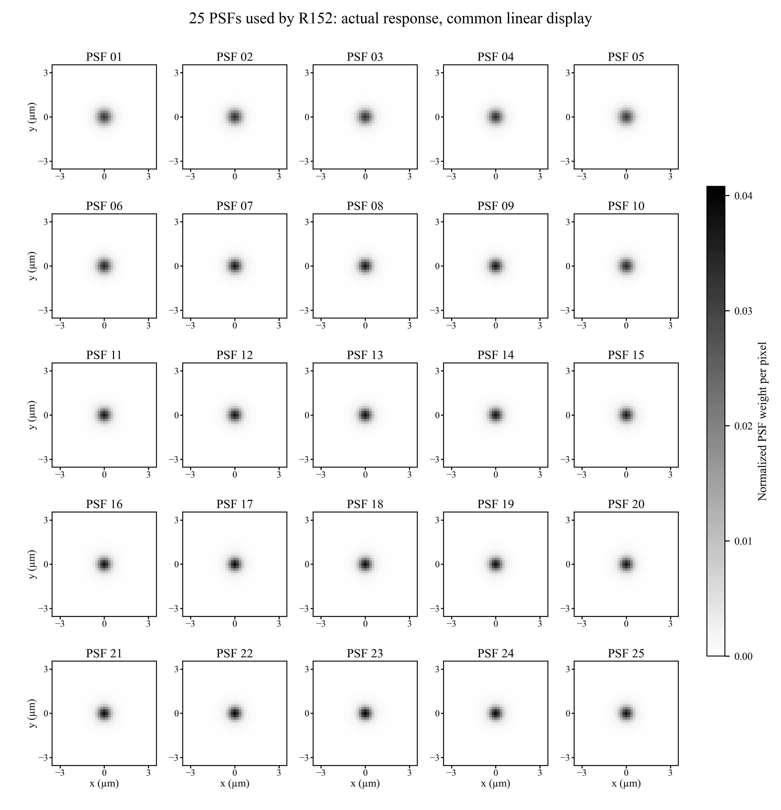
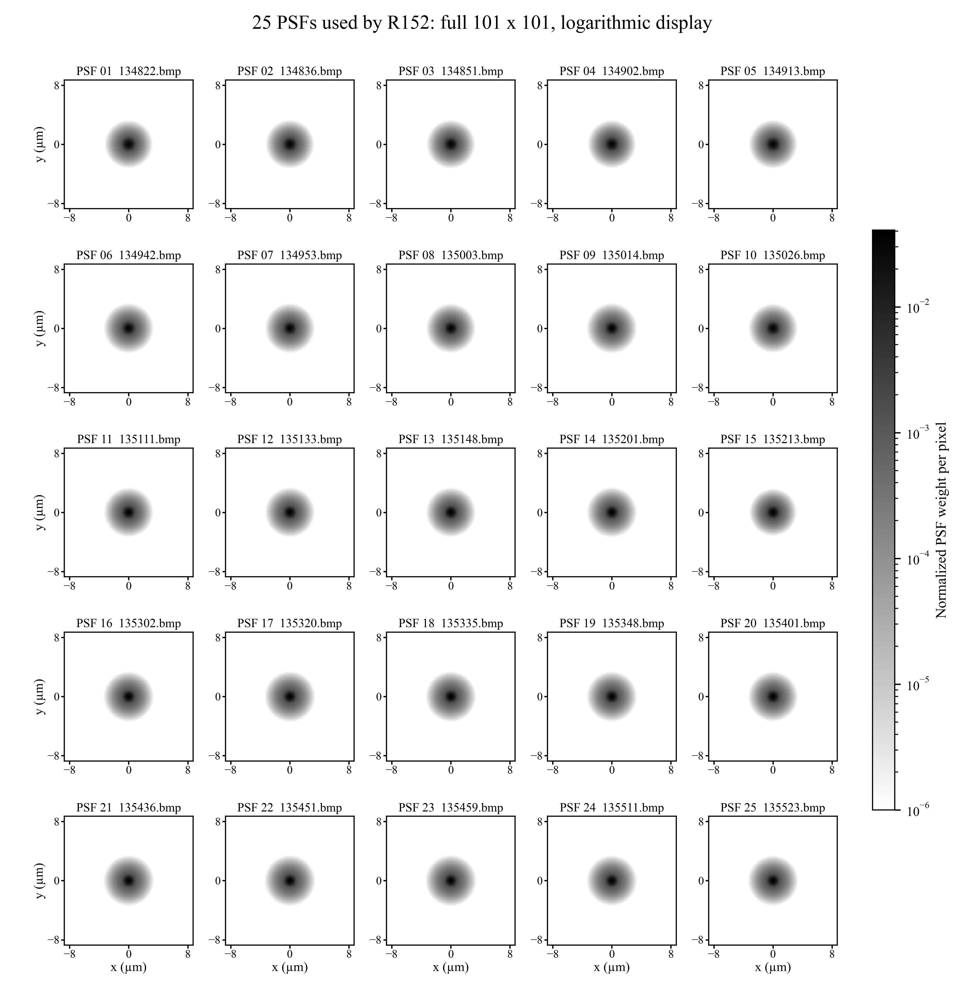
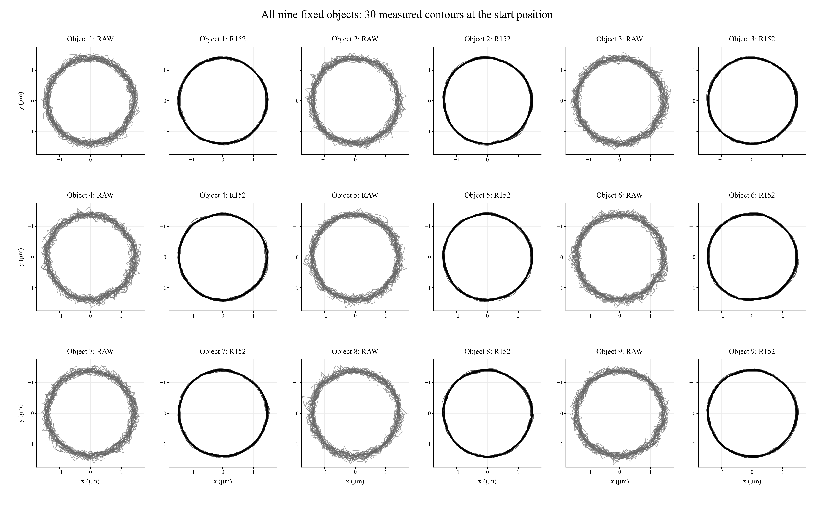

# R152論文三項實際圖像補件

日期：2026-10-03。比較影像的MOSR就是R152交付權重。這裡補的是實際矩陣、原生重建影像和保存的測得邊界，不使用舊Wiener圖或示意輪廓代替。

## 1 第6.1節與圖6-3 實際25顆PSF形貌

主圖每一格來自R152實際銀行的101×101矩陣，展示中央41×41像素的真實值，不是重新畫出的高斯示意。25格共用同一線性灰階範圍0～0.040789461，沒有逐顆除以峰值重新拉對比。每顆核總和為1。中央視圖保留每顆至少99.995174%的原矩陣能量；完整101×101以共同對數尺度另附在第四頁。對數圖只是顯示方式，沒有修改矩陣。

源MAT的psf_grid形狀為101×101×5×5，逐行順序與模型25顆完全一致；浮點部署保存點中的25個核也與銀行正規化後轉成float32完全相等。圖上PSF01～25對應模型索引0～24，左至右、上至下；來源檔名見下表及完整矩陣附圖。像素比例0.1725 µm/px；主圖像素中心範圍−3.45～+3.45 µm，完整矩陣像素中心範圍−8.625～+8.625 µm。

**可直接使用的中文圖說：** 圖6-3 本研究MOSR（R152）實際使用之25組PSF響應。PSF由本次系統成像資料擬合，依封存5×5順序排列。各核為101×101、非負且總和正規化為1；主圖展示中央41×41像素，25格採共同線性灰階尺度與共同物體空間座標。完整支持範圍及對數顯示另見附錄。此圖呈現實際核矩陣，不是PSF編號位置示意。

**English caption:** Actual responses of the 25 PSFs used by MOSR (R152), arranged in the archived row-major 5 x 5 order. Each PSF is a nonnegative, unit-sum 101 x 101 fitted system kernel. The central 41 x 41 samples are displayed with a common linear intensity scale and common object-space coordinates (0.1725 µm per pixel). The complete support and a common logarithmic display are provided in the appendix. No per-kernel peak normalization is applied.

### 對應校正資料

calibration內保存原始MAT、實際模型銀行、來源鎖、25張逐顆BADS參數及品質表、校正分組與E組保留驗證結果。data內提供25個可直接讀取的101×101 CSV矩陣、部署用float32核及逐顆彙整表。擬合形狀是同心兩高斯的離散正規化混合：h = w*g(sigma_core) + (1-w)*g(sigma_halo)，三個形狀參數和另外的亮度倍率均保留。每顆矩陣已用這些參數獨立重新產生並核對。

sigma_core範圍1.658694～1.967729 px；sigma_halo範圍4.718583～5.178455 px；核心能量比例0.643995～0.705280。亮度倍率保存在校正表中，沒有乘進已正規化PSF的能量。

| PSF | 模型索引 | 來源照片 | 核心sigma px | 尾部sigma px | 核心比例 | 亮度倍率 |
| --- | --- | --- | --- | --- | --- | --- |
| 1 | 0 | 134822.bmp | 1.943857 | 4.859775 | 0.696613 | 0.865830 |
| 2 | 1 | 134836.bmp | 1.897124 | 4.907996 | 0.691382 | 0.893110 |
| 3 | 2 | 134851.bmp | 1.895151 | 4.910973 | 0.684800 | 0.901417 |
| 4 | 3 | 134902.bmp | 1.869874 | 4.832700 | 0.668364 | 0.912481 |
| 5 | 4 | 134913.bmp | 1.967729 | 4.926938 | 0.705280 | 0.874253 |
| 6 | 5 | 134942.bmp | 1.841245 | 5.071951 | 0.695441 | 0.903553 |
| 7 | 6 | 134953.bmp | 1.769641 | 5.032894 | 0.683850 | 0.932667 |
| 8 | 7 | 135003.bmp | 1.754282 | 4.980058 | 0.677276 | 0.942419 |
| 9 | 8 | 135014.bmp | 1.762668 | 5.096878 | 0.688543 | 0.946963 |
| 10 | 9 | 135026.bmp | 1.857445 | 4.961082 | 0.690369 | 0.895607 |
| 11 | 10 | 135111.bmp | 1.750120 | 4.980173 | 0.672497 | 0.923682 |
| 12 | 11 | 135133.bmp | 1.756795 | 5.030147 | 0.684178 | 0.948648 |
| 13 | 12 | 135148.bmp | 1.734925 | 5.007364 | 0.680665 | 0.943849 |
| 14 | 13 | 135201.bmp | 1.748926 | 5.069836 | 0.684281 | 0.949395 |
| 15 | 14 | 135213.bmp | 1.755375 | 4.718583 | 0.643995 | 0.898207 |
| 16 | 15 | 135302.bmp | 1.715289 | 5.076604 | 0.673584 | 0.932441 |
| 17 | 16 | 135320.bmp | 1.689749 | 5.119711 | 0.668553 | 0.959092 |
| 18 | 17 | 135335.bmp | 1.724304 | 5.116951 | 0.683408 | 0.960822 |
| 19 | 18 | 135348.bmp | 1.718234 | 5.088195 | 0.680306 | 0.966192 |
| 20 | 19 | 135401.bmp | 1.747186 | 5.022102 | 0.674761 | 0.900987 |
| 21 | 20 | 135436.bmp | 1.702583 | 5.117357 | 0.673444 | 0.948851 |
| 22 | 21 | 135451.bmp | 1.693245 | 5.164598 | 0.681783 | 0.965286 |
| 23 | 22 | 135459.bmp | 1.658694 | 5.178455 | 0.671403 | 1.002430 |
| 24 | 23 | 135511.bmp | 1.681846 | 5.087663 | 0.670188 | 0.972366 |
| 25 | 24 | 135523.bmp | 1.730246 | 5.065635 | 0.668032 | 0.895919 |

## 2 第6.2.3節後 同區域RAW與MOSR原生影像

固定使用第16趟004246_XY_0的起點（影像1.bmp，index 0，2026-09-03 00:42:47.944609 +08:00），不是按重建分數挑出的最好影像。兩方法使用同一1544×2064原圖，MOSR讀取已核對的R152原生float32輸出，不重新推論、不套用額外銳化、平移、尺寸修正或獨立對比拉伸。兩邊均以固定0～1線性亮度、最近樣本顯示；原圖只除以255。

上排是同一完整視野，白框標示下排相同局部範圍。下排129×129像素，以RAW中央物件5的已保存圓心決定，兩方法裁切座標完全相同：x=[1557,1686)，y=[691,820)，零起算。下排小方框與數字5標出後續輪廓圖的物件，方框不是測得輪廓。完整視野比例尺50 µm、局部比例尺5 µm。白框、文字及比例尺是圖表註記，沒有寫回模型影像。

**可直接使用的中文圖說：** 同一實拍視野之RAW與MOSR（R152）原生重建影像對照。（a,b）相同完整視野；（c,d）白框區域之相同座標局部放大，小方框標示後續30次輪廓疊圖的固定物件5。兩方法採共同固定線性亮度範圍，不作個別對比調整或後置銳化。影像取自第16趟起點。完整視野與局部圖比例尺分別為50 µm及5 µm。

**English caption:** RAW and native MOSR (R152) reconstruction of the same acquired frame. Panels (a,b) show the identical full field of view, and panels (c,d) show an identical-coordinate enlargement of the boxed region. The small boxes mark the same fixed object 5 used in the contour overlay. Both methods use the same fixed linear display range; no independent contrast stretching or post-reconstruction sharpening is applied. The frame is the start position of scan 16. Scale bars are 50 µm in the full-field panels and 5 µm in the enlarged panels.

原始BMP及R152原生NPZ以原檔複製附在data中，檔案雜湊與原驗證收據一致。另附RAW八位元PNG及R152十六位元顯示PNG；後者只是顯示格式的量化，量測與本圖仍直接使用float32原生輸出。局部兩個float32陣列也附在same_region_native_crops.npz。

## 3 第6.2.4節 同一物件30次實際輪廓

固定比較3×3物件中的中央物件5、起點index 0，保留第1～30趟全部輪廓。每條線連接該次保存的64個最大梯度邊界點，並閉合首尾；沒有以擬合圓、平均輪廓或720方向插值曲線代替。只減去每條輪廓自己的已保存LSC圓心以移除平移，沒有縮放半徑、旋轉或自由形狀配準。兩方法共用比例與座標範圍；x向右為正、影像y向下為正。

上排展示整個物件，下排展示同一右側邊界區域。下排只是相同30條折線的局部座標放大，沒有另算新的形狀。中央物件不按改善幅度選取；附錄同時展示起點九顆物件各自的30條輪廓。

**可直接使用的中文圖說：** 同一固定物件於30次重複掃描起點的實測輪廓疊圖。（a）RAW與（b）MOSR（R152）各包含30條由64個測得邊界點構成的輪廓；（c,d）為相同右側邊界區域的局部放大。各輪廓僅以自身LSC圓心移除平移，保留實際尺寸與方向，兩方法採相同物體空間尺度。此圖顯示邊界重複性，不以位置對齊後的輪廓推定圓心位移準度。

**English caption:** Overlay of 30 measured contours of the same fixed object at the start position of the repeated scans. Each curve joins the 64 saved maximum-gradient boundary points for one measurement. Panels (a,b) show RAW and MOSR (R152), respectively; panels (c,d) show the same right-side boundary region at enlarged scale. Each contour is translated by its own saved LSC center only, without radius normalization, rotation or free-form registration. Identical object-space scales are used for both methods.

### 此物件、此位置的對應數值

以下數值只對中央物件5、起點成立；不把它代替全30趟×31位置×9顆的整體輪廓統計。疊圖用64個原始測點；下表的輪廓SD為與主報告一致的720方向半徑插值後，跨30趟求變異再合併。

| 方法 | 平均直徑nm | 直徑重拍SD nm | 輪廓重拍SD nm | 去尺寸形狀SD nm |
| --- | --- | --- | --- | --- |
| RAW | 2790.030220 | 30.605166 | 62.750035 | 60.975446 |
| R152 | 2834.605807 | 10.978473 | 17.987640 | 17.149429 |

## 4 附錄、來源及交付

THESIS_VISUAL_FIGURES.pdf共五頁：前三頁依第6.1、6.2.3、6.2.4節順序排列；第四頁為25顆完整101×101共同對數顯示，第五頁為九顆起點輪廓補充。figures內每張都有高解析PNG、單張PDF及可編輯SVG。

DATA_AND_SELECTION.json明確保存影像、裁切、顯示範圍、PSF索引、輪廓選擇與對齊方式；SOURCE_INDEX.json保存來源檔案及雜湊。all9_start_position_30_contours.csv共34560列（2方法×30趟×9顆×64點），同時保存絕對影像座標及平移後的物體空間座標；NPZ保留原始點與圓心。calibration提供原MAT、實際銀行及對應校正紀錄，data提供25個完整矩陣CSV。

這些圖補足實際形貌與影像證據，與完整統計報告一起使用。影像示例不代替全部930張的性能驗證；起點單一物件疊圖不代替全部位置的輪廓結果。PSF圖是實際使用的擬合系統核，沒有因模型成效重新更換核。
