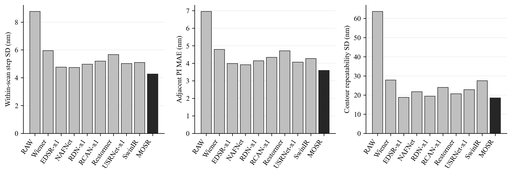

# 外部模型比較結果與完成狀態

本次十種可執行方法的訓練、完整實拍驗證、效率量測、數字重算及圖表核對已完成。另兩個方法的官方後端阻礙如實保留，未列入已驗證方法。原論文、MOSR與既有保存量測未修改；已交付的九方法資料包保留原樣。

可直接交給網頁對話修改論文的資料：[完整論文交接](FINAL_BENCHMARK_THESIS_HANDOFF/REPORT.md)、[修改位置指南](FINAL_BENCHMARK_THESIS_HANDOFF/PAPER_UPDATE_GUIDE.md)、[全部圖表與數據包](FINAL_BENCHMARK_THESIS_HANDOFF.zip)。以下為已核對的完整結果；更多模型架構、原訓練目標與設定、全部合成測試及未四捨五入資料見交接文件。

## 完整結果

本比較包括RAW、Wiener、EDSR-x1、NAFNet、RDN-x1、RCAN-x1、Restormer、USRNet-x1、SwinIR、MOSR。所有外部方法完成相同930張實拍影像、30次掃描×31位置×固定九顆的量測。RAW/MOSR使用既有保存圓心與輪廓，未重新擬合或重跑930張MOSR重建；效率測試另用三張固定影像作少量新前向量測。

EDSR-x1訓練32輪、選第30輪；NAFNet訓練32輪、選第31輪；RDN-x1訓練14輪、選第14輪；RCAN-x1訓練8輪、選第7輪；Restormer訓練8輪、選第8輪；USRNet-x1訓練8輪、選第8輪；SwinIR訓練8輪、選第8輪。實際輪數不同，屬使用者指定的較短訓練比較，不能宣稱相同訓練時間或各模型已充分收斂。全部模型與Wiener設定僅依合成資料訓練／選擇，實拍、PI與SEM沒有用於挑設定或權重。

## 主要實拍結果

| 方法 | 完整掃描 | 單趟波動合併SD nm | 相鄰PI MAE nm | 輪廓重複SD nm |
| --- | --- | --- | --- | --- |
| RAW | 30 | 8.781 | 6.969 | 63.758 |
| Wiener | 30 | 5.953 | 4.793 | 27.885 |
| EDSR-x1 | 30 | 4.772 | 3.992 | 18.860 |
| NAFNet | 30 | 4.747 | 3.919 | 21.810 |
| RDN-x1 | 30 | 4.975 | 4.147 | 19.488 |
| RCAN-x1 | 30 | 5.206 | 4.346 | 24.058 |
| Restormer | 30 | 5.666 | 4.716 | 20.723 |
| USRNet-x1 | 30 | 5.024 | 4.070 | 22.887 |
| SwinIR | 30 | 5.100 | 4.272 | 27.494 |
| MOSR | 30 | 4.273 | 3.598 | 18.600 |

位移先取九顆二維位移向量之算術平均，再投影至原固定方向；每趟以30步樣本SD表示單趟波動，30趟以方差平均開根號合併。PI MAE使用同影格對Y回授差。輪廓使用固定720方向，先逐位置／物件／方向跨30趟求SD再合併。全部資料保留，無後置銳化、尺寸修正、重新配準、逐圖對比調整或剔除不利點。

## 尺寸與長距離

| 方法 | 直徑SD nm | 去尺寸形狀SD nm | SEM工作表直徑差 nm | 起點相對PI MAE nm | 終點有號PI差 nm |
| --- | --- | --- | --- | --- | --- |
| RAW | 32.750 | 61.667 | 169.883 | 18.405 | 41.726 |
| Wiener | 27.478 | 24.324 | 170.693 | 17.804 | 42.830 |
| EDSR-x1 | 21.405 | 15.597 | 202.088 | 17.826 | 42.175 |
| NAFNet | 30.987 | 15.507 | 230.512 | 18.125 | 42.686 |
| RDN-x1 | 16.928 | 17.613 | 190.509 | 17.807 | 41.984 |
| RCAN-x1 | 26.479 | 20.152 | 204.671 | 17.914 | 42.811 |
| Restormer | 24.302 | 16.866 | 172.840 | 18.040 | 42.739 |
| USRNet-x1 | 15.748 | 21.525 | 213.302 | 17.491 | 40.363 |
| SwinIR | 16.561 | 26.244 | 201.159 | 18.022 | 44.486 |
| MOSR | 13.252 | 17.401 | 204.281 | 17.874 | 42.678 |

重複性與SEM尺寸差分開解讀；相對起點或終點是否改善，須看完整掃描配對區間，不由短步波動直接外推。

## 新效率測試

| 方法 | 平均重建秒數 | GPU配置峰值 GiB | GPU保留峰值 GiB | 推論方式 |
| --- | --- | --- | --- | --- |
| RAW | — | 0.012 | 0.049 | native_full_frame |
| Wiener | 0.002 | 0.109 | 0.111 | native_full_frame |
| EDSR-x1 | 0.526 | 3.056 | 3.100 | native_full_frame |
| NAFNet | 0.513 | 3.121 | 4.338 | native_full_frame |
| RDN-x1 | 9.873 | 32.712 | 41.504 | native_full_frame |
| RCAN-x1 | 6.731 | 3.868 | 3.914 | native_full_frame |
| Restormer | 5.007 | 26.973 | 36.342 | native_full_frame |
| USRNet-x1 | 2.967 | 4.660 | 5.340 | native_full_frame |
| SwinIR | 27.171 | 31.394 | 31.475 | native_full_frame |
| MOSR | 1.461 | 2.785 | 5.555 | native_MOSR_stage_tiles |

相同RTX A6000、FP32、batch=1、TF32關閉，固定三張1544×2064影像，各暖身兩次並量測五次。時間只含已同步完成的前向，讀檔、輸入傳輸、輸出檢查與CPU量測不計入。配置／保留峰值包括該程序模型、光學模組、輸入輸出與暫存。RAW為原圖，不需重建，其identity前向成本不作重建效能優勢；原始樣本完整保留。

native_full_frame表示原生整張。native_MOSR_stage_tiles為MOSR原有FFT／背景完整處理及512核心、24邊緣的階段分塊。memory_fallback_tiles僅在原生整張CUDA記憶體不足時啟用，固定512核心與192邊緣，只取核心、不重疊平均。具有全域注意力或全域池化的模型使用此方式會改變上下文，不能當作已證明整張等價；每個模型保持同一方式跑全部影像，另保留原生整張不足的紀錄。

## 全掃描配對比較與完整資料

data/full_benchmark/paired_intervals.csv保存MOSR減各方法的所有指標差值與95%區間，20000次、種子20261002，整趟配對重抽樣。對非負波動或MAE，負差值代表MOSR較低；有號偏差須另看距零大小。多個比較未作家族錯誤校正，不從中挑最有利結果宣稱全指標最佳。

summary.csv、per_scan.csv、per_position.csv、all_displacements.csv、per_pillar_geometry.csv及兩種SEM參照／兩個固定方向候選均完整保留。failures.csv記錄覆蓋與失敗，缺任何完整量測的方法不給全30趟主要指標，不能默默只分析成功子集。runtime_samples.csv有每張、每次時間與峰值。SEM方向與尺度維持原定義；重複抽樣區間不含完整PI、尺度或SEM誤差預算。此為本批資料的比較，不是跨樣品普遍結論。

## 三項目標分開判斷

單趟波動合併SD之本批最低點估計為MOSR（4.273 nm）；相鄰PI MAE之本批最低點估計為MOSR（3.598 nm）；輪廓重複SD之本批最低點估計為MOSR（18.600 nm）。這是本批資料的點估計排名，不等於已證明跨樣品的普遍優劣；請同時閱讀以下配對區間，不以一個總分混合三項目標。

| 比較方法 | 指標 | MOSR減比較方法 nm | 95%下界 nm | 95%上界 nm | 判讀 |
| --- | --- | --- | --- | --- | --- |
| RAW | 輪廓重複SD | -45.158 | -46.449 | -42.117 | 本批MOSR較低 |
| RAW | 相鄰PI MAE | -3.371 | -3.710 | -3.033 | 本批MOSR較低 |
| RAW | 單趟波動合併SD | -4.508 | -4.883 | -4.133 | 本批MOSR較低 |
| Wiener | 輪廓重複SD | -9.285 | -10.371 | -7.456 | 本批MOSR較低 |
| Wiener | 相鄰PI MAE | -1.194 | -1.437 | -0.960 | 本批MOSR較低 |
| Wiener | 單趟波動合併SD | -1.680 | -1.964 | -1.396 | 本批MOSR較低 |
| EDSR-x1 | 輪廓重複SD | -0.260 | -1.107 | 0.846 | 區間跨零，差異尚未確定 |
| EDSR-x1 | 相鄰PI MAE | -0.393 | -0.531 | -0.256 | 本批MOSR較低 |
| EDSR-x1 | 單趟波動合併SD | -0.499 | -0.663 | -0.333 | 本批MOSR較低 |
| NAFNet | 輪廓重複SD | -3.210 | -4.577 | -1.332 | 本批MOSR較低 |
| NAFNet | 相鄰PI MAE | -0.320 | -0.538 | -0.110 | 本批MOSR較低 |
| NAFNet | 單趟波動合併SD | -0.474 | -0.761 | -0.205 | 本批MOSR較低 |
| RDN-x1 | 輪廓重複SD | -0.888 | -1.512 | -0.083 | 本批MOSR較低 |
| RDN-x1 | 相鄰PI MAE | -0.549 | -0.684 | -0.413 | 本批MOSR較低 |
| RDN-x1 | 單趟波動合併SD | -0.703 | -0.864 | -0.543 | 本批MOSR較低 |
| RCAN-x1 | 輪廓重複SD | -5.458 | -6.464 | -3.860 | 本批MOSR較低 |
| RCAN-x1 | 相鄰PI MAE | -0.747 | -0.913 | -0.580 | 本批MOSR較低 |
| RCAN-x1 | 單趟波動合併SD | -0.934 | -1.136 | -0.731 | 本批MOSR較低 |
| Restormer | 輪廓重複SD | -2.123 | -2.984 | -0.911 | 本批MOSR較低 |
| Restormer | 相鄰PI MAE | -1.117 | -1.358 | -0.877 | 本批MOSR較低 |
| Restormer | 單趟波動合併SD | -1.393 | -1.677 | -1.124 | 本批MOSR較低 |
| USRNet-x1 | 輪廓重複SD | -4.287 | -5.013 | -3.229 | 本批MOSR較低 |
| USRNet-x1 | 相鄰PI MAE | -0.471 | -0.655 | -0.292 | 本批MOSR較低 |
| USRNet-x1 | 單趟波動合併SD | -0.751 | -1.022 | -0.495 | 本批MOSR較低 |
| SwinIR | 輪廓重複SD | -8.894 | -9.569 | -7.820 | 本批MOSR較低 |
| SwinIR | 相鄰PI MAE | -0.674 | -0.812 | -0.532 | 本批MOSR較低 |
| SwinIR | 單趟波動合併SD | -0.828 | -1.011 | -0.647 | 本批MOSR較低 |

負差值表示MOSR數值較低；非零區間是本批完整掃描配對估計，不是已校正多重比較的結論。區間跨零時不能以點估計較小宣稱確定改善。

### 30趟改善範圍

| 比較方法 | MOSR波動較低趟數 | 總趟數 | 逐趟降低率最小% | 逐趟降低率最大% |
| --- | --- | --- | --- | --- |
| RAW | 30 | 30 | 34.610 | 67.157 |
| Wiener | 30 | 30 | 6.543 | 41.919 |
| EDSR-x1 | 25 | 30 | -9.059 | 33.456 |
| NAFNet | 24 | 30 | -17.179 | 32.214 |
| RDN-x1 | 28 | 30 | -4.926 | 34.002 |
| RCAN-x1 | 28 | 30 | -0.721 | 39.080 |
| Restormer | 30 | 30 | 4.488 | 50.347 |
| USRNet-x1 | 26 | 30 | -8.828 | 30.381 |
| SwinIR | 30 | 30 | 0.435 | 34.115 |

此處逐趟降低範圍是本批觀察範圍，負降低率表示MOSR該趟波動更大，不是改善。它與合併SD降低率或合併降低率95%區間不同。

### SEM輪廓參照

| 方法 | 固定方向候選 | 完整徑向SEM平均絕對差 nm | 去尺寸形狀SEM平均絕對差 nm |
| --- | --- | --- | --- |
| RAW | 1 | 98.511 | 56.348 |
| RAW | 2 | 96.765 | 50.994 |
| Wiener | 1 | 94.087 | 34.644 |
| Wiener | 2 | 94.462 | 22.655 |
| EDSR-x1 | 1 | 109.368 | 30.448 |
| EDSR-x1 | 2 | 109.974 | 17.605 |
| NAFNet | 1 | 123.330 | 34.185 |
| NAFNet | 2 | 123.992 | 20.236 |
| RDN-x1 | 1 | 103.531 | 31.424 |
| RDN-x1 | 2 | 104.115 | 19.171 |
| RCAN-x1 | 1 | 110.555 | 32.518 |
| RCAN-x1 | 2 | 111.017 | 21.920 |
| Restormer | 1 | 94.820 | 31.717 |
| Restormer | 2 | 95.409 | 18.883 |
| USRNet-x1 | 1 | 114.886 | 31.466 |
| USRNet-x1 | 2 | 115.331 | 22.194 |
| SwinIR | 1 | 108.859 | 34.783 |
| SwinIR | 2 | 109.275 | 25.117 |
| MOSR | 1 | 110.287 | 31.745 |
| MOSR | 2 | 110.905 | 18.287 |

兩個方向候選皆沿用原定義，沒有依新模型結果挑較有利方向。完整徑向差保留尺寸影響；去尺寸形狀差先各自扣去平均半徑。輪廓重複SD描述30次重拍穩定性，這裡的SEM差才是幾何參照，兩者不可互換。使用實際SEM校正的系統PSF條件下，這些結果仍是相同校正條件的參照比較，不宣稱完整獨立絕對真值。

## 可供論文使用的計算與訓練細節

固定尺度172.5 nm/pixel，固定方向u=(−0.9998766245119538,0.015707824629190823)。對每趟r、位置j及柱體k，以保存／固定讀法所得圓心c計算Δc_k=c(r,j,k)−c(r,a,k)，其中相鄰步a=j−1，相對起點a=0。d=172.5 uᵀ[(1/9)Σ_kΔc_k]，e=d−1000[PI_Y(r,j)−PI_Y(r,a)]。每趟30步樣本SD分母29，30趟合併SD為sqrt[(1/30)Σ_rs_r²]。PI MAE使用全部900個相鄰誤差的絕對值平均；相對起點另用各位置對起點的直接圓心差計算。

直徑重複SD=sqrt{mean_(位置,物件)[Var_掃描(D)]}，每個樣本變異數分母29。輪廓先用該輪廓的LSC圓心平移對齊，64邊界點作週期插值至720固定方向，q為該方向半徑；完整輪廓SD=sqrt{mean_(位置,物件,方向)[Var_掃描(q)]}。去尺寸形狀先每個輪廓各自扣平均半徑再同樣合併。沒有依形狀重新旋轉、縮放或配準。SEM工作表直徑差=mean_k|mean_(r,j)D(r,j,k)−D_SEM(k)|，不是將8370個光學直徑各自對SEM作獨立觀測平均。

各方法使用完全相同物件對應與原固定讀法：RAW保存追蹤種子、29×29局部區域、ACM13次、沿法線±2.4 pixel搜尋最大灰階梯度、64個亞像素邊界點與LSC。固定讀法內原有的局部ACM正規化與梯度平滑照用，沒有在模型原生影像輸出後新增影像修正。既有RAW/MOSR圓心與邊界直接讀取，不重新擬合。

外部模型資料為同一TIFF合成銀行，場景分組512訓練／128驗證／128測試，每場景4視圖。每輪2048組影像，batch4、512次更新；384×384輸入，共同96×96有效監督區域。模型用各自常用目標從零訓練：EDSR-x1／RDN-x1／RCAN-x1使用L1與Adam，初始學習率1e−4；NAFNet使用作者PSNR目標與AdamW，初始1e−3。合成驗證每輪一次，僅依驗證分數保留權重；實拍與SEM結果不參與挑設定。使用者改為較短訓練後，完整保留各模型實際輪數差異，不能宣稱相同更新預算或充分收斂。

此為固定資料與量測規則下的整體方法比較，原生架構、訓練目標與實際輪數仍有差異；因此不能由本表單獨歸因某一PSF模組、共享主幹或損失項的因果效果，也不將各方法不同的PSF先驗資訊混寫成完全相同輸入條件。

EDSR-x1為作者基準16殘差塊、64通道，灰階與x1適配；RDN-x1為作者明示之配置A（20個密集區塊、每塊6層、成長32、主幹64）；RCAN-x1為10組、每組20殘差塊、64通道、通道注意力縮減16；NAFNet採作者GoPro寬32與TLC設定，編碼區塊[1,1,1,28]、中間1、解碼[1,1,1,1]。全部保留作者數值程式與固定適配；精確來源版本、普通訓練設定及原先時間上限修正隨交接包附上。MOSR沿用原已驗證的混合結構、光學模組、抗混疊與原生分塊，未為比較重新設計或訓練。

## 量測覆蓋與失敗

| 方法 | 影像數 | 嘗試量測數 | 失敗量測數 | 失敗率 | 完整有效趟數 | 全30趟主指標可用 |
| --- | --- | --- | --- | --- | --- | --- |
| RAW | 930 | 8370 | 0 | 0.000 | 30 | True |
| Wiener | 930 | 8370 | 0 | 0.000 | 30 | True |
| EDSR-x1 | 930 | 8370 | 0 | 0.000 | 30 | True |
| NAFNet | 930 | 8370 | 0 | 0.000 | 30 | True |
| RDN-x1 | 930 | 8370 | 0 | 0.000 | 30 | True |
| RCAN-x1 | 930 | 8370 | 0 | 0.000 | 30 | True |
| Restormer | 930 | 8370 | 0 | 0.000 | 30 | True |
| USRNet-x1 | 930 | 8370 | 0 | 0.000 | 30 | True |
| SwinIR | 930 | 8370 | 0 | 0.000 | 30 | True |
| MOSR | 930 | 8370 | 0 | 0.000 | 30 | True |

程序未拋出量測錯誤不等於已證明輪廓正確；因此重複性、SEM幾何參照及實際輪廓示例仍分開呈現。

## 後續三方法的固定條件

Restormer採作者灰階dim48、區塊[4,6,6,8]、精煉4、heads[1,2,4,8]、BiasFree，L1／AdamW初始3e−4。USRNet-x1採作者8次展開、prior[64,128,256,512]、nb2，L1／Adam初始1e−4及作者orthogonal gain0.2；訓練提供合成已知PSF與真實合成噪聲，驗證／測試／實拍固定平均PSF與1.5灰階噪聲，不依實拍調整。SwinIR採作者灰階去噪頭、embed180、6×6depth、heads6×6、window8、MLP2，作者Charbonnier／Adam初始2e−4、EMA0.999。三者皆使用原指定8輪上限及同一資料／有效區域／合成驗證。原九方法930張、8370讀值及135次效率資料直接重用，未重建、重新量測或重測；本次只新增SwinIR的完整930張、8370讀值與15次效率。

## 官方後端阻礙（不冒充完成）

U-Net：作者官方版本依賴caffe_unet/Linux後端；本機沒有Caffe、沒有可用WSL發行版，Docker Linux後端也無法連線。目前環境無法直接執行作者官方版本。未以自行簡化的網路替代。

MambaIRv2：已嘗試PyPI版本、作者完整來源、既有CUDA相容MSVC 14.44工具組與Windows標準數學常數設定。官方selective-scan CUDA程式仍出現C2975編譯期模板常數錯誤並累積超過100個錯誤，未取得可用後端；本機無可用Linux/WSL或Docker後端。保留錯誤與來源，不以其他模型替代。

本文件完成的是可執行十方法的比較與上述兩方法阻礙紀錄；不把blocked方法算作已訓練／已驗證，也不以替代簡化網路填數值。

## 較短訓練的完整記錄

RDN-x1完成14個完整輪次，另保存第15輪的128次未完成輪更新；選用的是第14輪合成驗證權重，不將未完成輪當作已驗證輪次。EDSR-x1／NAFNet的32輪與後續四模型的8輪如實分列。這項時間限制屬本次比較條件，不能推定各架構均已達最佳訓練結果。

## 最終交付核對

每方法930張、8370讀值、30完整有效趟次，量測失敗0。150次相同條件效率、162組完整掃描配對區間已核對；原九方法數字、區間及135次效率保持一致。SwinIR新增1800筆位移與18組區間獨立重算通過，同區域原生像素、灰階圖、附件及所有連結亦已核對。未變更實際訓練輪數，不宣稱全部充分收斂、相同訓練時間或單一模組的因果效果。全部可執行範圍已完成；原論文尚未修改，監看在交付後停止。
