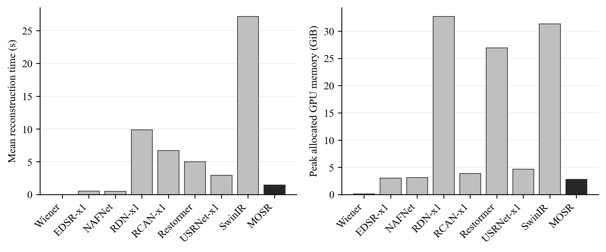
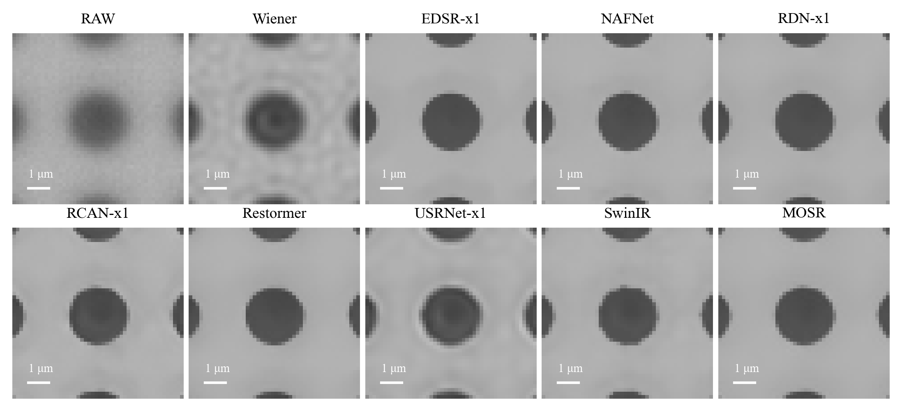

# 已完成方法之論文比較交接

本文件可連同最新論文交給網頁版對話。效率測試的十種可執行方法均已完成；目前已完成930張實拍量測的方法為：RAW、Wiener、EDSR-x1、NAFNet、RDN-x1、RCAN-x1、Restormer、USRNet-x1、SwinIR、MOSR。

本次包含七個完成訓練的外部模型與RAW、Wiener、MOSR；U-Net與MambaIRv2因官方後端阻礙未完成，原因完整保留，不計入已驗證數量。

請依下列真實數據修改論文的比較表、效率段落、圖說與討論。保留實際訓練輪數差異、SEM不利結果、長距離限制與量測失敗。使用RAW、MOSR與外部方法名稱；不修改原模型、PSF、尺度、方向或既有量測，也不要將合成影像分數代替實拍位移結果。

## 新效率結果

十種可執行方法的完整實拍驗證與效率測試均已完成，可連同完整結果用於論文；效率與位移、輪廓、SEM指標分別解讀。

## 測試條件

相同NVIDIA RTX A6000、PyTorch2.3.0+cu121、FP32、batch=1、TF32關閉。固定三張1544×2064實拍影像：第一趟起點、第16趟起點、最後一趟終點（固定影像索引0、465、929）。各張暖身兩次、正式前向五次，共每方法15次。每個方法使用獨立新程序，訓練已暫停並釋放GPU；測試時未並行執行其他本研究GPU工作。

時間僅計GPU同步前後的模型前向，不含權重載入、讀檔、輸入傳輸、存檔、輸出檢查與CPU量測。光學模組的首次FFT建立包含在暖身，不將首次建立成本混入穩態時間；此結果是暖身後的重建成本，不是開機至第一張結果的等待時間。

配置與保留峰值均取自該程序，包含模型、光學模組、輸入／輸出及前向暫存；在輸出有限性檢查之前讀取峰值。CUDA環境及顯示程序的其他配置不在此程序統計內。峰值數字不是整台電腦RAM或GPU總占用。

## 結果

| 方法 | 參數數量 | 平均±樣本SD 秒 | 中位數 秒 | GPU配置峰值 GiB | GPU保留峰值 GiB | 推論策略 |
| --- | ---: | ---: | ---: | ---: | ---: | --- |
| RAW | 0 | — | — | 0.012 | 0.049 | 原圖，不需重建 |
| Wiener | 0 | 0.001697 ± 0.000986 | 0.001237 | 0.109 | 0.111 | 原生整張 |
| EDSR-x1 | 1219845 | 0.526326 ± 0.024084 | 0.515389 | 3.056 | 3.100 | 原生整張 |
| NAFNet | 17110753 | 0.513206 ± 0.034596 | 0.496599 | 3.121 | 4.338 | 原生整張 |
| RDN-x1 | 5484673 | 9.873460 ± 0.238613 | 9.762951 | 32.712 | 41.504 | 原生整張 |
| RCAN-x1 | 15294629 | 6.730870 ± 0.219829 | 6.630873 | 3.868 | 3.914 | 原生整張 |
| Restormer | 26109076 | 5.007130 ± 0.137637 | 4.975377 | 26.973 | 36.342 | 原生整張 |
| USRNet-x1 | 17013712 | 2.967366 ± 0.044495 | 2.976845 | 4.660 | 5.340 | 原生整張 |
| SwinIR | 11497681 | 27.170865 ± 0.188895 | 27.090360 | 31.394 | 31.475 | 原生整張 |
| MOSR | 1207105 | 1.460774 ± 0.016356 | 1.454371 | 2.785 | 5.555 | 原有512核心／24邊緣分塊 |

RAW沒有重建；附件保留原圖identity操作的計時，但主表不把其微小呼叫成本當成重建時間。MOSR使用原有完整PSF／背景處理與512核心、24邊緣的階段分塊。其他方法的實際策略見上表，原生整張記憶體不足時只採預定替代分塊；沒有因本測試選擇較有利的局部影像或調整權重。若未來方法原生整張記憶體不足，應另列固定替代分塊策略及其限制，不與整張等價混寫。



圖說：相同三張實拍影像、相同GPU與FP32條件下，各方法暖身後的平均重建時間與GPU配置峰值。每方法15次前向；右圖取所有正式前向中最大配置峰值。兩張圖採灰階。重建速度與量測效果是不同評估面向。

## 可直接放入論文的敘述

在相同RTX A6000、FP32及單張輸入條件下，EDSR-x1與NAFNet的平均重建時間約0.53與0.51秒，MOSR約1.46秒；RDN-x1與RCAN-x1約9.87與6.73秒。MOSR的GPU配置峰值約2.78 GiB，EDSR-x1與NAFNet約3.06與3.12 GiB，RDN-x1約32.71 GiB。MOSR的GPU保留峰值則約5.56 GiB，高於EDSR-x1與NAFNet的3.10與4.34 GiB；因此配置峰值較低不能直接寫成所有記憶體占用都較低。MOSR重建時間未優於EDSR-x1與NAFNet；相對較慢的RDN-x1與RCAN-x1則有較低時間成本。這些結果不能直接推導位移或輪廓表現較佳，須與完整實拍量測分別判讀。

## 使用限制與完整紀錄

本次為三張固定影像的穩態效率測試，五次重複前向不是五張獨立影像；平均±SD描述本測試樣本的時間變動，不是跨樣品泛化區間。全部150次原始資料保存在data/full_efficiency/all150_samples.csv，摘要在summary.csv；每方法原始收據另保存GPU、框架、權重身分及策略。使用者指定較短訓練後，各模型實際輪數不同：EDSR-x1／NAFNet32輪、RDN-x1有14完整輪、RCAN-x1有8輪。不可將此表寫成各模型均已充分收斂或相同訓練時間。

原論文與MOSR權重未修改；不要把不同日期、精度、影像大小或分塊方式的舊效率數字混入本表。

Restormer／USRNet-x1／SwinIR同樣各8輪，使用相同GPU、FP32、batch=1與相同三張影像，在訓練結束釋放GPU後測量。已交付九方法的135次效率資料直接重用，本次只新增SwinIR的15次，共150次；不同日期的同硬體／版本／精度測試保留原始收據，不當作同一時刻測量。

Restormer、USRNet-x1與SwinIR的平均前向時間分別為5.007、2.967、27.171秒。這些數字使用各方法記錄的原生策略，不能由速度推定量測表現，亦不能據此宣稱相同訓練時間或充分收斂。


## 實拍結果與比較方法

本比較包括RAW、Wiener、EDSR-x1、NAFNet、RDN-x1、RCAN-x1、Restormer、USRNet-x1、SwinIR、MOSR。所有外部方法完成相同930張實拍影像、30次掃描×31位置×固定九顆的量測。RAW/MOSR使用既有保存圓心與輪廓，未重新擬合或重跑930張MOSR重建；效率測試另用三張固定影像作少量新前向量測。

EDSR-x1訓練32輪、選第30輪；NAFNet訓練32輪、選第31輪；RDN-x1訓練14輪、選第14輪；RCAN-x1訓練8輪、選第7輪；Restormer訓練8輪、選第8輪；USRNet-x1訓練8輪、選第8輪；SwinIR訓練8輪、選第8輪。實際輪數不同，屬使用者指定的較短訓練比較，不能宣稱相同訓練時間或各模型已充分收斂。全部模型與Wiener設定僅依合成資料訓練／選擇，實拍、PI與SEM沒有用於挑設定或權重。

## 主要實拍結果

| 方法 | 完整掃描 | 單趟波動合併SD nm | 相鄰PI MAE nm | 輪廓重複SD nm |
| --- | --- | --- | --- | --- |
| RAW | 30 | 8.781 | 6.969 | 63.758 |
| Wiener | 30 | 5.953 | 4.793 | 27.885 |
| EDSR-x1 | 30 | 4.772 | 3.992 | 18.860 |
| NAFNet | 30 | 4.747 | 3.919 | 21.810 |
| RDN-x1 | 30 | 4.975 | 4.147 | 19.488 |
| RCAN-x1 | 30 | 5.206 | 4.346 | 24.058 |
| Restormer | 30 | 5.666 | 4.716 | 20.723 |
| USRNet-x1 | 30 | 5.024 | 4.070 | 22.887 |
| SwinIR | 30 | 5.100 | 4.272 | 27.494 |
| MOSR | 30 | 4.273 | 3.598 | 18.600 |

位移先取九顆二維位移向量之算術平均，再投影至原固定方向；每趟以30步樣本SD表示單趟波動，30趟以方差平均開根號合併。PI MAE使用同影格對Y回授差。輪廓使用固定720方向，先逐位置／物件／方向跨30趟求SD再合併。全部資料保留，無後置銳化、尺寸修正、重新配準、逐圖對比調整或剔除不利點。


## 尺寸與長距離

| 方法 | 直徑SD nm | 去尺寸形狀SD nm | SEM工作表直徑差 nm | 起點相對PI MAE nm | 終點有號PI差 nm |
| --- | --- | --- | --- | --- | --- |
| RAW | 32.750 | 61.667 | 169.883 | 18.405 | 41.726 |
| Wiener | 27.478 | 24.324 | 170.693 | 17.804 | 42.830 |
| EDSR-x1 | 21.405 | 15.597 | 202.088 | 17.826 | 42.175 |
| NAFNet | 30.987 | 15.507 | 230.512 | 18.125 | 42.686 |
| RDN-x1 | 16.928 | 17.613 | 190.509 | 17.807 | 41.984 |
| RCAN-x1 | 26.479 | 20.152 | 204.671 | 17.914 | 42.811 |
| Restormer | 24.302 | 16.866 | 172.840 | 18.040 | 42.739 |
| USRNet-x1 | 15.748 | 21.525 | 213.302 | 17.491 | 40.363 |
| SwinIR | 16.561 | 26.244 | 201.159 | 18.022 | 44.486 |
| MOSR | 13.252 | 17.401 | 204.281 | 17.874 | 42.678 |

重複性與SEM尺寸差分開解讀；相對起點或終點是否改善，須看完整掃描配對區間，不由短步波動直接外推。

## 新效率測試

| 方法 | 平均重建秒數 | GPU配置峰值 GiB | GPU保留峰值 GiB | 推論方式 |
| --- | --- | --- | --- | --- |
| RAW | — | 0.012 | 0.049 | native_full_frame |
| Wiener | 0.002 | 0.109 | 0.111 | native_full_frame |
| EDSR-x1 | 0.526 | 3.056 | 3.100 | native_full_frame |
| NAFNet | 0.513 | 3.121 | 4.338 | native_full_frame |
| RDN-x1 | 9.873 | 32.712 | 41.504 | native_full_frame |
| RCAN-x1 | 6.731 | 3.868 | 3.914 | native_full_frame |
| Restormer | 5.007 | 26.973 | 36.342 | native_full_frame |
| USRNet-x1 | 2.967 | 4.660 | 5.340 | native_full_frame |
| SwinIR | 27.171 | 31.394 | 31.475 | native_full_frame |
| MOSR | 1.461 | 2.785 | 5.555 | native_MOSR_stage_tiles |

相同RTX A6000、FP32、batch=1、TF32關閉，固定三張1544×2064影像，各暖身兩次並量測五次。時間只含已同步完成的前向，讀檔、輸入傳輸、輸出檢查與CPU量測不計入。配置／保留峰值包括該程序模型、光學模組、輸入輸出與暫存。RAW為原圖，不需重建，其identity前向成本不作重建效能優勢；原始樣本完整保留。

native_full_frame表示原生整張。native_MOSR_stage_tiles為MOSR原有FFT／背景完整處理及512核心、24邊緣的階段分塊。memory_fallback_tiles僅在原生整張CUDA記憶體不足時啟用，固定512核心與192邊緣，只取核心、不重疊平均。具有全域注意力或全域池化的模型使用此方式會改變上下文，不能當作已證明整張等價；每個模型保持同一方式跑全部影像，另保留原生整張不足的紀錄。

## 全掃描配對比較與完整資料

data/full_benchmark/paired_intervals.csv保存MOSR減各方法的所有指標差值與95%區間，20000次、種子20261002，整趟配對重抽樣。對非負波動或MAE，負差值代表MOSR較低；有號偏差須另看距零大小。多個比較未作家族錯誤校正，不從中挑最有利結果宣稱全指標最佳。

summary.csv、per_scan.csv、per_position.csv、all_displacements.csv、per_pillar_geometry.csv及兩種SEM參照／兩個固定方向候選均完整保留。failures.csv記錄覆蓋與失敗，缺任何完整量測的方法不給全30趟主要指標，不能默默只分析成功子集。runtime_samples.csv有每張、每次時間與峰值。SEM方向與尺度維持原定義；重複抽樣區間不含完整PI、尺度或SEM誤差預算。此為本批資料的比較，不是跨樣品普遍結論。

## 三項目標分開判斷

單趟波動合併SD之本批最低點估計為MOSR（4.273 nm）；相鄰PI MAE之本批最低點估計為MOSR（3.598 nm）；輪廓重複SD之本批最低點估計為MOSR（18.600 nm）。這是本批資料的點估計排名，不等於已證明跨樣品的普遍優劣；請同時閱讀以下配對區間，不以一個總分混合三項目標。

| 比較方法 | 指標 | MOSR減比較方法 nm | 95%下界 nm | 95%上界 nm | 判讀 |
| --- | --- | --- | --- | --- | --- |
| RAW | 輪廓重複SD | -45.158 | -46.449 | -42.117 | 本批MOSR較低 |
| RAW | 相鄰PI MAE | -3.371 | -3.710 | -3.033 | 本批MOSR較低 |
| RAW | 單趟波動合併SD | -4.508 | -4.883 | -4.133 | 本批MOSR較低 |
| Wiener | 輪廓重複SD | -9.285 | -10.371 | -7.456 | 本批MOSR較低 |
| Wiener | 相鄰PI MAE | -1.194 | -1.437 | -0.960 | 本批MOSR較低 |
| Wiener | 單趟波動合併SD | -1.680 | -1.964 | -1.396 | 本批MOSR較低 |
| EDSR-x1 | 輪廓重複SD | -0.260 | -1.107 | 0.846 | 區間跨零，差異尚未確定 |
| EDSR-x1 | 相鄰PI MAE | -0.393 | -0.531 | -0.256 | 本批MOSR較低 |
| EDSR-x1 | 單趟波動合併SD | -0.499 | -0.663 | -0.333 | 本批MOSR較低 |
| NAFNet | 輪廓重複SD | -3.210 | -4.577 | -1.332 | 本批MOSR較低 |
| NAFNet | 相鄰PI MAE | -0.320 | -0.538 | -0.110 | 本批MOSR較低 |
| NAFNet | 單趟波動合併SD | -0.474 | -0.761 | -0.205 | 本批MOSR較低 |
| RDN-x1 | 輪廓重複SD | -0.888 | -1.512 | -0.083 | 本批MOSR較低 |
| RDN-x1 | 相鄰PI MAE | -0.549 | -0.684 | -0.413 | 本批MOSR較低 |
| RDN-x1 | 單趟波動合併SD | -0.703 | -0.864 | -0.543 | 本批MOSR較低 |
| RCAN-x1 | 輪廓重複SD | -5.458 | -6.464 | -3.860 | 本批MOSR較低 |
| RCAN-x1 | 相鄰PI MAE | -0.747 | -0.913 | -0.580 | 本批MOSR較低 |
| RCAN-x1 | 單趟波動合併SD | -0.934 | -1.136 | -0.731 | 本批MOSR較低 |
| Restormer | 輪廓重複SD | -2.123 | -2.984 | -0.911 | 本批MOSR較低 |
| Restormer | 相鄰PI MAE | -1.117 | -1.358 | -0.877 | 本批MOSR較低 |
| Restormer | 單趟波動合併SD | -1.393 | -1.677 | -1.124 | 本批MOSR較低 |
| USRNet-x1 | 輪廓重複SD | -4.287 | -5.013 | -3.229 | 本批MOSR較低 |
| USRNet-x1 | 相鄰PI MAE | -0.471 | -0.655 | -0.292 | 本批MOSR較低 |
| USRNet-x1 | 單趟波動合併SD | -0.751 | -1.022 | -0.495 | 本批MOSR較低 |
| SwinIR | 輪廓重複SD | -8.894 | -9.569 | -7.820 | 本批MOSR較低 |
| SwinIR | 相鄰PI MAE | -0.674 | -0.812 | -0.532 | 本批MOSR較低 |
| SwinIR | 單趟波動合併SD | -0.828 | -1.011 | -0.647 | 本批MOSR較低 |

負差值表示MOSR數值較低；非零區間是本批完整掃描配對估計，不是已校正多重比較的結論。區間跨零時不能以點估計較小宣稱確定改善。

### 30趟改善範圍

| 比較方法 | MOSR波動較低趟數 | 總趟數 | 逐趟降低率最小% | 逐趟降低率最大% |
| --- | --- | --- | --- | --- |
| RAW | 30 | 30 | 34.610 | 67.157 |
| Wiener | 30 | 30 | 6.543 | 41.919 |
| EDSR-x1 | 25 | 30 | -9.059 | 33.456 |
| NAFNet | 24 | 30 | -17.179 | 32.214 |
| RDN-x1 | 28 | 30 | -4.926 | 34.002 |
| RCAN-x1 | 28 | 30 | -0.721 | 39.080 |
| Restormer | 30 | 30 | 4.488 | 50.347 |
| USRNet-x1 | 26 | 30 | -8.828 | 30.381 |
| SwinIR | 30 | 30 | 0.435 | 34.115 |

此處逐趟降低範圍是本批觀察範圍，負降低率表示MOSR該趟波動更大，不是改善。它與合併SD降低率或合併降低率95%區間不同。

### SEM輪廓參照

| 方法 | 固定方向候選 | 完整徑向SEM平均絕對差 nm | 去尺寸形狀SEM平均絕對差 nm |
| --- | --- | --- | --- |
| RAW | 1 | 98.511 | 56.348 |
| RAW | 2 | 96.765 | 50.994 |
| Wiener | 1 | 94.087 | 34.644 |
| Wiener | 2 | 94.462 | 22.655 |
| EDSR-x1 | 1 | 109.368 | 30.448 |
| EDSR-x1 | 2 | 109.974 | 17.605 |
| NAFNet | 1 | 123.330 | 34.185 |
| NAFNet | 2 | 123.992 | 20.236 |
| RDN-x1 | 1 | 103.531 | 31.424 |
| RDN-x1 | 2 | 104.115 | 19.171 |
| RCAN-x1 | 1 | 110.555 | 32.518 |
| RCAN-x1 | 2 | 111.017 | 21.920 |
| Restormer | 1 | 94.820 | 31.717 |
| Restormer | 2 | 95.409 | 18.883 |
| USRNet-x1 | 1 | 114.886 | 31.466 |
| USRNet-x1 | 2 | 115.331 | 22.194 |
| SwinIR | 1 | 108.859 | 34.783 |
| SwinIR | 2 | 109.275 | 25.117 |
| MOSR | 1 | 110.287 | 31.745 |
| MOSR | 2 | 110.905 | 18.287 |

兩個方向候選皆沿用原定義，沒有依新模型結果挑較有利方向。完整徑向差保留尺寸影響；去尺寸形狀差先各自扣去平均半徑。輪廓重複SD描述30次重拍穩定性，這裡的SEM差才是幾何參照，兩者不可互換。使用實際SEM校正的系統PSF條件下，這些結果仍是相同校正條件的參照比較，不宣稱完整獨立絕對真值。

## 可供論文使用的計算與訓練細節

固定尺度172.5 nm/pixel，固定方向u=(−0.9998766245119538,0.015707824629190823)。對每趟r、位置j及柱體k，以保存／固定讀法所得圓心c計算Δc_k=c(r,j,k)−c(r,a,k)，其中相鄰步a=j−1，相對起點a=0。d=172.5 uᵀ[(1/9)Σ_kΔc_k]，e=d−1000[PI_Y(r,j)−PI_Y(r,a)]。每趟30步樣本SD分母29，30趟合併SD為sqrt[(1/30)Σ_rs_r²]。PI MAE使用全部900個相鄰誤差的絕對值平均；相對起點另用各位置對起點的直接圓心差計算。

直徑重複SD=sqrt{mean_(位置,物件)[Var_掃描(D)]}，每個樣本變異數分母29。輪廓先用該輪廓的LSC圓心平移對齊，64邊界點作週期插值至720固定方向，q為該方向半徑；完整輪廓SD=sqrt{mean_(位置,物件,方向)[Var_掃描(q)]}。去尺寸形狀先每個輪廓各自扣平均半徑再同樣合併。沒有依形狀重新旋轉、縮放或配準。SEM工作表直徑差=mean_k|mean_(r,j)D(r,j,k)−D_SEM(k)|，不是將8370個光學直徑各自對SEM作獨立觀測平均。

各方法使用完全相同物件對應與原固定讀法：RAW保存追蹤種子、29×29局部區域、ACM13次、沿法線±2.4 pixel搜尋最大灰階梯度、64個亞像素邊界點與LSC。固定讀法內原有的局部ACM正規化與梯度平滑照用，沒有在模型原生影像輸出後新增影像修正。既有RAW/MOSR圓心與邊界直接讀取，不重新擬合。

外部模型資料為同一TIFF合成銀行，場景分組512訓練／128驗證／128測試，每場景4視圖。每輪2048組影像，batch4、512次更新；384×384輸入，共同96×96有效監督區域。模型用各自常用目標從零訓練：EDSR-x1／RDN-x1／RCAN-x1使用L1與Adam，初始學習率1e−4；NAFNet使用作者PSNR目標與AdamW，初始1e−3。合成驗證每輪一次，僅依驗證分數保留權重；實拍與SEM結果不參與挑設定。使用者改為較短訓練後，完整保留各模型實際輪數差異，不能宣稱相同更新預算或充分收斂。

此為固定資料與量測規則下的整體方法比較，原生架構、訓練目標與實際輪數仍有差異；因此不能由本表單獨歸因某一PSF模組、共享主幹或損失項的因果效果，也不將各方法不同的PSF先驗資訊混寫成完全相同輸入條件。

EDSR-x1為作者基準16殘差塊、64通道，灰階與x1適配；RDN-x1為作者明示之配置A（20個密集區塊、每塊6層、成長32、主幹64）；RCAN-x1為10組、每組20殘差塊、64通道、通道注意力縮減16；NAFNet採作者GoPro寬32與TLC設定，編碼區塊[1,1,1,28]、中間1、解碼[1,1,1,1]。全部保留作者數值程式與固定適配；精確來源版本、普通訓練設定及原先時間上限修正隨交接包附上。MOSR沿用原已驗證的混合結構、光學模組、抗混疊與原生分塊，未為比較重新設計或訓練。

## 量測覆蓋與失敗

| 方法 | 影像數 | 嘗試量測數 | 失敗量測數 | 失敗率 | 完整有效趟數 | 全30趟主指標可用 |
| --- | --- | --- | --- | --- | --- | --- |
| RAW | 930 | 8370 | 0 | 0.000 | 30 | True |
| Wiener | 930 | 8370 | 0 | 0.000 | 30 | True |
| EDSR-x1 | 930 | 8370 | 0 | 0.000 | 30 | True |
| NAFNet | 930 | 8370 | 0 | 0.000 | 30 | True |
| RDN-x1 | 930 | 8370 | 0 | 0.000 | 30 | True |
| RCAN-x1 | 930 | 8370 | 0 | 0.000 | 30 | True |
| Restormer | 930 | 8370 | 0 | 0.000 | 30 | True |
| USRNet-x1 | 930 | 8370 | 0 | 0.000 | 30 | True |
| SwinIR | 930 | 8370 | 0 | 0.000 | 30 | True |
| MOSR | 930 | 8370 | 0 | 0.000 | 30 | True |

程序未拋出量測錯誤不等於已證明輪廓正確；因此重複性、SEM幾何參照及實際輪廓示例仍分開呈現。

## 後續三方法的固定條件

Restormer採作者灰階dim48、區塊[4,6,6,8]、精煉4、heads[1,2,4,8]、BiasFree，L1／AdamW初始3e−4。USRNet-x1採作者8次展開、prior[64,128,256,512]、nb2，L1／Adam初始1e−4及作者orthogonal gain0.2；訓練提供合成已知PSF與真實合成噪聲，驗證／測試／實拍固定平均PSF與1.5灰階噪聲，不依實拍調整。SwinIR採作者灰階去噪頭、embed180、6×6depth、heads6×6、window8、MLP2，作者Charbonnier／Adam初始2e−4、EMA0.999。三者皆使用原指定8輪上限及同一資料／有效區域／合成驗證。原九方法930張、8370讀值及135次效率資料直接重用，未重建、重新量測或重測；本次只新增SwinIR的完整930張、8370讀值與15次效率。

## 官方後端阻礙（不冒充完成）

U-Net：作者官方版本依賴caffe_unet/Linux後端；本機沒有Caffe、沒有可用WSL發行版，Docker Linux後端也無法連線。目前環境無法直接執行作者官方版本。未以自行簡化的網路替代。

MambaIRv2：已嘗試PyPI版本、作者完整來源、既有CUDA相容MSVC 14.44工具組與Windows標準數學常數設定。官方selective-scan CUDA程式仍出現C2975編譯期模板常數錯誤並累積超過100個錯誤，未取得可用後端；本機無可用Linux/WSL或Docker後端。保留錯誤與來源，不以其他模型替代。

本文件完成的是可執行十方法的比較與上述兩方法阻礙紀錄；不把blocked方法算作已訓練／已驗證，也不以替代簡化網路填數值。

## 較短訓練的完整記錄

RDN-x1完成14個完整輪次，另保存第15輪的128次未完成輪更新；選用的是第14輪合成驗證權重，不將未完成輪當作已驗證輪次。EDSR-x1／NAFNet的32輪與後續四模型的8輪如實分列。這項時間限制屬本次比較條件，不能推定各架構均已達最佳訓練結果。

## MOSR完整架構、理念與原訓練紀錄

多尺度脈絡每張只計算一次並由三個原尺寸階段共用；三個階段的修正參數各自獨立，不能寫成同一完整U-Net／ResNet重跑四遍。第一階段從零訓練主體8192次，第二階段凍結主體再訓練光學擴充8192次；本次外部比較沒有再訓練MOSR。完整具體設定沿用以下已核對原紀錄。


### 3.1 輸入與固定特徵

模型一次處理一張單色影像。實拍來源為1544×2064、八位元影像；先除以255變成0～1的FP32張量，形狀N×1×H×W，分塊推論N=1、最短邊至少202像素，輸出維持原尺寸。固定特徵為水平及垂直中央差分、四鄰域Laplacian、5×5局部平均，另加光學提示 x－Blur(x)。提示使用25顆PSF的平均核，光學提示增益為0.1。

U-Net的六個輸入通道為原圖、光學提示及上述四個固定特徵。以下讀值所用的是模型浮點原生輸出，沒有額外銳化、位移、尺寸修正或SEM直徑校正。輸出限制及光學附加支路是模型本身的前向運算。

### 3.2 一次執行的U-Net脈絡

| 部位 | 具體設計 |
|---|---|
| 原尺寸編碼 | 六通道輸入，3×3卷積至24通道，逐像素通道正規化、SiLU、一個殘差區塊 |
| 第一次降採樣 | 固定3×3二項式濾波後stride 2，卷積至40通道及殘差區塊 |
| 第二次降採樣 | 同樣先濾波後stride 2，卷積至64通道及殘差區塊 |
| 解碼 | 雙線性升採樣、固定二項式濾波、卷積，與對應編碼特徵接合，64→40→24 |
| 脈絡輸出 | 3×3卷積得到16通道，再用9×9二項式核平滑；供後續三階段共用 |
| 固定濾波 | 3×3核是外積[1,2,1]／4；9×9核是外積[1,8,28,56,70,56,28,8,1]／256 |
| 正規化 | 同一像素的通道減均值後除以通道RMS，加ε=1e-4，另有學得的通道比例與偏置；不跨整張影像計算空間平均 |
| 殘差區塊 | 兩個3×3卷積，每個接通道正規化，第一個之後為SiLU；區塊輸出為 h＋0.1×修正 |
| 邊界填補 | 手工反射填補；不以零值補影像邊界 |
| 執行次數 | 每張影像一次，16通道脈絡在三個原尺寸階段共用 |

### 3.3 三個獨立原尺寸階段

每階段輸入24通道：當前影像z、原圖x、z－x、固定光學提示共四個，四個原圖固定特徵，再加16通道脈絡。脈絡增益0.05。每階段是3×3卷積至64通道、四個殘差區塊、3×3卷積回一通道；四個區塊的膨脹距離為1、2、4、2。三階段的參數各自獨立。

```text
r_0 = 0; z_0 = x
delta_t = Stage_t([z_(t-1), x, z_(t-1)-x, 0.1*cue, dx, dy, lap, local_mean, 0.05*context])
eta_t = 0.25 * sigmoid(step_logit_t)
r_t = clip(r_(t-1) + eta_t * tanh(0.1 * delta_t), -0.35, +0.35)
z_t = clip(x + r_t, 0, 1), t=1,2,3
```

交付的三個eta依序為0.077756293、0.073991276、0.071194686。每一步都以同一原圖x加累積殘差，避免把前一步輸出作為無限制的新基準。

### 3.4 多PSF頻域加權融合支路

| 項目 | 實際設定 |
|---|---|
| 固定銀行 | 25顆非負、總和為1的101×101核；5×5拍攝順序，索引=row×5+column |
| 權重輸入 | 凍結的16通道脈絡及原圖的16格徑向對數功率頻譜 |
| 脈絡估計器 | 16→24的5×5卷積、SiLU、24通道3×3逐通道卷積、SiLU、1×1卷積、SiLU、全域平均 |
| 頻譜估計器 | 原圖先減空間均值，rFFT功率取log(1+power)，半徑0～0.5 cycles/px分16格；格間正規化後16→24→24兩層線性層與SiLU |
| 融合權重 | 24+24共48維輸入線性層輸出25 logits，softmax溫度1；每張影像只有一組全域權重，25核全部參與 |
| 反濾波 | PSF中心移到FFT原點；G_k=conj(H_k)／(abs(H_k)²+0.03)，頻率遮罩外改成1，增益幅度最多2 |
| 頻率範圍 | 半徑相對Nyquist的比值≤0.25，即徑向頻率≤0.125 cycles/px |
| 填補與還原 | 原圖四周反射50像素，先加權頻域濾波器，再一次逆轉換，裁掉50像素 |
| 修正限制 | q=clip(x_filtered－x, −0.25, +0.25) |
| 模組內比例β | 0.0025～0.03，初值0.01，交付0.0119699407369 |
| 外部比例s | 0～0.25，初值0.01，交付0.0138008007780 |
| 部署倍率d | 開發集預定候選0、0.25、0.5、0.75、1中選到1；實拍之前已固定 |

```text
x_anchor = clip(x + beta*q, 0, 1)
y_MOSR = clip(z_3 + d*s*(x_anchor-x), 0, 1)
```

25個候選先在頻域相加再做一次逆轉換，與逐顆逆轉換後用同一權重相加等價。這個支路是模型原生輸出的一部分。本文只記錄其結構與使用狀態，不以RAW／MOSR整體比較判定單一模組的獨立貢獻。

### 3.5 參數總數及凍結狀態

| 部分 | 參數數量 | MOSR第二階段更新 |
|---|---:|---|
| 脈絡U-Net | 261280 | 凍結 |
| 每一原尺寸階段 | 311041，三階段共933123 | 凍結 |
| 三個階段比例 | 3 | 凍結 |
| 原主體合計 | 1194406 | 全部凍結 |
| 新頻域融合支路含β | 12698 | 更新 |
| 外部安全比例 | 1 | 更新 |
| MOSR合計 | 1207105 | 其中12699接受本輪訓練 |


### 原兩階段訓練設定與目標


第一階段主體從零訓練8192次，16輪，每輪512母場景；每次讀四視圖，三個階段有0.25／0.35／0.40的訓練權重。第二階段新增支路訓練同樣8192次與16輪，原主體權重與緩衝值均保持凍結；沒有以實拍結果挑選保存點。

| 項目 | 第二階段MOSR設定 |
|---|---|
| 最佳化 | AdamW；最高學習率3e-4、最低3e-6、weight decay 1e-5 |
| 排程 | 前128次線性暖身，之後餘弦下降 |
| 梯度 | L2範數裁切至1；非有限梯度直接中止 |
| 精度 | FP32、TF32關閉，確定性設定；RTX A6000 |
| 種子 | 模型1522101，順序1482102，噪聲1481003，訓練觀測PSF1482104 |
| 保存與評估 | 每128次保存，每512次評估全部128開發母場景 |
| 主要範圍 | 384×384輸入中，清晰監督中央96×96，索引[144:240] |
| 觀測範圍 | 中央64×64，索引[160:224] |
| 訓練觀測核 | 每視圖25%機率使用已知核，其他使用平均核；無PSF視圖另有identity算子 |
| 開發／測試觀測核 | 平均核；實拍模型主體提示也固定平均核 |
| 部署倍率選擇 | 五候選先檢查影像、梯度、配對、邊界、觀測各項不得比關閉支路高0.5%，再取任務總量最低者 |

### 5.1 訓練目標的可重現定義

令影像範圍0～1，ε=0.5／255，robust_gray(v)=255×mean(v²／(sqrt(v²+ε²)+ε))。影像與梯度項使用這個函數，故合成訓練數值是灰階尺度，不是實拍位移nm。

```text
L = 1.0*L_image + 0.2*L_gradient + 0.2*L_pair
    + 0.2*L_boundary + 0.01*L_observation
    + 0.2*L_preserve_base + 0.01*L_PSF_descriptor
```

| 項 | 如何計算 |
|---|---|
| 影像 | 中央96×96模型輸出減合成清晰目標的robust_gray |
| 梯度 | 中央差分dx、dy對清晰目標的robust_gray，各取半權重 |
| 配對一致 | 四視圖輸出各減自身均值、除自身標準差後，按已知位移雙線性對齊到第一視圖；中央區robust_gray／255，三個非首視圖取平均 |
| 幾何邊界 | 清晰幾何signed distance；邊界帶權重exp(−abs(sdf)／2)乘影像梯度幅值；比較加權有號位置與0.5倍加權絕對位置的目標差 |
| 觀測一致 | 最終輸出再以指定訓練核模糊，與含噪觀測在中央64×64比較 |
| 原主體保留 | MOSR輸出對凍結主體輸出之中央96×96差 |
| PSF描述 | 25核二階半徑矩、四階半徑矩及半徑≥15像素的尾部能量，先跨核標準化；加權描述對已知合成核描述的均方差 |

沒有把25分類正確率列入本輪必要條件。這些目標控制影像、位置及邊界行為，並不直接以SEM實拍直徑或實拍平台回授當訓練答案。


## 完整合成測試摘要

固定128母場景、各4視圖；核心為共同96×96有效區域，整張為384×384。這些指標有合成清楚答案，不能將實拍RAW當作真值，亦不能把本表排名代替位移／輪廓結果。五項原MOSR任務指標只作共同評估診斷，外部模型的訓練目標依各自原規則。

| 方法 | 核心PSNR dB | 核心SSIM | 整張PSNR dB |
| --- | ---: | ---: | ---: |
| RAW | 30.002761 | 0.829589 | 35.409763 |
| Wiener | 31.567595 | 0.871895 | 35.088429 |
| EDSR-x1 | 45.176674 | 0.984546 | 36.100350 |
| NAFNet | 45.078520 | 0.985954 | 38.647091 |
| RDN-x1 | 42.788015 | 0.984051 | 28.760805 |
| RCAN-x1 | 39.905737 | 0.974105 | 35.255408 |
| Restormer | 41.658202 | 0.981954 | 38.756901 |
| USRNet-x1 | 35.653876 | 0.948324 | 29.343076 |
| SwinIR | 40.284572 | 0.976368 | 36.329802 |
| MOSR | 42.861994 | 0.979420 | 47.969083 |

完整診斷與未四捨五入值在data/full_benchmark/synthetic_test_summary.csv。

## 同區域原生影像補充



圖說：固定第16趟起點的中央物件（第5顆）同座標48×48像素區域，各方法均使用同一原始影像與相同截取座標，比例尺1 μm（172.5 nm/pixel）。顯示共同固定0至1灰階範圍，不逐圖調整對比，不配準、縮放物件或後置銳化。像素放大僅為排版；量測使用原生浮點影像，未作顯示範圍裁切。區域取自原先固定三張效率影像之一，不依比較效果重新挑圖；此圖只是示例，正式指標使用全部930張。

## 九方法交付後之追加比較

使用者在原九方法論文資料交付後直接要求續訓SwinIR，從原保存點接續至總共8輪；資料、模型與原訓練設定保持一致。原九方法的全部930張結果、8370讀值與135次效率測量直接重用，本次只新增SwinIR的930張、8370讀值及15次效率。本文件另行交付十方法結果，先前九方法資料包保持原樣。

## 實際執行異常與恢復紀錄

USRNet-x1首次整張效率測試的程序曾在NVIDIA驅動nvcuda64.dll終止，Windows記錄0xc0000409。保存權重、資料、FP32精度與原生整張策略未改；隨後原生全尺寸八步前向檢查通過，相同三張影像各五次效率重測亦全部完成，正式表格僅使用完整成功的採樣。錯誤原因未被證明，不能寫成PSF或模型設計錯誤；原始程序及事件紀錄附於provenance。本次完整930張驗證結果與失敗覆蓋另列，不以先前程序退出掩蓋後續資料。
